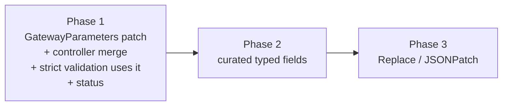
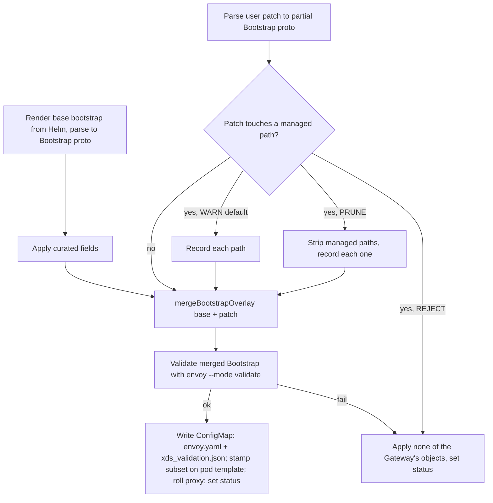

# EP-13666: Mutable Envoy bootstrap config for managed gateway proxies

- Issue: [#13666](https://github.com/kgateway-dev/kgateway/issues/13666)
- Merge function origin: [#14752](https://github.com/kgateway-dev/kgateway/pull/14752)
  (closed without merging; its code is not in the tree)
- Strict validation dependency: [#14814](https://github.com/kgateway-dev/kgateway/issues/14814)

## Background

For a managed gateway proxy, kgateway's deployer renders the Envoy bootstrap
(`envoy.yaml`) from an internal Helm template, stores it in a `ConfigMap` named
after the `Gateway`, and mounts it into the proxy `Pod` at `/etc/envoy` through the
`envoy-config` volume. The `envoy-wrapper` (envoyinit) reads that file and passes it
to Envoy as the whole bootstrap.

`GatewayParameters.spec.kube.envoyContainer.bootstrap` exposes a few curated fields
(`logLevel`, `componentLogLevels`, `logFormat`, `dnsResolver.udpMaxQueries`,
`enableReadinessProbeProxyProtocol`, `maxDownstreamConnections`). Nothing else in
the bootstrap can be set through the API: Envoy reloadable feature flags
(`envoy.reloadable_features.*`), `stats_config.histogram_bucket_settings`
([#14088](https://github.com/kgateway-dev/kgateway/issues/14088)),
`stats_flush_interval`, extra runtime layers, other DNS resolver settings, custom
static clusters.

The motivating case ([#13666](https://github.com/kgateway-dev/kgateway/issues/13666)) is reloadable feature flags. When an Envoy upgrade
changes behavior, Envoy adds an `envoy.reloadable_features.<name>` flag so operators
can restore the old behavior while they adapt, and removes the flag in a later
release. The flag is set in the bootstrap, as a `layered_runtime` layer. A user can
add one today with `-c` (see Alternatives), but the controller never sees it:
strict validation, status and rollout know nothing about it, and nothing kgateway
sets can be overridden that way. The issue asks for a generic way to change the
bootstrap rather than a setting specific to reloadable features, and this EP takes
that approach.

A second case shows why the merge must happen in the controller. Envoy rejects a
regex whose compiled program exceeds the runtime key
`re2.max_program_size.error_level` (default 100); regexes generated from long
OpenAPI path templates exceed it easily. A user can raise the limit in the proxy's
runtime, but under `validation.level: strict` the controller validates each route
against its own synthetic bootstrap, which has no `layered_runtime`
([`pkg/xds/bootstrap/builder.go`](https://github.com/kgateway-dev/kgateway/blob/851bfc9c3cf37139586e82c1c0081ff718c02799/pkg/xds/bootstrap/builder.go#L256)).
The route is dropped before it reaches a proxy that would accept it ([#14814](https://github.com/kgateway-dev/kgateway/issues/14814)).

The current workaround is to copy the generated bootstrap into a custom
`ConfigMap`, add the desired config, and repoint the `envoy-config` volume at it
with a `deploymentOverlay`. The user then owns a **complete, verbatim copy** of the
generated bootstrap, including control-plane–managed fields (`node.cluster`,
`node.metadata.role`, the `xds_cluster`, the xDS JWT credential config,
`dynamic_resources`).

### Relevant sources

- Bootstrap template: `pkg/kgateway/helm/envoy/templates/configmap.yaml`
- Wrapper that loads, transforms, and re-marshals the bootstrap proto:
  `pkg/envoyinit/run.go`
- Merge function: `mergeBootstrapOverlay` in `pkg/envoyinit/overlay.go` from the
  unmerged [#14752](https://github.com/kgateway-dev/kgateway/pull/14752) (proto `Merge` plus runtime-layer insertion), to be added in a
  package the deployer can use and extended with the list rules in Merge semantics
- API types: `api/v1alpha1/kgateway/gateway_parameters_types.go` (`EnvoyBootstrap`)
- Controller settings: `api/settings/settings.go`
- Object overlays (`deploymentOverlay` and the others), whose GatewayClass-then-Gateway
  order the bootstrap patch follows: `api/v1alpha1/shared/overlay_types.go`
  (`KubernetesResourceOverlay`)

## Motivation

The workaround is fragile in exactly the way an API should not be. The moment
kgateway changes its bootstrap template in a future version — a new xDS field, a
new static listener, a renamed cluster, a new managed filter — the user's copied
`ConfigMap` silently drifts from the generated format. There is no merge, no
validation, and no warning; the user must manually re-reconcile their copy on every
upgrade, and a stale copy can break xDS connectivity or crash-loop the proxy.

We want a way to mutate the bootstrap that:

1. lets the user express **only their delta**, not a full copy,
2. **continues to apply correctly when the base bootstrap meaningfully changes**
   in a future version, because untouched fields flow through automatically, and
3. is **known to the controller**, so xDS validation sees the same bootstrap the
   proxy runs.

## Goals

- **Change the managed proxy's bootstrap through `GatewayParameters` without
  copying it.** Changes are a structured patch on the generated `Bootstrap` proto,
  so the base can change between versions without breaking them. Phase 1 ships a
  free-form patch, Phase 2 adds curated typed fields, and Phase 3 adds removal
  and replace when a need appears.
- **The controller knows the effective bootstrap of every Gateway it manages.**
  Strict validation checks routes against it, so turning on `strict` no longer
  drops routes the proxy would accept
  ([#14814](https://github.com/kgateway-dev/kgateway/issues/14814)). Inputs the
  controller does not manage (`-c`, a replacement `ConfigMap`, self-managed
  Gateways) keep validating against Envoy defaults.
- **The user's value wins, and kgateway reports when it disagrees.** A patch that
  sets a control-plane–managed field is applied and reported on status, in events
  and in metrics. For lists, Merge semantics defines what winning means. Operators
  who want enforcement can opt into pruning or rejecting.
- **Validate the merged bootstrap before rollout,** and report failures on the
  `Gateway` instead of crash-looping Envoy.
- **Adding a curated field never breaks an existing patch.** Curated fields are
  applied first and the patch on top, so a patch keeps its effect (Phase 2).
- **Cover the open requests.** Runtime keys, including reloadable feature flags
  ([#13666](https://github.com/kgateway-dev/kgateway/issues/13666)), work through
  the patch in Phase 1. Histogram buckets
  ([#14088](https://github.com/kgateway-dev/kgateway/issues/14088)) work through
  the patch in Phase 1 and get a curated field in Phase 2.

## Non-Goals

- Replacing the existing `deploymentOverlay` mechanism. It remains the way to make
  `Deployment`-level changes (volumes, sidecars, etc.); this EP is only about the
  bootstrap's content.
- Mutating dynamic (xDS-delivered) config such as listeners, routes, and clusters.
  Those are owned by the translation pipeline and configured via Gateway API and
  policy CRDs.
- Validating `-c` (see Alternatives). It merges in the proxy pod at startup, so the
  controller cannot see it; it stays documented as a way to add settings outside
  the controller's view.
- Arbitrary text/templating of the bootstrap document (see Alternatives).
- An admission webhook (see Write-time feedback).

## Implementation Details

### Design principle

Apply changes as a **proto-level patch onto the generated `Bootstrap`**, never as a
textual or whole-document replacement. This is the same layering Envoy itself uses
(`--config-path` + `--config-yaml`, which is a proto `MergeFrom`). Because the patch
targets stable proto field paths rather than line positions, it keeps working when
the surrounding base config changes.

### Validation subset

Strict validation runs Envoy in the controller pod to check each Gateway's
translated xDS config (see Translator and Proxy Syncer). To match the proxy, it
needs the bootstrap fields that change what Envoy accepts, but it cannot use the
whole merged bootstrap: that bootstrap references `xds_cluster`, the admin
interface and file-based SDS secrets, none of which resolve in the controller pod.

- The **validation allowlist** lists the bootstrap fields that validation uses.
  It holds only the `layered_runtime` layers of type `static_layer`, whose values
  are written in the bootstrap. `admin_layer` is left out: it starts empty and
  holds only values set on a running proxy with `/runtime_modify`. A patch can
  add only static layers (see Managed paths), so the static layers hold every
  runtime value the bootstrap sets.
- The **validation subset** is the partial `Bootstrap` made by copying the
  allowlisted fields out of a Gateway's merged bootstrap. The deployer writes it
  next to `envoy.yaml` and onto each proxy pod (see Deployer), and the translator
  validates the Gateway's routes against it.

### Phasing



- **Phase 1: API, controller-side merge, validation, status (the supported MVP).**
  Adds the merge function from the unmerged [#14752](https://github.com/kgateway-dev/kgateway/pull/14752) to the controller, extended
  with the list rules in Merge semantics, plus managed-path reporting, validation
  of the merged result, strict xDS validation against the merged bootstrap, status,
  and automatic rollout.
- **Phase 2: curated fields.** Add a typed field when users keep writing the same
  patch.
- **Phase 3: removal and replace strategies.** Only once a concrete need appears for
  edits that remove or replace base content.

Phase 1 merges only in the controller; envoyinit does not merge a patch
itself (see Alternatives). Until Phase 1 ships, `-c` covers additions the controller
need not see, and full bootstrap replacement remains the documented option for
anything else.

The patch can express anything a curated field can, so the patch ships first and
fields are curated later.

### Phase 1: API, controller merge, guardrails

#### Configuration

The bootstrap API is `GatewayParameters.spec.kube.envoyContainer.bootstrap`
(`EnvoyBootstrap` in `api/v1alpha1/kgateway/gateway_parameters_types.go`). Its
existing fields are either Envoy command-line flags (`logLevel`,
`componentLogLevels`, `logFormat`) or rendered into the bootstrap by the Helm
template (`dnsResolver`, `maxDownstreamConnections`,
`enableReadinessProbeProxyProtocol`). Stats settings that render into the bootstrap
live on `spec.kube.stats` (`matcher` renders `stats_config.stats_matcher`).

This EP adds two kinds of field:

- **`patch` (Phase 1)**, a free-form partial bootstrap merged onto the
  generated one. Its result is reported on the
  `kgateway.dev/BootstrapPatchApplied` condition.
- **Curated fields (Phase 2)**, typed fields for common cases. Each goes next to
  the existing fields it belongs with: directly on `bootstrap`, or on
  `spec.kube.stats` for a stats setting. How a field reaches the bootstrap (a
  command-line flag, the Helm template, or a proto merge in the controller)
  is not part of the API. A curated field looks like an existing field to the
  user, and a field can change how it is applied without moving.

```yaml
apiVersion: gateway.kgateway.dev/v1alpha1
kind: GatewayParameters
metadata:
  name: my-gateway
spec:
  kube:
    stats:
      histogramBucketSettings:                 # curated field (Phase 2)
        - match: { prefix: "cluster." }
          buckets: [1, 5, 10, 25, 50, 100, 250, 500, 1000, 2500, 5000, 10000]
    envoyContainer:
      bootstrap:
        dnsResolver:                           # existing field
          udpMaxQueries: 50
        re2MaxProgramSize:                     # curated field (Phase 2)
          errorLevel: 1000
        patch:                                 # Phase 1: typed proto merge for everything else
          mergeStrategy: StructuredMerge       # required; the only value in Phase 1
          value:                               # a partial envoy.config.bootstrap.v3.Bootstrap
            stats_flush_interval: 10s
            layered_runtime:
              layers:
                - name: user_runtime
                  static_layer:
                    envoy.reloadable_features.http_reject_path_with_fragment: false
```

- **The typed proto patch (`patch.value`) is what Phase 1 ships.** It
  is stored with `+kubebuilder:pruning:PreserveUnknownFields` and parsed by the
  controller as a *partial* `envoy.config.bootstrap.v3.Bootstrap`. The API server
  does not validate it, so typos and bad types are caught by the controller and
  reported on status. Because it is keyed by proto field, it survives
  base-template changes.
- **Curated fields (`stats.histogramBucketSettings`,
  `bootstrap.re2MaxProgramSize`, ...) come in Phase 2.** They give CRD
  validation, documentation, and a stable contract. The controller applies each
  as a partial `Bootstrap` built from the typed field, on the parsed base before
  the patch (see Pipeline and Phase 2: curated fields).
  [#14088](https://github.com/kgateway-dev/kgateway/issues/14088) is the first
  candidate for promotion; until then it goes through the patch. The rest of
  this Phase 1 section mentions curated fields only where the patch's behavior
  depends on them.

The existing fields stay where they are: moving or removing one is a breaking
change. A new setting that extends an existing field goes into it, such as more
c-ares options in `dnsResolver`. Some settings can be written two ways, for
example `dnsResolver.udpMaxQueries` and `typed_dns_resolver_config` in the
patch. As with `deploymentOverlay`, the docs recommend the typed field where one
exists, for its validation, error messages and upgrade path.

A GatewayClass (`spec.parametersRef`) and a Gateway
(`spec.infrastructure.parametersRef`) can each reference a `GatewayParameters`. Their
patches combine the way `deploymentOverlay` and the other object overlays do today:
the GatewayClass patch is merged onto the generated bootstrap, then the Gateway
patch onto the result, each under the rules in Merge semantics. So:

- The Gateway's value wins a conflict with the GatewayClass's.
- In a prepended list (see Lists) the Gateway's entries come before the
  GatewayClass's, which come before the base's. In `layered_runtime.layers` the
  GatewayClass's layers come first and the Gateway's after them, before
  `admin_layer`. Either way the Gateway's value wins where order matters.
- A runtime layer name used in both patches is rejected, because the GatewayClass
  layer is already in the base when the Gateway patch merges. The message names
  both `GatewayParameters`.
- Each managed-path report names the `GatewayParameters` that set the path.

Curated fields combine like the existing fields: the Gateway's are deep-merged
over the GatewayClass's when the deployer builds the merged `GatewayParameters`
the Helm values come from (`deepMergeEnvoyBootstrap` in `pkg/deployer/merge.go`
for the fields on `bootstrap`). That merge skips `patch`.
`PostProcessObjects` reads the GatewayClass's patch and the Gateway's patch
separately (`resolveParametersForOverlays`), as it does for the object overlays,
and applies them in that order.

#### Worked example: reloadable feature flags

The Envoy bootstrap has no field for reloadable features. A flag such as
`envoy.reloadable_features.<name>` is a runtime key, set through
`layered_runtime.layers[].static_layer` as shown above.

- The generated bootstrap already defines a `layered_runtime` with one layer,
  `admin_layer`
  ([`configmap.yaml`](https://github.com/kgateway-dev/kgateway/blob/851bfc9c3cf37139586e82c1c0081ff718c02799/pkg/kgateway/helm/envoy/templates/configmap.yaml#L47-L50)).
  It starts empty and holds the values an operator sets on a running proxy with
  `POST /runtime_modify` on the admin port.
- For each key, Envoy uses the value from the last layer in `layers` that sets it.
  A plain proto merge appends, giving `[admin_layer, user_runtime]`, so
  `user_runtime` would override `/runtime_modify` for every key it sets. The merge
  therefore inserts user layers immediately before the first `admin_layer`. The
  effective precedence is Envoy's compiled-in default, then the user layer, then
  `/runtime_modify`.
- The user layer needs a **distinct `name`**. Envoy rejects duplicate layer names at
  startup; the merge rejects them earlier with a clearer message, checking each
  patch layer against the base layers and the other patch layers.
  `layered_runtime` is not a managed path.
- A flag that a later Envoy removes stops having an effect. Envoy logs
  `Using a removed guard <key>` and ignores the key; kgateway does not report it.
  The Envoy release notes for the bump are the signal. Once Envoy treats a removed
  flag as invalid configuration, the bump fails validation for every Gateway whose
  patch still sets it, and the Gateway follows the invalid-merge fallback.
- The example flag defaults to `true` in the pinned Envoy, under which Envoy rejects
  a request whose path contains a `#` fragment. Set to `false`, Envoy strips the
  fragment and routes the request.

#### Merge semantics

`StructuredMerge` is built on Go's `proto.Merge`, which has the same semantics as
the C++ `MergeFrom` that Envoy uses to layer `--config-yaml` (see Design
principle). It merges each kind of field as follows:

| Field kind | Example | Result |
|---|---|---|
| Scalar | `cluster_manager.local_cluster_name`, `admin.address.socket_address.port_value` | The patch's value replaces the base's. A zero value (`false`, `0`, `""`) counts as unset, so the patch cannot reset a field to it. |
| Message | `stats_config`, `admin`, `stats_flush_interval` (a `Duration`) | Merged field by field, by these same rules. |
| `google.protobuf.Any` | `typed_dns_resolver_config.typed_config`, the `typed_config` of a listener filter or cluster extension | The patch's value replaces the base's whole, including a patch `Any` with an empty payload. See `Any` fields below. |
| `oneof` | `stats_config.stats_matcher` (`inclusion_list`, `exclusion_list` or `reject_all`) | Setting the same option merges it. Setting a different option clears the base's option. |
| Map, including `Struct` | `certificate_provider_instances`, `node.metadata` | Merged by key. A patch entry replaces the base entry with the same key whole. |
| List | `static_resources.clusters`, `stats_sinks` | See Lists below. |

`proto.Merge` cannot remove an entry or replace a message as a whole; the Phase 3
strategies add that. `mergeStrategy` ships in Phase 1 as a required enum with one
value, so every stored patch names its strategy, and when Phase 3 adds a strategy
no patch relies on an implicit default.

- `StructuredMerge` (Phase 1): `proto.Merge` as in the table, except
  for the lists described below. `mergeBootstrapOverlay` from [#14752](https://github.com/kgateway-dev/kgateway/pull/14752) provides the
  `Merge` call, the runtime-layer insertion and the duplicate check against the
  base; merge by name, prepending, whole-`Any` replacement and the check between
  patch layers are new.
- `Replace` (Phase 3): replace the messages and lists named by field path as a whole
  (e.g. fully define `stats_config`).
- `JSONPatch` (Phase 3): RFC 6902 operations against the bootstrap, to remove
  individual entries. Its paths depend on the base bootstrap's structure, so it is
  discouraged and documented as such.

##### `Any` fields

Every `typed_config` field is a `google.protobuf.Any`: a `type_url` and the message
serialized to bytes in `value`. `proto.Merge` merges it as an ordinary message, and
an empty `value` counts as unset, so a patch that sets only `@type` (for example
`CaresDnsResolverConfig` with no fields, to get the c-ares defaults) would keep the
base's settings. Before `proto.Merge`, `StructuredMerge` therefore clears each base
`Any` that the patch sets at the same path, following singular message fields. It
does not descend into lists or maps, where a patch entry is added or replaces an
entry whole.

##### Lists

`proto.Merge` appends to every repeated field. For some lists Envoy rejects a second
entry with the same name (`duplicate cluster 'xds_cluster'`), so appending can never
override a base entry: the bootstrap fails validation and the whole patch falls
back. `StructuredMerge` therefore handles lists in three ways. Named entries and
runtime layers are taken out of the patch before `proto.Merge` and merged by their
own code. Every other list goes through `proto.Merge`, which appends, and the
patch's entries are then moved to the front.

| Kind | Fields | `StructuredMerge` |
|---|---|---|
| Named entries | `static_resources.clusters`, `static_resources.listeners`, `static_resources.secrets`, `overload_manager.resource_monitors` | Merge by `name`. A patch entry whose `name` matches a base entry replaces that entry; other patch entries are appended. |
| Runtime layers | `layered_runtime.layers` | Patch layers are inserted before `admin_layer` instead of appended. A patch layer that reuses a base or patch layer's `name` is rejected (see the worked example). |
| Every other list | e.g. `stats_config.histogram_bucket_settings`, `stats_config.stats_tags`, `stats_sinks`, `bootstrap_extensions` | Prepend: the patch's entries go before the base's. `proto.Merge` appends them, and the merge then moves them to the front. |

- **A replaced entry is replaced whole,** not merged field by field. The user writes
  the full entry, for example by copying it from the generated `ConfigMap`, and a
  later kgateway change to that base entry does not reach it. A partial merge would
  be no better: most of a cluster or listener sits inside `typed_config` fields,
  which `proto.Merge` replaces whole anyway.
- **Only these four fields merge by name,** because Envoy requires unique names in
  each. Elsewhere `name` often identifies the extension type rather than the entry
  (`stats_sinks[].name` is `envoy.stat_sinks.statsd` for every statsd sink), and
  merging by `name` would silently drop entries.
- **Runtime layers are not replaced by name.** Replacing would let a patch remove
  `admin_layer`, and with it `/runtime_modify`. A later layer already wins per key.
- **Other lists are prepended, not appended, so the patch wins.** Some lists
  are first-match: in `histogram_bucket_settings`, Envoy uses the first entry that
  matches a stat. Appending, as `proto.Merge` does, would let a base entry beat the
  patch's entry for the same stat, against the rule that the user's value wins.
  Prepending makes the patch's entry match first. In lists where every entry
  applies, such as `stats_sinks` and `bootstrap_extensions`, order does not
  matter, so prepending changes nothing there. `-c` gives the same order
  today.
- **A patch entry never changes a base entry in these lists.** Entries are
  matched by position, not by content, so a patch entry equal to a base entry
  is a second copy. In a list where every entry applies, the copy applies twice,
  such as a second identical stats sink. In a first-match list, the copy is
  never used.
- **The base rarely fills these lists.** Today it fills only the
  `stats_matcher` patterns (from `kube.stats.matcher`), where order does not
  matter and a duplicate pattern changes nothing. Removing or changing a base
  entry waits for Phase 3 `Replace`.

Under merge by name, an `xds_cluster` in a patch replaces kgateway's. It is a managed
path, so `WARN` applies and reports it, `PRUNE` drops it, and `REJECT` refuses the
patch (see Guardrails).

#### Pipeline

Phase 1 merges in the controller, before the bootstrap `ConfigMap` is written, so
the `ConfigMap` on the cluster is the final config and all logic and status
reporting live in one place.



Today the deployer renders the bootstrap as Helm text and never builds a
`Bootstrap` proto. Phase 1 adds a parse / mutate / re-marshal step for Gateways
with `patch` set (see Deployer), the same roundtrip envoyinit already performs
(`pkg/envoyinit/run.go`). The existing
`pkg/xds/bootstrap` `ConfigBuilder` cannot generate the base bootstrap: it builds a
bootstrap only for validating translated xDS.

Parsing needs every `@type` in the base and the patch to be registered in the
controller binary, because `protojson` resolves each `Any` through Go's global type
registry. The controller links only the packages its translation code imports,
which leaves out four types the generated bootstrap already uses
(`CaresDnsResolverConfig`, `DownstreamConnectionsConfig`, `CredentialInjector`, and
the generic injected credential), and a patch may use any extension type. Phase 1
imports `pkg/utils/filter_types` into the controller, which registers every
go-control-plane package (see Envoy versions and proto types). That
grows the stripped controller binary by about 13 MB (150 MB to 163 MB) and leaves
no type list to maintain; the file is regenerated when go-control-plane is bumped,
as today. A `@type` the pinned Envoy does not know still fails
`envoy --mode validate` and is reported as `ValidationFailed`.

Parsing and merging use the field definitions in the controller's go-control-plane
(`go.mod`). Validation uses the Envoy binary in the controller image
(`ENVOY_IMAGE`). The two are pinned separately and can differ in either direction:

- **go-control-plane has a field or type the binary does not.** go-control-plane is
  mirrored from Envoy's main branch, while the binary is a release, so main is
  usually in this state. The patch parses and merges. `envoy --mode validate`
  rejects the unknown field, because Envoy rejects unknown fields in a bootstrap,
  and the Gateway reports `ValidationFailed`. Nothing reaches the proxy.
- **The binary has a field or type go-control-plane does not.** This happens on a
  release branch that takes an Envoy security release, which can add a field or an
  extension, without updating its go-control-plane pin. The patch fails to parse
  and the Gateway reports `InvalidPatch`, although the proxy's Envoy would accept
  it. Such a field can be set only through `-c` until a kgateway release updates
  go-control-plane.

#### Guardrails

##### Managed paths

A path is managed if kgateway generates it and something outside the patch
depends on its name or value: the controller, the proxy `Deployment`, envoyinit,
translated xDS, or another managed path. The controller keeps the list; every entry
is in the generated bootstrap (`pkg/kgateway/helm/envoy/templates/configmap.yaml`):

| Path | What depends on it |
|---|---|
| `node` | The controller selects the proxy's xDS snapshot by `node.metadata.role` ([`xds/utils.go`](https://github.com/kgateway-dev/kgateway/blob/851bfc9c3cf37139586e82c1c0081ff718c02799/pkg/kgateway/xds/utils.go#L64-L79)). envoyinit sets `node.locality`. |
| `dynamic_resources` | The proxy receives all translated config through it. |
| `admin.address` | The `Deployment`'s `preStop` hook calls `127.0.0.1:19000/healthcheck/fail`, and `admin_port_cluster` points at it. |
| `static_resources.clusters[name=xds_cluster]` | The proxy's connection to the controller, including the xDS JWT credential injector. With xDS TLS, its transport socket trusts the controller's certificate through the `xds-ca` secret, which it reads with file-based SDS from `xds_ca_sds.json` and `ca.crt` in the generated `ConfigMap`. That secret is not in the bootstrap, so this entry covers it, and a static secret named `xds-ca` in a patch is never used: Envoy reads static secrets only for an SDS reference without `sds_config`. |
| `cluster_manager.local_cluster_name`, and the static cluster with that name | The controller sends that cluster's endpoints by name (`pkg/kgateway/proxy_syncer/local_cluster.go`), and translated clusters use it for zone-aware routing. |
| `static_resources.clusters[name=admin_port_cluster]` | `readiness_listener` and `prometheus_listener` route to it. |
| `static_resources.clusters[name=gateway_proxy_sds]` (Istio integration only) | Translated listeners and clusters get Istio certificates through it (`wellknown.SdsClusterName`). |
| `static_resources.listeners[name=readiness_listener]` | The `Deployment`'s default readiness and startup probes target its port, 8082. |
| `static_resources.listeners[name=prometheus_listener]` | The pod's `prometheus.io/port: "9091"` scrape annotation targets its port. |

Under every mode, the controller rejects with `InvalidPatch`:

- A secret named `SYSTEM_CA_CERT`, which envoyinit adds in the pod (see Changes
  envoyinit makes in the pod).
- A runtime layer named `admin_layer`. Runtime layers are never replaced (see
  Lists), so `/runtime_modify` keeps working.
- A runtime layer that is not a `static_layer`. A disk, RTDS or admin layer's
  values are not in the bootstrap, so route validation and status could not see
  them (see Validation subset).

Paths are matched on the **parsed proto** (field descriptors, with list entries
identified by key), never on raw YAML keys, because the proto JSON mapping accepts
both `dynamic_resources` and `dynamicResources`.

What happens to a patch that touches a managed path is an operator choice, set by a
new controller setting in `api/settings/settings.go`, modeled on `ValidationMode`:

```go
// BootstrapPatchManagedPaths determines what the controller does with a
// GatewayParameters bootstrap patch that sets a control-plane-managed path.
// Supported values:
// - "WARN" (default): apply the patch as written and report each managed path
//   it sets on status, in an event and in a metric.
// - "PRUNE": drop each managed path from the patch before merging, apply the
//   rest, and report each dropped path.
// - "REJECT": apply none of the patch and report the managed paths.
BootstrapPatchManagedPaths BootstrapPatchManagedPathsMode `split_words:"true" default:"WARN"`
```

That is `KGW_BOOTSTRAP_PATCH_MANAGED_PATHS=WARN|PRUNE|REJECT`.

**`WARN` is the default** because a user who sets a managed path usually means it.
The main reason to change the bootstrap is a security response, which often
overrides something kgateway sets; refusing it sends the user back to full
bootstrap replacement, which has no validation or status at all. So kgateway makes
the override visible instead of forbidding it. The condition reports that the
override applied, not that the proxy still works: an override can pass
`envoy --mode validate` and still break the proxy, or point it at the wrong
configuration. Changing `node.metadata.role` to another Gateway's role makes the
proxy receive that Gateway's snapshot: the xDS server authenticates the proxy's
service account token (`pkg/kgateway/setup/authn.go`) but selects the snapshot by
role alone.

That is not new exposure, and the trust model is unchanged. Any pod with a token
the controller accepts can already connect with any role, and `deploymentOverlay`
already lets a `GatewayParameters` author run arbitrary containers in the proxy
pod. Whoever can write the `GatewayParameters` a Gateway uses is trusted with that
proxy's bootstrap, as they are with its `Deployment`.

On upgrade, `WARN` keeps an override applying as long as the merge succeeds. If
kgateway N+1 starts managing a field the user set under N, the user's value still
applies and the conflict appears on status, so a security-response override
survives. If N+1 adds a cluster, listener, secret or resource monitor with the same
name as a user entry, the user's entry replaces it (see Lists), and status reports
it if the name is a managed path. If N+1 adds a runtime layer with the same name as
a user layer, the merge fails and the Gateway follows the invalid-merge fallback.

`PRUNE` and `REJECT` are for platform teams that want enforcement:

- `PRUNE` drops the managed paths and applies the rest, so an unrelated entry the
  Gateway depends on still applies after an upgrade that adds a managed path.
- `REJECT` applies nothing. On an upgrade that adds a managed path, the whole
  patch stops applying to affected Gateways, which follow the invalid-merge
  fallback. The docs must state this.

The operator owns this choice rather than the `GatewayParameters` author, because
under `PRUNE` or `REJECT` the author is the person the setting constrains.

##### Growing the managed-path list

Under `WARN`, adding a path adds a report but does not change what applies. Under
`PRUNE` and `REJECT` it does, and under any mode a new runtime layer can collide
with a user layer's name, so each addition needs a release note that names the
path. Before upgrading, a platform team finds the affected Gateways by searching
their `GatewayParameters` patches for that path, in both snake_case and
lowerCamelCase. The per-path metric (see Reporting) lists them only after the new
controller runs, because the running controller does not yet treat the path as
managed.

##### Validate the merged result

Run the merged `Bootstrap` through `envoy --mode validate` before rollout, using
the validator the translator already uses (`validator.New`). It runs the Envoy in
the controller image, not the proxy's `envoyContainer.image` (see Envoy versions
and proto types). The validator gets a bootstrap mode that validates a copy of the
merged bootstrap adjusted to match what the proxy pod runs: it adds what envoyinit
adds in the pod (see Changes envoyinit makes in the pod) and stands in for what
exists only in the pod, such as the file-based SDS files and the node id.

##### Changes envoyinit makes in the pod

The `ConfigMap` is not exactly what Envoy runs. When the proxy pod starts,
envoyinit changes the bootstrap
([`run.go`](https://github.com/kgateway-dev/kgateway/blob/851bfc9c3cf37139586e82c1c0081ff718c02799/pkg/envoyinit/run.go#L44-L67),
`internal/envoyinit/pkg/downward/transform.go`) and passes the result to Envoy with
`--config-yaml`. This design does not change envoyinit. Its existing locality edit
decodes the bootstrap into a generic YAML map and encodes it again, and its
existing secret edit parses it into a `Bootstrap` proto and marshals it again, so
in today's code the bootstrap Envoy runs can differ from the `ConfigMap` in key
order and formatting.

- **Template pass.** envoyinit runs Go `text/template` over the whole file to fill
  in Downward API values such as `{{.PodName}}`, `{{.PodIp}}` and `{{.NodeName}}`.
  The generated bootstrap contains no templates, so only patch content is
  affected. The controller does not know these values before the pod exists, so it
  cannot validate the text the pod runs, and a malformed template crash-loops the
  pod. The controller therefore rejects a patch that contains `{{` anywhere,
  with reason `InvalidPatch`, under every mode (see Open Questions).
- **System CA secret.** When the pod has an OS CA bundle, envoyinit appends a static
  secret named `SYSTEM_CA_CERT`, so a secret with that name in a patch fails in the
  pod as a duplicate. The controller rejects a patch that defines it, with
  reason `InvalidPatch`, under every mode, rather than leaving it to show up as a
  duplicate against the validation placeholder (see Validate the merged result).
- **Node locality.** envoyinit sets `node.locality.region`, `zone` and `sub_zone`
  from the `KGATEWAY_NODE_*` environment variables or the pod's topology labels,
  overwriting each key it finds a value for. `node` is a managed path, so a patch
  that sets `node.locality` is reported; the docs state that envoyinit overwrites
  the keys it derives.

##### Listener ports

`envoy --mode validate` does not bind ports, so it does not catch a static listener
on a port a Gateway listener also uses. On the proxy, Envoy rejects the second
listener as a duplicate address, and the controller does not see it.

Gateway listener ports come from the Gateway and its ListenerSets and are sent as
dynamic listeners over xDS; the bootstrap holds only the static listeners and the
admin address. Today the two are kept apart by constants: ports 8082
(`readiness_listener`), 9091 (`prometheus_listener`) and 19000 (admin) are reserved
(`pkg/kgateway/validate/gateway.go`), the translator rejects a Gateway or
ListenerSet listener on a reserved port, and the deployer leaves that port off the
`Service`.

A patch can add or move a static listener, so a Gateway's reserved ports come
from its merged bootstrap instead. A port lives at a fixed set of proto paths:
`admin.address.socket_address.port_value`, and on each static listener
`address.socket_address.port_value` and
`additional_addresses[].address.socket_address.port_value`. A listener with a pipe
or internal address has no port and is skipped. The deployer reads those paths from
the merged proto and writes the set into the `ConfigMap`'s validation key and the
pod annotation, next to the validation subset (see Deployer); the ports are not
added to the validation bootstrap. Until the key exists, the translator uses the
constant ports; a Gateway without a `patch` never has the key. A static listener a
patch adds on a Gateway listener's port is caught on the first translation after
the key is written. A new pod running that bootstrap receives no xDS configuration
until a translation has reserved the port (see the first-snapshot hold in
Translator and Proxy Syncer), so it never receives the conflicting listener.

A Gateway's reserved ports are the union of the set in the key and the sets carried
by its running pods, the same per-Gateway collection that holds the validation
subsets (see Translator and Proxy Syncer). A pod without the annotation reserves
the constant ports. The union replaces the constants for that Gateway: a constant
port that no running bootstrap listens on, such as 8082 after a patch moves
`readiness_listener` and the rollout completes, is free for a Gateway listener.
While an old pod still listens on the port, a Gateway listener on it is rejected,
because every pod receives the same xDS listeners and the old pod would reject the
listener as a duplicate address. A Gateway listener that claims the port in the
same edit that frees it is accepted, without a further edit, once the last old pod
is gone.

The deployer reads the same collection when it builds the `Service`. The Gateway
reconciler already registers on a KRT collection (`GatewaysForDeployer`) to
requeue a Gateway when its ListenerSets change, and registers on this one the same
way, so the port is added to the `Service` when the last old pod is gone. Until
then, traffic to the port does not reach an old pod's static listener.

The translator rejects a Gateway or ListenerSet listener on a reserved port with
the `Accepted=False`, `Conflicted=True` reason `Invalid` it uses for the constants,
and a message that says the bootstrap with the GatewayParameters bootstrap patch applied
listens on that port, or, when only an old pod's bootstrap does, that the port is
free once the rollout completes. The deployer, which already has the Gateway's listener ports (`GatewayForDeployer` in
`pkg/krtcollections/policy.go`, recomputed when a ListenerSet changes), leaves the
port off the `Service` and lists each colliding port in the
`kgateway.dev/BootstrapPatchApplied` message. A collision does not reject the
patch, so a ListenerSet added later cannot make a working patch fall back. The
one exception is a collision on every Gateway listener port: the `Service` would
have no ports, which Kubernetes does not accept, so the deployer takes the
invalid-merge fallback with `InvalidPatch` and names the ports.

##### Invalid-merge fallback

When the patch cannot be parsed, the merged bootstrap fails validation,
`REJECT` refuses the patch, or the generated `ConfigMap` would exceed the API
server's size limit (see Versioned bootstrap keys), the deployer applies none of
the Gateway's objects:
the `ConfigMap`, `Deployment`, `Service` and the rest stay as they are, as they do
today when the deployer cannot render a Gateway's objects. The controller never
rolls out the generated bootstrap without the patch, because that would silently
remove settings the user depends on, often a security-response override. See Open
Questions for the alternatives.

- **Existing Gateway.** The proxy keeps running its last-good bootstrap and
  receiving xDS. Other `GatewayParameters` changes (image, resources, replicas)
  wait until the patch is fixed, so the pods never run a patch that failed
  validation. Validation uses the controller's Envoy, so for a Gateway that
  overrides `envoyContainer.image` it does not show that the pods' Envoy accepts
  the patch (see Envoy versions and proto types).
- **New Gateway.** No proxy is deployed until the patch is fixed. Nothing is
  serving, so the reconciler also sets `Accepted=False` with reason
  `InvalidParameters`, as it does today for any objects it cannot render. Without
  that, the translator's defaults would report `Accepted=True` and
  `Programmed=True` for a Gateway with no `Deployment`.
- **kgateway upgrade or Envoy bump.** The previous version's `Deployment` keeps
  running under the new control plane, as every proxy does while an upgrade rolls
  out. The condition and the metric identify these Gateways, and the upgrade docs
  say to check for them. This includes an Envoy bump that makes a removed feature
  flag invalid configuration. The old `Deployment` keeps its proxy image, so the
  Envoy release the upgrade carries, including any security fix in it, does not
  reach these proxies until the patch is fixed; the condition message names the
  image that is held back (see Reporting).

The reconciler tells an existing Gateway from a new one by whether its generated
`ConfigMap` exists; it already has a `ConfigMap` client. For an existing Gateway
it sets `kgateway.dev/BootstrapPatchApplied=False` and leaves `Accepted` alone.
Today's error path sets `Accepted=False` with reason `InvalidParameters`, and
while that is set the translator stops reporting `Accepted=True`
(`gatewayConditionsWithDefaults` in `pkg/reports/status.go`), so a Gateway still
serving its last-good config would read as not accepted. The deployer returns a
distinct error for an invalid patch, which the reconciler handles in its own
branch, as it already does for `ErrNoValidPorts`.

The same fallback applies when the controller cannot validate the patches, and the
reason says why (see Reporting): `ValidationUnavailable` when the controller could
not run Envoy, retried when the cause can clear, and `ControllerError` for a
kgateway defect. In each case `Accepted` is left alone for an existing Gateway.

#### Deployer

- **Where the pipeline runs.** In `PostProcessObjects`
  (`pkg/kgateway/deployer/gateway_parameters.go`), after Helm renders the
  Gateway's objects and before `deploymentOverlay`, `serviceOverlay` and
  `serviceAccountOverlay` are applied, so an object overlay can still change
  anything in the `Deployment`.
- **Only Gateways with `patch` set are merged.** A Gateway whose resolved
  `GatewayParameters` have no `patch` keeps the Helm-rendered `envoy.yaml` byte
  for byte, and gets no validation key and no pod-template annotation. It is not
  parsed, merged, validated or re-marshalled. Like every Gateway, it gets
  versioned bootstrap keys and `INPUT_CONF` (see Versioned bootstrap keys), so the
  upgrade that adds them rolls its pods once. Every kgateway upgrade already rolls
  them: the pod template carries the release in `OTEL_RESOURCE_ATTRIBUTES`
  (`service.version`).
- **Output format.** The merged bootstrap is marshalled with `protojson` using proto
  field names (`UseProtoNames: true`) and converted to YAML with sorted keys
  (`sigs.k8s.io/yaml`), so the `ConfigMap` keeps the snake_case of the template and
  the Envoy docs. `protoutils.MarshalBytes` emits lowerCamelCase and is not used
  here. Users copy entries from this `ConfigMap` to replace them, so it stays
  readable. The conversion also removes `protojson`'s whitespace, which the
  protobuf library varies between builds on purpose, so identical content keeps
  the same checksum across controller versions.
- **Validation key and pod annotation.** Next to `envoy.yaml`, the `ConfigMap` gets
  a `xds_validation.json` key: the validation subset (see Validation subset) as a
  partial `Bootstrap` in proto JSON, plus the reserved ports (see Listener ports).
  The same subset and ports go on the pod template as the
  `kgateway.dev/xds-validation-bootstrap` annotation, so every proxy pod carries the
  subset and ports of the bootstrap it started with. A change to either always
  changes `envoy.yaml`, so the annotation never rolls pods on its own. A static layer is
  small; the deployer rejects a subset over 64 KiB with `InvalidPatch` rather
  than approach the annotation size limit.
- No new volumes or mounts; the existing `envoy-config` volume carries the merged
  bootstrap. After applying the object overlays, the deployer checks that the
  `kgateway-proxy` container's `/etc/envoy` mount is backed by the generated
  `ConfigMap`. If an object overlay points the `envoy-config` volume at another
  `ConfigMap` (the full-replacement workaround), or mounts a different volume at
  `/etc/envoy`, the patches never reach the proxy, and the condition says so
  (`BootstrapNotMounted`). The deployer then writes neither the validation key nor
  the pod annotation, and leaves `INPUT_CONF` unset (see Versioned bootstrap
  keys), so strict validation uses Envoy defaults and the constant
  reserved ports, as for a Gateway without a `patch`; otherwise it would validate
  routes against runtime layers the proxy never loads. The merge and
  `envoy --mode validate` still run, so the condition still reports whether the
  patches are valid. The combination is not rejected: that would take the
  invalid-merge fallback and hold back unrelated `Deployment` changes. The deployer
  runs the same mount check for a Gateway without a `patch`, where it only decides
  whether to set `INPUT_CONF` and reports nothing.
- **Proxy image check.** Also after applying the object overlays, the deployer
  reads the image of the `kgateway-proxy` container in the final `Deployment` and
  compares it with the controller's own image tag, so an image set by
  `deploymentOverlay` is compared too (see Envoy versions and proto types). If an
  object overlay removes or renames that container, the condition message says
  the proxy image could not be checked.
- Pods roll when the pod-template checksum changes. Today the Helm template
  computes it from the rendered `envoy.yaml`
  ([`deployment.yaml`](https://github.com/kgateway-dev/kgateway/blob/851bfc9c3cf37139586e82c1c0081ff718c02799/pkg/kgateway/helm/envoy/templates/deployment.yaml#L31-L34)).
  That hash, `kgateway.dev/checksum-config`, covers the generated bootstrap without
  the patch, so for a Gateway with a `patch` the deployer replaces it with the
  hex SHA-256 of the merged `envoy.yaml`, and a patch-only change rolls the
  pods. A Gateway without a `patch` keeps the checksum Helm computes, the SHA-256
  of its rendered `envoy.yaml`. Either way the checksum names the pod's revision
  key (see Versioned bootstrap keys).
- **Override `HelmValuesGenerator`.** A project that embeds kgateway can replace
  how Helm values are generated with `WithHelmValuesGeneratorOverride`. When the
  override also implements `deployer.ObjectPostProcessor`, its `PostProcessObjects`
  replaces kgateway's post-processing, object overlays included. To keep bootstrap
  patches, the override implements the optional `BootstrapPatchProvider`
  interface: `BootstrapOverlays(ctx, gw, fromGatewayParameters)` returns the
  patches to merge, in order. `fromGatewayParameters` are the patches of the
  `GatewayParameters` the `GatewayClass` and the `Gateway` reference, so returning
  them unchanged applies the patches as kgateway does. The deployer then runs the
  same pipeline (merge, validation, Service ports, validation key and annotation,
  checksum, revision key, condition, events and metric) and calls the override's
  `PostProcessObjects` after the merge, so the post-processor sees the patched
  bootstrap. Each patch carries the kind and name of the resource that holds it,
  so status messages and events name an override's own parameters resource. An
  override that implements `ObjectPostProcessor` without `BootstrapPatchProvider`
  applies no bootstrap patches and reports no `BootstrapPatchApplied` condition,
  including for patches in its own parameters resource, so an override whose
  resource reuses `envoyContainer` returns those patches from `BootstrapOverlays`.
  The override's values code builds the Service
  ports with `GetPortsValuesForBootstrapPatches` for a Gateway with a `patch`, so a
  listener on a default proxy port that a patch frees stays on the Service (see
  Listener ports). Versioned bootstrap keys apply to an override's Gateways
  whether or not it implements `BootstrapPatchProvider`: the deployer adds them
  after the override's `PostProcessObjects`, so the mount check sees the volumes
  the override sets.

##### Versioned bootstrap keys

Envoy reads its bootstrap only when the process starts. Every pod of a Gateway
mounts the same `ConfigMap` as a whole volume, and kubelet updates the mounted
files in place when it changes, which the xDS CA rotation depends on (see the
`xds_cluster` managed path). So an Envoy container that restarts (a crash, an OOM
kill, a failed probe) loads what the `ConfigMap` holds at that moment, not the
bootstrap its pod's annotations describe, and strict validation and reserved
ports rely on those annotations. Each revision of a Gateway's bootstrap therefore
gets its own key, and each pod reads its own. This applies to every Gateway, with
or without a `patch`, so adding or removing a `patch` changes only the content of
the next key; old pods keep reading theirs.

- **Key and pointer.** The deployer writes the bootstrap (merged, for a Gateway
  with a `patch`) to `envoy-<checksum>.yaml`, where `<checksum>` is the pod
  template's `kgateway.dev/checksum-config` (the hex SHA-256 of `envoy.yaml`), and
  sets `INPUT_CONF=/etc/envoy/envoy-<checksum>.yaml` on the pod template. envoyinit
  already reads its input path from that variable (`pkg/envoyinit/run.go`), and
  the checksum already rolls the pods on every change, so `INPUT_CONF` causes no
  extra rollouts. A restarted container, or a pod the old ReplicaSet creates after
  an eviction, reads its own revision; a revert produces the same checksum and so
  the same key. `ca.crt` and `xds_ca_sds.json` stay where they are.
- **Missing key.** kubelet serves `ConfigMap` volumes from a watch-based cache, so
  a pod created right after the write can see the previous content. envoyinit
  waits for its file to appear; the pod is not Ready meanwhile, and the startup
  probe bounds the wait.
- **Pruning.** On each reconcile the deployer keeps the keys of the current
  revision, of every non-terminal pod, and of every ReplicaSet of the `Deployment`
  with `replicas` above zero (it can still create pods), and removes the rest. The
  Gateway reconciler is triggered by the per-Gateway collection of pod annotations
  (see Listener ports) and by the Gateway's ReplicaSets (selected by the
  `gateway.networking.k8s.io/gateway-name` label), so a key is removed soon after
  its last user is gone. Earlier keys are copied from the `ConfigMap` as read from
  the API server, not the informer cache, whose copy could be stale and lack a key
  a pod still uses. NotFound means the `ConfigMap` does not exist yet; any other
  error fails the reconcile without changing the Gateway's objects or status, and
  the reconcile retries.
- **Size limit.** The API server rejects a `ConfigMap` whose data is over 1 MiB,
  so the deployer checks the size before writing. A revision is about 10 KB
  (8.7 KB with xDS TLS). Normally one or two are in use, plus `envoy.yaml`; more
  stay in use only when `GatewayParameters` is edited again mid-rollout, and the
  `Deployment` controller scales down a ReplicaSet whose pods never became
  available first. Reaching the limit takes a very large patch or about 50
  revisions still in use. A change that would exceed it takes the invalid-merge
  fallback with `BootstrapConfigMapTooLarge`, whose message gives the size of the
  new revision and of the revisions still in use. A Gateway without a `patch` has
  no `BootstrapPatchApplied` condition, so the deployer reports the same message
  as a `Warning` event on the Gateway.
- **A key in use is never removed to make room.** After pruning, every remaining
  key belongs to a pod or a ReplicaSet with replicas. Removing one would leave
  that pod's next container restart, or the ReplicaSet's next pod, waiting for a
  file that never appears, and the startup probe would put it in a crash loop.
  The cost is that the fallback applies none of the Gateway's objects, so a
  `GatewayParameters` edit meant to unstick the rollout (resources, image,
  scheduling) is held back too. To recover, scale down the old ReplicaSets or
  delete their pods; pruning then removes their keys and the next reconcile
  applies the change.
- **`envoy.yaml`** still holds the current bootstrap, the one new pods get, for
  people and tooling that read the `ConfigMap`. No pod reads it: a pod's
  `INPUT_CONF` names the key it reads, and envoyinit writes the bootstrap it
  passed to Envoy to `/tmp/envoy.yaml` in the pod.
- **A user-mounted bootstrap.** When an object overlay mounts another `ConfigMap`
  at `/etc/envoy` (`BootstrapNotMounted` for a Gateway with a `patch`), the
  deployer writes no key for the current revision and leaves `INPUT_CONF` unset,
  so envoyinit reads `envoy.yaml` from the `ConfigMap` the user mounted. Pruning
  still runs, so old pods that mount the generated `ConfigMap` keep their keys
  until they are gone.

#### Reporting

Status goes on the **`Gateway`**, not `GatewayParameters`: `GatewayParametersStatus`
is empty today, one `GatewayParameters` can serve many Gateways, and the merged
result is per Gateway.

Add a `kgateway.dev/BootstrapPatchApplied` condition. The domain prefix keeps this
implementation-specific type from colliding with a type Gateway API adds later.

The Gateway reconciler (`pkg/kgateway/controller/gw_controller.go`), which runs the
deployer, writes the condition. It already writes `Accepted=False` with reason
`InvalidParameters` when the deployer cannot render a Gateway's objects. The
translator also writes Gateway conditions but preserves types it does not own
(`shouldPreserveGatewayCondition` in `pkg/reports/status.go`).

| Status | Reason | When |
| --- | --- | --- |
| `True` | `Applied` | Whole patch applied, no managed path set. |
| `True` | `ManagedPathsOverridden` | `WARN` applied a patch that sets one or more managed paths. The message lists each path. |
| `True` | `PathsIgnored` | `PRUNE` dropped one or more managed paths; the rest applied. The message lists each dropped path. |
| `False` | `PathsDenied` | `REJECT` refused a patch that touched managed paths. The message lists them. |
| `False` | `InvalidPatch` | One of:<ul><li>The patch does not parse as a partial `Bootstrap`.</li><li>The patch contains `{{`.</li><li>The patch defines a reserved name.</li><li>The patch adds a runtime layer that is not a static layer.</li><li>The patch uses the same name twice in a list where Envoy requires unique names.</li><li>The patched bootstrap's validation subset is over 64 KiB.</li><li>The patched bootstrap listens on every Gateway listener port (see Listener ports).</li></ul> |
| `False` | `ValidationFailed` | The merged bootstrap failed `envoy --mode validate`, or Envoy crashed on it. |
| `False` | `ValidationUnavailable` | The controller could not run Envoy to validate the merged bootstrap. |
| `False` | `ControllerError` | The controller failed to process the bootstrap it generated or the merged result. This is a kgateway defect; the message says so. |
| `False` | `BootstrapConfigMapTooLarge` | The generated `ConfigMap` would exceed the API server's 1 MiB limit, because the new bootstrap is very large or because pods or ReplicaSets still use earlier revisions (see Versioned bootstrap keys). The message gives the size of each; in the second case the change applies once the rollout finishes. |
| `False` | `BootstrapNotMounted` | An object overlay points the `envoy-config` volume at a `ConfigMap` other than the generated one, or mounts a different volume at `/etc/envoy`, so the proxy does not run the patched bootstrap. |

`True` with `ManagedPathsOverridden` or `PathsIgnored` is deliberate: the patch did
apply, and a routine report must not read as a broken Gateway to anyone alerting on
condition status. `False` means the patches are not in effect on the proxy.

**A proxy image that differs from the controller's.** When the `kgateway-proxy`
image in the final `Deployment` is not `envoy-wrapper` at the controller's own
image tag, or is pinned by digest, the condition message names the proxy image and
the controller's tag and says that validation used the Envoy in the controller
image, not the proxy's. This covers an `envoyContainer.image` override, a
`deploymentOverlay` that sets the image, and a Helm install that sets
`controller.image.tag` apart from `image.tag`. The status and reason do not change
(see Envoy versions and proto types).

**A held-back proxy image.** When the invalid-merge fallback leaves an existing
Gateway's objects unchanged, the reconciler compares the Envoy container image in
the live `Deployment` with the image it rendered. If they differ, the
`BootstrapPatchApplied=False` message names both: the image the proxy keeps
running and the image that applies once the patch is fixed. A `Warning` event
says the same (see Envoy versions and proto types).

Also emit a `Warning` event for each overridden, dropped or denied path, and a
metric labeled by Gateway, namespace and path, so a platform team can find the
affected Gateways. The reconciler has no event recorder today; Phase 1 wires a
`record.EventRecorder` into it. The metric has a series only for a Gateway whose
patch sets a managed path, so its cardinality is bounded by the number of such
Gateways. Other kgateway metrics already carry the same Gateway labels, such as
the route replacement counter in
`pkg/kgateway/translator/irtranslator/metrics.go`.

#### Write-time feedback

Enforcement stays in the controller, the only place that can validate against the
*current* base bootstrap and run `envoy --mode validate`. kgateway has no admission
webhooks today and this EP does not add one.

CRD `x-kubernetes-validations` (CEL) rules could reject managed paths at write time,
but under the `WARN` default they would refuse what the controller applies, and a
CRD rule cannot depend on a controller setting. This EP ships none. If that changes
for `PRUNE`/`REJECT` users, the mechanics are known. CEL sees only the properties
a `PreserveUnknownFields` object declares, so each managed path must be declared
as a schema property in both snake_case and lowerCamelCase, and a keyed list needs
partially typed items with a `name` property. Declaring properties does not
prune: an allowed patch round-trips with its unknown fields intact. This was
verified against envtest.

### Phase 2: curated fields

When a patch shape recurs, promote it to a curated field next to the existing
fields it belongs with (see Configuration). Each curated field needs:

- the API field, with CEL rules for its shape;
- the function that builds its partial `Bootstrap`, with unit and golden tests;
- a CEL rule rejecting `{{` in its string values, because the merged bootstrap goes
  through envoyinit's template pass like the patch does.

The controller applies curated fields to the parsed base before the patch, so a
Gateway that sets one goes through the same pipeline as a Gateway that sets
`patch`: Envoy validation, the validation subset, the invalid-merge fallback and the `kgateway.dev/BootstrapPatchApplied`
condition. From Phase 2, "a Gateway with a `patch`" in this document means a
Gateway whose resolved `GatewayParameters` set `patch` or a curated field.
The condition's messages name the field, not how it is applied.

Promotion is backward-compatible: the curated field and the patch target the same
proto path, with the curated field applied first and the patch merged on top.
In a prepended list the patch's entries precede the curated ones, as they
precede the base's.

The first candidate is `spec.kube.stats.histogramBucketSettings`, next to
`matcher`, for [#14088](https://github.com/kgateway-dev/kgateway/issues/14088).
Envoy applies the first matching entry, and patch entries precede curated ones
(see Lists), so a patch entry wins over a curated entry matching the same stat,
as the patch-on-top rule requires.

The second candidate is the RE2 program-size limit
(`bootstrap.re2MaxProgramSize.errorLevel` and `warnLevel`), rendered into a static
runtime layer. Through the patch, a misspelled runtime key is ignored by Envoy
and the limit stays at 100; a typed field is checked at write time and is listed
in the API reference. It needs no plumbing of its own: it renders into the merged
bootstrap, and its static layer is in the validation subset that strict
validation reads.

Settings that extend an existing field, such as more c-ares options next to
`dnsResolver.udpMaxQueries`, are added to that field when a use case comes up.

### Phase 3: removal and replace strategies

Add `Replace` and (discouraged) `JSONPatch` once a concrete need appears.
`StructuredMerge` covers changes that only add or overwrite values, which are most
of them.

`Replace` clears the messages and lists the user names in the generated bootstrap,
then merges the patch as under `StructuredMerge`, so the patch's value
becomes the whole value at each named path. For example, replacing
`stats_config.histogram_bucket_settings` drops every generated bucket setting and
keeps only the patch's. How the user names the paths is decided with Phase 3.

- **Managed paths.** A replaced path that contains a managed path counts as setting
  it. Replacing `static_resources.clusters` sets
  `static_resources.clusters[name=xds_cluster]`, so `WARN` reports it, `PRUNE` keeps
  the base `xds_cluster` and replaces the other clusters, and `REJECT` refuses the
  patch. `JSONPatch` operations are checked the same way.
- **Runtime layers.** `layered_runtime.layers` cannot be replaced, because that
  would remove `admin_layer`. A user changes runtime values by adding a layer.

### Translator and Proxy Syncer

Strict validation must see the bootstrap the target proxy runs. Today it builds its
own, with a node, a cluster manager and static resources but no `layered_runtime`
([`pkg/xds/bootstrap/builder.go`](https://github.com/kgateway-dev/kgateway/blob/851bfc9c3cf37139586e82c1c0081ff718c02799/pkg/xds/bootstrap/builder.go#L256)).

- **Insertion point.** Route validation runs per Gateway, inside
  [`ComputeRouteConfiguration`](https://github.com/kgateway-dev/kgateway/blob/851bfc9c3cf37139586e82c1c0081ff718c02799/pkg/kgateway/translator/irtranslator/route.go#L66).
  The Gateway's bootstrap subset must reach **every** Envoy validation call there:
  the whole-configuration and shared-settings checks
  ([`route.go`](https://github.com/kgateway-dev/kgateway/blob/851bfc9c3cf37139586e82c1c0081ff718c02799/pkg/kgateway/translator/irtranslator/route.go#L540-L565))
  and the per-route checks in
  [`routeValidationScope`](https://github.com/kgateway-dev/kgateway/blob/851bfc9c3cf37139586e82c1c0081ff718c02799/pkg/kgateway/translator/irtranslator/validate.go#L279).
  If any call is missed, a route can pass the scoped check and still fail the final
  whole-configuration check under Envoy defaults.
- **Source.** The deployer writes the allowlisted subset and the reserved ports
  into the Gateway's generated bootstrap `ConfigMap` (named after the Gateway and
  owned by it) as a `xds_validation.json` key, and the same subset and ports onto
  the pod template as the `kgateway.dev/xds-validation-bootstrap` annotation (see
  Deployer).
  The translator reads the key through the `ConfigMap` collection the plugin SDK
  already builds (`pkg/pluginsdk/collections/collections.go`) and the annotation
  through the wrapped pod collection there (`WrappedPods`, which keeps
  annotations), selecting a Gateway's pods by the
  `gateway.networking.k8s.io/gateway-name` label in its namespace. From them it
  builds a per-Gateway KRT collection holding the current subset, the distinct
  subsets carried by pods that are not terminal, and the union of their reserved
  ports. The collection lives in the plugin SDK's common collections, so the
  Gateway reconciler also registers on it (see Listener ports). It does
  not resolve `GatewayParameters` a second time and does not parse `envoy.yaml`,
  so it needs none of the Envoy types a patch uses. Its `Equals` compares the
  strings, so a pod becoming Ready, or a `ConfigMap` change outside the key, does
  not revalidate the Gateway's routes. Because the key is written together with
  `envoy.yaml`:
  - an invalid patch leaves both unchanged, and validation keeps using the
    last-good subset;
  - it survives a controller restart with no state to rebuild.
- **Every running bootstrap must accept the config.** Envoy reads its bootstrap
  only at startup, and kgateway builds one xDS snapshot per Gateway, so old and
  new pods receive the same config while a rollout is in progress
  ([`perclient.go`](https://github.com/kgateway-dev/kgateway/blob/851bfc9c3cf37139586e82c1c0081ff718c02799/pkg/kgateway/proxy_syncer/perclient.go#L210)).
  So a route must pass under the current subset and under every subset a running
  pod carries. A pod without the annotation counts as Envoy defaults.
  - **Raising a limit** restores a dropped route only after the last old pod is
    gone. An old pod would reject the whole `RouteConfiguration` and stop taking
    route updates. A stalled rollout delays the change until it completes or is
    rolled back.
  - **Lowering a limit** drops the route once the translator validates under the
    new subset, from the `ConfigMap` key or from the first new pod. A new pod's
    first snapshot waits for that translation (see the first-snapshot hold
    below), so the new pod never receives the route its bootstrap rejects.
  - When a route fails only under an old pod's subset, its status names that pod.
    The check runs the old pod's subset on the controller's Envoy, not on the
    Envoy that pod runs, so after an upgrade it predicts the pod's result from
    its runtime layers under the new Envoy.
  - Each distinct subset costs one cached Envoy run: two during a rollout, one
    otherwise.
- **First-snapshot hold.** A new proxy's first xDS snapshot is published only
  after the Gateway's configuration was validated under that proxy's bootstrap:
  the translation validated under the proxy's subset, and reserved every port the
  proxy's bootstrap listens on. When the proxy connects, the controller reads its
  pod's subset and ports from the `kgateway.dev/xds-validation-bootstrap`
  annotation. A pod without the annotation, or with one that does not decode, has
  Envoy's defaults and the constant ports, as in the per-Gateway collection, and
  subsets are compared as the same normalized strings. Each published translation
  carries the subsets and ports it was validated under. The hold is per xDS client
  key, and the key includes `pod-template-hash`, so every pod under one key runs
  the same bootstrap.
  - A held proxy receives no configuration. It has no listeners, its readiness
    check fails, and the `Deployment` rollout waits for it. It serves no traffic,
    so it never serves a configuration it rejected.
  - The hold has no time limit, because its release is guaranteed. The xDS server
    admits a proxy only after its pod is in the controller's pod collection. The
    per-Gateway collection adds the subset and ports of every pod that is not
    terminal, and that change translates the Gateway again. The resulting snapshot
    was validated under the new pod's bootstrap, and it is published to the pod.
    The hold lasts as long as one translation after the controller sees the pod.
    That is longer when validation under a new subset misses the validator cache,
    or when a GatewayClass patch translates every Gateway of the class in turn.
  - A proxy that already has configuration is never held: one already published
    to on its current connection, and one whose first listener request carried a
    previously accepted version. Holding it would freeze the configuration it
    serves. Its pod is already running, so its bootstrap is already in the
    validation set. A reconnecting Envoy sends its listener request only after
    CDS, so until then the controller treats it as new. It is held only if the
    Gateway's translation has not yet included its running pod, and it keeps
    serving its existing configuration meanwhile.
  - The first-publish budget does not bound the hold. Once released, a snapshot
    that still waits for referenced clusters gets what remains of the budget, with
    the time spent held counted.
  - A Gateway without a `patch` validates under Envoy's defaults and the constant
    ports, which cover all of its pods, so none of its proxies is held. The check
    compares two strings and a few ports.
  - With pod locality off (`DISABLE_POD_LOCALITY_XDS=true`), every pod of a
    Gateway shares one client key across revisions, the client has no pod, and the
    hold does not apply.
  - The controller reads a proxy's subset when the proxy connects. Changing the
    annotation on a running pod is not supported: a held proxy is compared with
    the subset read at connection until it reconnects.
- **An allowlist, not the whole bootstrap.** Validation uses only the allowlisted
  fields (see Validation subset). Add a field to the allowlist only with a test
  showing it changes what Envoy accepts.
- **Policy and backend validation keep Envoy defaults in Phase 1.** TrafficPolicy
  and BackendConfigPolicy are validated when the policy is constructed, before any
  Gateway is known
  ([`traffic_policy_plugin.go`](https://github.com/kgateway-dev/kgateway/blob/851bfc9c3cf37139586e82c1c0081ff718c02799/pkg/kgateway/extensions2/plugins/trafficpolicy/traffic_policy_plugin.go#L312-L327));
  backend and generated-listener validation have no Gateway either. With defaults,
  these paths can reject config a proxy with a raised limit would accept, such as a
  long CORS wildcard origin, which becomes a regex
  ([`cors.go`](https://github.com/kgateway-dev/kgateway/blob/851bfc9c3cf37139586e82c1c0081ff718c02799/pkg/pluginsdk/policy/cors.go#L148-L165)),
  and can accept config a proxy with a lowered limit rejects. The docs must say
  both. Gateway-aware policy validation is a follow-up.
- **Caching and churn.** The validator caches by a hash of the bootstrap, so
  Gateways with different subsets stop sharing entries. A change to the subset
  revalidates that Gateway's routes and can change which are dropped or replaced,
  and so change RDS: raising a limit restores dropped routes; lowering it drops
  them.

### Envoy versions and proto types

The controller checks a patch twice before rollout, and the proxy pod accepts
or rejects the result once at startup:

| Check | Where | Pinned by |
|---|---|---|
| Patch parse: `protojson` resolves each field and `@type` against the Go types registered in the binary | Controller | go-control-plane in `go.mod`, and the packages the binary imports |
| `envoy --mode validate` on the merged bootstrap | Controller | `ENVOY_IMAGE` in the controller image |
| Envoy startup | Proxy pod | `ENVOY_IMAGE` in the proxy image, or the Gateway's `envoyContainer.image` |

The controller's checks predict the pod's result when two things hold:

- **The Go parse accepts everything the proxy's Envoy accepts.** The controller
  registers every go-control-plane package (see Decisions), and go-control-plane is
  normally at or ahead of the Envoy release, so the parse never rejects a field or
  type that Envoy supports. The exception, a release line whose Envoy is newer than
  its go-control-plane, is described in Pipeline. Contrib types and fields newer
  than the binary parse, and `envoy --mode validate` rejects them with
  `ValidationFailed`.
- **The controller's Envoy is the proxy's Envoy.** A release builds both images
  from the same `ENVOY_IMAGE`. The deployer reports a Gateway whose proxy image
  differs from the controller's (see Decisions); nothing checks the other cases
  below.

The second does not hold while a Gateway's proxy runs a different Envoy from the
controller:

- **A Gateway whose proxy image differs from the controller's.** The proxy image
  can differ through the Gateway's `envoyContainer.image`, through a
  `deploymentOverlay` that sets the image, or for every Gateway through a Helm
  install that sets `controller.image.tag` apart from `image.tag`; the deployer's
  default proxy tag comes from `image.tag`. Its patch is validated
  against the controller's Envoy (see Validate the merged result), and so are its
  routes under strict validation, as they are today. Strict validation has no
  per-Gateway setting; the only way to turn it off is `ValidationMode: STANDARD`,
  which turns it off for every Gateway. If the proxy's Envoy is newer than the
  controller's, or is a custom build with extensions the controller's Envoy lacks:
  - a patch that uses a field or extension only the proxy's Envoy has fails
    with `ValidationFailed`, although the proxy would accept it;
  - the invalid-merge fallback then holds back the whole `Deployment`, including
    the image change, so an edit that changes the image and adds such a field
    together never applies. Removing the field from the patch is the only way
    to apply the image change;
  - strict validation drops a route that uses an extension only the proxy's Envoy
    has.

  An Envoy older or newer than the controller's also fails to load kgateway's Rust
  module (`librust_module.so`), which is built against one Envoy version's
  dynamic-module ABI. That proxy rejects every listener whose filter chain uses
  transformation or HTTP ACL, while the controller's validation passes. This
  happens with or without a `patch`.

  A registry mirror that serves the same repository and tag runs the same Envoy
  and has none of these problems.
- **A rollout after a kgateway upgrade.** Old pods run the previous Envoy until the
  `Deployment` replaces them.
- **A Gateway whose patch fails after an upgrade.** The invalid-merge fallback
  leaves its old `Deployment`, and so its old Envoy, running until the patch is
  fixed (see Invalid-merge fallback).

In each case the controller can roll out a field the proxy's Envoy does not know.
Envoy then rejects the bootstrap at startup: the new pod never becomes Ready and
the rollout stalls. How many old pods keep serving depends on the `Deployment`
strategy (see Notes for user docs). Apart from reporting a proxy image that
differs from the controller's and a held-back image (see Decisions), Phase 1 does
not detect this in the controller, and the Gateway's conditions do not change when
the rollout stalls. See Open Questions for reporting a stalled rollout, for whether
a validation failure should block the rollout of a Gateway with an overridden
image, and Alternatives for a check of stored patches before an upgrade.

#### Decisions

- **The controller registers every go-control-plane type.** It imports
  `pkg/utils/filter_types` (see Pipeline). The file is generated by `go list` over
  go-control-plane's `envoy/...`, `contrib/...` and `ratelimit/...` packages, so
  nobody maintains a list and the parse cannot reject a type the proxy's Envoy
  supports. The one package left out is the contrib ALPN filter
  (`contrib/envoy/extensions/filters/http/alpn/v3`): linking it alongside Istio's
  legacy ALPN package panics when the binary starts. Contrib extensions are not
  built into the proxy's Envoy, so a patch could not use it anyway. The
  generator also covers the cncf/xds `udpa/type/v1` and `xds/type/v3`
  packages, which hold the `TypedStruct` wrappers Envoy accepts in any
  `typed_config`. go-control-plane does not contain them, and the controller links
  `udpa.type.v1.TypedStruct` today only because an unrelated dependency imports it.
  Registering only the types the generated bootstrap uses was rejected:
  it fails patches the proxy would run, such as an OpenTelemetry stat sink or
  `GoogleRE2`, with `InvalidPatch`, and the list needs upkeep. The cost is about
  13 MB of controller binary.
- **The deployer reports a proxy image that differs from the controller's.** For
  a Gateway with a `patch`, the deployer reads the `kgateway-proxy` image in the
  final `Deployment`, after the object overlays, and compares it with the
  controller's own image tag. Helm passes that tag to the controller in a new
  `KGW_CONTROLLER_IMAGE_TAG` variable, set with the same expression as the
  controller container's image (`controller.image.tag`, else `image.tag`, else the
  chart's `appVersion`). If the repository is not `envoy-wrapper`, the tag differs,
  or the image is pinned by digest, the condition message names the proxy image
  and the controller's tag and says that validation used the controller's Envoy
  (see Reporting). The registry is not compared, so a mirror is not reported.
  Comparing with the deployer's default proxy image (`KGW_DEFAULT_IMAGE_TAG`) was
  not chosen: it comes from `image.tag`, so a Helm install that sets
  `controller.image.tag` apart from it gives every proxy a different Envoy from the
  validator and reports nothing. Comparing with the version compiled into the
  controller binary was not chosen either: release builds tag images with a
  staging tag that differs from that version. The controller cannot tell which
  Envoy version an arbitrary image holds without pulling it, so it reports the
  difference in image, not a version mismatch.
- **The reconciler reports a proxy image the fallback holds back.** After an
  upgrade whose new Envoy rejects a stored patch, the invalid-merge fallback
  keeps the Gateway's old `Deployment`, and so its old Envoy, with no time limit,
  including when the upgrade carries an Envoy security fix. The condition message
  and a `Warning` event name the image the proxy keeps running and the image that
  is held back (see Reporting). The comparison uses image references from the
  live and rendered `Deployment`, which the reconciler already caches; an upgrade
  changes the default tag, so references are enough here. Comparing each
  connected proxy's reported Envoy version (`user_agent_build_version`) with the
  controller's was not chosen for Phase 1: the gap it closes is not specific to
  bootstrap patches, and each proxy connects to one controller replica while only
  the leader writes status, so a Gateway condition would need every replica's
  connections. It is tracked separately.

### Test Plan

- **Merge function** (tests adapted from the unmerged [#14752](https://github.com/kgateway-dev/kgateway/pull/14752)): unit tests for each
  row of the field-kind table and each kind of list, layer placement, and duplicate
  layer names; a patch `Any` with only a `@type` replaces a base `Any` of the
  same type with that type's defaults, and one with a different `@type` and no
  fields keeps none of the base's bytes. Docker tests that run Envoy with a merged bootstrap and check,
  through the admin API, the runtime layers, their precedence, and that
  `/runtime_modify` still wins.
- **Guardrails:** managed-path matching on the parsed proto (both casings, keyed
  list entries); each mode applies, prunes or rejects as specified, with the right
  status reason; the settings decoder accepts only the three values; a patch
  containing `{{` or defining `SYSTEM_CA_CERT` is rejected under every mode; a
  translator status update keeps
  `kgateway.dev/BootstrapPatchApplied`.
- **Parsing:** the generated bootstrap parses in the controller with every option
  that adds a `@type` turned on; a patch `@type` the pinned Envoy does not know
  fails `envoy --mode validate` with `ValidationFailed`; a patch that wraps a
  filter in `udpa.type.v1.TypedStruct` or `xds.type.v3.TypedStruct` parses; a
  patch without `mergeStrategy` is rejected by the API server.
- **Golden:** patches produce the expected merged bootstrap; a base-bootstrap
  change leaves the user's settings in place; a managed-path patch under each
  mode; a prepended list orders Gateway, GatewayClass, then base entries, and
  runtime layers order GatewayClass, Gateway, then `admin_layer`.
- **Reserved ports:** a static listener on a Gateway or ListenerSet listener's port
  leaves the patch applied, rejects that listener, and leaves the port off the
  `Service`; a Gateway listener on a constant port the merged bootstrap no longer
  listens on is accepted and on the `Service`; while a pod whose annotation still
  reserves that port is running, the listener is rejected and the port is off the
  `Service`, and both change once that pod is gone.
- **Strict validation:** a route whose regex exceeds the default RE2 limit is
  dropped without a patch and programmed with one that raises the limit, in
  single- and multi-virtual-host configurations so every validation call is
  covered; the same route on a second Gateway without the patch is still dropped,
  with status for that parent only; lowering the limit drops it again;
  `admin_layer` and non-allowlisted fields never reach the validation bootstrap;
  while a pod still carries an older subset, a route the current subset accepts
  but the older one rejects stays dropped, with the pod named in its status, and
  is programmed once that pod is gone; a route a newer subset rejects is dropped
  when the `ConfigMap` key changes, with no pod carrying the newer subset; a pod
  without the annotation counts as Envoy defaults.
- **First-snapshot hold:** a new proxy whose subset or ports the published
  translation was not validated under gets no snapshot, past the first-publish
  budget, and gets the next translation that covers them, including one that
  changes nothing else; a proxy already published to, or one that reported a
  prior xDS version, is never held; a Gateway without a `patch` publishes to a pod
  without the annotation at once; a pod without the annotation, or with one that
  does not decode, is held for Envoy's defaults and the constant ports, exactly
  the subset and ports the per-Gateway collection validates under for it.
- **GatewayClass and Gateway:** both patches apply in order and the Gateway's
  value wins; a runtime layer name used in both is rejected, naming both
  `GatewayParameters`; a managed-path report names the `GatewayParameters` that set
  it.
- **Bootstrap validation:** the generated bootstrap with xDS TLS enabled passes
  the real Envoy validation in bootstrap mode, so an Envoy version that starts
  reading the placeholder files fails this test; a static cluster in a patch that
  trusts `SYSTEM_CA_CERT` passes; a Gateway with `logFormat` set passes, and an
  invalid `text_format` fails and is not rolled out.
- **Rollout and fallback:** a patch-only change changes the pod-template
  checksum, identical merged content does not, and a Gateway without a `patch`
  keeps today's `envoy.yaml` and checksum, with only revision keys added to its
  `ConfigMap`; an invalid patch
  leaves every object of an existing Gateway unchanged (including a `Deployment`
  change in the same edit), sets `BootstrapPatchApplied=False` and leaves
  `Accepted` unchanged, while a new Gateway also gets `Accepted=False` with
  `InvalidParameters`; an object overlay that repoints the `envoy-config` volume,
  or mounts a different volume at `/etc/envoy`, gives `BootstrapNotMounted`, and
  the Gateway gets no validation key, pod annotation or `INPUT_CONF`, so a route
  that only the patches' runtime layers allow is dropped, while the generated
  `ConfigMap` keeps the revision keys old pods use; when the fallback holds back a new proxy image, the condition message
  and a `Warning` event name the running and the held-back image, and when the
  image is unchanged they name neither.
- **Versioned bootstrap keys:** every Gateway, with or without a `patch`, gets an
  `envoy-<checksum>.yaml` key matching its pod template's checksum and
  `INPUT_CONF`; an old pod whose Envoy container is killed mid-rollout restarts on
  its own revision, including after an edit that adds or removes the `patch`;
  reverting the `GatewayParameters` edit mid-rollout leaves
  every pod running the bootstrap its annotations describe; the live `ConfigMap`
  is read from the API server, and a failed read retries the reconcile and removes
  no key; a key is kept while a
  pod or a ReplicaSet with `replicas` above zero uses it, including while an old
  ReplicaSet has no pods, and removed once neither does; a change that would put
  the `ConfigMap` over 1 MiB, from one large patch or from earlier revisions
  still in use, takes the fallback with `BootstrapConfigMapTooLarge`, removes no
  key in use, and applies once the old ReplicaSets are scaled down, and for a
  Gateway without a `patch` emits a `Warning` event with the same message; envoyinit
  waits for a missing `INPUT_CONF` file and starts Envoy once it appears.
- **Proxy image differs from the controller's:** a Gateway whose
  `envoyContainer.image` changes the repository, tag or digest, set on the
  GatewayClass or the Gateway `GatewayParameters`, gets the image message; so
  does one whose `deploymentOverlay` sets the `kgateway-proxy` image, and every
  patched Gateway when the controller's image tag differs from the default proxy
  tag. A Gateway that changes only the registry does not; one whose
  `deploymentOverlay` removes the `kgateway-proxy` container gets the
  could-not-check message.
- **Override `HelmValuesGenerator`:** an override with its own post-processor
  and no `BootstrapPatchProvider` gets no patches and no condition; with
  `BootstrapPatchProvider`, the `GatewayParameters` patches returned unchanged
  are merged and reported, patches the override supplies replace them, and its
  post-processor sees the patched bootstrap.
- **Runtime layer types:** a disk, RTDS or admin layer in a patch is rejected with
  `InvalidPatch` under every mode.
- **Upgrade regression:** a managed-path addition against a stored patch that
  sets that path plus a runtime layer, under each mode; a new base static cluster
  with the name of a cluster in a patch (the patch's cluster replaces it); a new
  base runtime layer with the name of a layer in a patch (invalid-merge fallback).
- **E2E:** a suite that applies a patch and asserts the running Envoy's
  bootstrap through `/config_dump`, with a managed-path case per mode; and the
  motivating case end to end: a raw request with a `#` fragment gets a 400, and
  after the patch sets `http_reject_path_with_fragment: false` and the pods roll,
  it reaches the backend with the fragment stripped.

### Notes for user docs

Edge cases and non-obvious behavior the user docs should call out, with the
section that specifies each. This is not a complete list: the basics, such as the
managed-path modes and the condition reasons, come straight from their own
sections.

**Writing a patch**

- Runtime layers from a patch go before `admin_layer`, so a value set with
  `/runtime_modify` still overrides the patch's value for the same key (see
  Worked example: reloadable feature flags).
- A patch entry in `static_resources.clusters`, `static_resources.listeners`,
  `static_resources.secrets` or `overload_manager.resource_monitors` with the name
  of a generated entry replaces that entry whole. Copy the full entry from the
  generated `ConfigMap`; later kgateway changes to that entry no longer reach the
  proxy. Every other list puts patch entries before the generated ones (see
  Lists).
- A patch that replaces the output of a typed field can drop a value the user
  did not mean to change. For example, setting another c-ares option in
  `typed_dns_resolver_config` drops the `dnsResolver.udpMaxQueries` cap, which
  kgateway sets to 100 by default. The condition reports `Applied`; the patch
  must set every option it wants kept.
- The controller rejects a patch that contains `{{` anywhere, including in a
  string value, because envoyinit runs a template pass over the bootstrap in the
  pod. It also rejects a secret named `SYSTEM_CA_CERT`, and any runtime layer
  other than a static layer (see Managed paths).
- envoyinit overwrites `node.locality.region`, `zone` and `sub_zone` with the
  values it derives from the pod's environment or topology labels (see Changes
  envoyinit makes in the pod).
- Envoy ignores a feature flag it does not know, whether removed or misspelled,
  instead of rejecting the bootstrap, and kgateway does not report it. A
  misspelled flag passes validation and has no effect (see Worked example:
  reloadable feature flags).
- A `deploymentOverlay` that mounts another `ConfigMap` as the bootstrap, as the
  full-replacement workaround does, keeps the patches from reaching the proxy, and
  the condition reports `BootstrapNotMounted` (see Deployer). Routes are then
  validated with Envoy defaults, not with the patches' runtime layers.
- The `ConfigMap`'s `envoy.yaml` is the bootstrap new pods get. Each pod reads the `envoy-<checksum>.yaml` key named by its
  `INPUT_CONF` environment variable, which can be an earlier revision while a
  rollout is in progress (see Versioned bootstrap keys).
- The generated `ConfigMap` holds every bootstrap revision that a pod or
  ReplicaSet still uses, and Kubernetes limits it to 1 MiB. A very large patch,
  or many edits while a proxy rollout is stuck, can reach that limit; the
  condition then reports `BootstrapConfigMapTooLarge`. While it does, no change to
  the `GatewayParameters` applies, including one meant to unstick the rollout. To
  recover, scale down the Gateway's old ReplicaSets or delete their pods; the
  controller then removes their bootstrap revisions and applies the change.
- `-c` still adds settings, but the controller does not validate them, report them
  or roll pods when they change (see Alternatives).

**Envoy versions**

- A field that the controller's Envoy supports but the kgateway release's API
  definitions do not include fails with `InvalidPatch`. This can happen on a
  release line that takes an Envoy security release; set such a field through `-c`
  until a kgateway release adds it (see Pipeline).
- A Gateway whose proxy image differs from the controller's, through
  `envoyContainer.image`, a `deploymentOverlay`, or a Helm install that sets
  `controller.image.tag` apart from `image.tag`, has its patch and, under
  strict validation, its routes validated against the Envoy in the controller
  image, not the one it runs. The condition message says so. A patch field or
  extension that only the proxy's Envoy has fails with `ValidationFailed` and holds
  back the whole `Deployment`, including the image change; removing the field is
  the only way to apply the image change. Strict validation drops routes that use
  such an extension (see Envoy versions and proto types).
- When the proxy's Envoy rejects a bootstrap the controller validated, kgateway
  does not report it: the Gateway's conditions do not change. The new pods restart
  in `CrashLoopBackOff`, the `kgateway-proxy` container log names the field, and
  after `progressDeadlineSeconds` the `Deployment` reports `Progressing=False` with
  reason `ProgressDeadlineExceeded`. Under the default `RollingUpdate`, a
  `Deployment` with 4 or more replicas loses up to a quarter of its old pods
  first; under `Recreate`, it loses all of them and the Gateway serves no traffic.
  Until the bootstrap is fixed, each later change to the Gateway starts a rollout
  that stalls the same way, and replicas a HorizontalPodAutoscaler adds fail too
  (see Open Questions).

**Route validation**

- Routes are validated against the static runtime layers in the Gateway's
  bootstrap. Values set with `/runtime_modify` are not in the bootstrap, so
  validation does not see them (see Validation subset).
- During a rollout, a route must pass under the bootstrap of every running proxy
  pod. Raising a limit restores a dropped route only after the last old pod is
  gone; lowering one drops the route at once. A route that fails only on an old pod
  names that pod in its status (see Translator and Proxy Syncer).
- TrafficPolicy, BackendConfigPolicy and backend validation always use Envoy's
  defaults, so they can reject config a proxy with a raised limit accepts, and
  accept config a proxy with a lowered limit rejects (see Translator and Proxy
  Syncer).

**Upgrades**

- An upgrade can make a stored patch fail: Envoy disallows a deprecated field
  or turns a removed feature flag into an error, a go-control-plane package the
  patch's `@type` uses moves, or kgateway adds a runtime layer with the
  patch's layer name. The Gateway then keeps its previous `Deployment`, with the
  previous proxy image and Envoy, until the patch is fixed, so any Envoy
  security fix the upgrade carries does not reach it. The condition message names
  the held-back image (see Invalid-merge fallback and Reporting).
- Rolling the controller back to a release without a `patch` removes every
  patch from the proxies. That controller does not read `patch`: it renders
  the generated bootstrap and rolls each patched Gateway without its patch,
  including any security-response override. The release notes for the release
  that adds `patch` warn against rolling back below it while any
  `GatewayParameters` sets `patch` (see Invalid-merge fallback).
- The same rollback removes the revision keys from every generated `ConfigMap`
  and rolls every proxy, because the pod template drops `INPUT_CONF`. Until the
  rollout replaces an old pod, a restart of its Envoy container waits for a key
  that is gone, and the startup probe keeps restarting it.

## Alternatives

- **Merge in envoyinit at proxy startup** (`OVERLAY_CONF`, [#14752](https://github.com/kgateway-dev/kgateway/pull/14752)). The user wins,
  but the controller never sees the result: no validation before rollout, no
  status, no rollout on edits, and strict validation keeps using Envoy defaults.
  Its merge function moves into the controller instead.
- **`-c <file>` via `envoyContainer.extraArgs`.** Works today with no code
  change. Envoy loads `--config-path` first and merges the wrapper's
  `--config-yaml` over it with proto `MergeFrom`
  (`InstanceUtil::loadBootstrapConfig` in `source/server/server.cc`). For a scalar
  or message field kgateway's value wins, so the user cannot override anything
  kgateway sets. List entries from the `-c` file precede kgateway's, so a runtime
  layer lands before `admin_layer`, the precedence this EP wants, and the
  motivating feature flag already works this way. What `-c` lacks is
  controller visibility: no validation before rollout, no status, and strict
  validation keeps using Envoy defaults. An edit to the `-c` file rolls no pods:
  kubelet updates the file in place, and each pod loads the edit only when its
  Envoy container next restarts, with no rollout gating. It stays documented as
  a way to add settings outside the controller's view. A second `--config-yaml`
  through `extraArgs` does not work: the wrapper already passes one, and Envoy
  rejects a repeated flag (`Argument already set!`).
- **`PRUNE` or `REJECT` as the default, or a per-`GatewayParameters` mode.** Either
  default makes overriding a managed path impossible through the API, which sends
  security responses back to full replacement; `REJECT` also silently stops a
  patch applying when an upgrade grows the managed-path list. Both are kept as
  opt-in modes. The mode is a controller setting rather than a field on
  `GatewayParameters` because the patch author is the person it constrains.
- **A typed allowlist of top-level fields** instead of a free-form patch. A
  pruned schema would let CEL rules enforce the managed paths, but it limits what a
  user can change during a security response, and controller-side enforcement does
  not need it.
- **A single opaque full-bootstrap field.** Reintroduces the verbatim-copy problem
  inside the CRD.
- **String templating of the bootstrap.** Text-level patches depend on line and
  character positions and break when the base changes.
- **Validate in the proxy's image** (possible follow-up). Run
  `envoy --mode validate` from the Gateway's own `envoyContainer.image`, so a
  Gateway with an overridden image, including a custom build with extra
  extensions, is validated against the Envoy it runs. Two ways:
  - A one-off `Job` per merged-bootstrap change. It can gate the rollout, but each
    change waits for the image pull and the scheduler, and the controller tracks a
    `Job` per Gateway. It cannot serve strict route validation, which runs on every
    translation.
  - An init container in the proxy pod. It validates after the rollout starts, so
    it does not gate anything that Envoy's own startup check does not already
    stop, but the controller can read its termination message and put the error
    on the Gateway's status.

  Phase 1 reports a proxy image that differs from the controller's instead (see
  Envoy versions and proto types).
- **Check stored patches before an upgrade** (possible follow-up). A command in
  the new controller image that renders, merges and validates every Gateway's
  patch against the target release, run by hand before `helm upgrade`, would
  find patches the invalid-merge fallback would hold back. It has to rebuild the
  deployer's inputs outside the controller, so it is left until users ask for it.
  A Helm `pre-upgrade` hook was rejected: if it blocks, one Gateway's patch
  holds back the controller upgrade for every Gateway.
- **Switch strict validation to the new bootstrap only after the rollout.**
  Validate against the previous bootstrap until every pod runs the new one. This
  is safe only for a change that makes Envoy accept more. A change that makes it
  stricter needs the served config to pass the new bootstrap before the first new
  pod starts, so the switch point would depend on the direction of each change.
- **Validate against the most restrictive value,** such as the lower of the old
  and new RE2 limits during a rollout. Simple, but it works only for numeric
  limits; a feature flag can make Envoy stricter or looser.
- **A dedicated RE2 setting with its own validator plumbing,** instead of the
  controller knowing the effective bootstrap. It fixes the RE2 case only; every
  other runtime key that changes what Envoy accepts would need the same plumbing
  again.
- **Per-regex `google_re2.max_program_size`** for the RE2 case. It travels in RDS,
  so the validator sees it without plumbing, but the field is deprecated, covers
  only regexes kgateway generates, disables the runtime warn level, and changing
  the limit rewrites every route with a regex.
- **A `ConfigMap` per bootstrap revision,** named by its checksum and immutable.
  `ca.crt` would have to move to a separate `ConfigMap` and mount, because CA
  rotation relies on kubelet updating it in place. That adds a volume, changes the
  mount paths the bootstrap refers to, and needs `ConfigMap` cleanup. Versioned
  keys in the existing `ConfigMap` give the same guarantee with one volume.
- **envoyinit refuses a bootstrap whose checksum does not match the pod's.** The
  pod's `kgateway.dev/checksum-config` is passed in through the Downward API and
  envoyinit does not start Envoy on a mismatch. An old pod whose container
  restarts mid-rollout then stays down until it is replaced, so during a stalled
  rollout every restarted or evicted old pod is lost.
- **The proxy reports its loaded bootstrap in xDS node metadata.** Only the
  controller replica a proxy connects to sees it, so replicas would validate
  routes differently, and the state is lost on a controller restart until the
  proxies reconnect.
- **Document the gap.** Leaves strict validation and reserved ports wrong for a
  pod that restarted mid-rollout and was not replaced, for example after a revert.

## Open Questions

- **Templates in a patch.** The controller rejects a patch that contains `{{`
  (see Changes envoyinit makes in the pod), which also rejects a string that needs
  `{{` literally. The alternative is to support templates: the controller fills in
  the values it knows before the pod exists (`PodNamespace`, `PodSvcAccount`),
  validates with placeholders for per-pod values (`PodName`, `PodIp`, `NodeName`),
  and checks that the template parses. Does any user need a per-pod value in the
  bootstrap, such as the pod name in a stats tag, or is rejecting `{{` enough?

  Recommendation: keep rejecting `{{`. No user has asked for templates. Allowing
  them later does not break any stored patch.
- **Invalid-merge fallback.** When a patch fails, the deployer applies none of
  the Gateway's objects (see Invalid-merge fallback). After an upgrade, that keeps
  the previous `Deployment`, and its Envoy, running with no time limit, including
  when the upgrade carries a security fix. A new Gateway gets no proxy at all.
  Options:
  - Hold every object, as this design does. Pods never run a patch that failed
    validation, but image, resource and replica changes wait for the fix.
  - Hold only the bootstrap: keep the last-good `envoy.yaml` and apply the other
    objects. The new Envoy image rolls out, but with a bootstrap the new control
    plane did not generate and the new Envoy did not validate.
  - Fail open: roll the generated bootstrap without the patch and set
    `BootstrapPatchApplied=False`. The Gateway gets the upgrade, but settings it
    depends on, possibly a security-response override, are removed.

  Which applies to an edit, an upgrade, and a new Gateway?

  Recommendation: hold every object in all three cases. Holding only the bootstrap
  fails in the most common upgrade case. When the new Envoy rejects the patch,
  the last-good bootstrap still contains that patch, and the new pods
  crash-loop. Failing open removes settings the user depends on, with only a
  condition to show it. The held-back image report (see Reporting) makes a held
  Gateway visible.
- **Who wins, per patch.** Under `WARN` the patch wins every conflict. Some
  users want kgateway's value to win once kgateway starts setting a path, as with
  `-c`, so their value applies only until then. A per-patch
  `conflictPolicy: UserWins | KgatewayWins`, with conflicts reported either way,
  would cover it. Unlike the managed-path mode, it limits only the author's own
  patch, so a field on `GatewayParameters` fits. Phase 1, or later?

  Recommendation: later. No user has asked for it, `-c` already gives this
  behavior for settings kgateway does not set, and an optional field can be added
  without breaking stored patches.
- **Name collisions in named lists.** A patch entry in
  `static_resources.clusters`, `static_resources.listeners`,
  `static_resources.secrets` or `overload_manager.resource_monitors` replaces the
  generated entry with the same name (see Lists). Today every named entry in the
  generated bootstrap is a managed path, so its replacement is reported, except the
  downstream-connections resource monitor that `maxDownstreamConnections` renders.
  A later kgateway release can also add a named entry that is not a managed path;
  if a user entry already has its name, the user's entry replaces it, with no
  report, and the proxy runs without what kgateway added. Options:
  - Report every generated entry a patch replaces, managed or not, in the
    condition message and a `Warning` event. The override still applies.
  - Append, as plain `proto.Merge` does: a patch entry with a generated entry's
    name fails validation as a duplicate, and the Gateway follows the
    invalid-merge fallback. A collision is never silent, but no generated entry can
    be overridden, including `xds_cluster` under `WARN`, so that override needs
    full bootstrap replacement.

  Should a replaced generated entry always be reported, or should a collision
  fail?

  Recommendation: report every replaced generated entry. The merge already finds
  the matching entry, so the report costs little. It keeps the `WARN` override of
  `xds_cluster` working, and it shows a collision with an entry a later release
  adds.
- **A static cluster with the name of a translated cluster.** Envoy does not let
  CDS update a cluster defined in the bootstrap: the CDS entry is skipped and
  logged only at debug level. If a patch defines a static cluster with the same
  name as a cluster kgateway translates for a backend, routes and policies that
  use that backend send traffic through the user's static cluster, and later
  changes to the backend, such as a BackendConfigPolicy, never reach the proxy.
  Nothing reports an error. A user who copies a cluster from `/config_dump` into
  a patch to change one setting creates exactly this. Bootstrap validation
  cannot detect it, because the backend can be created after the patch is
  applied. Should Phase 1 report the collision on status, or only document
  kgateway's generated cluster names as reserved?

  Recommendation: report it in Phase 1. The first user to hit it would have a
  hard time finding the cause. Documenting reserved names is not reliable:
  translated names come from `BackendObjectIR.ClusterName()`, in the form
  `<prefix>_<namespace>_<name>[_<key>]_<port>`, and each plugin, including an
  embedder's, chooses its prefix. The check:
  - The deployer writes the merged bootstrap's static cluster names into the
    `ConfigMap`'s validation key, next to the reserved ports.
  - The proxy syncer looks up each name in an index of translated backend
    clusters by name, so a backend change re-checks only the Gateways that have a
    static cluster with that name. A match is reported whether or not a route
    uses the backend yet.
  - The proxy syncer reports a match on the Gateway with a
    `kgateway.dev/StaticClusterConflicted` condition, modeled on the listener
    `Conflicted` condition: `True` with reason `TranslatedClusterShadowed` and a
    message naming each static cluster and the backend whose cluster Envoy
    ignores, otherwise `False` with reason `NoConflicts`. A Gateway without a
    `patch` gets no condition. The reconciler cannot report this on
    `BootstrapPatchApplied`: it does not watch backends, and a second writer would
    make that condition flap.
  - The patch stays applied.
  - The condition reads static cluster names from the current bootstrap's
    validation key only. During a rollout that removes a shadowing static
    cluster, it clears as soon as the key changes, while old pods still run the
    static cluster and send the backend's traffic through it until they are
    replaced.
  - Envoy never requests the shadowed cluster's endpoints. kgateway serves EDS
    per request (`newSnapshotCache`), so that unrequested endpoint resource does
    not hold back the proxy's other endpoint updates.
- **`default_regex_engine` in translator validation.** The validation subset leaves
  out `default_regex_engine`. The only engine the proxy's Envoy can load,
  `GoogleRE2`, has no fields, so setting it changes nothing Envoy accepts; the RE2
  program-size limit is the runtime key `re2.max_program_size.error_level`, which
  the static layers already carry. The other engine type the controller links,
  the contrib `Hyperscan`, is not built into the proxy image, so a patch that
  selects it fails bootstrap validation. Should tests guard this choice, so the
  field joins the subset once it can change what Envoy accepts? Candidates: a test
  that fails when `GoogleRE2` gains a field, and a test that fails when the
  pinned Envoy starts accepting `Hyperscan`.

  Recommendation: add the `GoogleRE2` test only. It checks the message's fields
  and is a few lines. The proxy image does not include `Hyperscan`, so a test for
  it guards nothing a user can reach.
- **go-control-plane older than `ENVOY_IMAGE`.** When a release line takes an
  Envoy release without updating go-control-plane, fields the proxy's Envoy
  supports fail with `InvalidPatch` (see Pipeline). Should a test fail when the
  Envoy commit go-control-plane was mirrored from is older than the
  `ENVOY_IMAGE` tag?

  Recommendation: no test. Add a step to the release process for an Envoy bump on
  a release branch. Matching a go-control-plane commit to an Envoy release is hard
  to automate. The failure is safe: the Gateway reports `InvalidPatch`, keeps its
  last-good bootstrap, and `-c` still works.
- **Validation failures for an overridden proxy image.** Validation uses the
  controller's Envoy, so for a Gateway that overrides `envoyContainer.image` it can
  fail config the proxy accepts and pass config the proxy rejects (see Envoy
  versions and proto types). Strict route validation has the same problem today
  and handles it with no per-Gateway behavior: it always uses the controller's
  Envoy, and `ValidationMode: STANDARD` turns it off for every Gateway. Options for
  bootstrap validation:
  - Block the rollout, as for any other Gateway. A failure that the proxy's Envoy
    would not have holds back the `Deployment` until the patch changes.
  - Report the failure and roll out anyway. If the proxy's Envoy rejects the
    bootstrap, the new pods never become Ready and the rollout stalls, as when
    the proxy's Envoy is older than the controller's (see the next question).
  - Let the user choose, with a field next to the image or with a controller
    setting. A field lets the patch author turn off a check the platform team
    may rely on, the concern that made the managed-path mode a controller setting
    (see Alternatives).

  Should strict route validation follow the same choice for that Gateway?

  Recommendation: block the rollout, as for any other Gateway, and leave strict
  route validation unchanged. This matches how strict validation treats these
  Gateways today. The report of a proxy image that differs from the controller's
  (see Reporting) tells the user why validation may disagree with the proxy.
- **Reporting a stalled proxy rollout.** When the proxy's Envoy rejects a
  bootstrap the controller validated, the Gateway's conditions do not change; the
  failure shows only in the proxy pods and the `Deployment` (see Notes for user
  docs). The reconciler already deploys the proxy `Deployment` and could watch its
  status. When the `Deployment` reports `Progressing=False` with reason
  `ProgressDeadlineExceeded`, it could add that to the Gateway's condition message
  and emit a `Warning` event, naming the image and the `Deployment`. Options:
  - Only for a Gateway with a `patch`, in the `kgateway.dev/BootstrapPatchApplied`
    message, since a patch is the usual cause.
  - For every Gateway, through a separate condition, since an image override, a
    `deploymentOverlay` or a full-replacement bootstrap can stall a rollout the
    same way. This changes status for Gateways that do not use `patch`.
  - Neither: document the `Deployment` and pod signals only.

  The `Deployment` reports the stall only after its progress deadline, 600 seconds
  by default, so the report comes late either way. Should Phase 1 report a stalled
  rollout, and for which Gateways?

  Recommendation: neither in Phase 1; document the `Deployment` and pod signals. A
  stalled rollout is not specific to `patch`, and a condition for every Gateway
  deserves its own issue.
