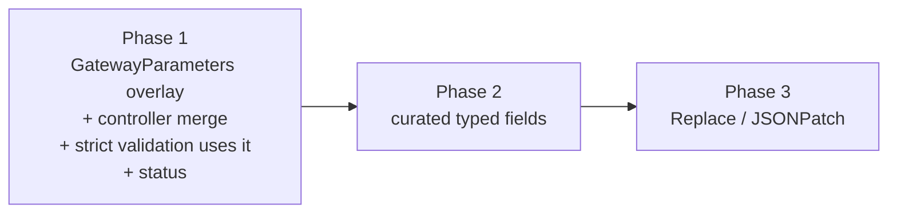
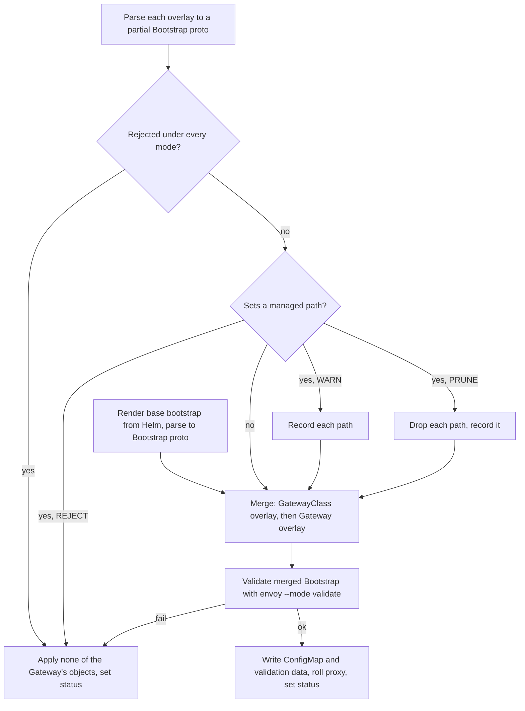

# EP-13666: Mutable Envoy bootstrap config for managed gateway proxies

- Issue: [#13666](https://github.com/kgateway-dev/kgateway/issues/13666)
- Strict validation dependency: [#14814](https://github.com/kgateway-dev/kgateway/issues/14814)
- Histogram buckets: [#14088](https://github.com/kgateway-dev/kgateway/issues/14088)

## Background

For a managed gateway proxy, kgateway's deployer renders the Envoy bootstrap
(`envoy.yaml`) from an internal Helm template, stores it in a `ConfigMap` named
after the `Gateway`, and mounts it into the proxy `Pod` at `/etc/envoy`. The
`envoy-wrapper` (envoyinit) reads that file and passes it to Envoy as the whole
bootstrap.

`GatewayParameters.spec.kube.envoyContainer.bootstrap` exposes a few curated fields
(`logLevel`, `componentLogLevels`, `logFormat`, `dnsResolver.udpMaxQueries`,
`enableReadinessProbeProxyProtocol`, `maxDownstreamConnections`). Nothing else in
the bootstrap can be set through the API: Envoy reloadable feature flags,
`stats_config.histogram_bucket_settings`
([#14088](https://github.com/kgateway-dev/kgateway/issues/14088)),
`stats_flush_interval`, extra runtime layers, other DNS resolver settings, custom
static clusters.

The motivating case ([#13666](https://github.com/kgateway-dev/kgateway/issues/13666))
is reloadable feature flags. When an Envoy upgrade changes behavior, Envoy adds an
`envoy.reloadable_features.<name>` flag so operators can restore the old behavior
while they adapt, and removes the flag in a later release. The flag is set in the
bootstrap, as a `layered_runtime` layer. The issue asks for a generic way to change
the bootstrap, not a setting for reloadable features only, and this EP takes that
approach.

A second case shows why the merge must happen in the controller. Envoy rejects a
regex whose compiled program exceeds the runtime key
`re2.max_program_size.error_level` (default 100); regexes generated from long
OpenAPI path templates exceed it easily. A user can raise the limit in the proxy's
runtime, but under `validation.level: strict` the controller validates each route
against its own synthetic bootstrap, which has no `layered_runtime`. The route is
dropped before it reaches a proxy that would accept it
([#14814](https://github.com/kgateway-dev/kgateway/issues/14814)).

The current workaround is to copy the generated bootstrap into a custom
`ConfigMap`, add the desired config, and repoint the `envoy-config` volume at it
with a `deploymentOverlay`. The user then owns a complete, verbatim copy of the
generated bootstrap, including control-plane–managed fields (`node`, the
`xds_cluster`, `dynamic_resources`).

## Motivation

The workaround breaks on upgrade. When a kgateway release changes the bootstrap
template (a new xDS field, a new static listener, a renamed cluster), the user's
copy does not get the change, and nothing warns them. A stale copy can break the
proxy's xDS connection or crash-loop it.

We want a way to change the bootstrap that:

1. lets the user express **only their delta**, not a full copy,
2. **continues to apply when the base bootstrap changes** in a future version,
   because untouched fields flow through, and
3. is **known to the controller**, so xDS validation sees the bootstrap the proxy
   runs.

## Goals

- **Change the managed proxy's bootstrap through `GatewayParameters` without
  copying it.** Changes are a structured overlay on the generated `Bootstrap` proto,
  so the base can change between versions without breaking them.
- **The controller knows the effective bootstrap of every Gateway it manages.**
  Strict validation checks routes against it, so turning on `strict` no longer
  drops routes the proxy would accept
  ([#14814](https://github.com/kgateway-dev/kgateway/issues/14814)).
- **The user's value wins, and kgateway reports when it disagrees.** An overlay that
  sets a control-plane–managed field is applied and reported. Operators who want
  enforcement can opt into pruning or rejecting.
- **Validate the merged bootstrap before rollout,** and report failures on the
  `Gateway` instead of crash-looping Envoy.
- **Adding a curated field never breaks an existing overlay** (Phase 2).
- **Cover the open requests.** Reloadable feature flags
  ([#13666](https://github.com/kgateway-dev/kgateway/issues/13666)) and histogram
  buckets ([#14088](https://github.com/kgateway-dev/kgateway/issues/14088)) work
  through the overlay in Phase 1.

## Non-Goals

- Replacing `deploymentOverlay`. It remains the way to change the `Deployment`;
  this EP is only about the bootstrap's content.
- Changing dynamic (xDS-delivered) config such as listeners, routes and clusters.
  Gateway API and policy CRDs configure those.
- Validating `-c` (see Alternatives). It merges in the proxy pod at startup, so the
  controller cannot see it.
- Text templating of the bootstrap.
- An admission webhook.

## Implementation Details

### Design principle

Apply changes as a **proto-level overlay onto the generated `Bootstrap`**, never as a
textual or whole-document replacement. Envoy layers its own `--config-yaml` over
`--config-path` the same way, with a proto `MergeFrom`. Because the overlay targets
proto field paths rather than line positions, it keeps working when the
surrounding base config changes.

### Phasing



- **Phase 1** (implemented): the overlay API, the merge in the controller,
  guardrails, validation of the merged bootstrap, strict xDS validation against
  it, status, and rollout.
- **Phase 2**: curated typed fields, added when users keep writing the same overlay.
  This EP defines how every curated field fits the Phase 1 pipeline, so that adding
  one never breaks a stored overlay; each field is specified when it is added (see
  Phase 2: curated fields).
- **Phase 3**: strategies that remove or replace base content, once a concrete
  need appears. This EP sketches them only far enough to show that Phase 1's API
  leaves room for them (see Phase 3: removal and replace strategies).

The overlay can express anything a curated field can, so the overlay ships first.

### Configuration

The API is a new field, `overlay`, on
`GatewayParameters.spec.kube.envoyContainer.bootstrap`:

```yaml
apiVersion: gateway.kgateway.dev/v1alpha1
kind: GatewayParameters
metadata:
  name: my-gateway
spec:
  kube:
    envoyContainer:
      bootstrap:
        dnsResolver:                     # existing field
          udpMaxQueries: 50
        overlay:
          mergeStrategy: StructuredMerge # required; the only value in Phase 1
          value:                         # a partial envoy.config.bootstrap.v3.Bootstrap
            stats_flush_interval: 10s
            layered_runtime:
              layers:
                - name: user_runtime
                  static_layer:
                    envoy.reloadable_features.http_reject_path_with_fragment: false
```

`overlay.value` is stored with `PreserveUnknownFields` and parsed by the controller
as a partial `envoy.config.bootstrap.v3.Bootstrap`. The API server does not validate
it, so the controller reports typos and wrong types on the Gateway's status.
`mergeStrategy` is a required enum with one value, so every stored overlay names its
strategy and no overlay relies on a default when Phase 3 adds strategies.

The existing fields stay where they are. Curated fields (Phase 2) go next to the
existing fields they belong with, on `bootstrap` or on `spec.kube.stats`. How a
field reaches the bootstrap (a command-line flag, the Helm template, or a proto
merge in the controller) is not part of the API.

A GatewayClass and a Gateway can each reference a `GatewayParameters`. Their
bootstrap overlays combine the way `deploymentOverlay` does: the GatewayClass overlay is merged
onto the generated bootstrap, then the Gateway overlay onto the result. The Gateway's
value wins a conflict. A `GatewayParameters` referenced by both applies once.

#### Worked example: reloadable feature flags

A flag such as `envoy.reloadable_features.<name>` is a runtime key, set in a
`layered_runtime.layers[].static_layer` as shown above.

- The generated bootstrap already defines one layer, `admin_layer`, which holds the
  values an operator sets on a running proxy with `POST /runtime_modify`.
- For each key, Envoy uses the value from the last layer that sets it. The merge
  inserts overlay layers immediately before `admin_layer`, so a value set with
  `/runtime_modify` still wins.
- An overlay layer needs a name that no other layer uses. Envoy rejects duplicate
  layer names at startup; the controller rejects them first with a clearer message
  that names both sources.
- Envoy ignores a flag it does not know, whether removed or misspelled, and logs
  it. kgateway does not report it.

### Merge semantics

`StructuredMerge` is built on Go's `proto.Merge`, which has the semantics of the
C++ `MergeFrom` Envoy uses:

| Field kind | Example | Result |
|---|---|---|
| Scalar | `cluster_manager.local_cluster_name` | The overlay's value replaces the base's. A zero value counts as unset, except in a `oneof`. |
| Message | `stats_config`, `admin` | Merged field by field, by these same rules. |
| `google.protobuf.Any` | any `typed_config` | The overlay's value replaces the base's whole, including an `Any` with only a `@type`, which then gets that type's defaults. |
| `oneof` | `stats_config.stats_matcher` | Setting the same option merges it; setting a different option clears the base's. |
| Map | `node.metadata` | Merged by key; an overlay entry replaces the base entry whole. |
| List | `static_resources.clusters`, `stats_sinks` | See the next table. |

Lists:

| Kind | Fields | Result |
|---|---|---|
| Named entries | `static_resources.clusters`, `static_resources.listeners`, `static_resources.secrets`, `overload_manager.resource_monitors` | Merge by `name`. An overlay entry with a base entry's name replaces it whole; other overlay entries are appended. |
| Runtime layers | `layered_runtime.layers` | Overlay layers are inserted before `admin_layer`. A reused layer name is rejected. |
| Every other list | `stats_config.histogram_bucket_settings`, `stats_sinks`, `bootstrap_extensions` | The overlay's entries go before the base's. |

- **Only the four named lists merge by name,** because Envoy requires unique names
  in each and would otherwise reject an overlay entry that overrides a base entry.
  Elsewhere `name` often identifies the extension type, not the entry.
- **A replaced named entry is replaced whole.** The user copies the full entry from
  the generated `ConfigMap`; a later kgateway change to that entry no longer
  reaches it.
- **Runtime layers are never replaced,** so an overlay cannot remove `admin_layer` and
  with it `/runtime_modify`.
- **Other lists put the overlay first,** so the overlay wins in first-match lists such
  as `histogram_bucket_settings`. In lists where every entry applies, order does
  not matter. An overlay entry never changes a base entry in these lists.

`proto.Merge` cannot remove an entry or replace a message as a whole; Phase 3 adds
that.

### Guardrails

#### Managed paths

A path is managed when kgateway generates it and something outside the overlay
depends on its name or value: the controller, the proxy `Deployment`, envoyinit, or
translated xDS. The managed paths are:

- **Every named entry in the generated bootstrap:** each entry of
  `static_resources.clusters`, `static_resources.listeners`,
  `static_resources.secrets` and `overload_manager.resource_monitors`. The
  controller reads the names from the generated bootstrap, so an entry a later
  release adds is managed without a controller change.
- **Four fields:** `node`, `dynamic_resources`, `admin.address` and
  `cluster_manager.local_cluster_name`.

| Path | What depends on it |
|---|---|
| `node` | The controller selects the proxy's xDS snapshot by `node.metadata.role`. envoyinit sets `node.locality`. |
| `dynamic_resources` | The proxy receives all translated config through it. |
| `admin.address` | The `preStop` hook calls the admin port, and `admin_port_cluster` points at it. |
| `cluster_manager.local_cluster_name` and its cluster | The controller sends that cluster's endpoints by name; translated clusters use it for zone-aware routing. |
| `xds_cluster` | The proxy's connection to the controller, including the xDS credentials and the xDS CA. |
| `admin_port_cluster` | `readiness_listener` and `prometheus_listener` route to it. |
| `gateway_proxy_sds` (Istio integration) | Translated listeners and clusters get Istio certificates through it. |
| `readiness_listener`, `prometheus_listener` | The default probes and the Prometheus scrape annotation target their ports. |
| The downstream-connections resource monitor | Rendered when `maxDownstreamConnections` is set. |

Paths are matched on the parsed proto, never on raw YAML keys, because the proto
JSON mapping accepts both `dynamic_resources` and `dynamicResources`.

#### Managed-path mode

What happens to an overlay that sets a managed path is an operator choice, set by the
controller setting `KGW_BOOTSTRAP_OVERLAY_MANAGED_PATHS`:

- **`WARN` (default):** apply the overlay as written, and report each managed path
  on status, in an event and in a metric.
- **`PRUNE`:** drop each managed path from the overlay, apply the rest, and report
  each dropped path.
- **`REJECT`:** apply none of the overlay, and report the managed paths.

`WARN` is the default because a user who sets a managed path usually means it. A
common reason to change the bootstrap is a security response, which often
overrides something kgateway sets; refusing it sends the user back to full
bootstrap replacement, which has no validation or status. The condition reports
that the override applied, not that the proxy still works.

This is not new exposure. `deploymentOverlay` already lets a `GatewayParameters`
author run arbitrary containers in the proxy pod, so whoever can write the
`GatewayParameters` is trusted with that proxy's bootstrap. The operator owns the
mode, not the `GatewayParameters` author, because under `PRUNE` or `REJECT` the
author is the person the setting constrains.

#### Always rejected

Under every mode, the controller rejects an overlay with `InvalidOverlay` when it:

- contains `{{` anywhere. envoyinit runs a Go template pass over the bootstrap in
  the pod, with values the controller does not know, so the controller could not
  validate what the pod runs. This also rejects a string that needs `{{`
  literally. No user has asked for per-pod values in the bootstrap, and supporting
  templates later breaks no stored overlay.
- defines a static secret named `SYSTEM_CA_CERT`, which envoyinit adds in the pod.
- adds a runtime layer that is not a `static_layer`. The values of a disk, RTDS or
  admin layer are not in the bootstrap, so route validation could not see them.
- uses the same name twice in one of the named lists.
- adds a static cluster or listener whose name neither matches a generated entry
  nor starts with `user_` (see below).

#### Names of new static clusters and listeners

Envoy ignores a cluster or listener from xDS that has a static one's name, and logs
it only at debug level. Without a rule, an overlay cluster copied from `/config_dump`
with a backend's translated name would carry that backend's traffic, and later
changes to the backend would never reach the proxy. Bootstrap validation cannot
catch this, because the backend can be created after the overlay applies.

So a static cluster or listener in an overlay must either have a generated entry's
name, which makes it a managed path, or a name that starts with `user_`. No
translated or generated name starts with `user_`: translated listeners are named
`listener~<port>`, backend clusters `<prefix>_<namespace>_<name>..._<port>`, and
Kubernetes names cannot contain `_`. A project that embeds kgateway must not give
its own backend plugin a `user` prefix.

Secrets and resource monitors need no prefix: a static secret cannot take the place
of an SDS secret, and kgateway translates no resource monitors.

#### Upgrades and the managed-path list

Every generated named entry is managed, so a release that adds one manages it from
that release. Under `WARN`, a new managed path adds a report but does not change
what applies. Under `PRUNE` and `REJECT` it does, so each addition needs a release
note that names it.

A kgateway patch release adds no managed path, and does not remove or rename a
generated named entry or add a runtime layer. These changes wait for a minor
release, with a release note.

On upgrade:

- If kgateway starts managing a path an overlay sets, `WARN` still applies the
  overlay's value and reports it.
- If kgateway removes or renames a generated cluster or listener an overlay
  replaces, the overlay's entry no longer matches a generated name and does not
  start with `user_`, so it is rejected with `InvalidOverlay`.
- If kgateway adds a runtime layer with an overlay layer's name, the overlay is
  rejected.

A rejected overlay follows the invalid-merge fallback below.

### Pipeline

The controller merges before it writes the bootstrap `ConfigMap`, so the `ConfigMap`
on the cluster is the final config, and all logic and status live in one place.



Validation runs the Envoy in the controller image on a copy of the merged bootstrap
adjusted to match what the proxy pod runs: it adds what envoyinit adds in the pod
and stands in for what exists only in the pod, such as the node id and file-based
SDS files.

TLS files are not supported in this phase. Envoy opens each TLS file the bootstrap
names (a certificate, key, CA, CRL, PKCS#12 bundle or OCSP staple given as
`filename`) when it loads it, and the controller container does not have the files
the proxy pod mounts, so an overlay that names one fails with `ValidationFailed`
although the proxy would accept it. TLS data given inline is validated as it is,
and a cluster can trust the `SYSTEM_CA_CERT` secret, but only public material (a
CA, a CRL, an OCSP response) belongs inline: a private key given inline would be
stored in the `GatewayParameters`, the generated `ConfigMap` and the proxy's
`/config_dump`, so mutual TLS from a static cluster has no supported form in this
phase. Supporting TLS files is a
follow-up: validation would stand in for each file with a placeholder, as xDS
validation does for the certificate, key and CA files of translated resources,
and needs a placeholder Envoy accepts for each other file field.

Parsing an overlay resolves each `@type` through the Go types registered in the
controller binary. The controller registers every type go-control-plane defines, so
the parse does not reject an extension the proxy's Envoy supports.

### Invalid-merge fallback

When the overlay cannot be parsed, is rejected, fails validation, or the generated
`ConfigMap` would exceed the API server's size limit, the deployer applies none of
the Gateway's objects. The controller never rolls out the generated bootstrap
without the overlay, because that would silently remove settings the user depends
on, often a security-response override.

- **Existing Gateway.** The proxy keeps running its last-good bootstrap and
  receiving xDS. `kgateway.dev/BootstrapOverlayApplied` is `False`, and the overlay
  failure does not count against `Accepted`, which reports the Gateway's other
  parameters: an object overlay that does not apply is still `InvalidParameters`,
  and an `InvalidParameters` failure recorded earlier for the same Gateway
  generation is replaced once the parameters resolve. Other `GatewayParameters`
  changes (image, resources, replicas) wait until the overlay is fixed.
- **New Gateway.** No proxy is deployed. The Gateway also gets `Accepted=False`
  with reason `InvalidParameters`, as for any objects the deployer cannot render.
- **kgateway upgrade or Envoy bump.** The previous `Deployment` keeps running with
  its proxy image, so the new Envoy release, including any security fix in it,
  does not reach these proxies until the overlay is fixed. The condition message and
  an event name the held-back image (see Reporting).

The fallback also holds back the generated `ConfigMap`'s `ca.crt`. With xDS TLS
enabled, if the CA is replaced while a Gateway is in the fallback, that Gateway's
proxies cannot verify the controller on their next connection, and serve their
last configuration until the overlay is fixed. Writing only `ca.crt` during the
fallback is a possible follow-up.

A failure the controller expects to clear, such as Envoy timing out while
validating, is retried. A failure that only a change to the overlay or the
controller fixes is not.

**Rolling back** the controller to a release without `overlay` removes every overlay
from the proxies, because that controller does not read the field. The release
notes warn against rolling back below the release that adds `overlay` while any
`GatewayParameters` sets it.

### Deployer

The merge runs in the deployer's post-processing, after Helm renders the Gateway's
objects and before the object overlays (`deploymentOverlay` and the others), so an
object overlay can still change anything in the `Deployment`. A Gateway whose
`GatewayParameters` set no `overlay` keeps the Helm-rendered `envoy.yaml` byte for
byte and gets no validation data.

The merged bootstrap is written with snake_case field names and sorted keys, so it
reads like the template and the Envoy docs, and identical content always gives the
same checksum. Pods roll when that checksum changes, so an overlay-only change rolls
the pods.

#### Versioned bootstrap keys

Envoy reads its bootstrap only when the process starts, and kubelet updates a
mounted `ConfigMap` in place. If pods read `envoy.yaml`, an Envoy container that
restarts mid-rollout (a crash, an OOM kill) would load the new bootstrap while its
pod still belongs to the old revision, and a bootstrap the proxy's Envoy rejects
would crash-loop old pods outside the rollout's `maxUnavailable`.

So each revision of a Gateway's bootstrap gets its own key, `envoy-<checksum>.yaml`,
in the generated `ConfigMap`, and the pod template's `INPUT_CONF` names the key the
pod reads. A bootstrap change reaches a pod only through the `Deployment` rollout.
This applies to every Gateway, with or without an `overlay`, so adding or removing an
`overlay` changes only the content of the next key.

- A key is kept while a running pod or a ReplicaSet with replicas above zero uses
  it, and removed after. The reconciler waits for its pod collection and its
  ReplicaSet informer to sync before its first reconcile, so a controller restart
  does not remove a key in use. The informer needs `get`, `list` and `watch` on
  `apps/replicasets`, which the Helm chart's ClusterRole gains; a controller
  without that rule reconciles no Gateway.
- The revision the live `ConfigMap` is current on, the key with the same content as
  `envoy.yaml`, is kept for one more write when the `ConfigMap` has room for it.
  The `Deployment`'s pod template names that revision until the reconcile's
  objects are applied, and a ReplicaSet or pod just created from it may not be in
  the controller's informers yet. This key never causes
  `BootstrapConfigMapTooLarge`.
- Earlier keys are copied from the controller's informer copy of the `ConfigMap`.
  A key names the SHA-256 of its content, so a stale copy can lack a key, or be
  current on an older revision, but never hold wrong content for a key. When the
  informer copy lacks the key this reconcile writes or an earlier key in use, the
  deployer reads the `ConfigMap` from the API server instead; a failed read
  retries the reconcile without changing objects or status. A Gateway whose
  bootstrap is unchanged and that is outside a rollout causes no API server read;
  each change of a Gateway's bootstrap causes one, and further ones until the
  informer has the write.
- envoyinit waits for its key to appear, because kubelet can serve a new pod the
  previous `ConfigMap` content for a short time. It waits only for a file inside
  `/etc/envoy`.
- A key in use is never removed to make room. A change that would put the
  `ConfigMap` over the API server's 1 MiB limit takes the invalid-merge fallback
  with `BootstrapConfigMapTooLarge`. A revision is about 10 KB, so this takes a
  very large overlay or many edits during a stuck rollout. Scaling down the old
  ReplicaSets frees their keys.
- `envoy.yaml` still holds the current bootstrap, for people and tooling that read
  the `ConfigMap`.

#### `/etc/envoy` mount check

After the object overlays, the deployer checks that the proxy container mounts the
whole generated `ConfigMap` at `/etc/envoy`. If an object overlay points the
volume at another `ConfigMap` (the full-replacement workaround) or mounts something
else there, the bootstrap overlay never reaches the proxy, and the condition reports
`BootstrapNotMounted`. The same applies when the proxy container's env already sets
`INPUT_CONF` to a file outside `/etc/envoy`, through `envoyContainer.env` or an
object overlay: envoyinit reads that file, so the deployer keeps the value. A path
inside `/etc/envoy` is in the generated `ConfigMap`, and the deployer replaces it
with the revision key. The last case is a second volume mounted inside
`/etc/envoy`, through `envoyContainer.extraVolumeMounts` or an object overlay, over
the file envoyinit reads: `envoy.yaml`, or the file the user's `INPUT_CONF` names.
A mount at that file's path, such as a `subPath` mount at `/etc/envoy/envoy.yaml`,
or at a directory above it holds the file, so the proxy reads the user's volume. A
volume mounted elsewhere inside `/etc/envoy` is not reported.

The deployer then writes no validation data and does not set `INPUT_CONF`, so
strict validation uses Envoy's defaults. `envoy.yaml` and the pod-template checksum
still come from the merged bootstrap, so an overlay edit rolls the pods although they
read another bootstrap. The combination of a valid overlay and a bootstrap that is
not mounted is not rejected, because the fallback would hold back unrelated
`Deployment` changes. An invalid overlay takes the fallback here too, because the
failure is found before the mount check runs. The failure stays the reason, since
it is what holds the objects back, and the condition message adds that the overlay
has no effect on the proxy, so removing it, or fixing it before removing the mount,
deploys the Gateway's other changes. Reporting the failure without holding back
the objects is a possible follow-up.

#### Listener ports

`envoy --mode validate` does not bind ports, so it does not catch a static listener
on a port a Gateway listener also uses. On the proxy, Envoy rejects the second
listener as a duplicate address.

Today ports 8082 (readiness), 9091 (Prometheus) and 19000 (admin) are reserved: the
translator rejects a Gateway listener on them, and the deployer leaves them off the
`Service`. An overlay can add or move a static listener, so the deployer reads every
TCP port the merged bootstrap listens on and writes them into the validation data (see
Translator and Proxy Syncer). The translator then also rejects a Gateway or
ListenerSet listener on one of those ports, and the deployer leaves it off the
`Service` and names it in the condition message.

The constant ports stay reserved even when an overlay moves a listener off them, so an
overlay never frees a port that pods started before it still listen on.

A collision does not reject the overlay, so a ListenerSet added later cannot make a
working overlay fall back. The exception is a collision on every Gateway listener
port: the `Service` would have no ports, so the overlay is rejected with
`InvalidOverlay`.

#### Projects that embed kgateway

A project that replaces Helm value generation and object post-processing with
`WithHelmValuesGeneratorOverride` gets no bootstrap overlays unless its override
also implements a new optional interface that returns the overlays to merge. The
deployer then runs the same pipeline for its Gateways, and calls the override's
post-processor after the merge.

### Translator and Proxy Syncer

#### Validation subset

Strict validation runs Envoy in the controller pod. It cannot use the whole merged
bootstrap, which references the xDS cluster, the admin interface and file-based SDS
secrets that do not resolve in the controller pod. It uses an allowlisted subset:
the `layered_runtime` layers of type `static_layer`. An overlay can add only static
layers, so the subset holds every runtime value the bootstrap sets. `admin_layer`
is left out: it holds only values set on a running proxy.

A field joins the allowlist only with a test that shows it changes what Envoy
accepts. `default_regex_engine` is left out because its only engine, `GoogleRE2`,
has no fields; a test fails if it gains one.

The deployer writes the subset and the bootstrap's listener ports into the
generated `ConfigMap` (`xds_validation.json`) and onto the pod template as an
annotation. The translator reads the `ConfigMap` key; it does not resolve
`GatewayParameters` again or parse `envoy.yaml`. The key is written together with
the bootstrap, so a failed overlay leaves both unchanged, and nothing needs rebuilding
after a controller restart.

The subset reaches every Envoy validation call for the Gateway's routes. If one
call were missed, a route could pass the per-route check and still fail the
whole-configuration check under Envoy's defaults.

#### Only the current bootstrap is validated

kgateway sends one translation of a Gateway to all of its pods, so old and new pods
receive the same config during a rollout. Routes are validated under the subset in
`xds_validation.json`, the one new pods start with. A Gateway without it is
validated under Envoy's defaults.

An overlay change can make Envoy reject a route the previous bootstrap accepted, or
accept a route the previous bootstrap rejected:

- **The new bootstrap rejects a route the old one accepted.** The translator drops
  the route once it validates under the new subset. Old pods accept the config
  without the route. A new pod's first configuration waits for that translation
  (see below), so it never receives the route its bootstrap rejects.
- **The new bootstrap accepts a route the old one rejected.** The route is
  programmed at once; new pods accept it. Each old pod rejects the
  `RouteConfiguration` that contains it and keeps its last accepted version, so
  until the rollout replaces the old pods, no route change on that listener reaches
  them. Clusters, endpoints and other listeners still update. The rejection shows
  in the existing `kgateway_envoy_xds_rejects_active` metric.

Validating against every running bootstrap would keep old and new pods identical,
at the cost of per-pod state in the controller (see Alternatives). The divergence
above happens only during a rollout whose new bootstrap accepts routes the old one
rejected, and ends when the rollout completes.

#### First-snapshot hold

A new proxy's first xDS snapshot is published only from a translation that was
validated under the proxy's subset and reserved every port the proxy's bootstrap
listens on. The controller reads the proxy pod's subset and ports from its pod
annotation when the proxy connects. A pod without the annotation has Envoy's
defaults and the constant ports.

- A held proxy receives no dynamic configuration, so it is not Ready, and the
  rollout waits for it. It serves no traffic, so it never serves a configuration it
  rejected.
- For a pod running the current bootstrap, release is guaranteed: the deployer
  applies the `ConfigMap` before the `Deployment`, so the new validation data
  exists before the pod, and the next translation covers it.
- A pod from an old ReplicaSet whose Envoy starts fresh mid-rollout is held while
  its bootstrap differs from the current one. It stays unready until the rollout
  removes it, and counts against `maxUnavailable` meanwhile. Without the hold, it
  would reject its first `RouteConfiguration` and serve that listener with no
  routes.
- A proxy that already has configuration is never held: one already published to
  on its connection, one that reported a previously accepted version, and one
  whose pod is Ready. Holding it would freeze every kind of configuration it
  serves, endpoints included.
- A Gateway without an `overlay` validates under Envoy's defaults and the constant
  ports, which cover all of its pods, so none of its proxies is held.

#### Policy and backend validation

TrafficPolicy and BackendConfigPolicy are validated when the policy is constructed,
before any Gateway is known, so they keep Envoy's defaults in Phase 1. They can
reject config that a proxy with an overlay accepts, such as a CORS wildcard origin whose
regex is over Envoy's default RE2 program-size limit, which an overlay can raise. Gateway-aware policy validation is a follow-up.

### Reporting

Status goes on the **`Gateway`**: one `GatewayParameters` can serve many Gateways,
and the merged result is per Gateway. The Gateway reconciler writes a new
condition, `kgateway.dev/BootstrapOverlayApplied`. The translator preserves it when it
writes Gateway status.

| Status | Reason | When |
| --- | --- | --- |
| `True` | `Applied` | The whole overlay applied, no managed path set. |
| `True` | `ManagedPathsOverridden` | `WARN` applied an overlay that sets managed paths. The message lists them. |
| `True` | `PathsIgnored` | `PRUNE` dropped managed paths; the rest applied. The message lists them. |
| `False` | `PathsDenied` | `REJECT` refused an overlay that sets managed paths. The message lists them. |
| `False` | `InvalidOverlay` | The overlay does not parse, is rejected under every mode (see Always rejected), has a validation subset over 64 KiB, or listens on every Gateway listener port. |
| `False` | `ValidationFailed` | The merged bootstrap failed `envoy --mode validate`. |
| `False` | `ValidationUnavailable` | The controller could not run Envoy to validate it. |
| `False` | `ControllerError` | The controller failed to process its own generated bootstrap. This is a kgateway defect. |
| `False` | `BootstrapConfigMapTooLarge` | The generated `ConfigMap` would exceed 1 MiB. |
| `False` | `BootstrapNotMounted` | An object overlay mounts something other than the generated `ConfigMap` at `/etc/envoy`, or the proxy container's env sets `INPUT_CONF` to a file outside `/etc/envoy`, or a second volume is mounted inside `/etc/envoy` over the bootstrap file the proxy reads. |

`True` with `ManagedPathsOverridden` or `PathsIgnored` is deliberate: the overlay
applied, and a routine report must not read as a broken Gateway to anyone alerting
on condition status. `False` means the overlay is not in effect on the proxy. The
condition is removed when the Gateway has no `overlay`, when the deployer cannot
render the Gateway's objects at all, and when the Gateway switches to a
self-managed `GatewayParameters`.

A `Warning` event goes with each overridden, dropped or denied path and each
failure, recorded when the condition changes rather than on every reconcile. A
Gateway without an `overlay` has no condition, so its `BootstrapConfigMapTooLarge`
event is recorded on each reconcile that hits the limit. The events are
`events.k8s.io` events, so the Helm chart's ClusterRole gains `create` and `overlay`
on them. The
metric `kgateway_controller_bootstrap_overlay_managed_paths{namespace,name,path}`
lets a platform team find the Gateways whose overlays set managed paths.

When the fallback leaves an existing Gateway's objects unchanged and the rendered
proxy image differs from the running one, the condition message and a `Warning`
event name both images.

The API server rejects an event note over 1024 bytes and a condition message over
32768 characters, and Envoy's error can exceed both. A condition message holds at
most the first 4096 bytes of an overlay error, where Envoy names the field. Every
event note is cut to 1024 bytes and every condition message to 32768 bytes. A cut
text says so, and the controller logs the full text.

### Envoy versions and proto types

The controller checks an overlay twice before rollout, and the proxy accepts or
rejects the result once at startup:

| Check | Where | Pinned by |
|---|---|---|
| Overlay parse | Controller | go-control-plane in `go.mod` |
| `envoy --mode validate` | Controller | `ENVOY_IMAGE` in the controller image |
| Envoy startup | Proxy pod | The proxy image, or the Gateway's `envoyContainer.image` |

A release builds the controller and proxy images from the same `ENVOY_IMAGE`, so
normally the controller's checks predict the pod's result. They can disagree:

- **go-control-plane behind Envoy.** A release line that takes an Envoy security
  release without updating go-control-plane rejects a new field with
  `InvalidOverlay`, although the proxy would accept it.
- **A proxy image that differs from the controller's**, through
  `envoyContainer.image`, a `deploymentOverlay`, or Helm values. The bootstrap overlay and,
  under strict validation, the routes are validated against the controller's
  Envoy, as routes already are today. An overlay field only the proxy's Envoy has
  fails with `ValidationFailed` and holds back the whole `Deployment`. Phase 1 does
  not report the difference; comparing the Envoy version each proxy reports when
  it connects is a possible follow-up.
- **A rollout after an upgrade**, or a Gateway held back by the fallback: old pods
  run the previous Envoy.

For a Gateway with an overridden proxy image, a validation failure blocks the
rollout as it does for any other Gateway. The docs say that validation uses the
controller's Envoy, which explains why it can disagree with the proxy. Strict route
validation already works this way.

When go-control-plane is behind Envoy, the failure is safe: the Gateway reports
`InvalidOverlay` and keeps its last-good bootstrap, and `-c` still works. No test
checks for it, because matching a go-control-plane commit to an Envoy release is
hard to automate. The Envoy upgrade guide (`devel/envoy/envoy-upgrade.md`) has a
step for an Envoy patch release on a release branch: check whether it adds API
fields or extensions, and bump go-control-plane if it does.

When the proxy's Envoy rejects a bootstrap the controller validated, the new pods
crash-loop and the rollout stalls. The Gateway's conditions do not change; the
failure shows in the proxy pods and in the `Deployment`, which reports
`ProgressDeadlineExceeded`. A rollout can stall this way without an `overlay`, through
an image override or a full-replacement bootstrap, so reporting it is left to a
separate change that covers every Gateway.

### Phase 2: curated fields

When an overlay shape recurs, promote it to a typed field next to the existing fields
it belongs with. The controller applies curated fields to the parsed base before
the overlay, so a Gateway that sets one goes through the same pipeline (validation,
validation subset, fallback, condition), and an overlay that sets the same path keeps
its effect. Each curated field rejects `{{` in its strings with a CEL rule.

Candidates: `spec.kube.stats.histogramBucketSettings`
([#14088](https://github.com/kgateway-dev/kgateway/issues/14088)), and the RE2
program-size limit (`bootstrap.re2MaxProgramSize`), where a typed field catches a
misspelled runtime key at write time.

### Phase 3: removal and replace strategies

Add `Replace` (clear named messages and lists in the generated bootstrap, then
merge) and a discouraged `JSONPatch` once a concrete need appears. A replaced path
that contains a managed path counts as setting it. `layered_runtime.layers` cannot
be replaced, because that would remove `admin_layer`.

### Test Plan

- **Merge:** each field kind and list kind; runtime layer placement and duplicate
  names; whole-`Any` replacement; GatewayClass and Gateway order. The e2e suite
  checks, through the admin API of a running proxy, the runtime layer order and
  that `/runtime_modify` still wins.
- **Guardrails:** managed-path matching in both casings; each mode applies, prunes
  or rejects with the right reason; every generated named entry is managed,
  including one only the test's base has; the `user_` rule; `{{`, `SYSTEM_CA_CERT`
  and non-static layers rejected under every mode.
- **Parsing and validation:** the generated bootstrap parses with every option that
  adds a `@type`; `TypedStruct` wrappers parse; a type the pinned Envoy does not
  know fails validation; the generated bootstrap with xDS TLS passes real Envoy
  validation; a static cluster whose CA is a file only the proxy pod has fails
  real Envoy validation, and the validator leaves the file path in place.
- **Deployer:** an overlay-only change rolls the pods; identical content does not; a
  Gateway without an overlay keeps its `envoy.yaml`; the fallback leaves every object
  of an existing Gateway unchanged and does not make it not accepted; it replaces
  an earlier `InvalidParameters` failure of the same generation, and reports an
  object overlay that does not apply; a new Gateway gets
  `Accepted=False`; `BootstrapNotMounted`, including for a second volume mounted
  over the bootstrap file inside `/etc/envoy`; an invalid overlay under a mount
  problem keeps its reason and says the overlay has no effect on the proxy, also
  after a cut error; the held-back image report; an overlay
  error longer than the API server's limits is reported cut; a Gateway that
  becomes self-managed loses the condition.
- **Versioned keys:** every Gateway gets a key matching its checksum; keys are kept
  while a pod or a ReplicaSet with replicas uses them and removed after; the
  revision the live `ConfigMap` is current on is kept for one more write when it
  fits; the informer copy is used when it holds the key the reconcile writes and
  every earlier key in use, and the API server is read when it lacks one; a
  failed `ConfigMap` read removes no key; the size limit; envoyinit waits for its
  key.
- **Strict validation:** a route whose regex exceeds the default RE2 limit is
  dropped without an overlay and programmed with one that raises the limit, in single-
  and multi-virtual-host configurations; a second Gateway without the overlay still
  drops it.
- **Reserved ports:** a static listener on a Gateway listener's port rejects that
  listener and leaves the port off the `Service`; constant ports stay reserved.
- **First-snapshot hold:** a new proxy whose bootstrap the translation was not
  validated under is held, and released by the next translation that covers it; a
  proxy already published to, warm, or with a Ready pod is never held.
- **E2E:** an overlay applied to a running proxy, checked through `/config_dump`; each
  managed-path mode; the `user_` rule; and the motivating case: a request with a
  `#` fragment gets a 400, and after the overlay sets
  `http_reject_path_with_fragment: false` and the pods roll, it reaches the backend;
  setting the flag back with `/runtime_modify` gives a 400 again.

## Alternatives

- **Merge in envoyinit at proxy startup**
  ([#14752](https://github.com/kgateway-dev/kgateway/pull/14752)). The user wins,
  but the controller never sees the result: no validation before rollout, no
  status, no rollout on edits, and strict validation keeps using Envoy's defaults.
  Its merge function moves into the controller instead.
- **`-c <file>` through `envoyContainer.extraArgs`.** Works today. Envoy merges the
  wrapper's `--config-yaml` over the file, so kgateway's value wins every conflict,
  and the controller has no visibility: no validation, no status, no rollout on
  edits. It stays documented as a way to add settings outside the controller's
  view.
- **`PRUNE` or `REJECT` as the default, or a per-`GatewayParameters` mode.** Either
  default makes overriding a managed path impossible through the API, which sends
  security responses back to full replacement. A per-`GatewayParameters` mode lets
  the author turn off a check the operator relies on.
- **Hold only the bootstrap when an overlay fails,** keeping the last-good
  `envoy.yaml` and applying the other objects. This fails in the common upgrade
  case: when the new Envoy rejects the overlay, the last-good bootstrap still
  contains it, and the new pods crash-loop.
- **Fail open when an overlay fails,** rolling the generated bootstrap without the
  overlay. The Gateway gets the upgrade, but loses settings it depends on, possibly a
  security-response override, with only a condition to show it.
- **A per-overlay `conflictPolicy: UserWins | KgatewayWins`,** so an overlay's value
  applies only until kgateway starts setting the path, as with `-c`. No user has
  asked for it, and an optional field can be added later without breaking stored
  overlays.
- **Validate TLS files with placeholders in this phase,** so an overlay could name
  files only the proxy pod mounts. Deferred to a follow-up: the xDS helper covers
  only the certificate, key and CA, and a CRL, a PKCS#12 bundle and an OCSP staple
  each need their own placeholder that Envoy accepts in place of the file.
- **A hand-kept list of managed static entries.** A release could add an entry and
  forget to list it. Reading the names from the generated bootstrap cannot drift.
- **Report a static cluster that shadows a translated cluster**, instead of the
  `user_` prefix. It needs a check that reruns whenever a backend appears, a second
  condition, and the same again for listeners, and it reports the collision only
  after the shadowing config is on the proxy.
- **A typed allowlist of top-level fields.** It limits what a user can change during
  a security response, and controller-side enforcement does not need it.
- **A single opaque full-bootstrap field.** It reintroduces the verbatim copy.
- **Validate in the proxy's image**, with a `Job` per change or an init container,
  so a Gateway with an overridden image is validated against the Envoy it runs. A
  `Job` cannot serve strict route validation, which runs on every translation; an
  init container validates only after the rollout starts. A possible follow-up.
- **Check stored overlays before an upgrade** with a command in the new controller
  image. A possible follow-up, if users ask for it. A Helm `pre-upgrade` hook was
  rejected: one Gateway's overlay would hold back the controller upgrade for every
  Gateway.
- **Validate against every running bootstrap.** Every pod would serve the same
  routes during a rollout, but the controller would need a per-Gateway collection of
  running pods, one Envoy run per distinct subset, a union of reserved ports across
  pods, and `Service` ports that wait for the last old pod. The divergence it avoids
  ends when the rollout completes.
- **Switch strict validation to the new bootstrap only after the rollout.** Safe
  only for a change that makes Envoy accept routes it rejected before; a change
  that makes Envoy reject routes it accepted before needs the served config to
  pass before the first new pod starts.
- **Validate against the most restrictive value.** Works for numeric limits only; a
  feature flag can make Envoy stricter or looser.
- **A dedicated RE2 setting with its own validator plumbing.** Fixes only the RE2
  case; every other runtime key would need the same plumbing.
- **One `ConfigMap` per bootstrap revision.** The xDS CA would have to move to a
  separate `ConfigMap`, because its rotation relies on kubelet updating the file in
  place. Versioned keys in the existing `ConfigMap` give the same guarantee with one
  volume.
- **One bootstrap key, with the restart gap documented.** A restarted old pod would
  load the newest bootstrap, so the first-snapshot hold would check a bootstrap the
  pod does not run, and a bootstrap the proxy rejects would crash old pods outside
  `maxUnavailable`.

