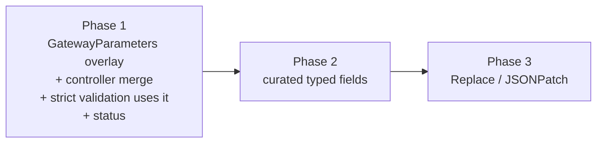

# EP-13666: Mutable Envoy bootstrap config for managed gateway proxies

- Issue: [#13666](https://github.com/kgateway-dev/kgateway/issues/13666)
- Merge function origin: [#14752](https://github.com/kgateway-dev/kgateway/pull/14752)
  (closed without merging; its code is not in the tree)
- Strict validation dependency: [#14814](https://github.com/kgateway-dev/kgateway/issues/14814)

## Background

For a managed gateway proxy, kgateway's deployer renders the Envoy bootstrap
(`envoy.yaml`) from an internal Helm template, stores it in a `ConfigMap` named
after the `Gateway`, and mounts it into the proxy `Pod` at `/etc/envoy` through the
`envoy-config` volume. The `envoy-wrapper` (envoyinit) reads that file and passes it
to Envoy as the whole bootstrap.

`GatewayParameters.spec.kube.envoyContainer.bootstrap` exposes a few curated fields
(`logLevel`, `componentLogLevels`, `logFormat`, `dnsResolver.udpMaxQueries`,
`enableReadinessProbeProxyProtocol`, `maxDownstreamConnections`). Nothing else in
the bootstrap can be set through the API: Envoy reloadable feature flags
(`envoy.reloadable_features.*`), `stats_config.histogram_bucket_settings`
([#14088](https://github.com/kgateway-dev/kgateway/issues/14088)),
`stats_flush_interval`, extra runtime layers, other DNS resolver settings, custom
static clusters.

The motivating case ([#13666](https://github.com/kgateway-dev/kgateway/issues/13666)) is reloadable feature flags. When an Envoy upgrade
changes behavior, Envoy adds an `envoy.reloadable_features.<name>` flag so operators
can restore the old behavior while they adapt, and removes the flag in a later
release. The flag is set in the bootstrap, as a `layered_runtime` layer. A user can
add one today with `-c` (see Alternatives), but the controller never sees it: it is
not validated, reported on status or rolled out, and it cannot override anything
kgateway sets. The issue asks for a generic way to change the bootstrap, not a
setting for reloadable features only, and this EP takes that approach.

A second case shows why the merge must happen in the controller. Envoy rejects a
regex whose compiled program exceeds the runtime key
`re2.max_program_size.error_level` (default 100); regexes generated from long
OpenAPI path templates exceed it easily. A user can raise the limit in the proxy's
runtime, but under `validation.level: strict` the controller validates each route
against its own synthetic bootstrap, which has no `layered_runtime`
([`pkg/xds/bootstrap/builder.go`](https://github.com/kgateway-dev/kgateway/blob/851bfc9c3cf37139586e82c1c0081ff718c02799/pkg/xds/bootstrap/builder.go#L256)).
The route is dropped before it reaches a proxy that would accept it ([#14814](https://github.com/kgateway-dev/kgateway/issues/14814)).

The current workaround is to copy the generated bootstrap into a custom
`ConfigMap`, add the desired config, and repoint the `envoy-config` volume at it
with a `deploymentOverlay`. The user then owns a **complete, verbatim copy** of the
generated bootstrap, including control-plane–managed fields (`node.cluster`,
`node.metadata.role`, the `xds_cluster`, the xDS JWT credential config,
`dynamic_resources`).

### Relevant sources

- Bootstrap template: `pkg/kgateway/helm/envoy/templates/configmap.yaml`
- Wrapper that loads, transforms, and re-marshals the bootstrap proto:
  `pkg/envoyinit/run.go`
- Merge function: `mergeBootstrapOverlay` in `pkg/envoyinit/overlay.go` from the
  unmerged [#14752](https://github.com/kgateway-dev/kgateway/pull/14752) (proto `Merge` plus runtime-layer insertion), to be added in a
  package the deployer can use and extended with the list rules in Merge semantics
- API types: `api/v1alpha1/kgateway/gateway_parameters_types.go` (`EnvoyBootstrap`)
- Controller settings: `api/settings/settings.go`
- Object overlays (`deploymentOverlay` and the others), whose GatewayClass-then-Gateway
  order the bootstrap overlay follows: `api/v1alpha1/shared/overlay_types.go`
  (`KubernetesResourceOverlay`)

## Motivation

The workaround breaks on upgrade. When a kgateway release changes the bootstrap
template (a new xDS field, a new static listener, a renamed cluster, a new managed
filter), the user's copy does not get the change, and nothing warns them. The user
must update the copy by hand on every upgrade, and a stale copy can break the
proxy's xDS connection or crash-loop it.

We want a way to mutate the bootstrap that:

1. lets the user express **only their delta**, not a full copy,
2. **continues to apply correctly when the base bootstrap meaningfully changes**
   in a future version, because untouched fields flow through automatically, and
3. is **known to the controller**, so xDS validation sees the same bootstrap the
   proxy runs.

## Goals

- **Change the managed proxy's bootstrap through `GatewayParameters` without
  copying it.** Changes are a structured overlay on the generated `Bootstrap` proto,
  so the base can change between versions without breaking them. Phase 1 ships a
  free-form overlay, Phase 2 adds curated typed fields, and Phase 3 adds removal
  and replace when a need appears.
- **The controller knows the effective bootstrap of every Gateway it manages.**
  Strict validation checks routes against it, so turning on `strict` no longer
  drops routes the proxy would accept
  ([#14814](https://github.com/kgateway-dev/kgateway/issues/14814)). Inputs the
  controller does not manage (`-c`, a replacement `ConfigMap`, self-managed
  Gateways) keep validating against Envoy defaults.
- **The user's value wins, and kgateway reports when it disagrees.** An overlay that
  sets a control-plane–managed field is applied and reported on status, in events
  and in metrics. For lists, Merge semantics defines what winning means. Operators
  who want enforcement can opt into pruning or rejecting.
- **Validate the merged bootstrap before rollout,** and report failures on the
  `Gateway` instead of crash-looping Envoy.
- **Adding a curated field never breaks an existing overlay.** Curated fields are
  applied first and the overlay on top, so an overlay keeps its effect (Phase 2).
- **Cover the open requests.** Runtime keys, including reloadable feature flags
  ([#13666](https://github.com/kgateway-dev/kgateway/issues/13666)), work through
  the overlay in Phase 1. Histogram buckets
  ([#14088](https://github.com/kgateway-dev/kgateway/issues/14088)) work through
  the overlay in Phase 1 and get a curated field in Phase 2.

## Non-Goals

- Replacing the existing `deploymentOverlay` mechanism. It remains the way to make
  `Deployment`-level changes (volumes, sidecars, etc.); this EP is only about the
  bootstrap's content.
- Mutating dynamic (xDS-delivered) config such as listeners, routes, and clusters.
  Those are owned by the translation pipeline and configured via Gateway API and
  policy CRDs.
- Validating `-c` (see Alternatives). It merges in the proxy pod at startup, so the
  controller cannot see it; it stays documented as a way to add settings outside
  the controller's view.
- Arbitrary text/templating of the bootstrap document (see Alternatives).
- An admission webhook (see Write-time feedback).

## Implementation Details

### Design principle

Apply changes as a **proto-level overlay onto the generated `Bootstrap`**, never as a
textual or whole-document replacement. This is the same layering Envoy itself uses
(`--config-path` + `--config-yaml`, which is a proto `MergeFrom`). Because the overlay
targets stable proto field paths rather than line positions, it keeps working when
the surrounding base config changes.

### Validation subset

Strict validation runs Envoy in the controller pod to check each Gateway's
translated xDS config (see Translator and Proxy Syncer). To match the proxy, it
needs the bootstrap fields that change what Envoy accepts, but it cannot use the
whole merged bootstrap: that bootstrap references `xds_cluster`, the admin
interface and file-based SDS secrets, none of which resolve in the controller pod.

- The **validation allowlist** lists the bootstrap fields that validation uses.
  It holds only the `layered_runtime` layers of type `static_layer`, whose values
  are written in the bootstrap. `admin_layer` is left out: it starts empty and
  holds only values set on a running proxy with `/runtime_modify`. An overlay can
  add only static layers (see Managed paths), so the static layers hold every
  runtime value the bootstrap sets.
- The **validation subset** is the partial `Bootstrap` made by copying the
  allowlisted fields out of a Gateway's merged bootstrap. The deployer writes it
  next to `envoy.yaml` and onto each proxy pod (see Deployer). The translator
  validates the Gateway's routes against the subset in `xds_validation.json`. A new
  proxy gets its first snapshot only from a translation validated under the
  subset on its pod (see the first-snapshot hold in Translator and Proxy Syncer).

### Phasing



- **Phase 1: API, controller-side merge, validation, status (the supported MVP).**
  The controller merges the overlay, reports managed paths, validates the merged
  bootstrap, uses it for strict xDS validation, reports status, and rolls the
  pods.
- **Phase 2: curated fields.** Add a typed field when users keep writing the same
  overlay.
- **Phase 3: removal and replace strategies.** Only once a concrete need appears for
  edits that remove or replace base content.

Phase 1 merges only in the controller; envoyinit does not merge an overlay
itself (see Alternatives). Until Phase 1 ships, `-c` covers additions the controller
need not see, and full bootstrap replacement remains the documented option for
anything else.

The overlay can express anything a curated field can, so the overlay ships first and
fields are curated later.

### Phase 1: API, controller merge, guardrails

#### Configuration

The bootstrap API is `GatewayParameters.spec.kube.envoyContainer.bootstrap`
(`EnvoyBootstrap` in `api/v1alpha1/kgateway/gateway_parameters_types.go`). Its
existing fields are either Envoy command-line flags (`logLevel`,
`componentLogLevels`, `logFormat`) or rendered into the bootstrap by the Helm
template (`dnsResolver`, `maxDownstreamConnections`,
`enableReadinessProbeProxyProtocol`). Stats settings that render into the bootstrap
live on `spec.kube.stats` (`matcher` renders `stats_config.stats_matcher`).

This EP adds two kinds of field:

- **`overlay` (Phase 1)**, a free-form partial bootstrap merged onto the
  generated one. Its result is reported on the
  `kgateway.dev/BootstrapOverlayApplied` condition.
- **Curated fields (Phase 2)**, typed fields for common cases. Each goes next to
  the existing fields it belongs with: directly on `bootstrap`, or on
  `spec.kube.stats` for a stats setting. How a field reaches the bootstrap (a
  command-line flag, the Helm template, or a proto merge in the controller)
  is not part of the API. A curated field looks like an existing field to the
  user, and a field can change how it is applied without moving.

```yaml
apiVersion: gateway.kgateway.dev/v1alpha1
kind: GatewayParameters
metadata:
  name: my-gateway
spec:
  kube:
    stats:
      histogramBucketSettings:                 # curated field (Phase 2)
        - match: { prefix: "cluster." }
          buckets: [1, 5, 10, 25, 50, 100, 250, 500, 1000, 2500, 5000, 10000]
    envoyContainer:
      bootstrap:
        dnsResolver:                           # existing field
          udpMaxQueries: 50
        re2MaxProgramSize:                     # curated field (Phase 2)
          errorLevel: 1000
        overlay:                                 # Phase 1: typed proto merge for everything else
          mergeStrategy: StructuredMerge       # required; the only value in Phase 1
          value:                               # a partial envoy.config.bootstrap.v3.Bootstrap
            stats_flush_interval: 10s
            layered_runtime:
              layers:
                - name: user_runtime
                  static_layer:
                    envoy.reloadable_features.http_reject_path_with_fragment: false
```

`overlay.value` is stored with `+kubebuilder:pruning:PreserveUnknownFields` and
parsed by the controller as a *partial* `envoy.config.bootstrap.v3.Bootstrap`. The
API server does not validate it, so the controller reports typos and wrong types on
status. Because it is keyed by proto field, it survives base-template changes.

Curated fields add CRD validation, API reference docs and a stable contract. The
controller builds a partial `Bootstrap` from each and applies it to the parsed base
before the overlay (see Phase 2: curated fields). The rest of this Phase 1 section
mentions curated fields only where the overlay's behavior depends on them.

The existing fields stay where they are: moving or removing one is a breaking
change. A new setting that extends an existing field goes into it, such as more
c-ares options in `dnsResolver`. Some settings can be written two ways, for
example `dnsResolver.udpMaxQueries` and `typed_dns_resolver_config` in the
overlay. As with `deploymentOverlay`, the docs recommend the typed field where one
exists, for its validation, error messages and upgrade path.

A GatewayClass (`spec.parametersRef`) and a Gateway
(`spec.infrastructure.parametersRef`) can each reference a `GatewayParameters`. Their
bootstrap overlays combine the way `deploymentOverlay` and the other object overlays do today:
the GatewayClass overlay is merged onto the generated bootstrap, then the Gateway
overlay onto the result, each under the rules in Merge semantics. So:

- The Gateway's value wins a conflict with the GatewayClass's.
- In a prepended list (see Lists) the Gateway's entries come before the
  GatewayClass's, which come before the base's. In `layered_runtime.layers` the
  GatewayClass's layers come first and the Gateway's after them, before
  `admin_layer`. Either way the Gateway's value wins where order matters.
- A runtime layer name used in both overlays is rejected, because the GatewayClass
  layer is already in the base when the Gateway overlay merges. The message names
  both `GatewayParameters`.
- Each managed-path report names the `GatewayParameters` that set the path.

Curated fields combine like the existing fields: the Gateway's are deep-merged
over the GatewayClass's when the deployer builds the merged `GatewayParameters`
the Helm values come from (`deepMergeEnvoyBootstrap` in `pkg/deployer/merge.go`
for the fields on `bootstrap`). That merge skips `overlay`.
`PostProcessObjects` reads the GatewayClass's and the Gateway's bootstrap overlays
separately (`resolveParametersForOverlays`), as it does for the object overlays,
and applies them in that order.

#### Worked example: reloadable feature flags

The Envoy bootstrap has no field for reloadable features. A flag such as
`envoy.reloadable_features.<name>` is a runtime key, set through
`layered_runtime.layers[].static_layer` as shown above.

- The generated bootstrap already defines a `layered_runtime` with one layer,
  `admin_layer`
  ([`configmap.yaml`](https://github.com/kgateway-dev/kgateway/blob/851bfc9c3cf37139586e82c1c0081ff718c02799/pkg/kgateway/helm/envoy/templates/configmap.yaml#L47-L50)).
  It starts empty and holds the values an operator sets on a running proxy with
  `POST /runtime_modify` on the admin port.
- For each key, Envoy uses the value from the last layer in `layers` that sets it.
  A plain proto merge appends, giving `[admin_layer, user_runtime]`, so
  `user_runtime` would override `/runtime_modify` for every key it sets. The merge
  therefore inserts user layers immediately before the first `admin_layer`. The
  effective precedence is Envoy's compiled-in default, then the user layer, then
  `/runtime_modify`.
- The user layer needs a **distinct `name`**. Envoy rejects duplicate layer names at
  startup; the merge rejects them earlier with a clearer message, checking each
  overlay layer against the base layers and the other overlay layers.
  `layered_runtime` is not a managed path.
- A flag that a later Envoy removes stops having an effect. Envoy logs
  `Using a removed guard <key>` and ignores the key; kgateway does not report it.
  The Envoy release notes for the bump are the signal. Once Envoy treats a removed
  flag as invalid configuration, the bump fails validation for every Gateway whose
  overlay still sets it, and the Gateway follows the invalid-merge fallback.
- The example flag defaults to `true` in the pinned Envoy, under which Envoy rejects
  a request whose path contains a `#` fragment. Set to `false`, Envoy strips the
  fragment and routes the request.

#### Merge semantics

`StructuredMerge` is built on Go's `proto.Merge`, which has the same semantics as
the C++ `MergeFrom` that Envoy uses to layer `--config-yaml` (see Design
principle). It merges each kind of field as follows:

| Field kind | Example | Result |
|---|---|---|
| Scalar | `cluster_manager.local_cluster_name`, `admin.address.socket_address.address` | The overlay's value replaces the base's. A zero value (`false`, `0`, `""`) counts as unset, so the overlay cannot reset a field to it. A scalar in a `oneof`, such as `admin.address.socket_address.port_value`, is the exception: a zero value is set and replaces the base's. |
| Message | `stats_config`, `admin`, `stats_flush_interval` (a `Duration`) | Merged field by field, by these same rules. |
| `google.protobuf.Any` | `typed_dns_resolver_config.typed_config`, the `typed_config` of a listener filter or cluster extension | The overlay's value replaces the base's whole, including an overlay `Any` with an empty payload. See `Any` fields below. |
| `oneof` | `stats_config.stats_matcher` (`inclusion_list`, `exclusion_list` or `reject_all`) | Setting the same option merges it. Setting a different option clears the base's option. |
| Map, including `Struct` | `certificate_provider_instances`, `node.metadata` | Merged by key. An overlay entry replaces the base entry with the same key whole. |
| List | `static_resources.clusters`, `stats_sinks` | See Lists below. |

`proto.Merge` cannot remove an entry or replace a message as a whole; the Phase 3
strategies add that. `mergeStrategy` ships in Phase 1 as a required enum with one
value, so every stored overlay names its strategy, and when Phase 3 adds a strategy
no overlay relies on an implicit default.

- `StructuredMerge` (Phase 1): `proto.Merge` as in the table, except
  for the lists described below. `mergeBootstrapOverlay` from [#14752](https://github.com/kgateway-dev/kgateway/pull/14752) provides the
  `Merge` call, the runtime-layer insertion and the duplicate check against the
  base; merge by name, prepending, whole-`Any` replacement and the check between
  overlay layers are new.
- `Replace` (Phase 3): replace the messages and lists named by field path as a whole
  (e.g. fully define `stats_config`).
- `JSONPatch` (Phase 3): RFC 6902 operations against the bootstrap, to remove
  individual entries. Its paths depend on the base bootstrap's structure, so it is
  discouraged and documented as such.

##### `Any` fields

Every `typed_config` field is a `google.protobuf.Any`: a `type_url` and the message
serialized to bytes in `value`. `proto.Merge` merges it as an ordinary message, and
an empty `value` counts as unset, so an overlay that sets only `@type` (for example
`CaresDnsResolverConfig` with no fields, to get the c-ares defaults) would keep the
base's settings. Before `proto.Merge`, `StructuredMerge` therefore clears each base
`Any` that the overlay sets at the same path, following singular message fields. It
does not descend into lists or maps, where an overlay entry is added or replaces an
entry whole.

##### Lists

`proto.Merge` appends to every repeated field. For some lists Envoy rejects a second
entry with the same name (`duplicate cluster 'xds_cluster'`), so appending can never
override a base entry: the bootstrap fails validation and the whole overlay falls
back. `StructuredMerge` therefore handles lists in three ways. Named entries and
runtime layers are taken out of the overlay before `proto.Merge` and merged by their
own code. Every other list goes through `proto.Merge`, which appends, and the
overlay's entries are then moved to the front.

| Kind | Fields | `StructuredMerge` |
|---|---|---|
| Named entries | `static_resources.clusters`, `static_resources.listeners`, `static_resources.secrets`, `overload_manager.resource_monitors` | Merge by `name`. An overlay entry whose `name` matches a base entry replaces that entry; other overlay entries are appended. An overlay cluster or listener that does not replace a generated entry must have a name starting with `user_` (see Static cluster and listener names). |
| Runtime layers | `layered_runtime.layers` | Overlay layers are inserted before `admin_layer` instead of appended. An overlay layer that reuses a base or overlay layer's `name` is rejected (see the worked example). |
| Every other list | e.g. `stats_config.histogram_bucket_settings`, `stats_config.stats_tags`, `stats_sinks`, `bootstrap_extensions` | Prepend: the overlay's entries go before the base's. |

- **A replaced entry is replaced whole,** not merged field by field. The user writes
  the full entry, for example by copying it from the generated `ConfigMap`, and a
  later kgateway change to that base entry does not reach it. A partial merge would
  be no better: most of a cluster or listener sits inside `typed_config` fields,
  which `proto.Merge` replaces whole anyway.
- **Only these four fields merge by name,** because Envoy requires unique names in
  each. Elsewhere `name` often identifies the extension type rather than the entry
  (`stats_sinks[].name` is `envoy.stat_sinks.statsd` for every statsd sink), and
  merging by `name` would silently drop entries.
- **Runtime layers are not replaced by name.** Replacing would let an overlay remove
  `admin_layer`, and with it `/runtime_modify`. A later layer already wins per key.
- **Other lists are prepended, not appended, so the overlay wins.** Some lists
  are first-match: in `histogram_bucket_settings`, Envoy uses the first entry that
  matches a stat. Appending, as `proto.Merge` does, would let a base entry beat the
  overlay's entry for the same stat, against the rule that the user's value wins.
  Prepending makes the overlay's entry match first. In lists where every entry
  applies, such as `stats_sinks` and `bootstrap_extensions`, order does not
  matter, so prepending changes nothing there. `-c` gives the same order
  today.
- **An overlay entry never changes a base entry in these lists.** Entries are not
  matched, so an overlay entry equal to a base entry is a second copy. In a list
  where every entry applies, the copy applies twice, such as a second identical
  stats sink. In a first-match list, the copy is never used.
- **The base rarely fills these lists.** Today it fills only the
  `stats_matcher` patterns (from `kube.stats.matcher`), where order does not
  matter and a duplicate pattern changes nothing. Removing or changing a base
  entry waits for Phase 3 `Replace`.

Under merge by name, an `xds_cluster` in an overlay replaces kgateway's. Every named
entry in the generated bootstrap is a managed path, so `WARN` applies and reports
it, `PRUNE` drops it, and `REJECT` refuses the overlay (see Guardrails).

#### Pipeline

Phase 1 merges in the controller, before the bootstrap `ConfigMap` is written, so
the `ConfigMap` on the cluster is the final config and all logic and status
reporting live in one place.


Today the deployer renders the bootstrap as Helm text and never builds a
`Bootstrap` proto. For a Gateway with `overlay` set, Phase 1 parses the rendered
bootstrap into a proto, merges the overlay, and marshals the result (see Deployer);
envoyinit already parses and marshals the bootstrap the same way
(`pkg/envoyinit/run.go`). The existing `pkg/xds/bootstrap` `ConfigBuilder` cannot
generate the base bootstrap: it builds a bootstrap only for validating translated
xDS.

Parsing needs every `@type` in the base and the overlay to be registered in the
controller binary, because `protojson` resolves each `Any` through Go's global type
registry. The controller links only the packages its translation code imports,
which leaves out four types the generated bootstrap already uses
(`CaresDnsResolverConfig`, `DownstreamConnectionsConfig`, `CredentialInjector`, and
the generic injected credential), and an overlay may use any extension type. Phase 1
imports `pkg/utils/filter_types` into the controller, which registers every
go-control-plane type (see Decisions under Envoy versions and proto types). A
`@type` the pinned Envoy does not know still fails `envoy --mode validate` and is
reported as `ValidationFailed`.

Parsing and merging use the field definitions in the controller's go-control-plane
(`go.mod`). Validation uses the Envoy binary in the controller image
(`ENVOY_IMAGE`). Envoy versions and proto types covers what happens when the two
disagree.

#### Guardrails

##### Managed paths

A path is managed if kgateway generates it and something outside the overlay
depends on its name or value: the controller, the proxy `Deployment`, envoyinit,
translated xDS, or another managed path. The managed paths are:

- **Every named entry in the generated bootstrap**
  (`pkg/kgateway/helm/envoy/templates/configmap.yaml`): each entry of
  `static_resources.clusters`, `static_resources.listeners`,
  `static_resources.secrets` and `overload_manager.resource_monitors`. The
  controller reads the names from the generated bootstrap, so an entry that a later
  release adds is managed without a change to the controller.
- **Four fields, listed in the controller:** `node`, `dynamic_resources`,
  `admin.address` and `cluster_manager.local_cluster_name`.

What depends on each managed path in this release's generated bootstrap, which has
no static secrets:

| Path | What depends on it |
|---|---|
| `node` | The controller selects the proxy's xDS snapshot by `node.metadata.role` ([`xds/utils.go`](https://github.com/kgateway-dev/kgateway/blob/851bfc9c3cf37139586e82c1c0081ff718c02799/pkg/kgateway/xds/utils.go#L64-L79)). envoyinit sets `node.locality`. |
| `dynamic_resources` | The proxy receives all translated config through it. |
| `admin.address` | The `Deployment`'s `preStop` hook calls `127.0.0.1:19000/healthcheck/fail`, and `admin_port_cluster` points at it. |
| `static_resources.clusters[name=xds_cluster]` | The proxy's connection to the controller, including the xDS JWT credential injector. With xDS TLS, its transport socket trusts the controller's certificate through the `xds-ca` secret, which it loads with file-based SDS from `xds_ca_sds.json` and `ca.crt` in the generated `ConfigMap`. That secret is not in the bootstrap, so this entry covers it. A static secret named `xds-ca` in an overlay is never used, because Envoy reads static secrets only for an SDS reference without `sds_config`. |
| `cluster_manager.local_cluster_name`, and the static cluster with that name | The controller sends that cluster's endpoints by name (`pkg/kgateway/proxy_syncer/local_cluster.go`), and translated clusters use it for zone-aware routing. |
| `static_resources.clusters[name=admin_port_cluster]` | `readiness_listener` and `prometheus_listener` route to it. |
| `static_resources.clusters[name=gateway_proxy_sds]` (Istio integration only) | Translated listeners and clusters get Istio certificates through it (`wellknown.SdsClusterName`). |
| `static_resources.listeners[name=readiness_listener]` | The `Deployment`'s default readiness and startup probes target its port, 8082. |
| `static_resources.listeners[name=prometheus_listener]` | The pod's `prometheus.io/port: "9091"` scrape annotation targets its port. |
| `overload_manager.resource_monitors[name=envoy.resource_monitors.global_downstream_max_connections]` | Rendered only when `maxDownstreamConnections` is set, which sets its limit. |

Under every mode, the controller rejects with `InvalidOverlay`:

- A secret named `SYSTEM_CA_CERT`, which envoyinit adds in the pod (see Changes
  envoyinit makes in the pod).
- A runtime layer named `admin_layer`. Runtime layers are never replaced (see
  Lists), so `/runtime_modify` keeps working.
- A runtime layer that is not a `static_layer`. A disk, RTDS or admin layer's
  values are not in the bootstrap, so route validation and status could not see
  them (see Validation subset).
- A static cluster or listener whose name neither matches a generated entry nor
  starts with `user_` (see Static cluster and listener names).

Paths are matched on the **parsed proto** (field descriptors, with list entries
identified by key), never on raw YAML keys, because the proto JSON mapping accepts
both `dynamic_resources` and `dynamicResources`.

What happens to an overlay that touches a managed path is an operator choice, set by a
new controller setting in `api/settings/settings.go`, modeled on `ValidationMode`:

```go
// BootstrapOverlayManagedPaths determines what the controller does with a
// GatewayParameters bootstrap overlay that sets a control-plane-managed path.
// Supported values:
// - "WARN" (default): apply the overlay as written and report each managed path
//   it sets on status, in an event and in a metric.
// - "PRUNE": drop each managed path from the overlay before merging, apply the
//   rest, and report each dropped path.
// - "REJECT": apply none of the overlay and report the managed paths.
BootstrapOverlayManagedPaths BootstrapOverlayManagedPathsMode `split_words:"true" default:"WARN"`
```

That is `KGW_BOOTSTRAP_OVERLAY_MANAGED_PATHS=WARN|PRUNE|REJECT`.

**`WARN` is the default** because a user who sets a managed path usually means it.
The main reason to change the bootstrap is a security response, which often
overrides something kgateway sets; refusing it sends the user back to full
bootstrap replacement, which has no validation or status at all. So kgateway makes
the override visible instead of forbidding it. The condition reports that the
override applied, not that the proxy still works: an override can pass
`envoy --mode validate` and still break the proxy, or point it at the wrong
configuration. Changing `node.metadata.role` to another Gateway's role makes the
proxy receive that Gateway's snapshot: the xDS server authenticates the proxy's
service account token (`pkg/kgateway/setup/authn.go`) but selects the snapshot by
role alone.

That is not new exposure, and the trust model is unchanged. Any pod with a token
the controller accepts can already connect with any role, and `deploymentOverlay`
already lets a `GatewayParameters` author run arbitrary containers in the proxy
pod. Whoever can write the `GatewayParameters` a Gateway uses is trusted with that
proxy's bootstrap, as they are with its `Deployment`.

On upgrade, `WARN` keeps an override applying as long as the merge succeeds. If
kgateway N+1 starts managing a field the user set under N, the user's value still
applies and the conflict appears on status, so a security-response override
survives. If N+1 adds a secret or resource monitor with the same name as a user
entry, the user's entry replaces the generated one (see Lists), and status
reports the user's entry as a managed path. N+1 does not add a cluster or
listener with the name of a user entry that starts with `user_`, because
generated names never use that prefix (see Static cluster and listener names).
If N+1 removes or renames a generated cluster or listener that an overlay replaces,
the overlay's entry neither matches a generated name nor starts with `user_`, so
the overlay is rejected with `InvalidOverlay` and the Gateway follows the
invalid-merge fallback. If N+1 adds a runtime layer with the same name as a user
layer, the merge fails and the Gateway follows the invalid-merge fallback.

`PRUNE` and `REJECT` are for platform teams that want enforcement:

- `PRUNE` drops the managed paths and applies the rest, so an unrelated entry the
  Gateway depends on still applies after an upgrade that adds a managed path.
- `REJECT` applies nothing. On an upgrade that adds a managed path, the whole
  overlay stops applying to affected Gateways, which follow the invalid-merge
  fallback.

The operator owns this choice rather than the `GatewayParameters` author, because
under `PRUNE` or `REJECT` the author is the person the setting constrains.

##### Static cluster and listener names

A static cluster or listener in an overlay must either have a generated entry's
name, which makes it a managed path, or a name that starts with `user_`. Under
every mode, the controller rejects any other name with `InvalidOverlay`, and the
message names the entry and the prefix:

```yaml
static_resources:
  clusters:
  - name: kube_default_httpbin_8000   # rejected: not generated, no prefix (would shadow the CDS cluster)
    connect_timeout: 1s
  - name: user_otel_collector         # accepted: no translated cluster can have this name
    type: STRICT_DNS
  - name: xds_cluster                 # replaces a generated entry: applied, pruned or rejected per mode
```

The rule exists because Envoy ignores an xDS cluster or listener that has a
static one's name, logging the skip only at debug level (`blockLdsUpdate` in
`source/common/listener_manager/listener_impl.h`). Without it, an overlay cluster
with a backend's translated name, for example one copied from `/config_dump` to
change one setting, would carry that backend's traffic, and later changes to the
backend would never reach the proxy. Bootstrap validation could not catch this,
because the backend can be created after the overlay applies.

No translated or generated name starts with `user_`: translated listeners are
named `listener~<port>`, backend clusters
`<prefix>_<namespace>_<name>[_<key>]_<port>` with the prefixes `kube`, `backend`
and `istio-se`, and Kubernetes names cannot contain `_`. A project that embeds
kgateway must not give its own backend plugin a `user` prefix (see the
`NewBackendObjectIR` doc comment).

Secrets and resource monitors need no prefix: a static secret cannot replace an
SDS secret, and kgateway translates no resource monitors.

##### Growing the managed-path list

Every generated named entry is a managed path, so an entry a release adds is
managed in that release. Under `WARN`, adding a path adds a report but does not
change what applies. Under `PRUNE` and `REJECT` it does, and under any mode a new
runtime layer can collide with a user layer's name, so each addition needs a
release note that names the path. The release note is the only warning before
the upgrade: the per-path metric (see Reporting) lists affected Gateways only
after the new controller runs, because the running controller does not yet treat
the path as managed.

A kgateway patch release does not change the managed paths in a way that makes a
stored overlay fail: it adds no managed path, and it does not remove or rename a
generated named entry or add a runtime layer. These changes wait for a minor
release, with a release note. The rule covers what kgateway generates. An Envoy
release taken in a kgateway patch release can still disallow a field an overlay sets;
the invalid-merge fallback and the held-back image report cover that case (see
Invalid-merge fallback).

##### Validate the merged result

Run the merged `Bootstrap` through `envoy --mode validate` before rollout, using
the validator the translator already uses (`validator.New`). It runs the Envoy in
the controller image, not the proxy's `envoyContainer.image` (see Envoy versions
and proto types). The validator gets a bootstrap mode that validates a copy of the
merged bootstrap adjusted to match what the proxy pod runs: it adds what envoyinit
adds in the pod (see Changes envoyinit makes in the pod) and stands in for what
exists only in the pod, such as the file-based SDS files and the node id.

A TLS certificate, key or CA that the merged bootstrap gives as a file path is
validated with an inline placeholder in its place. Envoy opens these files when it
loads the bootstrap, and they are mounted in the proxy pod, not in the controller
container. The validator uses the helper that xDS validation uses for translated
resources (`ReplaceTLSFiles` in `pkg/xds/bootstrap`). The bootstrap written to the
`ConfigMap` keeps the file paths.

- Validation does not report a wrong path, an unreadable file or invalid content
  in one of these files. Envoy reports those when a proxy pod starts: the new pods
  fail to start, the rollout stops, and the earlier pods keep serving.
- The condition message lists each such file (see Reporting).
- The placeholder covers `certificate_chain` and `private_key` of a
  `TlsCertificate`, and `trusted_ca` of a `CertificateValidationContext`. An empty
  file path is not replaced. Any other file the bootstrap names, such as a CRL, is
  left as a path, so validation fails when Envoy opens it and the controller
  container does not have it.

##### Changes envoyinit makes in the pod

The `ConfigMap` is not exactly what Envoy runs. When the proxy pod starts,
envoyinit changes the bootstrap
([`run.go`](https://github.com/kgateway-dev/kgateway/blob/851bfc9c3cf37139586e82c1c0081ff718c02799/pkg/envoyinit/run.go#L44-L67),
`internal/envoyinit/pkg/downward/transform.go`) and passes the result to Envoy with
`--config-yaml`. This design changes envoyinit only to wait for its input file
(see Versioned bootstrap keys). envoyinit's edits decode and re-encode the
bootstrap, so the bootstrap Envoy runs can differ from the `ConfigMap` in key order
and formatting.

- **Template pass.** envoyinit runs Go `text/template` over the whole file to fill
  in Downward API values such as `{{.PodName}}`, `{{.PodIp}}` and `{{.NodeName}}`.
  The generated bootstrap contains no templates, so only overlay content is
  affected. The controller does not know these values before the pod exists, so it
  cannot validate the text the pod runs, and a malformed template crash-loops the
  pod. The controller therefore rejects an overlay that contains `{{` anywhere,
  with reason `InvalidOverlay`, under every mode (see Open Questions).
- **System CA secret.** When the pod has an OS CA bundle, envoyinit appends a static
  secret named `SYSTEM_CA_CERT`, so a secret with that name in an overlay fails in the
  pod as a duplicate. The controller rejects an overlay that defines it (see Managed
  paths) rather than leaving it to show up as a duplicate against the validation
  placeholder (see Validate the merged result).
- **Node locality.** envoyinit sets `node.locality.region`, `zone` and `sub_zone`
  from the `KGATEWAY_NODE_*` environment variables or the pod's topology labels,
  overwriting each key it finds a value for. `node` is a managed path, so an overlay
  that sets `node.locality` is reported; the docs state that envoyinit overwrites
  the keys it derives.

##### Listener ports

`envoy --mode validate` does not bind ports, so it does not catch a static listener
on a port a Gateway listener also uses. On the proxy, Envoy rejects the second
listener as a duplicate address, and the controller does not see it.

Gateway listener ports come from the Gateway and its ListenerSets and are sent as
dynamic listeners over xDS; the bootstrap holds only the static listeners and the
admin address. Today the two are kept apart by constants: ports 8082
(`readiness_listener`), 9091 (`prometheus_listener`) and 19000 (admin) are reserved
(`pkg/kgateway/validate/gateway.go`), the translator rejects a Gateway or
ListenerSet listener on a reserved port, and the deployer leaves that port off the
`Service`.

An overlay can add or move a static listener, so a Gateway's reserved ports come
from its merged bootstrap instead. The ports are at fixed proto paths:
`admin.address.socket_address.port_value`, and on each static listener
`address.socket_address.port_value` and
`additional_addresses[].address.socket_address.port_value`. A listener with a pipe
or internal address has no port and is skipped. A UDP address is skipped
too: Gateway listeners and the `Service`'s ports are TCP, and Envoy binds a TCP
and a UDP socket on the same port number. The deployer reads those paths from
the merged proto and writes the set into the `ConfigMap`'s `xds_validation.json`
and the pod annotation, next to the validation subset (see Deployer); the ports
are not added to the validation bootstrap. Until `xds_validation.json` exists, the
translator uses the constant ports; a Gateway without an `overlay` never has it. A
static listener an overlay adds on a Gateway listener's port is caught on the first
translation after `xds_validation.json` is written. A new pod running that bootstrap receives no xDS configuration
until a translation has reserved the port (see the first-snapshot hold in
Translator and Proxy Syncer), so it never receives the conflicting listener.

A Gateway's reserved ports are the constant ports plus the ports listed in
`xds_validation.json`. The constant ports stay reserved even when an overlay moves
`readiness_listener` or `prometheus_listener` off them, so an overlay never frees a
port that old pods still listen on, and the ports a pod without the annotation
listens on are always reserved.

A port that an overlay added can be freed. When an overlay removes a static listener
that an earlier revision of the overlay added, its port is free once the translator
reads the new `xds_validation.json`, while old pods still listen on it until the rollout replaces
them. A Gateway listener on that port is accepted and added to the `Service`.
Every pod receives the same xDS listeners, so each old pod rejects that listener
as a duplicate address, and traffic the `Service` sends to an old pod on that
port reaches the old pod's static listener. Until the rollout completes, old pods
serve that port from their static listener and new pods from the Gateway
listener, as with a raised limit (see Translator and Proxy Syncer).

The translator rejects a Gateway or ListenerSet listener on a reserved port with
`Accepted=False`, `Conflicted=True` and reason `Invalid`, as it does for the
constant ports. The message says that the merged bootstrap listens on that port.

The deployer already has the Gateway's listener ports (`GatewayForDeployer` in
`pkg/krtcollections/policy.go`, recomputed when a ListenerSet changes). It leaves
each colliding port off the `Service` and lists it in the
`kgateway.dev/BootstrapOverlayApplied` message. A collision does not reject the
overlay, so a ListenerSet added later cannot make a working overlay fall back. The
exception is a collision on every Gateway listener port: the `Service` would have
no ports, which Kubernetes does not accept, so the deployer takes the
invalid-merge fallback with `InvalidOverlay` and names the ports.

When the merged bootstrap is not mounted (`BootstrapNotMounted`), the translator
and the `Service` use the constant ports.

##### Invalid-merge fallback

When the overlay cannot be parsed, the merged bootstrap fails validation,
`REJECT` refuses the overlay, or the generated `ConfigMap` would exceed the API
server's size limit (see Versioned bootstrap keys), the deployer applies none of
the Gateway's objects: the `ConfigMap`, `Deployment`, `Service` and the rest stay
as they are, as they do today when the deployer cannot render a Gateway's
objects. The controller never
rolls out the generated bootstrap without the overlay, because that would silently
remove settings the user depends on, often a security-response override. See Open
Questions for the alternatives.

- **Existing Gateway.** The proxy keeps running its last-good bootstrap and
  receiving xDS. Other `GatewayParameters` changes (image, resources, replicas)
  wait until the overlay is fixed, so the pods never run an overlay that failed
  validation. Validation uses the controller's Envoy, so for a Gateway that
  overrides `envoyContainer.image` it does not show that the pods' Envoy accepts
  the overlay (see Envoy versions and proto types).
- **New Gateway.** No proxy is deployed until the overlay is fixed. Nothing is
  serving, so the reconciler also sets `Accepted=False` with reason
  `InvalidParameters`, as it does today for any objects it cannot render. Without
  that, the translator's defaults would report `Accepted=True` and
  `Programmed=True` for a Gateway with no `Deployment`.
- **kgateway upgrade or Envoy bump,** including one that makes a removed feature
  flag invalid configuration. The previous version's `Deployment` keeps running
  under the new control plane, as every proxy does while an upgrade rolls out, and
  keeps its proxy image. The new Envoy release, including any security fix in it,
  does not reach these proxies until the overlay is fixed. The condition and the
  metric identify these Gateways, the condition message names the held-back image
  (see Reporting), and the upgrade docs say to check for them.

The fallback also holds back the generated `ConfigMap`'s `ca.crt`. With xDS TLS
enabled, a proxy trusts the controller through that key, and kubelet's in-place
update of it is how a new CA reaches a running proxy. If the CA is replaced while
a Gateway is in the fallback, that Gateway's proxies keep the old CA: they cannot
verify the controller on their next connection, and serve their last
configuration until the overlay is fixed. A renewed serving certificate under the
same CA does not change `ca.crt` and is not affected. xDS TLS is off by default.
Any failure to render a Gateway's objects has this effect today; the fallback can
last longer, for example after an upgrade makes a stored overlay fail. See
Alternatives for the follow-up.

The reconciler tells an existing Gateway from a new one by whether its generated
`ConfigMap` exists; it already has a `ConfigMap` client. For an existing Gateway
it sets `kgateway.dev/BootstrapOverlayApplied=False` and leaves `Accepted` alone.
Today's error path sets `Accepted=False` with reason `InvalidParameters`, and
while that is set the translator stops reporting `Accepted=True`
(`gatewayConditionsWithDefaults` in `pkg/reports/status.go`), so a Gateway still
serving its last-good config would read as not accepted. The deployer returns a
distinct error for an invalid overlay, which the reconciler handles in its own
branch, as it already does for `ErrNoValidPorts`.

The same fallback applies when the controller cannot validate the overlays, and the
reason says why (see Reporting): `ValidationUnavailable` when the controller could
not run Envoy, retried when the cause can clear, and `ControllerError` for a
kgateway defect. In each case `Accepted` is left alone for an existing Gateway.

#### Deployer

- **Where the pipeline runs.** In `PostProcessObjects`
  (`pkg/kgateway/deployer/gateway_parameters.go`), after Helm renders the
  Gateway's objects and before `deploymentOverlay`, `serviceOverlay` and
  `serviceAccountOverlay` are applied, so an object overlay can still change
  anything in the `Deployment`. The `Service` ports are the exception: the
  deployer removes the ports the proxy's bootstrap listens on after the object
  overlays, once it knows which bootstrap the proxy mounts (see the `/etc/envoy`
  check below), so a `serviceOverlay` cannot add such a port back.
- **Only Gateways with `overlay` set are merged.** A Gateway whose resolved
  `GatewayParameters` have no `overlay` keeps the Helm-rendered `envoy.yaml` byte
  for byte, and gets no validation key and no pod-template annotation. It is not
  parsed, merged, validated or marshalled again. Like every Gateway, it gets
  versioned bootstrap keys and `INPUT_CONF` (see Versioned bootstrap keys). That
  rolls its pods on the upgrade that adds them, which costs nothing extra: every
  kgateway upgrade already rolls them, because the pod template carries the
  release in `OTEL_RESOURCE_ATTRIBUTES` (`service.version`).
- **Output format.** The merged bootstrap is marshalled with `protojson` using proto
  field names (`UseProtoNames: true`) and converted to YAML with sorted keys
  (`sigs.k8s.io/yaml`), so the `ConfigMap` keeps the snake_case of the template and
  the Envoy docs. `protoutils.MarshalBytes` emits lowerCamelCase and is not used
  here. Users copy entries from this `ConfigMap` to replace them, so it stays
  readable. The conversion also removes `protojson`'s whitespace, which the
  protobuf library varies between builds on purpose, so identical content keeps
  the same checksum across controller versions.
- **Validation key and pod annotation.** Next to `envoy.yaml`, the `ConfigMap` gets
  a `xds_validation.json` key: the validation subset (see Validation subset) as a
  partial `Bootstrap` in proto JSON, plus the reserved ports (see Listener ports).
  The same subset and ports go on the pod template as the
  `kgateway.dev/xds-validation-bootstrap` annotation, so every proxy pod carries the
  subset and ports of the bootstrap it started with, which the first-snapshot hold
  reads when the proxy connects. A change to either always
  changes `envoy.yaml`, so the annotation never rolls pods on its own. A static layer is
  small; the deployer rejects a subset over 64 KiB with `InvalidOverlay` rather
  than approach the annotation size limit.
- **No new volumes or mounts.** The existing `envoy-config` volume carries the
  merged bootstrap.
- **`/etc/envoy` mount check.** After applying the object overlays, the deployer
  checks that the `kgateway-proxy` container's `/etc/envoy` mount is backed by the
  generated `ConfigMap`. If an object overlay points the `envoy-config` volume at
  another `ConfigMap` (the full-replacement workaround) or mounts a different
  volume at `/etc/envoy`, the bootstrap overlays never reach the proxy, and the condition
  reports `BootstrapNotMounted`. The same applies when the container already has
  an `INPUT_CONF`, from `envoyContainer.env` or an object overlay, that names a
  file outside `/etc/envoy`: envoyinit reads that file, so the deployer keeps the
  value and does not set its own. A value that is not a literal path, such as one
  from a `valueFrom`, counts as outside. A path inside `/etc/envoy` is in the
  generated `ConfigMap`, so the deployer replaces it with the revision key. The
  rendered `Deployment` has no `INPUT_CONF`, so one found at this point was set
  by the user; one built into a custom proxy image is not in the pod spec and is
  not detected. The deployer then handles what the proxy runs as
  for a Gateway without an `overlay`: it writes no validation key or pod annotation
  and leaves `INPUT_CONF` unset (see Versioned bootstrap keys), so strict
  validation uses Envoy defaults and the constant reserved ports, and the
  `Service` leaves off only the constant ports. Otherwise routes would be
  validated against runtime layers the proxy never loads. The merge and
  `envoy --mode validate` still run, so the condition still says whether the
  overlays are valid. Its message lists no ports, because no port is left off the
  `Service` for the overlay. `envoy.yaml` and the pod-template checksum still come
  from the merged bootstrap, so an overlay edit rolls the pods although they read
  the bootstrap the user mounted. An overlay that fails the merge or the validation
  takes the invalid-merge fallback here too: the failure is found before the
  mount check runs, so the condition reports the overlay's reason, not
  `BootstrapNotMounted`, and none of the Gateway's objects are applied although
  the overlay could not have reached the proxy. Reporting the failure without
  holding back the objects is a possible follow-up (see Alternatives). The
  combination of a valid overlay and a bootstrap that is not mounted is not rejected, because the invalid-merge fallback would hold back
  unrelated `Deployment` changes. For a Gateway without an `overlay`, the check only
  decides whether to set `INPUT_CONF` and reports nothing.
- **Checksum.** Pods roll when the pod-template checksum,
  `kgateway.dev/checksum-config`, changes. The Helm template computes it from the
  rendered `envoy.yaml`
  ([`deployment.yaml`](https://github.com/kgateway-dev/kgateway/blob/851bfc9c3cf37139586e82c1c0081ff718c02799/pkg/kgateway/helm/envoy/templates/deployment.yaml#L31-L34)),
  which does not include the overlay. For a Gateway with an `overlay`, the deployer
  replaces it with the hex SHA-256 of the merged `envoy.yaml`, so an overlay-only
  change rolls the pods. Either way the checksum is the SHA-256 of the
  `envoy.yaml` in the generated `ConfigMap` and names its revision key (see
  Versioned bootstrap keys). Under `BootstrapNotMounted` the pod reads the
  bootstrap the user mounted, and the checksum still follows the merged one.
- **Override `HelmValuesGenerator`.** A project that embeds kgateway can replace
  Helm value generation with `WithHelmValuesGeneratorOverride`. If the override
  also implements `deployer.ObjectPostProcessor`, its `PostProcessObjects`
  replaces kgateway's, object overlays included. To keep bootstrap overlays, the
  override also implements the optional `BootstrapOverlayProvider` interface:
  - `BootstrapOverlays(ctx, gw, fromGatewayParameters)` returns the overlays to
    merge, in order. `fromGatewayParameters` holds the overlays from the
    `GatewayParameters` the `GatewayClass` and the `Gateway` reference; returning
    it unchanged applies them as kgateway does. Each overlay carries the kind and
    name of the resource that holds it, so status messages and events name the
    override's own parameters resource.
  - The deployer runs the same pipeline as for its own Gateways (merge,
    validation, `Service` ports, validation key and annotation, checksum, revision
    key, condition, events and metric) and calls the override's
    `PostProcessObjects` after the merge, so the post-processor sees the merged
    bootstrap.

  An override that implements `ObjectPostProcessor` without
  `BootstrapOverlayProvider` applies no bootstrap overlays and reports no
  `BootstrapOverlayApplied` condition, even for overlays in its own parameters
  resource; an override whose resource reuses `envoyContainer` returns those
  overlays from `BootstrapOverlays`. Versioned bootstrap keys apply to every
  override's Gateways: the deployer adds them after the override's
  `PostProcessObjects`, so the mount check sees the volumes the override sets.

##### Versioned bootstrap keys

Envoy reads its bootstrap only when the process starts. Every pod of a Gateway
mounts the same `ConfigMap` as a whole volume, and kubelet updates the mounted
files in place when it changes, which the xDS CA rotation depends on (see the
`xds_cluster` managed path). So an Envoy container that restarts (a crash, an OOM
kill, a failed probe) loads what the `ConfigMap` holds at that moment, not the
bootstrap its pod's annotations describe. The pod's annotation would then
describe a bootstrap its Envoy no longer runs, so the first-snapshot hold would
check the wrong subset. If the proxy's Envoy rejects the new bootstrap, every old
pod whose container restarts would crash-loop too, and `maxUnavailable` would not
limit how many. Each revision of a Gateway's bootstrap therefore gets its own
key, and each pod reads its own, so a bootstrap change reaches a pod only through
the `Deployment` rollout. This applies to every Gateway, with or without an
`overlay`, so adding or removing an `overlay` changes only the content of the next
key; old pods keep reading theirs.

- **Key and pointer.** The deployer writes the bootstrap (merged, for a Gateway
  with an `overlay`) to `envoy-<checksum>.yaml`, where `<checksum>` is the pod
  template's `kgateway.dev/checksum-config` (the hex SHA-256 of `envoy.yaml`), and
  sets `INPUT_CONF=/etc/envoy/envoy-<checksum>.yaml` on the pod template. envoyinit
  already reads its input path from that variable (`pkg/envoyinit/run.go`), and
  the checksum already rolls the pods on every change, so `INPUT_CONF` causes no
  extra rollouts. A restarted container, or a pod the old ReplicaSet creates after
  an eviction, reads its own revision; a revert produces the same checksum and so
  the same key. `ca.crt` and `xds_ca_sds.json` stay where they are.
- **Missing key.** kubelet serves `ConfigMap` volumes from a watch-based cache, so
  a pod created right after the write can see the previous content. envoyinit
  waits for its file to appear; the pod is not Ready meanwhile, and the startup
  probe bounds the wait. It waits only when `INPUT_CONF` names a file inside
  `/etc/envoy`. With `INPUT_CONF` unset, or naming a file elsewhere, a missing
  file fails at once, as it does today.
- **Pruning.** On each reconcile the deployer keeps the keys of the current
  revision, of every non-terminal pod, and of every ReplicaSet of the `Deployment`
  with `replicas` above zero (it can still create pods), and removes the rest. The
  Gateway reconciler is triggered by the Gateway's pods and ReplicaSets (both
  selected by the `gateway.networking.k8s.io/gateway-name` label), so a key is
  removed soon after its last user is gone. The reconciler waits for the pod
  collection and the ReplicaSet informer to sync before its first reconcile, so a
  controller restart does not read an empty pod set as no pods and prune a key a
  terminating pod still mounts. The ReplicaSet informer needs `get`, `list` and
  `watch` on `apps/replicasets`, which the Helm chart's ClusterRole gains. A
  controller without that rule never finishes the sync and reconciles no
  Gateway.
- **Reading earlier keys.** The deployer copies each earlier key in use from the
  `ConfigMap` as the controller's informer holds it. A key names the SHA-256 of
  its content, so a stale informer copy that holds a key holds its current
  content; staleness can only make a key a pod still uses missing. When the
  informer copy lacks an earlier key in use, the deployer reads the `ConfigMap`
  from the API server instead. The key this reconcile writes does not count. So
  a Gateway outside a rollout causes no API server read, and the controller
  already runs the `ConfigMap` informer. A read happens in a short window after
  the controller writes a new key, when a pod can start on it before the
  informer has the write, and, after an upgrade from a release without revision
  keys, on each reconcile until the rollout replaces the old pods: their
  checksum names a key no `ConfigMap` holds, and they read `envoy.yaml`. From the
  API server, NotFound means the `ConfigMap` does not exist yet; any other error
  fails the reconcile without changing the Gateway's objects or status, and the
  reconcile retries.
- **Size limit.** The API server rejects a `ConfigMap` whose data is over 1 MiB,
  so the deployer checks the size before writing. A revision is about 10 KB
  (8.7 KB with xDS TLS). Normally one or two are in use, plus `envoy.yaml`. More
  stay in use only when `GatewayParameters` is edited again mid-rollout, and even
  then the `Deployment` controller first scales down a ReplicaSet whose pods never
  became available. Reaching the limit takes a very large overlay or about 100
  revisions still in use. A change that would exceed it takes the invalid-merge
  fallback with `BootstrapConfigMapTooLarge`, whose message gives the size of the
  new revision and of the revisions still in use. A Gateway without an `overlay` has
  no `BootstrapOverlayApplied` condition, so the deployer reports the same message
  as a `Warning` event on the Gateway. With no condition to compare against, the
  event is recorded on each reconcile that hits the limit.
- **A key in use is never removed to make room.** After pruning, every remaining
  key belongs to a pod or a ReplicaSet with replicas. Removing one would leave
  that pod's next container restart, or the ReplicaSet's next pod, waiting for a
  file that never appears, and the startup probe would put it in a crash loop.
  The cost is that the fallback applies none of the Gateway's objects, so a
  `GatewayParameters` edit meant to unstick the rollout (resources, image,
  scheduling) is held back too. To recover, scale down the old ReplicaSets or
  delete their pods; pruning then removes their keys and the next reconcile
  applies the change.
- **`envoy.yaml`** still holds the current bootstrap, the one new pods get, for
  people and tooling that read the `ConfigMap`. No pod reads it: a pod's
  `INPUT_CONF` names the key it reads, and envoyinit writes the bootstrap it
  passed to Envoy to `/tmp/envoy.yaml` in the pod.
- **A user-mounted bootstrap.** When an object overlay mounts another `ConfigMap`
  at `/etc/envoy` (`BootstrapNotMounted` for a Gateway with an `overlay`), the
  deployer writes no key for the current revision and leaves `INPUT_CONF` unset,
  so envoyinit reads `envoy.yaml` from the `ConfigMap` the user mounted. When the
  user set `INPUT_CONF` to a file outside `/etc/envoy`, the deployer keeps it,
  and envoyinit reads that file. Pruning
  still runs, so old pods that mount the generated `ConfigMap` keep their keys
  until they are gone.

#### Reporting

Status goes on the **`Gateway`**, not `GatewayParameters`: `GatewayParametersStatus`
is empty today, one `GatewayParameters` can serve many Gateways, and the merged
result is per Gateway.

Add a `kgateway.dev/BootstrapOverlayApplied` condition. The domain prefix keeps this
implementation-specific type from colliding with a type Gateway API adds later.

The Gateway reconciler (`pkg/kgateway/controller/gw_controller.go`), which runs the
deployer, writes the condition. It already writes `Accepted=False` with reason
`InvalidParameters` when the deployer cannot render a Gateway's objects. The
translator also writes Gateway conditions but preserves types it does not own
(`shouldPreserveGatewayCondition` in `pkg/reports/status.go`).

| Status | Reason | When |
| --- | --- | --- |
| `True` | `Applied` | Whole overlay applied, no managed path set. |
| `True` | `ManagedPathsOverridden` | `WARN` applied an overlay that sets one or more managed paths. The message lists each path. |
| `True` | `PathsIgnored` | `PRUNE` dropped one or more managed paths; the rest applied. The message lists each dropped path. |
| `False` | `PathsDenied` | `REJECT` refused an overlay that touched managed paths. The message lists them. |
| `False` | `InvalidOverlay` | One of:<ul><li>The overlay does not parse as a partial `Bootstrap`.</li><li>The overlay contains `{{`.</li><li>The overlay defines a reserved name.</li><li>The overlay adds a runtime layer that is not a static layer.</li><li>The overlay has a static cluster or listener whose name neither matches a generated entry nor starts with `user_`.</li><li>The overlay uses the same name twice in a list where Envoy requires unique names.</li><li>The merged bootstrap's validation subset is over 64 KiB.</li><li>The merged bootstrap listens on every Gateway listener port (see Listener ports).</li></ul> |
| `False` | `ValidationFailed` | The merged bootstrap failed `envoy --mode validate`, or Envoy crashed on it. |
| `False` | `ValidationUnavailable` | The controller could not run Envoy to validate the merged bootstrap. |
| `False` | `ControllerError` | The controller failed to process the bootstrap it generated or the merged result. This is a kgateway defect; the message says so. |
| `False` | `BootstrapConfigMapTooLarge` | The generated `ConfigMap` would exceed the API server's 1 MiB limit, because the new bootstrap is very large or because pods or ReplicaSets still use earlier revisions (see Versioned bootstrap keys). The message gives the size of each; in the second case the change applies once the rollout finishes. |
| `False` | `BootstrapNotMounted` | An object overlay points the `envoy-config` volume at a `ConfigMap` other than the generated one, or mounts a different volume at `/etc/envoy`, or the proxy container's env sets `INPUT_CONF` to a file outside `/etc/envoy`, so the proxy does not run the merged bootstrap. |

`True` with `ManagedPathsOverridden` or `PathsIgnored` is deliberate: the overlay did
apply, and a routine report must not read as a broken Gateway to anyone alerting on
condition status. `False` means the overlays are not in effect on the proxy.

The message of a `True` condition, under any of its reasons, also lists each TLS
file that validation replaced with a placeholder (see Validate the merged result),
and says that a missing or invalid file keeps new proxy pods from starting. This
is a sentence in the message, not a reason or an event: the overlay is applied, and
a file path is an ordinary way to configure TLS.

When the deployer cannot render a Gateway's objects at all (`Accepted=False`,
`InvalidParameters`), the `BootstrapOverlayApplied` condition is removed: nothing
says whether the overlay would apply. An override that implements
`ObjectPostProcessor` without `BootstrapOverlayProvider` removes it too. So does a
Gateway that switches to a self-managed `GatewayParameters`, for which kgateway
deploys no proxy; its metric series is removed with it.

**Text length.** The API server rejects an event whose note is over 1024 bytes,
and a status update whose condition message is over 32768 characters. Envoy's
error can exceed both: for a proto constraint failure it follows its reason with
the text of the rejected message. The reconciler therefore:

- puts at most the first 4096 bytes of an overlay error in a condition message,
  which keeps the part where Envoy names the field and leaves room for the text
  added after it, such as the held-back image;
- cuts every event note to 1024 bytes and every condition message to 32768
  bytes;
- ends a cut text with a note that the controller log has the full text, and
  logs the full text.

A message is cut before it is compared with the stored condition, so a cut
message does not record its events again on each reconcile.

**A held-back proxy image.** When the invalid-merge fallback leaves an existing
Gateway's objects unchanged, the reconciler compares the Envoy container image in
the live `Deployment` with the image it rendered. If they differ, the
`BootstrapOverlayApplied=False` message names both: the image the proxy keeps
running and the image that applies once the overlay is fixed. A `Warning` event
says the same (see Envoy versions and proto types).

Also emit a `Warning` event for each overridden, dropped or denied path, and a
metric labeled by Gateway, namespace and path, so a platform team can find the
affected Gateways. The events are recorded when the condition's status, reason or
message changes, not on every reconcile, so an unrelated Gateway edit does not
repeat them. The reconciler has no event recorder today; Phase 1 wires an
`events.EventRecorder` (`k8s.io/client-go/tools/events`) into it, which writes
`events.k8s.io` events, so the Helm chart's ClusterRole gains `create` and
`overlay` on `events.k8s.io` `events`. A controller without that rule runs, and
its events are dropped. The metric has a series only for a Gateway whose
overlay sets a managed path, so its cardinality is bounded by the number of such
Gateways. Other kgateway metrics already carry the same Gateway labels, such as
the route replacement counter in
`pkg/kgateway/translator/irtranslator/metrics.go`.

#### Write-time feedback

Enforcement stays in the controller, the only place that can validate against the
*current* base bootstrap and run `envoy --mode validate`. kgateway has no admission
webhooks today and this EP does not add one.

CRD `x-kubernetes-validations` (CEL) rules could reject managed paths at write time,
but under the `WARN` default they would refuse what the controller applies, and a
CRD rule cannot depend on a controller setting. This EP ships none. If that changes
for `PRUNE`/`REJECT` users, the mechanics are known. CEL sees only the properties
a `PreserveUnknownFields` object declares, so each managed path must be declared
as a schema property in both snake_case and lowerCamelCase, and a keyed list needs
partially typed items with a `name` property. Declaring properties does not
prune: an allowed overlay round-trips with its unknown fields intact. This was
verified against envtest.

### Phase 2: curated fields

When an overlay shape recurs, promote it to a curated field next to the existing
fields it belongs with (see Configuration). Each curated field needs:

- the API field, with CEL rules for its shape;
- the function that builds its partial `Bootstrap`, with unit and golden tests;
- a CEL rule rejecting `{{` in its string values, because the merged bootstrap goes
  through envoyinit's template pass like the overlay does.

The controller applies curated fields to the parsed base before the overlay, so a
Gateway that sets one goes through the same pipeline as a Gateway that sets
`overlay`: Envoy validation, the validation subset, the invalid-merge fallback and
the `kgateway.dev/BootstrapOverlayApplied` condition. From Phase 2, "a Gateway with
an `overlay`" in this document means a
Gateway whose resolved `GatewayParameters` set `overlay` or a curated field.
The condition's messages name the field, not how it is applied.

Promotion is backward-compatible: the curated field and the overlay target the same
proto path, with the curated field applied first and the overlay merged on top.
In a prepended list the overlay's entries precede the curated ones, as they
precede the base's.

The first candidate is `spec.kube.stats.histogramBucketSettings`, next to
`matcher`, for [#14088](https://github.com/kgateway-dev/kgateway/issues/14088).
Envoy applies the first matching entry, so an overlay entry wins over a curated
entry for the same stat.

The second candidate is the RE2 program-size limit
(`bootstrap.re2MaxProgramSize.errorLevel` and `warnLevel`), rendered into a static
runtime layer. Through the overlay, a misspelled runtime key is ignored by Envoy
and the limit stays at 100; a typed field is checked at write time and is listed
in the API reference. It needs no plumbing of its own: it renders into the merged
bootstrap, and its static layer is in the validation subset that strict
validation reads.

Settings that extend an existing field, such as more c-ares options next to
`dnsResolver.udpMaxQueries`, are added to that field when a use case comes up.

### Phase 3: removal and replace strategies

Add `Replace` and (discouraged) `JSONPatch` once a concrete need appears.
`StructuredMerge` covers changes that only add or overwrite values, which are most
of them.

`Replace` clears the messages and lists the user names in the generated bootstrap,
then merges the overlay as under `StructuredMerge`, so the overlay's value
becomes the whole value at each named path. For example, replacing
`stats_config.histogram_bucket_settings` drops every generated bucket setting and
keeps only the overlay's. How the user names the paths is decided with Phase 3.

- **Managed paths.** A replaced path that contains a managed path counts as setting
  it. Replacing `static_resources.clusters` sets
  `static_resources.clusters[name=xds_cluster]`, so `WARN` reports it, `PRUNE` keeps
  the base `xds_cluster` and replaces the other clusters, and `REJECT` refuses the
  overlay. `JSONPatch` operations are checked the same way.
- **Runtime layers.** `layered_runtime.layers` cannot be replaced, because that
  would remove `admin_layer`. A user changes runtime values by adding a layer.

### Translator and Proxy Syncer

Strict validation must see the bootstrap the target proxy runs. Today it builds its
own, with a node, a cluster manager and static resources but no `layered_runtime`
([`pkg/xds/bootstrap/builder.go`](https://github.com/kgateway-dev/kgateway/blob/851bfc9c3cf37139586e82c1c0081ff718c02799/pkg/xds/bootstrap/builder.go#L256)).

- **Insertion point.** Route validation runs per Gateway, inside
  [`ComputeRouteConfiguration`](https://github.com/kgateway-dev/kgateway/blob/851bfc9c3cf37139586e82c1c0081ff718c02799/pkg/kgateway/translator/irtranslator/route.go#L66).
  The Gateway's bootstrap subset must reach **every** Envoy validation call there:
  the whole-configuration and shared-settings checks
  ([`route.go`](https://github.com/kgateway-dev/kgateway/blob/851bfc9c3cf37139586e82c1c0081ff718c02799/pkg/kgateway/translator/irtranslator/route.go#L540-L565))
  and the per-route checks in
  [`routeValidationScope`](https://github.com/kgateway-dev/kgateway/blob/851bfc9c3cf37139586e82c1c0081ff718c02799/pkg/kgateway/translator/irtranslator/validate.go#L279).
  If any call is missed, a route can pass the scoped check and still fail the final
  whole-configuration check under Envoy defaults.
- **Source.** The translator reads the `xds_validation.json` key from the
  Gateway's generated `ConfigMap` (see Deployer), through the `ConfigMap`
  collection the plugin SDK already builds
  (`pkg/pluginsdk/collections/collections.go`). It does not resolve
  `GatewayParameters` again or parse `envoy.yaml`, so it needs none of the Envoy
  types an overlay uses.
  - `Equals` compares the value of `xds_validation.json` as a string, so a
    change to any other key in the `ConfigMap` does not revalidate the Gateway's
    routes.
  - `xds_validation.json` is written together with `envoy.yaml`, so an invalid
    overlay leaves both unchanged and validation keeps the last-good subset. It
    survives a controller restart with no state to rebuild.
- **Only the current bootstrap is validated.** Envoy reads its bootstrap only at
  startup, and kgateway sends one translation of a Gateway to all of its pods, so
  old and new pods receive the same config while a rollout is in progress
  ([`perclient.go`](https://github.com/kgateway-dev/kgateway/blob/851bfc9c3cf37139586e82c1c0081ff718c02799/pkg/kgateway/proxy_syncer/perclient.go#L210)).
  Routes are validated under the subset in `xds_validation.json`, the one new
  pods start with. A Gateway without `xds_validation.json` is validated under
  Envoy's defaults.
  - **Lowering a limit** drops the route once the translator validates under the
    new subset. Old pods accept the config without the route. A new pod's first
    snapshot waits for that translation (see the first-snapshot hold below), so
    the new pod never receives the route its bootstrap rejects.
  - **Raising a limit** programs the route as soon as the translator validates
    under the new subset, and new pods accept it. Each old pod rejects the
    `RouteConfiguration` that contains it and keeps its last accepted version, so
    until the rollout replaces the old pods, no route change on that listener
    reaches them, and old and new pods serve different routes. Clusters,
    endpoints, secrets and other listeners still update on old pods. A stalled
    rollout keeps the old pods behind until it completes or is rolled back. The
    rejection shows in the existing `kgateway_envoy_xds_rejects_active` metric for
    the Gateway.
  - A change to the static runtime layers that makes Envoy reject more config
    behaves like lowering a limit; one that makes Envoy accept more behaves like
    raising one. A bootstrap change outside the validation subset changes nothing
    here.
  - Validation runs on the controller's Envoy under one subset per Gateway, and
    the validator caches the result.
- **First-snapshot hold.** A new proxy's first xDS snapshot is published only
  from a translation that covers the proxy: one that was validated under the
  proxy's subset and reserved every port the proxy's bootstrap listens on. When
  the proxy connects, the controller reads
  its pod's subset and ports from the `kgateway.dev/xds-validation-bootstrap`
  annotation, through the wrapped pod collection (`WrappedPods`, which keeps
  annotations). A pod without the annotation, or with one that does not decode,
  has Envoy's defaults and the constant ports, and subsets are compared as the
  same normalized strings. Each published translation carries the subset and
  ports it was validated under. The hold is per xDS client key, and the key
  includes `pod-template-hash`, so every pod under one key runs the same
  bootstrap.
  - A held proxy receives no dynamic configuration. Its Envoy stays in
    initialization (the bootstrap sets CDS and LDS `initial_fetch_timeout` to 0,
    so Envoy waits for them indefinitely), so its readiness check fails and the
    `Deployment` rollout waits for it. It serves no traffic, so it never serves a
    configuration it rejected.
  - For a pod running the current bootstrap, the release is guaranteed, so the
    hold has no time limit. The deployer applies the `ConfigMap` before the
    `Deployment` (`SortByKindPriority` in `pkg/deployer/deployer.go`), so the new
    `xds_validation.json` exists before any pod that runs that bootstrap, and the
    translation that reads it covers the pod. The hold lasts until the translator
    has read it. That takes longer when validation under a new subset
    misses the validator cache, or when a GatewayClass overlay translates every
    Gateway of the class in turn.
  - A pod from an old ReplicaSet whose Envoy starts fresh during a rollout (a
    container restart, or a pod the old ReplicaSet creates after an eviction) is
    held when its subset differs from the one in `xds_validation.json`, or when
    its bootstrap listens on
    a port the current translation does not reserve: no translation covers it.
    It stays unready and serves nothing until the rollout removes it, or a
    revert makes its bootstrap current again. Meanwhile it counts
    against the `Deployment`'s `maxUnavailable` and any PodDisruptionBudget. The
    `Deployment` controller scales down unready old pods first, so in a rollout
    that progresses it is removed early; in a stalled rollout it stays. Without
    the hold, it would reject its first `RouteConfiguration` and, with no earlier
    version to keep, serve that listener with no routes.
  - A proxy that already has configuration is never held: one already published
    to on its current connection, one whose first listener request carried a
    previously accepted version, and one whose pod is Ready (`WrappedPod.Ready`).
    Holding it would freeze every kind of configuration it serves, endpoints
    included. A reconnecting Envoy, after a controller restart or a dropped
    stream, sends its listener request only after CDS, so the controller cannot
    tell it from a new proxy by its requests. Its pod is Ready, because its Envoy
    kept serving, while a restarted Envoy container starts unready and cannot
    become Ready while held. A Ready old pod is released with the current
    configuration; it rejects only what its bootstrap does not accept and keeps
    its last accepted version of each resource it rejects.
  - The existing time limit on a proxy's first publish, which bounds the wait for
    referenced clusters, does not bound the hold. Once released, a snapshot that
    still waits for referenced clusters gets what remains of that limit, with the
    time spent held counted.
  - A Gateway without an `overlay` validates under Envoy's defaults and the constant
    ports, which cover all of its pods, so none of its proxies is held. The check
    compares two strings and a few ports.
  - With pod locality off (`DISABLE_POD_LOCALITY_XDS=true`), every pod of a
    Gateway shares one client key across revisions, the client has no pod, and the
    hold does not apply.
  - The controller reads a proxy's subset when the proxy connects. Changing the
    annotation on a running pod is not supported: a held proxy is compared with
    the subset read at connection until it reconnects.
- **An allowlist, not the whole bootstrap.** Validation uses only the allowlisted
  fields (see Validation subset). Add a field to the allowlist only with a test
  showing it changes what Envoy accepts.
- **Policy and backend validation keep Envoy defaults in Phase 1.** TrafficPolicy
  and BackendConfigPolicy are validated when the policy is constructed, before any
  Gateway is known
  ([`traffic_policy_plugin.go`](https://github.com/kgateway-dev/kgateway/blob/851bfc9c3cf37139586e82c1c0081ff718c02799/pkg/kgateway/extensions2/plugins/trafficpolicy/traffic_policy_plugin.go#L312-L327));
  backend and generated-listener validation have no Gateway either. With defaults,
  these paths can reject config a proxy with a raised limit would accept, such as a
  long CORS wildcard origin, which becomes a regex
  ([`cors.go`](https://github.com/kgateway-dev/kgateway/blob/851bfc9c3cf37139586e82c1c0081ff718c02799/pkg/pluginsdk/policy/cors.go#L148-L165)),
  and can accept config a proxy with a lowered limit rejects. Gateway-aware
  policy validation is a follow-up.
- **Caching and churn.** The validator caches by a hash of the bootstrap, so
  Gateways with different subsets stop sharing entries. A change to the subset
  revalidates that Gateway's routes, which can change RDS.

### Envoy versions and proto types

The controller checks an overlay twice before rollout, and the proxy pod accepts
or rejects the result once at startup:

| Check | Where | Pinned by |
|---|---|---|
| Overlay parse: `protojson` resolves each field and `@type` against the Go types registered in the binary | Controller | go-control-plane in `go.mod`, and the packages the binary imports |
| `envoy --mode validate` on the merged bootstrap | Controller | `ENVOY_IMAGE` in the controller image |
| Envoy startup | Proxy pod | `ENVOY_IMAGE` in the proxy image, or the Gateway's `envoyContainer.image` |

The controller's checks predict the pod's result when two things hold:

- **The Go parse accepts everything the proxy's Envoy accepts.** The controller
  registers every go-control-plane type (see Decisions). go-control-plane is
  mirrored from Envoy's main branch, so it is usually at or ahead of the Envoy
  release. A field or type that go-control-plane has and the Envoy binary does not,
  including a contrib type, parses and merges, then fails `envoy --mode validate`
  with `ValidationFailed`; nothing reaches the proxy. The reverse happens on a
  release branch that takes an Envoy security release, which can add a field or
  an extension, without updating go-control-plane: the overlay fails to parse with
  `InvalidOverlay`, although the proxy's Envoy would accept it. Such a field can be
  set only through `-c` until a kgateway release updates go-control-plane.
- **The controller's Envoy is the proxy's Envoy.** A release builds both images
  from the same `ENVOY_IMAGE`.

The second does not hold in three cases:

- **A Gateway whose proxy image differs from the controller's.** The proxy image
  can differ through the Gateway's `envoyContainer.image`, through a
  `deploymentOverlay` that sets the image, or for every Gateway through a Helm
  install that sets `controller.image.tag` apart from `image.tag` (the deployer's
  default proxy tag comes from `image.tag`). Phase 1 does not report this (see
  Decisions). The overlay and, under strict validation, the routes are validated
  against the controller's Envoy, as routes are today. Strict validation has no
  per-Gateway setting; `ValidationMode: STANDARD` turns it off for every Gateway.
  If the proxy's Envoy is newer than the controller's, or is a custom build with
  extensions the controller's Envoy lacks:
  - an overlay that uses a field or extension only the proxy's Envoy has fails
    with `ValidationFailed`, although the proxy would accept it;
  - the invalid-merge fallback then holds back the whole `Deployment`, including
    the image change, so an edit that changes the image and adds such a field
    together never applies. Removing the field from the overlay is the only way
    to apply the image change;
  - strict validation drops a route that uses an extension only the proxy's Envoy
    has.

  An Envoy older or newer than the controller's also fails to load kgateway's Rust
  module (`librust_module.so`), which is built against one Envoy version's
  dynamic-module ABI. That proxy rejects every listener whose filter chain uses
  transformation or HTTP ACL, while the controller's validation passes. This
  happens with or without an `overlay`.

  A registry mirror that serves the same repository and tag runs the same Envoy
  and has none of these problems.
- **A rollout after a kgateway upgrade.** Old pods run the previous Envoy until the
  `Deployment` replaces them.
- **A Gateway whose overlay fails after an upgrade.** The invalid-merge fallback
  leaves its old `Deployment`, and so its old Envoy, running until the overlay is
  fixed (see Invalid-merge fallback).

In each case the controller can roll out a field the proxy's Envoy does not know.
Envoy then rejects the bootstrap at startup: the new pod never becomes Ready and
the rollout stalls. How many old pods keep serving depends on the `Deployment`
strategy (see Notes for user docs). Phase 1 reports a held-back image (see
Decisions), but does not detect the stall: the Gateway's conditions do not
change. Open Questions covers reporting a stalled rollout and whether a
validation failure should block the rollout of a Gateway with an overridden
image; Alternatives covers checking stored overlays before an upgrade.

#### Decisions

- **The controller registers every go-control-plane type.** It imports
  `pkg/utils/filter_types` (see Pipeline), which is generated by `go list` over
  go-control-plane's `envoy/...`, `contrib/...` and `ratelimit/...` packages, so
  nobody maintains a list and the parse cannot reject a type the proxy's Envoy
  supports. The one package left out is the contrib ALPN filter
  (`contrib/envoy/extensions/filters/http/alpn/v3`): linking it alongside Istio's
  legacy ALPN package panics when the binary starts. Contrib extensions are not
  built into the proxy's Envoy, so an overlay could not use it anyway. The
  generator also covers the cncf/xds `udpa/type/v1` and `xds/type/v3`
  packages, which hold the `TypedStruct` wrappers Envoy accepts in any
  `typed_config`. go-control-plane does not contain them, and the controller links
  `udpa.type.v1.TypedStruct` today only because an unrelated dependency imports it.
  Registering only the types the generated bootstrap uses was rejected:
  it fails overlays the proxy would run, such as an OpenTelemetry stat sink or
  `GoogleRE2`, with `InvalidOverlay`, and the list needs upkeep. The cost is about
  13 MB of stripped controller binary (150 MB to 163 MB). The file is regenerated
  when go-control-plane is bumped, as today.
- **Phase 1 does not report a proxy that runs a different Envoy from the
  controller's.** The user docs state that bootstrap validation and strict route
  validation use the controller's Envoy (see Notes for user docs). A report would
  not change what happens: validation still uses the controller's Envoy, and the
  rollout proceeds or falls back either way. The gap is not specific to bootstrap
  overlays, because strict route validation has used the controller's Envoy for
  every Gateway, with no report. Two ways to report it were considered:
  - Comparing image references (`envoy-wrapper` at the controller's image tag)
    would report supported setups that run the same Envoy as different: a
    vendor build under another image name, such as a FIPS image, an image pinned
    by digest, and every Gateway of a project that embeds kgateway with its own
    proxy image name. A
    Helm list of images that count as matching would fix that, but every operator
    with such an image would have to keep the list current on each upgrade.
  - Comparing the Envoy version each proxy reports when it connects
    (`node.user_agent_build_version`) with the version of the controller's Envoy
    is accurate whatever the image is named. Every controller replica serves xDS
    and only the leader writes status, so the report would be a metric and a
    `Warning` event from the replica the proxy connects to, not a condition. It
    covers every Gateway, and is a possible follow-up.
- **The reconciler reports a proxy image the fallback holds back** (see
  Reporting), because the fallback keeps the old Envoy with no time limit, even
  when the upgrade carries a security fix. It compares image references in the
  live and rendered `Deployment`, which the reconciler already caches; an upgrade
  changes the default tag, so references are enough.

### Test Plan

- **Merge function** (tests adapted from the unmerged
  [#14752](https://github.com/kgateway-dev/kgateway/pull/14752)): unit tests for
  each row of the field-kind table and each kind of list, layer placement, and
  duplicate layer names; an overlay `Any` with only a `@type` replaces a base `Any` of
  the same type with that type's defaults, and one with a different `@type` and no
  fields keeps none of the base's bytes. The e2e suite checks, through the admin
  API of a running proxy, the runtime layer order and that `/runtime_modify`
  still wins.
- **Guardrails:** managed-path matching on the parsed proto (both casings, keyed
  list entries); each mode applies, prunes or rejects as specified, with the right
  status reason; the settings decoder accepts only the three values; an overlay
  containing `{{` or defining `SYSTEM_CA_CERT` is rejected under every mode; a
  translator status update keeps
  `kgateway.dev/BootstrapOverlayApplied`.
- **Named entries:** every named entry of a base bootstrap is a managed path,
  including one that only the test's base has, so no list needs updating when the
  template adds an entry. A static cluster or listener with a generated entry's
  name replaces it and is reported; one whose name starts with `user_` is added;
  any other name, including a translated cluster's or `listener~<port>`, is
  rejected with `InvalidOverlay` under every mode. A secret or resource monitor
  without the prefix is added.
- **Parsing:** the generated bootstrap parses in the controller with every option
  that adds a `@type` turned on; an overlay `@type` the pinned Envoy does not know
  fails `envoy --mode validate` with `ValidationFailed`; an overlay that wraps a
  filter in `udpa.type.v1.TypedStruct` or `xds.type.v3.TypedStruct` parses; an
  overlay without `mergeStrategy` is rejected by the API server.
- **Golden:** overlays produce the expected merged bootstrap; a base-bootstrap
  change leaves the user's settings in place; a managed-path overlay under each
  mode; a prepended list orders Gateway, GatewayClass, then base entries, and
  runtime layers order GatewayClass, Gateway, then `admin_layer`.
- **Reserved ports:** a static listener on a Gateway or ListenerSet listener's port
  leaves the overlay applied, rejects that listener, and leaves the port off the
  `Service`; a Gateway listener on a constant port is rejected even after an overlay
  moves the static listener off it; a Gateway listener on a port that an earlier
  overlay added and the current overlay removes is accepted and on the `Service` once
  the new `xds_validation.json` is read.
- **Strict validation:** a route whose regex exceeds the default RE2 limit is
  dropped without an overlay and programmed with one that raises the limit, in
  single- and multi-virtual-host configurations so every validation call is
  covered; the same route on a second Gateway without the overlay is still dropped,
  with status for that parent only; lowering the limit drops it again;
  `admin_layer` and non-allowlisted fields never reach the validation bootstrap;
  routes are validated only under the subset in `xds_validation.json`, whatever
  subsets running pods carry; a route a new subset rejects is dropped, and one it
  accepts is programmed, when `xds_validation.json` changes.
- **First-snapshot hold:** a new proxy whose subset or ports the published
  translation was not validated under gets no snapshot, even past the first-publish
  time limit, and gets the next translation that covers them, including one that
  changes nothing else; a proxy already published to, one that reported a prior
  xDS version, or one whose pod is Ready is never held; a not-Ready proxy from an
  old ReplicaSet whose subset differs from the current one stays held; a Gateway
  without an `overlay` publishes to a pod without the annotation at once; a pod
  without the annotation, or with one that does not decode, is compared as Envoy's
  defaults and the constant ports.
- **GatewayClass and Gateway:** both overlays apply in order and the Gateway's
  value wins; a runtime layer name used in both is rejected, naming both
  `GatewayParameters`; a managed-path report names the `GatewayParameters` that set
  it.
- **Bootstrap validation:** the generated bootstrap with xDS TLS enabled passes
  the real Envoy validation in bootstrap mode, so an Envoy version that starts
  reading the placeholder files fails this test; a static cluster in an overlay that
  trusts `SYSTEM_CA_CERT` passes; a Gateway with `logFormat` set passes, and an
  invalid `text_format` fails and is not rolled out; a static cluster whose
  certificate, key and CA are files that only the proxy pod has fails the real
  Envoy validation without the placeholders and passes with them, the `ConfigMap`
  keeps the file paths, and the condition message lists the files; an empty file
  path is not replaced.
- **Rollout and fallback:**
  - An overlay-only change changes the pod-template checksum; identical merged
    content does not. A Gateway without an `overlay` keeps today's `envoy.yaml` and
    checksum, with only revision keys added to its `ConfigMap`.
  - An invalid overlay leaves every object of an existing Gateway unchanged
    (including a `Deployment` change in the same edit), sets
    `BootstrapOverlayApplied=False` and leaves `Accepted` unchanged. A new Gateway
    also gets `Accepted=False` with `InvalidParameters`.
  - An object overlay that repoints the `envoy-config` volume, or mounts a
    different volume at `/etc/envoy`, gives `BootstrapNotMounted`. The Gateway
    gets no validation key, pod annotation or `INPUT_CONF`, so a route that only
    the overlays' runtime layers allow is dropped, and the generated `ConfigMap`
    keeps the revision keys old pods use. An `INPUT_CONF` set through
    `envoyContainer.env` to a file outside `/etc/envoy` gives
    `BootstrapNotMounted` too and is kept; without an `overlay` it is kept and
    nothing is reported. One that names a file inside `/etc/envoy` is replaced
    with the revision key. An invalid overlay on a Gateway whose bootstrap is not
    mounted takes the fallback.
  - When the fallback holds back a new proxy image, the condition message and a
    `Warning` event name the running and the held-back image; when the image is
    unchanged they name neither.
  - An overlay error longer than the API server's limits is reported with a cut
    condition message and a cut event note; the status update and the event are
    accepted.
  - A Gateway whose overlay applied loses the condition when it switches to a
    self-managed `GatewayParameters`.
- **Versioned bootstrap keys:**
  - Every Gateway, with or without an `overlay`, gets an `envoy-<checksum>.yaml` key
    matching its pod template's checksum, and `INPUT_CONF`.
  - An old pod whose Envoy container is killed mid-rollout restarts on its own
    revision, including after an edit that adds or removes the `overlay`.
    Reverting the `GatewayParameters` edit mid-rollout leaves every pod running
    the bootstrap its annotations describe.
  - Earlier keys come from the informer copy when it holds every one in use, with
    no API server read; when it lacks one, they come from the API server; the key
    this reconcile writes does not count; a failed API server read retries the
    reconcile and removes no key.
  - A key is kept while a pod or a ReplicaSet with `replicas` above zero uses it,
    including while an old ReplicaSet has no pods, and removed once neither does.
  - A change that would put the `ConfigMap` over 1 MiB, from one large overlay or
    from earlier revisions still in use, takes the fallback with
    `BootstrapConfigMapTooLarge`, removes no key in use, and applies once the old
    ReplicaSets are scaled down. For a Gateway without an `overlay` it emits a
    `Warning` event with the same message.
  - envoyinit waits for a missing `INPUT_CONF` file and starts Envoy once it
    appears.
- **Override `HelmValuesGenerator`:** an override with its own post-processor
  and no `BootstrapOverlayProvider` gets no overlays and no condition; with
  `BootstrapOverlayProvider`, the `GatewayParameters` overlays returned unchanged
  are merged and reported, overlays the override supplies replace them, and its
  post-processor sees the merged bootstrap.
- **Runtime layer types:** a disk, RTDS or admin layer in an overlay is rejected with
  `InvalidOverlay` under every mode.
- **Upgrade regression:** a managed-path addition against a stored overlay that
  sets that path plus a runtime layer, under each mode; a new base secret with the
  name of a secret in an overlay (the overlay's secret replaces it and is reported); a
  base without a cluster that an overlay replaces (`InvalidOverlay`, invalid-merge
  fallback); a new base runtime layer with the name of a layer in an overlay
  (invalid-merge fallback).
- **E2E:** a suite that applies an overlay and asserts the running Envoy's
  bootstrap through `/config_dump`, with a managed-path case per mode; and the
  motivating case end to end: a raw request with a `#` fragment gets a 400, and
  after the overlay sets `http_reject_path_with_fragment: false` and the pods roll,
  it reaches the backend with the fragment stripped. Setting the flag back to
  `true` with `/runtime_modify` then gives a 400 again.

### Notes for user docs

Edge cases and non-obvious behavior the user docs should call out, with the
section that specifies each. This is not a complete list: the basics, such as the
managed-path modes and the condition reasons, come straight from their own
sections.

**Writing an overlay**

- Runtime layers from an overlay go before `admin_layer`, so a value set with
  `/runtime_modify` still overrides the overlay's value for the same key (see
  Worked example: reloadable feature flags).
- An overlay entry in `static_resources.clusters`, `static_resources.listeners`,
  `static_resources.secrets` or `overload_manager.resource_monitors` with the name
  of a generated entry replaces that entry whole, and is reported as a managed
  path. Copy the full entry from the generated `ConfigMap`; later kgateway changes
  to that entry no longer reach the proxy. Every other list puts overlay entries
  before the generated ones (see Lists).
- A new static cluster or listener needs a name that starts with `user_`. The
  controller rejects any other new name, including a cluster copied from
  `/config_dump` with a translated cluster's name, which Envoy would use in place
  of the translated cluster (see Static cluster and listener names).
- An overlay that replaces the output of a typed field can drop a value the user
  did not mean to change. For example, setting another c-ares option in
  `typed_dns_resolver_config` drops the `dnsResolver.udpMaxQueries` cap, which
  kgateway sets to 100 by default. The condition reports `Applied`; the overlay
  must set every option it wants kept.
- The controller rejects an overlay that contains `{{` anywhere, including in a
  string value, because envoyinit runs a template pass over the bootstrap in the
  pod. It also rejects a secret named `SYSTEM_CA_CERT`, and any runtime layer
  other than a static layer (see Managed paths).
- envoyinit overwrites `node.locality.region`, `zone` and `sub_zone` with the
  values it derives from the pod's environment or topology labels (see Changes
  envoyinit makes in the pod).
- The controller does not check a TLS certificate, key or CA given as a file
  path, because the file is mounted in the proxy pod. The condition message lists
  these files. If one is missing or invalid in the pod, new proxy pods fail to
  start and the rollout stops, while the earlier pods keep serving. Any other
  file an overlay names, such as a CRL, must also exist at the same path in the
  controller container (see Validate the merged result).
- Envoy ignores a feature flag it does not know, whether removed or misspelled,
  instead of rejecting the bootstrap, and kgateway does not report it. A
  misspelled flag passes validation and has no effect (see Worked example:
  reloadable feature flags).
- A `deploymentOverlay` that mounts another `ConfigMap` as the bootstrap, as the
  full-replacement workaround does, keeps the bootstrap overlays from reaching the proxy, and
  the condition reports `BootstrapNotMounted` (see Deployer). Routes are then
  validated with Envoy defaults, not with the overlays' runtime layers. Setting
  `INPUT_CONF` on the proxy container to a file outside `/etc/envoy`, through
  `envoyContainer.env` or a `deploymentOverlay`, has the same effect: the proxy
  reads that file. In both cases an overlay that is invalid still holds back every
  change to the Gateway's `Deployment`, `Service` and `ConfigMap` until it is
  fixed or removed.
- The `ConfigMap`'s `envoy.yaml` is the bootstrap new pods get. Each pod reads the
  `envoy-<checksum>.yaml` key named by its `INPUT_CONF` environment variable,
  which can be an earlier revision while a rollout is in progress (see Versioned
  bootstrap keys).
- The generated `ConfigMap` holds every bootstrap revision that a pod or
  ReplicaSet still uses, and Kubernetes limits it to 1 MiB. A very large overlay,
  or many edits while a proxy rollout is stuck, can reach that limit; the
  condition then reports `BootstrapConfigMapTooLarge`. While it does, no change to
  the `GatewayParameters` applies, including one meant to unstick the rollout. To
  recover, scale down the Gateway's old ReplicaSets or delete their pods; the
  controller then removes their bootstrap revisions and applies the change.
- An overlay that removes a static listener an earlier revision added frees its
  port for a Gateway listener at once, but until the rollout completes, old pods
  reject that Gateway listener and serve the port from their static listener
  (see Listener ports).
- `-c` still adds settings, but the controller does not validate them, report them
  or roll pods when they change (see Alternatives).

**Envoy versions**

- A field that the controller's Envoy supports but the kgateway release's API
  definitions do not include fails with `InvalidOverlay`. This can happen on a
  release line that takes an Envoy security release; set such a field through `-c`
  until a kgateway release adds it (see Envoy versions and proto types).
- When a Gateway's proxy image differs from the controller's (through
  `envoyContainer.image`, a `deploymentOverlay`, or a Helm install that sets
  `controller.image.tag` apart from `image.tag`), its overlay and, under strict
  validation, its routes are validated against the controller's Envoy, not the one
  the proxy runs, and nothing reports the difference. An overlay field or extension
  that only the proxy's Envoy has fails with `ValidationFailed` and holds back the
  whole `Deployment`, including the image change; removing the field is the only
  way to apply the image change. Strict validation drops routes that use such an
  extension (see Envoy versions and proto types).
- When the proxy's Envoy rejects a bootstrap the controller validated, kgateway
  does not report it: the Gateway's conditions do not change. The new pods restart
  in `CrashLoopBackOff`, the `kgateway-proxy` container log names the field, and
  after `progressDeadlineSeconds` the `Deployment` reports `Progressing=False` with
  reason `ProgressDeadlineExceeded`. Under the default `RollingUpdate`, a
  `Deployment` with 4 or more replicas loses up to a quarter of its old pods
  first; under `Recreate`, it loses all of them and the Gateway serves no traffic.
  Until the bootstrap is fixed, each later change to the Gateway starts a rollout
  that stalls the same way, and replicas a HorizontalPodAutoscaler adds fail too
  (see Open Questions).

**Route validation**

- Routes are validated against the static runtime layers in the Gateway's
  bootstrap. Values set with `/runtime_modify` are not in the bootstrap, so
  validation does not see them (see Validation subset).
- Routes are validated against the bootstrap new pods start with, not the one old
  pods still run during a rollout. Lowering a limit drops the route at once, and
  every pod accepts the result. Raising a limit programs the route at once on new
  pods; old pods reject the route configuration that contains it and keep their
  previous routes, so no route change on that listener reaches them until the
  rollout replaces them, and old and new pods can answer the same request
  differently. A stalled rollout extends this until it completes or is rolled
  back (see Translator and Proxy Syncer).
- During a rollout that changes the validation subset or the ports the static
  listeners use, an old pod whose Envoy container restarts gets no
  configuration and stays unready until the rollout removes it; it counts against
  `maxUnavailable` and any PodDisruptionBudget meanwhile (see the first-snapshot
  hold in Translator and Proxy Syncer).
- TrafficPolicy, BackendConfigPolicy and backend validation always use Envoy's
  defaults, so they can reject config a proxy with a raised limit accepts, and
  accept config a proxy with a lowered limit rejects (see Translator and Proxy
  Syncer).

**Upgrades**

- An upgrade can make a stored overlay fail: Envoy disallows a deprecated field
  or turns a removed feature flag into an error, a go-control-plane package the
  overlay's `@type` uses moves, kgateway adds a runtime layer with the overlay's layer
  name, or kgateway removes or renames a generated cluster or listener the overlay
  replaces. The Gateway then keeps its previous `Deployment`, with the previous
  proxy image and Envoy, until the overlay is fixed, so any Envoy security fix the
  upgrade carries does not reach it. The condition message names the held-back
  image (see Invalid-merge fallback and Reporting). A kgateway patch release makes
  none of these kgateway changes (see Growing the managed-path list).
- With xDS TLS enabled, a Gateway whose overlay fails does not receive a replaced
  xDS CA. Fix the overlay before replacing the CA; otherwise that Gateway's proxies
  stop receiving configuration at their next connection to the controller, and
  keep serving the configuration they have (see Invalid-merge fallback).
- A kgateway minor release can add managed paths, and its release notes name
  each one. Before upgrading, find the Gateways a new path affects by searching
  `GatewayParameters` overlays for it in both snake_case and lowerCamelCase; the
  per-path metric lists them only after the new controller runs. Under `WARN`
  such an overlay still applies and is reported, under `PRUNE` the path is dropped
  and the rest applies, and under `REJECT` the whole overlay stops applying and the
  Gateway follows the invalid-merge fallback (see Growing the managed-path list).
- Rolling the controller back to a release without an `overlay` removes every
  overlay from the proxies. That controller does not read `overlay`: it renders
  the generated bootstrap and rolls each Gateway that has an overlay without it,
  including any security-response override. The release notes for the release
  that adds `overlay` warn against rolling back below it while any
  `GatewayParameters` sets `overlay` (see Invalid-merge fallback).
- The same rollback removes the revision keys from every generated `ConfigMap`
  and rolls every proxy, because the pod template drops `INPUT_CONF`. Until the
  rollout replaces an old pod, a restart of its Envoy container waits for a key
  that is gone, and the startup probe keeps restarting it.
- An install that manages the controller's RBAC itself must add two ClusterRole
  rules before upgrading: `get`, `list` and `watch` on `apps/replicasets`, and
  `create` and `overlay` on `events.k8s.io` `events`. Without the first, the
  controller reconciles no Gateway (see Versioned bootstrap keys); without the
  second, its events are dropped (see Reporting).

## Alternatives

- **Merge in envoyinit at proxy startup** (`OVERLAY_CONF`, [#14752](https://github.com/kgateway-dev/kgateway/pull/14752)). The user wins,
  but the controller never sees the result: no validation before rollout, no
  status, no rollout on edits, and strict validation keeps using Envoy defaults.
  Its merge function moves into the controller instead.
- **`-c <file>` via `envoyContainer.extraArgs`.** Works today with no code
  change. Envoy loads `--config-path` first and merges the wrapper's
  `--config-yaml` over it with proto `MergeFrom`
  (`InstanceUtil::loadBootstrapConfig` in `source/server/server.cc`). For a scalar
  or message field kgateway's value wins, so the user cannot override anything
  kgateway sets. List entries from the `-c` file precede kgateway's, so a runtime
  layer lands before `admin_layer`, the precedence this EP wants, and the
  motivating feature flag already works this way. What `-c` lacks is
  controller visibility: no validation before rollout, no status, and strict
  validation keeps using Envoy defaults. An edit to the `-c` file rolls no pods:
  kubelet updates the file in place, and each pod loads the edit only when its
  Envoy container next restarts, with no rollout gating. It stays documented as
  a way to add settings outside the controller's view. A second `--config-yaml`
  through `extraArgs` does not work: the wrapper already passes one, and Envoy
  rejects a repeated flag (`Argument already set!`).
- **`PRUNE` or `REJECT` as the default, or a per-`GatewayParameters` mode.** Either
  default makes overriding a managed path impossible through the API, which sends
  security responses back to full replacement; `REJECT` also silently stops an
  overlay applying when an upgrade grows the managed-path list. Both are kept as
  opt-in modes. The mode is a controller setting rather than a field on
  `GatewayParameters` because the overlay author is the person it constrains.
- **A hand-kept list of managed static entries,** with a separate report for each
  other generated entry an overlay replaces. A release could add an entry and forget
  to list it, and the entry would then get the weaker report. Every generated
  named entry is managed instead, so a new entry is managed in the release that
  adds it (see Managed paths).
- **Report a static cluster that shadows a translated cluster,** instead of
  requiring a name prefix. The deployer would write the static cluster names into
  the validation key, the proxy syncer would look each up in an index of translated
  clusters by name, and a `kgateway.dev/StaticClusterConflicted` condition would
  report a match while the overlay stays applied. That needs a check that reruns
  whenever a backend appears, a second Gateway condition, and the same again for
  listeners, and it reports the collision only after the shadowing config is on
  the proxy. The prefix rejects the overlay before rollout (see Static cluster and
  listener names).
- **A typed allowlist of top-level fields** instead of a free-form overlay. A
  pruned schema would let CEL rules enforce the managed paths, but it limits what a
  user can change during a security response, and controller-side enforcement does
  not need it.
- **A single opaque full-bootstrap field.** Reintroduces the verbatim-copy problem
  inside the CRD.
- **String templating of the bootstrap.** Text-level overlays depend on line and
  character positions and break when the base changes.
- **Validate in the proxy's image** (possible follow-up). Run
  `envoy --mode validate` from the Gateway's own `envoyContainer.image`, so a
  Gateway with an overridden image, including a custom build with extra
  extensions, is validated against the Envoy it runs. Two ways:
  - A one-off `Job` per merged-bootstrap change. It can gate the rollout, but each
    change waits for the image pull and the scheduler, and the controller tracks a
    `Job` per Gateway. It cannot serve strict route validation, which runs on every
    translation.
  - An init container in the proxy pod. It validates after the rollout starts, so
    it does not gate anything that Envoy's own startup check does not already
    stop, but the controller can read its termination message and put the error
    on the Gateway's status.

  Phase 1 documents that validation uses the controller's Envoy instead (see
  Envoy versions and proto types).
- **Require TLS files to exist in the controller container.** Validation would
  open every TLS file the bootstrap names, so the condition would report a wrong
  path or invalid content. A file that only the proxy pod mounts would then fail
  with `ValidationFailed` although the proxy accepts the bootstrap, and the user
  would have to move the certificate into file-based SDS or inline data. Rejected:
  mounting a `Secret` in the proxy pod and naming its files is the direct way to
  give a static cluster a client certificate, and xDS validation already
  validates translated resources with placeholders (see Validate the merged
  result).
- **Report an invalid overlay without the fallback when the bootstrap is not
  mounted** (possible follow-up). Under `BootstrapNotMounted` the overlay cannot
  reach the proxy, so the deployer could apply the Gateway's objects and report
  the overlay's failure in the condition message. That matches the reason a valid
  overlay is not rejected in this state: the fallback would hold back unrelated
  `Deployment` changes. It needs the mount check to run before a failed merge or
  validation returns. Phase 1 takes the fallback (see Deployer).
- **Deliver a rotated xDS CA during the fallback** (possible follow-up). The
  reconciler could write only `ca.crt` to the live `ConfigMap` when the fallback
  holds back the Gateway's objects, so a proxy on its last-good bootstrap keeps
  trusting the controller after a CA replacement. Phase 1 documents the gap (see
  Invalid-merge fallback).
- **Check stored overlays before an upgrade** (possible follow-up). A command in
  the new controller image that renders, merges and validates every Gateway's
  overlay against the target release, run by hand before `helm upgrade`, would
  find overlays the invalid-merge fallback would hold back. It has to rebuild the
  deployer's inputs outside the controller, so it is left until users ask for it.
  A Helm `pre-upgrade` hook was rejected: if it blocks, one Gateway's overlay
  holds back the controller upgrade for every Gateway.
- **Validate against every running bootstrap.** Each pod would carry its
  bootstrap's subset and ports, a per-Gateway collection would gather those of
  every running pod, and a route would have to pass under each distinct subset.
  Raising a limit would then keep the route dropped everywhere until the last old
  pod is gone. Old pods would keep taking route changes, every pod would serve
  the same routes, and a restarted old pod would be released after one
  translation. It needs the per-Gateway collection of running pods, one Envoy run
  per distinct subset during a rollout, a union of reserved ports across pods, and
  a `Service` port added only once the last old pod is gone. Old pods diverge
  from new ones only during a rollout whose bootstrap accepts more config or
  frees a port an earlier overlay added, and the divergence ends when the rollout
  completes, so the design validates against the current bootstrap only (see
  Translator and Proxy Syncer).
- **Switch strict validation to the new bootstrap only after the rollout.**
  Validate against the previous bootstrap until every pod runs the new one. This
  is safe only for a change that makes Envoy accept more. A change that makes it
  stricter needs the served config to pass the new bootstrap before the first new
  pod starts, so the switch point would depend on the direction of each change.
- **Validate against the most restrictive value,** such as the lower of the old
  and new RE2 limits during a rollout. Simple, but it works only for numeric
  limits; a feature flag can make Envoy stricter or looser.
- **A dedicated RE2 setting with its own validator plumbing,** instead of the
  controller knowing the effective bootstrap. It fixes the RE2 case only; every
  other runtime key that changes what Envoy accepts would need the same plumbing
  again.
- **Per-regex `google_re2.max_program_size`** for the RE2 case. It travels in RDS,
  so the validator sees it without plumbing, but the field is deprecated, covers
  only regexes kgateway generates, disables the runtime warn level, and changing
  the limit rewrites every route with a regex.
- **A `ConfigMap` per bootstrap revision,** named by its checksum and immutable.
  `ca.crt` would have to move to a separate `ConfigMap` and mount, because CA
  rotation relies on kubelet updating it in place. That adds a volume, changes the
  mount paths the bootstrap refers to, and needs `ConfigMap` cleanup. Versioned
  keys in the existing `ConfigMap` give the same guarantee with one volume.
- **envoyinit refuses a bootstrap whose checksum does not match the pod's.** The
  pod's `kgateway.dev/checksum-config` is passed in through the Downward API and
  envoyinit does not start Envoy on a mismatch. An old pod whose container
  restarts mid-rollout then stays down until it is replaced, so during a stalled
  rollout every restarted or evicted old pod is lost.
- **The proxy reports its loaded bootstrap in xDS node metadata.** Only the
  controller replica a proxy connects to sees it, so replicas would validate
  routes differently, and the state is lost on a controller restart until the
  proxies reconnect.
- **One bootstrap key, with the restart gap documented.** A pod whose Envoy
  container restarts mid-rollout loads the newest bootstrap, so the first-snapshot
  hold compares it with a bootstrap it no longer runs, which after a revert can
  release it with configuration validated under the wrong bootstrap. A bootstrap
  the proxy's Envoy rejects would also crash old pods as their containers
  restart, outside the rollout's `maxUnavailable`.

## Open Questions

- **Templates in an overlay.** The controller rejects an overlay that contains `{{`
  (see Changes envoyinit makes in the pod), which also rejects a string that needs
  `{{` literally. The alternative is to support templates: the controller fills in
  the values it knows before the pod exists (`PodNamespace`, `PodSvcAccount`),
  validates with placeholders for per-pod values (`PodName`, `PodIp`, `NodeName`),
  and checks that the template parses. Does any user need a per-pod value in the
  bootstrap, such as the pod name in a stats tag, or is rejecting `{{` enough?

  Recommendation: keep rejecting `{{`. No user has asked for templates. Allowing
  them later does not break any stored overlay.
- **Invalid-merge fallback.** When an overlay fails, the deployer applies none of
  the Gateway's objects (see Invalid-merge fallback). After an upgrade, that keeps
  the previous `Deployment`, and its Envoy, running with no time limit, including
  when the upgrade carries a security fix. A new Gateway gets no proxy at all.
  Options:
  - Hold every object, as this design does. Pods never run an overlay that failed
    validation, but image, resource and replica changes wait for the fix.
  - Hold only the bootstrap: keep the last-good `envoy.yaml` and apply the other
    objects. The new Envoy image rolls out, but with a bootstrap the new control
    plane did not generate and the new Envoy did not validate.
  - Fail open: roll the generated bootstrap without the overlay and set
    `BootstrapOverlayApplied=False`. The Gateway gets the upgrade, but settings it
    depends on, possibly a security-response override, are removed.

  Which applies to an edit, an upgrade, and a new Gateway?

  Recommendation: hold every object in all three cases. Holding only the bootstrap
  fails in the most common upgrade case. When the new Envoy rejects the overlay,
  the last-good bootstrap still contains that overlay, and the new pods
  crash-loop. Failing open removes settings the user depends on, with only a
  condition to show it. The held-back image report (see Reporting) makes a held
  Gateway visible.
- **Who wins, per overlay.** Under `WARN` the overlay wins every conflict. Some
  users want kgateway's value to win once kgateway starts setting a path, as with
  `-c`, so their value applies only until then. A per-overlay
  `conflictPolicy: UserWins | KgatewayWins`, with conflicts reported either way,
  would cover it. Unlike the managed-path mode, it limits only the author's own
  overlay, so a field on `GatewayParameters` fits. Phase 1, or later?

  Recommendation: later. No user has asked for it, `-c` already gives this
  behavior for settings kgateway does not set, and an optional field can be added
  without breaking stored overlays.
- **`default_regex_engine` in translator validation.** The validation subset leaves
  out `default_regex_engine`. The only engine the proxy's Envoy can load,
  `GoogleRE2`, has no fields, so setting it changes nothing Envoy accepts; the RE2
  program-size limit is the runtime key `re2.max_program_size.error_level`, which
  the static layers already carry. The other engine type the controller links,
  the contrib `Hyperscan`, is not built into the proxy image, so an overlay that
  selects it fails bootstrap validation. Should tests guard this choice, so the
  field joins the subset once it can change what Envoy accepts? Candidates: a test
  that fails when `GoogleRE2` gains a field, and a test that fails when the
  pinned Envoy starts accepting `Hyperscan`.

  Recommendation: add the `GoogleRE2` test only. It checks the message's fields
  and is a few lines. The proxy image does not include `Hyperscan`, so a test for
  it guards nothing a user can reach.
- **go-control-plane older than `ENVOY_IMAGE`.** When a release line takes an
  Envoy release without updating go-control-plane, fields the proxy's Envoy
  supports fail with `InvalidOverlay` (see Envoy versions and proto types). Should a
  test fail when the
  Envoy commit go-control-plane was mirrored from is older than the
  `ENVOY_IMAGE` tag?

  Recommendation: no test. Add a step to the release process for an Envoy bump on
  a release branch. Matching a go-control-plane commit to an Envoy release is hard
  to automate. The failure is safe: the Gateway reports `InvalidOverlay`, keeps its
  last-good bootstrap, and `-c` still works.
- **Validation failures for an overridden proxy image.** Validation uses the
  controller's Envoy, so for a Gateway that overrides `envoyContainer.image` it can
  fail config the proxy accepts and pass config the proxy rejects (see Envoy
  versions and proto types). Strict route validation has the same problem today
  and handles it with no per-Gateway behavior: it always uses the controller's
  Envoy, and `ValidationMode: STANDARD` turns it off for every Gateway. Options for
  bootstrap validation:
  - Block the rollout, as for any other Gateway. A failure that the proxy's Envoy
    would not have holds back the `Deployment` until the overlay changes.
  - Report the failure and roll out anyway. If the proxy's Envoy rejects the
    bootstrap, the new pods never become Ready and the rollout stalls, as when
    the proxy's Envoy is older than the controller's (see the next question).
  - Let the user choose, with a field next to the image or with a controller
    setting. A field lets the overlay author turn off a check the platform team
    may rely on, the concern that made the managed-path mode a controller setting
    (see Alternatives).

  Should strict route validation follow the same choice for that Gateway?

  Recommendation: block the rollout, as for any other Gateway, and leave strict
  route validation unchanged. This matches how strict validation treats these
  Gateways today. The docs tell the user that validation uses the controller's
  Envoy, which explains why it may disagree with the proxy.
- **Reporting a stalled proxy rollout.** When the proxy's Envoy rejects a
  bootstrap the controller validated, the Gateway's conditions do not change; the
  failure shows only in the proxy pods and the `Deployment` (see Notes for user
  docs). The reconciler already deploys the proxy `Deployment` and could watch its
  status. When the `Deployment` reports `Progressing=False` with reason
  `ProgressDeadlineExceeded`, it could add that to the Gateway's condition message
  and emit a `Warning` event, naming the image and the `Deployment`. Options:
  - Only for a Gateway with an `overlay`, in the `kgateway.dev/BootstrapOverlayApplied`
    message, since an overlay is the usual cause.
  - For every Gateway, through a separate condition, since an image override, a
    `deploymentOverlay` or a full-replacement bootstrap can stall a rollout the
    same way. This changes status for Gateways that do not use `overlay`.
  - Neither: document the `Deployment` and pod signals only.

  The `Deployment` reports the stall only after its progress deadline, 600 seconds
  by default, so the report comes late either way. Should Phase 1 report a stalled
  rollout, and for which Gateways?

  Recommendation: neither in Phase 1; document the `Deployment` and pod signals. A
  stalled rollout is not specific to `overlay`, and a condition for every Gateway
  deserves its own issue.
