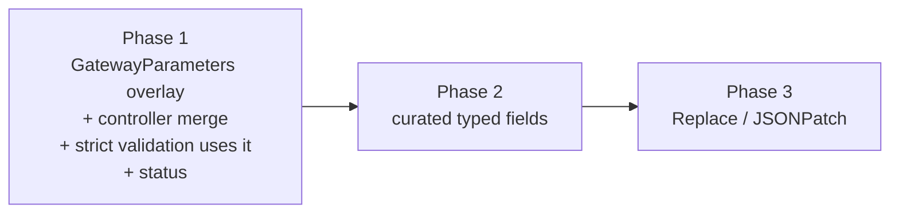
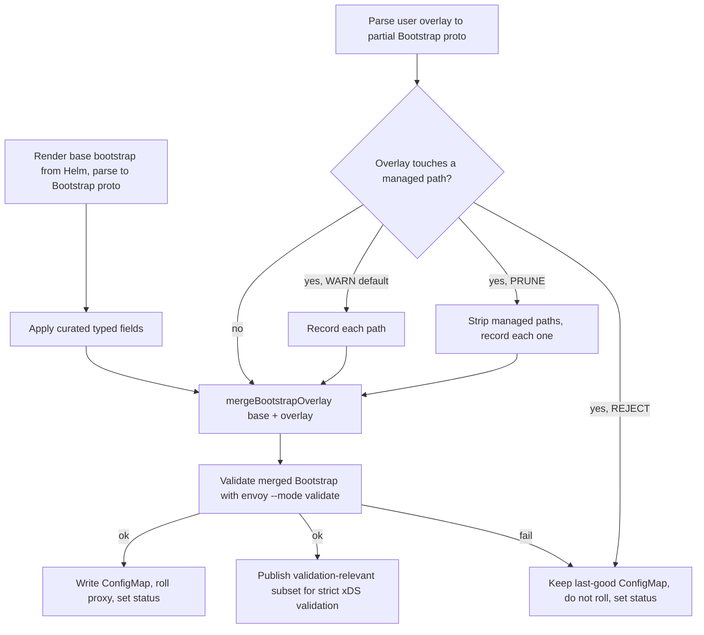

# EP-13666: Mutable Envoy bootstrap config for managed gateway proxies

- Issue: [#13666](https://github.com/kgateway-dev/kgateway/issues/13666)
- Merge function origin: [#14752](https://github.com/kgateway-dev/kgateway/pull/14752)
  (closed without merging; its code is not in the tree)
- Strict validation dependency: [#14814](https://github.com/kgateway-dev/kgateway/issues/14814)

## Background

For a managed gateway proxy, kgateway's deployer generates the Envoy bootstrap
(`envoy.yaml`) from an internal Helm template, stores it in a `ConfigMap` named
after the `Gateway`, and mounts it into the proxy `Pod` at `/etc/envoy` via a
volume named `envoy-config`. The `envoy-wrapper` (envoyinit) reads that file and
feeds it to Envoy as the whole bootstrap.

`GatewayParameters.spec.kube.envoyContainer.bootstrap` exposes only a few curated
fields today (`logLevel`, `componentLogLevels`, `logFormat`,
`dnsResolver.udpMaxQueries`, `enableReadinessProbeProxyProtocol`,
`maxDownstreamConnections`). Other bootstrap settings cannot be set through the API,
including Envoy reloadable feature flags (`envoy.reloadable_features.*`),
`stats_config.histogram_bucket_settings`
([#14088](https://github.com/kgateway-dev/kgateway/issues/14088)),
`stats_flush_interval`, extra runtime layers, alternate DNS resolver settings and
custom static clusters.

The case that motivated this issue (#13666) is reloadable feature flags. When an
Envoy upgrade changes behavior, Envoy adds a `envoy.reloadable_features.<name>` flag
so operators can turn the old behavior back on while they adapt; the flag is removed
in a later release. Those flags are set in the bootstrap (as a `layered_runtime`
layer), so today a kgateway user has no supported way to set one. The issue asks for
a generic way to change the bootstrap rather than a setting specific to reloadable
features, and this EP takes that approach.

A second case shows why the merge must happen in the controller. Envoy rejects a
regex whose compiled program size exceeds the runtime key
`re2.max_program_size.error_level` (default 100); long literal paths, such as regexes
generated from OpenAPI path templates, exceed it easily. A user can raise the limit
in the proxy's runtime, but under `validation.level: strict` the controller validates
each route against its own synthetic bootstrap, which has no `layered_runtime`
([`pkg/xds/bootstrap/builder.go`](https://github.com/kgateway-dev/kgateway/blob/851bfc9c3cf37139586e82c1c0081ff718c02799/pkg/xds/bootstrap/builder.go#L256)).
The route is dropped before it reaches a proxy that would accept it (#14814).

The current answer is a workaround: copy the generated bootstrap into a custom
`ConfigMap`, add the desired config, and repoint the `envoy-config` volume at it
using a `deploymentOverlay` (`spec.kube.deploymentOverlay`). This works, but it
forces the user to own a **complete, verbatim copy** of the generated bootstrap,
including control-plane–managed fields (`node.cluster`, `node.metadata.role`, the
`xds_cluster`, the xDS JWT credential config, `dynamic_resources`).

### Relevant sources

- Bootstrap template: `pkg/kgateway/helm/envoy/templates/configmap.yaml`
- Wrapper that loads, transforms, and re-marshals the bootstrap proto:
  `pkg/envoyinit/run.go`
- Merge function: `mergeBootstrapOverlay` in `pkg/envoyinit/overlay.go` from the
  unmerged #14752, to be added in a package the deployer can use
- API types: `api/v1alpha1/kgateway/gateway_parameters_types.go` (`EnvoyBootstrap`)
- Controller settings: `api/settings/settings.go`
- Overlay precedent (strategic merge patch with `$patch` directives):
  `api/v1alpha1/shared/overlay_types.go` (`KubernetesResourceOverlay`)

## Motivation

When kgateway changes its bootstrap template in a later version (a new xDS field, a
new static listener, a renamed cluster, a new managed filter), the user's copied
`ConfigMap` no longer matches what kgateway generates, and nothing says so. There is
no merge, no validation and no warning; the user must update their copy by hand on
every upgrade, and an outdated copy can break xDS connectivity or crash-loop the
proxy.

We want a way to change the bootstrap that:

1. lets the user write **only the settings they change**, not a full copy,
2. **continues to apply correctly when the base bootstrap changes** in a later
   version, because fields the user does not set come from the new base, and
3. is **known to the controller**, so xDS validation sees the same bootstrap the
   proxy runs.

## Goals

- **Phase 1:** provide a `GatewayParameters` API to mutate the managed proxy's Envoy
  bootstrap without copying the whole document, applied as a **structured patch
  against the Envoy `Bootstrap` proto after the base bootstrap is generated**, so the
  base can evolve across versions without breaking user config.
- **The controller knows the effective bootstrap of every Gateway it manages.**
  Strict route validation uses its validation-relevant subset, so a setting that
  changes what Envoy accepts behaves the same under `standard` and `strict` (#14814).
  Bootstrap inputs the controller does not manage (`-c`, a replacement `ConfigMap`,
  self-managed Gateways) are out of scope; validation for them uses Envoy defaults,
  as today.
- **The user's value wins, and kgateway reports when it disagrees.** A patch that
  sets a control-plane–managed field is applied and flagged on status, in events and
  in metrics. For lists, Merge semantics defines what winning means. Operators who
  want enforcement can opt into pruning or rejecting.
- Validate the merged bootstrap before rollout and report results on the `Gateway`'s
  status, rather than crash-looping Envoy.
- Satisfy [#14088](https://github.com/kgateway-dev/kgateway/issues/14088)
  (`stats_config.histogram_bucket_settings`): expressible through the overlay in
  Phase 1, and promoted to a curated, validated field in Phase 2.
- Set runtime keys, including reloadable feature flags: through an overlay
  `layered_runtime` layer in Phase 1, and through a curated `runtime` field in
  Phase 2 that takes a map of keys and leaves the layer to kgateway.

## Non-Goals

- Replacing the existing `deploymentOverlay` mechanism. It remains the way to make
  `Deployment`-level changes (volumes, sidecars, etc.); this EP is only about the
  bootstrap's content.
- Mutating dynamic (xDS-delivered) config such as listeners, routes, and clusters.
  Those are owned by the translation pipeline and configured via Gateway API and
  policy CRDs.
- Validating `-c` (see Alternatives). It merges in the proxy pod at startup, so the
  controller cannot see it; it stays documented as a way to add settings kgateway
  does not set.
- Arbitrary text/templating of the bootstrap document (see Alternatives).
- An admission webhook (see Write-time feedback).

## Implementation Details

### Design principle

Apply changes as a **proto-level patch onto the generated `Bootstrap`**, never as a
textual or whole-document replacement. This is the same layering Envoy
itself uses (`--config-path` + `--config-yaml`, which is a proto `MergeFrom`).
Because the patch targets stable proto field paths rather than line/character
positions, it keeps working when the surrounding base config changes.

### Phasing



- **Phase 1: API, controller-side merge, validation, status (the supported MVP).**
  Adds the merge function from the unmerged #14752 to the controller, plus
  managed-field reporting, merged-result validation, strict xDS validation against the merged
  bootstrap, status reporting, and automatic rollout.
- **Phase 2: curated fields.** Add a typed field when users keep writing the same
  overlay.
- **Phase 3: removal and replace strategies.** Only once a concrete need appears for
  edits that remove or replace base content.

Phase 1 merges only in the controller. envoyinit does not merge an overlay of its
own (see Alternatives for the envoyinit overlay, `OVERLAY_CONF`). Until Phase 1
ships, `-c` covers settings kgateway does not set, and full bootstrap replacement
remains the documented option for anything else.

Layer 2 of the Phase 1 API (the overlay) is strictly more general than Layer 1
(curated fields): anything a curated field does, the overlay can already express. So
we ship the overlay first and curate later.

### Phase 1: API, controller merge, guardrails

#### Configuration

Extend `EnvoyBootstrap` in `api/v1alpha1/kgateway/gateway_parameters_types.go` with
a `patches` field, structured in two layers. Phase 1 ships Layer 2 only; Layer 1
fields arrive in Phase 2.

```yaml
apiVersion: gateway.kgateway.dev/v1alpha1
kind: GatewayParameters
metadata:
  name: my-gateway
spec:
  kube:
    envoyContainer:
      bootstrap:
        patches:
          # Layer 1 (Phase 2): curated, strongly-typed fields for common cases.
          runtime:
            envoy.reloadable_features.http_reject_path_with_fragment: false
          statsConfig:
            histogramBucketSettings:
              - match: { prefix: "cluster." }
                buckets: [1, 5, 10, 25, 50, 100, 250, 500, 1000, 2500, 5000, 10000]

          # Layer 2 (Phase 1): typed proto merge for everything else.
          overlay:
            mergeStrategy: StructuredMerge   # default, and the only value in Phase 1
            value:                           # a partial envoy.config.bootstrap.v3.Bootstrap
              stats_flush_interval: 10s
              layered_runtime:
                layers:
                  - name: user_runtime
                    static_layer:
                      envoy.reloadable_features.http_reject_path_with_fragment: false
```

The `runtime` entry and the `layered_runtime` overlay set the same flag; a user
writes one or the other. The overlay form works in Phase 1; `runtime` is its Phase 2
replacement (see Phase 2).

1. **Curated typed fields** (`runtime`, `statsConfig.histogramBucketSettings`,
   `statsFlushInterval`, `dnsResolver`, ...). These give CRD validation,
   documentation, and a stable contract. `runtime` (the motivating case) and
   #14088 are the first candidates for promotion (Phase 2); until then they go
   through the overlay.
2. **A typed proto overlay** (`overlay.value`), stored with
   `+kubebuilder:pruning:PreserveUnknownFields` and parsed by the controller as a
   *partial* `envoy.config.bootstrap.v3.Bootstrap`. The API server does not validate
   under `PreserveUnknownFields`, so typos and bad types are caught by the controller
   and reported on status. Because it is keyed by proto field, it survives
   base-template changes.

#### Worked example: reloadable feature flags

The Envoy bootstrap has no field for reloadable features. A feature flag such as
`envoy.reloadable_features.<name>` is a runtime key, set through
`layered_runtime.layers[].static_layer` as shown above.

- The generated base bootstrap already defines a `layered_runtime` with a single
  layer, `admin_layer`
  ([`configmap.yaml`](https://github.com/kgateway-dev/kgateway/blob/851bfc9c3cf37139586e82c1c0081ff718c02799/pkg/kgateway/helm/envoy/templates/configmap.yaml#L47-L50)).
  It starts empty and holds the values an operator sets on a running proxy with
  `POST /runtime_modify` on the admin port, without a restart.
- `layers` is an ordered list, and for each key Envoy uses the value from the last
  layer in the list that sets it. A plain proto merge appends repeated fields, which
  would give `[admin_layer, user_runtime]`: `user_runtime` would then override
  `/runtime_modify` for every key it sets, and a live change to one of those keys
  would succeed but have no effect. The merge therefore inserts user layers
  immediately before the first `admin_layer`, giving `[user_runtime, admin_layer]`.
  The effective precedence is Envoy's compiled-in default, then the user layer, then
  `/runtime_modify`.
- Give the user layer a **distinct `name`** (e.g. `user_runtime`). Envoy rejects
  duplicate layer names (`Duplicate layer name: <name>`,
  `source/common/runtime/runtime_impl.cc`). The merge rejects them earlier with a
  clearer message, checking each overlay layer against the base layers and against
  the other overlay layers. `layered_runtime` is not a managed path.
- A flag that a later Envoy removes stops having an effect. For an
  `envoy.reloadable_features.*` or `envoy.restart_features.*` key Envoy does not
  know, set to a boolean or a number, Envoy logs `Using a removed guard <key>. In future version
  of Envoy this will be treated as invalid configuration` and otherwise ignores the
  key (`source/common/runtime/runtime_impl.cc`). Bootstrap validation runs Envoy with
  `-l critical`, which hides that log, so a stale flag passes validation today. Once
  Envoy treats it as invalid configuration, the Envoy bump makes the merged bootstrap
  fail validation and the Gateway follows the invalid-merge fallback (see Open
  Questions).
- The example flag is in the runtime feature list of Envoy v1.39.6, the version
  kgateway pins (`source/common/runtime/runtime_features.cc`). It defaults to
  `true`, under which Envoy rejects a request whose path contains a `#` fragment;
  set to `false`, Envoy strips the fragment and routes the request
  (`source/common/http/conn_manager_utility.cc`).

The layer name, the insertion point and the duplicate-name check are all things a
user has to get right to set one key. The curated `runtime` field (Phase 2) takes a
map of runtime keys and leaves the layer to kgateway.

#### Merge semantics

`StructuredMerge` is built on proto `MergeFrom`, which merges each kind of field as
follows:

| Field kind | Example | Result |
|---|---|---|
| Scalar | `cluster_manager.local_cluster_name`, `admin.address.socket_address.port_value` | The overlay's value replaces the base's. A zero value (`false`, `0`, `""`) counts as unset, so the overlay cannot reset a field to it. |
| Message | `stats_config`, `admin`, `stats_flush_interval` (a `Duration`) | Merged field by field, by these same rules. |
| `Any` | `typed_dns_resolver_config.typed_config`, the `typed_config` of a listener filter or cluster extension | The overlay's value replaces the base's whole. An `Any` holds its message as serialized bytes, so its fields are not merged. |
| `oneof` | `stats_config.stats_matcher` (`inclusion_list`, `exclusion_list` or `reject_all`) | Setting the same option merges it. Setting a different option clears the base's option. |
| Map, including `Struct` | `certificate_provider_instances`, `node.metadata` | Merged by key. An overlay entry replaces the base entry with the same key whole. |
| List | `static_resources.clusters`, `stats_sinks` | See Lists below. |

`MergeFrom` cannot remove an entry or replace a message as a whole.
`mergeStrategy` takes its value names from the existing
`KubernetesResourceOverlay` (`api/v1alpha1/shared/overlay_types.go`), but not its
code: that overlay is implemented with Kubernetes strategic merge patch
(`pkg/deployer/strategicpatch/strategicpatch.go`), which depends on
`patchStrategy`/`patchMergeKey` struct tags the Envoy `Bootstrap` proto does not
carry.

- `StructuredMerge` (default; Phase 1): `mergeBootstrapOverlay` from #14752, which is
  proto `MergeFrom` as in the table above, except for the lists described under
  Lists below.
- `Replace` (Phase 3): replace the messages and lists named by field path as a whole
  (e.g. fully define `stats_config`). See Phase 3.
- `JSONPatch` (Phase 3): RFC 6902 operations against the bootstrap, to remove
  individual entries. This is the one mode whose paths depend on the base
  bootstrap's structure, so it is discouraged and documented as such.

##### Lists

`MergeFrom` appends to every repeated field. That alone does not make the user's
value win for a list, because what a second entry means depends on how Envoy reads
that list. For some lists Envoy rejects a second entry with the same name
(`cluster manager: duplicate cluster 'xds_cluster'`,
`source/common/upstream/cluster_manager_impl.cc`), so appending can never override a
base entry: the bootstrap fails validation and the whole overlay falls back.
`StructuredMerge` therefore handles three kinds of list:

| Kind | Fields | `StructuredMerge` |
|---|---|---|
| Named entries | `static_resources.clusters`, `static_resources.listeners`, `static_resources.secrets`, `overload_manager.resource_monitors` | Merge by `name`. An overlay entry whose `name` matches a base entry replaces that entry; other overlay entries are appended. |
| Runtime layers | `layered_runtime.layers` | Overlay layers are inserted before `admin_layer`. An overlay layer whose `name` matches a base layer or another overlay layer is rejected (see the worked example). |
| Every other list | e.g. `stats_config.histogram_bucket_settings`, `stats_config.stats_tags`, `stats_sinks`, `bootstrap_extensions` | Append: the overlay's entries go after the base's. |

- **A replaced entry is replaced whole,** not merged field by field. The user writes
  the full entry, for example by copying it from the generated `ConfigMap`. A field
  that is left out is not inherited from the base entry, and a later kgateway change
  to that base entry does not reach it. A partial merge would not be more
  predictable: most of a cluster or listener sits inside `typed_config` fields,
  which `MergeFrom` replaces whole anyway, and nested lists such as filter chains
  would append.
- **Only these four fields merge by name.** Envoy requires unique names in each of
  them. Elsewhere `name` often identifies the extension type rather than the entry:
  `stats_sinks[].name` is, for example, `envoy.stat_sinks.statsd`, and two statsd
  sinks share it. Merging every list by `name` would silently drop entries there.
- **Runtime layers are not replaced by name.** Replacing would let an overlay remove
  `admin_layer`, and with it `/runtime_modify`. A layer never needs replacing to
  override a value: Envoy resolves each key separately, and a later layer wins.
- **In an appended list, the overlay does not always win.** Whether the first
  matching entry applies or every entry applies is defined per field by Envoy.
  `histogram_bucket_settings` uses the first match ("Rules are evaluated in order,
  and the first match is applied"), so a base entry that matches first wins over an
  overlay entry after it. `stats_tags` applies every entry, so both apply. The
  generated bootstrap fills only one such list,
  `stats_config.stats_matcher.*.patterns`, rendered from `kube.stats.matcher`; to
  narrow those patterns, the user edits that field. Clearing a base list so the
  overlay's entries replace it is Phase 3 (`Replace`).

Under merge by name, an overlay `xds_cluster` replaces kgateway's `xds_cluster`. It
is a managed path, so `WARN` applies it and reports it, `PRUNE` drops it, and
`REJECT` refuses the overlay (see Guardrails).

#### Pipeline

Phase 1 merges in the controller, before the bootstrap `ConfigMap` is written, so the
`ConfigMap` on the cluster is already the final config and all logic and status
reporting live in one place.



Today the deployer does not build a `Bootstrap` proto; it renders the bootstrap as
Helm text. Phase 1 adds a parse / mutate / re-marshal step, the same roundtrip
envoyinit already performs (`pkg/envoyinit/run.go`). The existing `pkg/xds/bootstrap`
`ConfigBuilder` cannot generate the base bootstrap: it builds a bootstrap only for
validating translated xDS.

#### Guardrails

##### Managed paths

The controller maintains a list of proto paths the control plane owns, all present
in the generated bootstrap (`pkg/kgateway/helm/envoy/templates/configmap.yaml`):

- `node`
- `dynamic_resources`
- `admin.address`
- `static_resources.clusters[name=xds_cluster]` (which also carries the xDS JWT
  credential injector)

Paths are matched on the **parsed proto** (field descriptors, with list entries
identified by key), never on raw YAML keys, because the proto JSON mapping accepts
both `dynamic_resources` and `dynamicResources`.

What happens to a patch that touches a managed path is an operator choice, set by a
new controller setting in `api/settings/settings.go`, modeled on `ValidationMode`:

```go
// BootstrapPatchManagedPaths determines what the controller does with a
// GatewayParameters bootstrap overlay that sets a control-plane-managed path.
// Supported values:
// - "WARN" (default): apply the overlay as written and report each managed path
//   it sets on status, in an event and in a metric.
// - "PRUNE": drop each managed path from the overlay before merging, apply the
//   rest, and report each dropped path.
// - "REJECT": apply none of the overlay and report the managed paths.
BootstrapPatchManagedPaths BootstrapPatchManagedPathsMode `split_words:"true" default:"WARN"`
```

That is `KGW_BOOTSTRAP_PATCH_MANAGED_PATHS=WARN|PRUNE|REJECT`.

**`WARN` is the default** because the user who sets a managed path usually means
it. The main reason to change the bootstrap is a security response, which often
means overriding something kgateway sets; refusing it sends users back to full
bootstrap replacement, which has no validation or status at all. kgateway makes the
override visible rather than forbidding it. A managed path set by mistake shows up
as a condition, an event and a metric. The condition reports that the
override applied, not that the proxy still works: an override can pass
`envoy --mode validate` and still cut the proxy off from the controller. For
example, `node.metadata.role` selects the proxy's xDS snapshot
([`xds/utils.go`](https://github.com/kgateway-dev/kgateway/blob/851bfc9c3cf37139586e82c1c0081ff718c02799/pkg/kgateway/xds/utils.go#L64-L79)).

On upgrade, `WARN` keeps an override applying as long as the merge still succeeds.
If kgateway N+1 starts managing a field a user set under N, the user's value still
applies and the conflict appears on status, instead of being silently dropped, so a
security-response override can survive a rollback. If N+1 adds a cluster, listener,
secret or resource monitor with the same name as one the user defined, the user's
entry replaces kgateway's (see Lists), and status reports it if the name is a
managed path. If N+1 adds a runtime layer with the same name as one the user
defined, the merge fails and the Gateway follows the invalid-merge fallback,
unrelated entries included.

`PRUNE` and `REJECT` remain for platform teams that want enforcement:

- `PRUNE` drops the managed paths and applies the rest, so an unrelated entry the
  Gateway depends on (e.g. a reloadable feature flag) still applies after an upgrade
  that adds a managed path.
- `REJECT` applies nothing, for operators who would rather have patch authors fix
  mistakes. On an upgrade that adds a managed path, the whole overlay stops applying
  to affected Gateways, which then follow the invalid-merge fallback. The docs must
  state this.

The operator (usually a platform team) owns this choice rather than the
`GatewayParameters` author, because under `PRUNE` or `REJECT` the author is the
person the setting constrains.

##### Growing the managed-path list

Under `WARN`, adding a path adds a report but does not change what applies. Under
`PRUNE` and `REJECT` it does, and under any mode a new runtime layer can collide by
name with a user layer, so each addition needs a release note. The per-path metric
(see Reporting) lets a platform team find affected Gateways *before* a version bump.

##### Validate the merged result

Run the combined `Bootstrap` through `envoy --mode validate` before rollout. A
reusable validator exists in `pkg/validator` (binary / docker / caching), but today
it is wired only into the translator (`proxy_syncer.go` ->
`NewCombinedTranslator(..., validator)`), so reusing it on the bootstrap path is new
wiring. Prefer the binary validator where the Envoy binary is available; the docker
validator is fragile in network-restricted environments. `--mode validate` builds
both the runtime and the cluster manager, so it catches duplicate layer and cluster
names.

The validator cannot be reused unchanged. Its preparation step drops
`application_log_config`
([`validator.go`](https://github.com/kgateway-dev/kgateway/blob/851bfc9c3cf37139586e82c1c0081ff718c02799/pkg/validator/validator.go#L302-L308)),
which is right for xDS validation but would let an invalid log config in an overlay
through. Bootstrap validation needs its own mode that keeps it, and that defines how
proxy-only inputs are handled: the xDS token file, and the system CA secret
envoyinit adds at startup
([`run.go`](https://github.com/kgateway-dev/kgateway/blob/851bfc9c3cf37139586e82c1c0081ff718c02799/pkg/envoyinit/run.go#L44-L67)).

##### Invalid-merge fallback

When the overlay cannot be parsed, the merged bootstrap fails validation, or
`REJECT` refuses the overlay, the controller keeps the last-good bootstrap
`ConfigMap`, does not roll the proxy, and sets status. See Open Questions for the
upgrade and first-creation cases.

#### Deployer

- The bootstrap `ConfigMap` rendering gains the pipeline above.
- No new volumes or mounts; the existing `envoy-config` volume carries the merged
  bootstrap.
- Pods roll when the pod-template checksum changes. That checksum hashes the
  Helm-rendered `envoy.yaml`
  ([`deployment.yaml`](https://github.com/kgateway-dev/kgateway/blob/851bfc9c3cf37139586e82c1c0081ff718c02799/pkg/kgateway/helm/envoy/templates/deployment.yaml#L31-L34)),
  so a merge after rendering would not roll pods on an overlay-only change. The
  checksum must be computed from the final merged bootstrap.

#### Reporting

Status goes on the **`Gateway`**, not `GatewayParameters`:
`GatewayParametersStatus` is empty today, one `GatewayParameters` can serve many
Gateways, and the merged result is per Gateway.

Add a `kgateway.dev/BootstrapPatchApplied` condition. The domain prefix keeps this
implementation-specific type from colliding with a condition type Gateway API adds
later.

The Gateway reconciler (`pkg/kgateway/controller/gw_controller.go`), which runs the
deployer, writes the condition. It already writes Gateway status: `Accepted=False`
with reason `InvalidParameters` when the deployer cannot render a Gateway's
objects. The translator also writes Gateway conditions, but it keeps condition types
it does not own (`shouldPreserveGatewayCondition` in `pkg/reports/status.go`), so it
does not remove this one.

| Status | Reason | When |
| --- | --- | --- |
| `True` | `Applied` | Whole overlay applied, no managed path set. |
| `True` | `ManagedPathsOverridden` | `WARN` applied an overlay that sets one or more managed paths. The message lists each path. |
| `True` | `PathsIgnored` | `PRUNE` dropped one or more managed paths; the rest applied. The message lists each dropped path. |
| `False` | `PathsDenied` | `REJECT` refused an overlay that touched managed paths. The message lists them. |
| `False` | `InvalidOverlay` | The overlay does not parse as a partial `Bootstrap`. |
| `False` | `ValidationFailed` | The merged bootstrap failed `envoy --mode validate`. |

`True` with `ManagedPathsOverridden` or `PathsIgnored` is deliberate: the patch did
apply, and a routine report must not read as a broken Gateway to anyone alerting on
condition status. `False` is reserved for cases where the overlay could not be
rolled out at all.

Also emit a `Warning` event for each overridden, dropped or denied path, and a
metric labeled by Gateway, namespace and path. The Gateway labels let a platform
team find the affected Gateways. A series exists only for a Gateway whose overlay
sets a managed path, so the metric has at most one series per such Gateway and
managed path. Other kgateway metrics already carry the same Gateway labels, such as
the route replacement counter in
`pkg/kgateway/translator/irtranslator/metrics.go`.

The cost of `WARN` as the default: a mistaken override of a managed path takes
effect. The condition, the event and the metric make it visible; `PRUNE` and
`REJECT` exist for operators who want it prevented.

#### Write-time feedback

Enforcement stays in the controller, which is the only place that can validate
against the *current* base bootstrap (it changes on upgrade) and run
`envoy --mode validate`. kgateway has no admission webhooks today and this EP does
not add one.

CRD `x-kubernetes-validations` (CEL) rules could reject managed paths at write time,
but under the `WARN` default they would refuse what the controller applies, and a
CRD rule cannot depend on a controller setting. This EP therefore ships none. The
mechanics are recorded for `PRUNE`/`REJECT` users, should that change: CEL sees
only the properties a `PreserveUnknownFields` object declares: a rule naming an
undeclared field fails CRD creation (`compilation failed: undefined field 'node'`),
and undeclared fields are stored but invisible to rules. So each managed path must
be declared as a schema property alongside `PreserveUnknownFields`, in both
snake_case and lowerCamelCase. Keyed list entries work too, by declaring the list
with partially typed items (`type: object`, `PreserveUnknownFields`, and a
`name: string` property):

```yaml
x-kubernetes-validations:
- rule: "!has(self.node) && !has(self.dynamic_resources) && !has(self.dynamicResources)"
  message: node and dynamic_resources are managed by kgateway
- rule: >-
    !has(self.static_resources) || !has(self.static_resources.clusters) ||
    !self.static_resources.clusters.exists(c, has(c.name) && c.name == 'xds_cluster')
  message: static cluster xds_cluster is managed by kgateway
```

This was checked against envtest API servers v1.31.0 and v1.35.0. The controller
pinned `k8s.io/apiserver` v0.35.3 at the time, whose `pkg/cel/common/schemas.go`
documents the same behavior; `main` now pins v0.37.1, which these checks predate.
Declaring properties does not prune anything: an allowed overlay round-trips with
its unknown fields intact.

### Phase 2: curated fields

When a given overlay shape recurs, promote it into a strongly-typed Layer 1 field for
CRD validation, documentation, and a stable contract. Promotion is
backward-compatible: the curated field and the overlay target the same proto path,
with the curated field applied first and the overlay layered on top. Where a curated
field renders into an `Any` or a named list entry, the overlay replaces its result
whole rather than adjusting it (see Merge semantics). For example, the existing
`dnsResolver.udpMaxQueries` renders into `typed_dns_resolver_config.typed_config`,
so an overlay that sets that `typed_config` drops `udpMaxQueries` unless it repeats
it; the same holds for the resource monitor that `maxDownstreamConnections` renders.
The candidates, in order:

1. `runtime`, for the motivating case (reloadable feature flags) and any other
   runtime key, below. The issue is the evidence for it, so it can be built
   directly after Phase 1 rather than after overlay usage accumulates.
2. `statsConfig.histogramBucketSettings`, for #14088.
3. `staticResources.clusters`, if demand warrants. It can reject collisions with
   managed cluster names up front with a clearer message.

#### `runtime`

```yaml
patches:
  runtime:
    envoy.reloadable_features.http_reject_path_with_fragment: false
    re2.max_program_size.error_level: 200
```

- **Shape.** A map from runtime key to a scalar value (boolean, number or string),
  enforced by CEL. Runtime values that are objects, such as a `FractionalPercent`
  (`numerator`/`denominator`), stay in the overlay.
- **Rendering.** kgateway renders the map into a static layer it owns,
  `kgateway_runtime`, placed first among the user layers:
  `[kgateway_runtime, <overlay layers>, admin_layer]`. An overlay layer can still
  override a `runtime` entry, matching the curated-first rule above, and
  `/runtime_modify` still overrides both. The merge rejects an overlay layer named
  `kgateway_runtime` as a duplicate.
- **Strict validation.** `kgateway_runtime` is a static `layered_runtime` layer, which
  the validation allowlist already includes (see Translator and Proxy Syncer). A
  runtime key that changes what Envoy accepts, such as the RE2 limit, takes effect in
  strict validation with no plumbing of its own. The RE2 limit is set like any other
  key, as in the example above; a typed `re2MaxProgramSize` field can follow if
  write-time checking of that key turns out to be needed.
- **Restart features.** `envoy.restart_features.*` keys work too: the layer is part
  of the bootstrap Envoy reads at startup, and a change to `runtime` rolls the pods
  like any other bootstrap change.
- **What it does not catch.** The CRD checks the shape, not the key. A misspelled or
  removed `envoy.reloadable_features.*` or `envoy.restart_features.*` key gets the
  `Using a removed guard` log described in the worked example and has no effect; any
  other unknown key is ignored without a log. This is the same as through the
  overlay. A follow-up can capture that log during bootstrap validation, which runs
  with `-l critical` today, and report the key on status. That uses the Envoy binary
  the controller already runs, so it needs no list of known keys in kgateway.

### Phase 3: removal and replace strategies

Add `Replace` and (discouraged) `JSONPatch` once a concrete need appears for edits
that remove or replace base content. `StructuredMerge` covers changes that only add
or overwrite values, which are most of them.

`Replace` takes the paths to replace in a field next to `value`:

```yaml
overlay:
  mergeStrategy: Replace
  replace:
    - stats_config.histogram_bucket_settings
  value:
    stats_config:
      histogram_bucket_settings:
        - match: { prefix: "cluster." }
          buckets: [1, 5, 10, 25, 50, 100]
```

Each listed path is cleared in the base, and then the overlay is merged as under
`StructuredMerge`. The paths go in their own field, not as `$patch: replace`
directives inside `value`, because `value` is parsed as a `Bootstrap` proto, which
has no field to hold a directive.

- **Managed paths.** A replaced path that contains a managed path counts as setting
  it. Replacing `static_resources.clusters` sets
  `static_resources.clusters[name=xds_cluster]`, so `WARN` reports it, `PRUNE` keeps
  the base `xds_cluster` and replaces the other clusters, and `REJECT` refuses the
  overlay. `JSONPatch` operations
  are checked the same way.
- **Runtime layers.** `layered_runtime.layers` cannot be replaced, because that would
  remove `admin_layer`. A user changes runtime values by adding a layer.

### Translator and Proxy Syncer

Strict validation must see the bootstrap the target proxy runs. Today it builds its
own, with a node, a cluster manager and static resources but no `layered_runtime`
([`pkg/xds/bootstrap/builder.go`](https://github.com/kgateway-dev/kgateway/blob/851bfc9c3cf37139586e82c1c0081ff718c02799/pkg/xds/bootstrap/builder.go#L256)).

- **Insertion point.** Route validation already runs per Gateway, inside
  [`ComputeRouteConfiguration`](https://github.com/kgateway-dev/kgateway/blob/851bfc9c3cf37139586e82c1c0081ff718c02799/pkg/kgateway/translator/irtranslator/route.go#L66).
  The Gateway's validation-relevant bootstrap subset must reach **every** Envoy
  validation call there: the whole-configuration and shared-settings checks
  ([`route.go`](https://github.com/kgateway-dev/kgateway/blob/851bfc9c3cf37139586e82c1c0081ff718c02799/pkg/kgateway/translator/irtranslator/route.go#L540-L565)) as well
  as the per-route checks in
  [`routeValidationScope`](https://github.com/kgateway-dev/kgateway/blob/851bfc9c3cf37139586e82c1c0081ff718c02799/pkg/kgateway/translator/irtranslator/validate.go#L279).
  If any call is missed, a route can pass the scoped check and still fail the final
  whole-configuration check under Envoy defaults.
- **Source.** Nothing in `pkg/kgateway/translator` or `proxy_syncer` reads
  `GatewayParameters` today. The translator takes the subset from the same
  per-Gateway result the deployer produces in the Pipeline above, not from a second
  resolution of `GatewayParameters`. Which bootstrap that is while pods are still
  rolling is an open question (see Open Questions).
- **An allowlist, not the whole bootstrap.** The merged bootstrap carries
  `xds_cluster`, admin and file-based SDS references that do not resolve in the
  controller pod. Start with the static `layered_runtime` layers (not `admin_layer`
  or RTDS) and `default_regex_engine`. Add a field only with a test showing it
  changes what Envoy accepts.
- **Policy and backend validation keep Envoy defaults in Phase 1.** TrafficPolicy and
  BackendConfigPolicy are validated when the policy is constructed, before any
  Gateway is known
  ([`traffic_policy_plugin.go`](https://github.com/kgateway-dev/kgateway/blob/851bfc9c3cf37139586e82c1c0081ff718c02799/pkg/kgateway/extensions2/plugins/trafficpolicy/traffic_policy_plugin.go#L312-L327));
  backend and generated-listener validation have no Gateway either. With defaults,
  these paths can reject config a proxy with a raised limit would accept, e.g. a long
  CORS wildcard origin, which becomes a regex
  ([`cors.go`](https://github.com/kgateway-dev/kgateway/blob/851bfc9c3cf37139586e82c1c0081ff718c02799/pkg/pluginsdk/policy/cors.go#L148-L165)). If a user lowers a limit
  below Envoy's default, they can also accept config the proxy rejects. The docs must
  say both. Gateway-aware policy validation is a follow-up.
- **Caching and churn.** The validator caches by a hash of the bootstrap, so Gateways
  with different subsets stop sharing entries. Bootstrap fields are never copied into
  xDS, but a change to the subset revalidates that Gateway's routes and can change
  which routes are dropped or replaced, and so change RDS. Raising a limit restores
  dropped routes; lowering it drops them.

### Test Plan

- **Merge function (tests adapted from the unmerged #14752):** unit tests for
  `mergeBootstrapOverlay` (layer placement, duplicate layer names between overlay
  and base and within the overlay, each row of the field-kind table, and each kind
  of list: a same-name entry in each of the
  four named-entry fields replaces the base entry whole, a new name is appended, and
  every other list appends); docker tests that run Envoy with a merged
  bootstrap and assert, through the admin API, the running runtime layers,
  precedence, and `/runtime_modify` still winning.
- **Phase 1 unit:** managed-path matching on the parsed proto (snake_case and
  lowerCamelCase, keyed list entries); `WARN` applies everything and records each
  managed path; `PRUNE` strips exactly the managed paths and leaves the rest;
  `REJECT` applies nothing; the settings decoder accepts only
  `WARN`/`PRUNE`/`REJECT`; each status reason; a translator status update keeps
  `kgateway.dev/BootstrapPatchApplied`.
- **Phase 1 golden:** `GatewayParameters` inputs with overlays produce the expected
  merged bootstrap; a base-bootstrap change does not change the user's settings
  (regression guard for "survives version change"); an overlay touching a managed
  path under each mode.
- **Phase 1 strict validation:** under `validation.level: strict`, a route whose
  regex exceeds the default RE2 limit is dropped without an overlay and programmed
  with one that raises `re2.max_program_size.error_level`, in both single- and
  multi-virtual-host configurations, so every validation call is covered. The same
  route on a second Gateway without the overlay is still dropped, and its status
  reports the drop only for that parent (the reporter is already per parent,
  `route.go#L178`). Lowering the limit drops the route again. `admin_layer` and
  non-allowlisted fields never reach the validation bootstrap.
- **Phase 1 bootstrap validation:** an overlay with an invalid
  `application_log_config` fails validation and is not rolled out.
- **Phase 1 rollout:** an overlay-only change changes the pod-template checksum;
  identical merged content does not; an invalid overlay keeps both the last-good
  `ConfigMap` and its checksum.
- **Phase 1 upgrade regression:** simulate a managed-path addition against a stored
  overlay that sets that path plus a runtime layer. Under `WARN` both still apply
  and status is `True`/`ManagedPathsOverridden`; under `PRUNE` the runtime layer
  still applies and status is `True`/`PathsIgnored`. Also simulate a new base
  static cluster whose name matches an overlay cluster, and assert the overlay's
  cluster replaces it; and a new base runtime layer whose name matches an overlay
  layer, under each mode, and assert the invalid-merge fallback.
- **Phase 1 e2e:** a new suite (there is no existing `/config_dump`
  `BootstrapConfigDump` assertion in the tree) that applies an overlay and asserts
  the running Envoy's bootstrap, plus a negative case for a managed path surfacing
  `ManagedPathsOverridden` (default), `PathsIgnored` (with `PRUNE`) and
  `PathsDenied` (with `REJECT`).
- **Phase 1 e2e, feature flag takes effect:** a request whose request target
  contains a `#` fragment (sent raw, since clients such as curl drop the fragment by
  default) gets a 400 from the Gateway. After an overlay sets
  `envoy.reloadable_features.http_reject_path_with_fragment: false` and the pods
  roll, the same request is routed to the backend with the fragment stripped. This
  checks the effect of the motivating case, not only that the layer is present.
- **Phase 2 `runtime`:** golden output places `kgateway_runtime` before the overlay
  layers and `admin_layer`; an overlay layer overrides a `runtime` entry for the same
  key; an overlay layer named `kgateway_runtime` is rejected; CEL rejects object
  values; the feature flag e2e case above passes with `runtime` in place of the
  overlay.

## Alternatives

- **Status quo: clone `ConfigMap` + `deploymentOverlay`.** Works today but requires a
  verbatim full copy of the generated bootstrap, which falls out of date on upgrade
  without any warning.
- **envoyinit overlay (`OVERLAY_CONF`, #14752) as Phase 0.** Revision 1's bridge:
  envoyinit merges a user file over the generated bootstrap at proxy startup, and
  the user wins. It has no status, does not roll on edits, and is invisible to
  strict validation. Once Phase 1 ships with `WARN` it adds only a way around
  validation and status, so it is dropped; its merge function moves into Phase 1.
- **`--config-yaml` via `envoyContainer.extraArgs`.** The envoyinit wrapper already
  invokes Envoy with one `--config-yaml <generated bootstrap>`; a second one collides
  (`(--config-yaml) -- Argument already set!`).
- **`-c <overlay>` (`--config-path`) via `envoyContainer.extraArgs`.** Works today
  with no code change. Envoy loads `--config-path` first and merges the wrapper's
  `--config-yaml` over it, so **kgateway's bootstrap wins every conflict** and a stale
  user file can never override a managed field. In exchange, the user cannot
  override anything kgateway sets (e.g. the admin address, or the overload manager
  rendered from `maxDownstreamConnections`), and their runtime layers and other
  repeated-field entries come first. It covers adding a
  reloadable-feature flag kgateway does not set, but not overriding one it does.
  Verified in the unmerged #14752 (`TestEnvoyExtraArgsConfigPathMergesUnderBootstrap`,
  not in the tree). It has no
  validation before rollout, no status, no rollout on edits, and is invisible to
  strict validation. It stays documented as a way to add settings kgateway does not
  set.
- **`PRUNE` as the default.** Revision 1 of this EP. Safe across an unattended
  upgrade, but it makes overriding a managed path impossible through the API, which
  sends security responses back to full replacement. Kept as an opt-in mode.
- **Always reject a patch that touches a managed path.** The original draft of this
  EP. Clearest feedback for new mistakes, but an upgrade that grows the list stops
  the user's other, unrelated entries from applying, with nobody there to notice. Kept as the `REJECT`
  mode.
- **Per-`GatewayParameters` mode switch.** Puts the choice with the patch author, the
  person `PRUNE` and `REJECT` constrain. Rejected in favor of the controller
  setting.
- **Allowlist of top-level fields** (`stats_config`, `layered_runtime`,
  `stats_flush_interval`, `typed_dns_resolver_config`, `static_resources.clusters`).
  A typed, pruned schema would let CEL rules enforce the managed paths, but it limits
  what a user can change during a security response, and controller-side
  enforcement does not need it.
- **Admission webhook.** Immediate feedback, but a new component kgateway does not
  run today, and it still cannot validate against a future base bootstrap.
- **A single opaque "full bootstrap replacement" field.** Reintroduces the
  verbatim-copy problem and the managed-field hazard inside the CRD.
- **String templating of the bootstrap.** Text-level patches depend on line and
  character positions and break when the base changes.
- **A dedicated RE2 setting with its own validator plumbing.** Fixes the RE2 case
  only; every other runtime key that changes what Envoy accepts would need the same
  plumbing again.
- **Per-regex `google_re2.max_program_size`** for the RE2 case. It travels in RDS,
  so the validator sees it without plumbing, but the field is deprecated, covers only
  regexes kgateway generates, disables the runtime warn level, and changing the limit
  rewrites every route with a regex.

## Open Questions

- **Invalid-merge fallback across an upgrade and on first creation.** "Keep last-good
  `ConfigMap`, do not roll" is well defined for an edit to an existing Gateway. After
  a kgateway upgrade, last-good was rendered by the previous version; keeping it means
  running an old bootstrap under the new control plane, and holding the `Deployment`
  too blocks that Gateway's upgrade. A new Gateway has no last-good at all. The
  alternative is failing open (roll the generated bootstrap without the overlay and
  set `False`), which proceeds but drops settings the Gateway depends on. Which
  applies in each case?

  An Envoy bump is an upgrade case of its own: once Envoy treats a removed feature
  flag as invalid configuration, every Gateway whose overlay still sets that flag
  fails validation on the bump (see the worked example).

  The same question comes up without an upgrade. If an edit makes the overlay
  invalid and the fallback holds back only the `ConfigMap`, other `GatewayParameters`
  changes (image, resources, replicas) still reach the `Deployment`, so the pods run
  a combination that was never validated together. If it holds back both, one bad
  overlay blocks every other change to that Gateway's proxy. Holding back both is
  what the Gateway reconciler does today when the deployer cannot render a Gateway's
  objects: it sets `Accepted=False` with reason `InvalidParameters` and deploys
  nothing. Should an invalid overlay follow that behavior, or hold back only the
  `ConfigMap`?
- **A static cluster with the name of a translated cluster.** Envoy does not let CDS
  update a cluster defined in the bootstrap: the CDS entry is skipped and logged
  only at debug level (`source/common/upstream/cluster_manager_impl.cc`,
  `cds_api_helper.cc`). If an overlay defines a static cluster with the same name as
  a cluster kgateway translates for a backend, routes to that backend use the
  user's static cluster, with no error. Bootstrap validation cannot detect this,
  because the translated cluster may not exist yet. It can be detected at
  translation time, when a route or backend adds the translated cluster: the
  translator compares each cluster name with the Gateway's static cluster names.
  Should Phase 1 report the collision on status (on the route, the backend or the
  Gateway), or only document kgateway's generated cluster names as reserved?
- **Which bootstrap strict validation uses while pods roll.** Envoy reads its
  bootstrap only at startup, and kgateway builds one xDS snapshot per Gateway, so
  old and new pods receive the same config during a rollout
  ([`perclient.go`](https://github.com/kgateway-dev/kgateway/blob/851bfc9c3cf37139586e82c1c0081ff718c02799/pkg/kgateway/proxy_syncer/perclient.go#L210)).
  Both directions are unsafe if validation switches at the wrong moment:
  - **Widening** (e.g. raising a limit): if validation switches as soon as the
    `ConfigMap` changes, newly accepted routes reach old pods that still have the
    old limit. They reject the whole `RouteConfiguration` and stop applying route
    changes until replaced, indefinitely if the rollout stalls.
  - **Tightening** (e.g. lowering a limit, a stricter feature flag): if validation
    switches only after the rollout, new pods start with the stricter bootstrap
    while the served config still holds a route it rejects, and they have no
    earlier config to fall back to.

  Requirement: never push config that a running or starting proxy would reject.
  Options:
  - **Switch after rollout:** validate against the previous bootstrap until every
    pod runs the new one. Safe only for widening changes; tightening needs the
    served config to satisfy the new bootstrap before new pods start, so the switch
    direction depends on the change. A stalled rollout keeps widened settings
    unusable.
  - **Validate against every running bootstrap:** from the moment the new bootstrap
    is written until the rollout completes, a route must pass under both old and new
    settings. Covers both directions, but keeps both bootstraps and validates twice.
  - **Most restrictive value:** e.g. `min(old, new)` for RE2. Simple, but only works
    for numeric limits; a feature flag can make Envoy stricter or looser.

  Each needs the translator to know which bootstraps are running (e.g. from the
  pods' checksum annotation), behavior on a failed rollout, and behavior after a
  controller restart.
- **Who wins, per overlay.** Some users want kgateway's future configuration to win
  over theirs (the `-c` semantics), so their value applies only until kgateway starts
  setting that path. A per-overlay `conflictPolicy: UserWins | KgatewayWins`, with
  conflicts reported either way, would cover it. Phase 1, or later?
