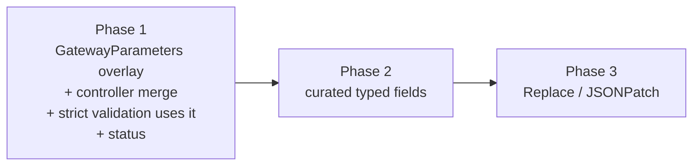
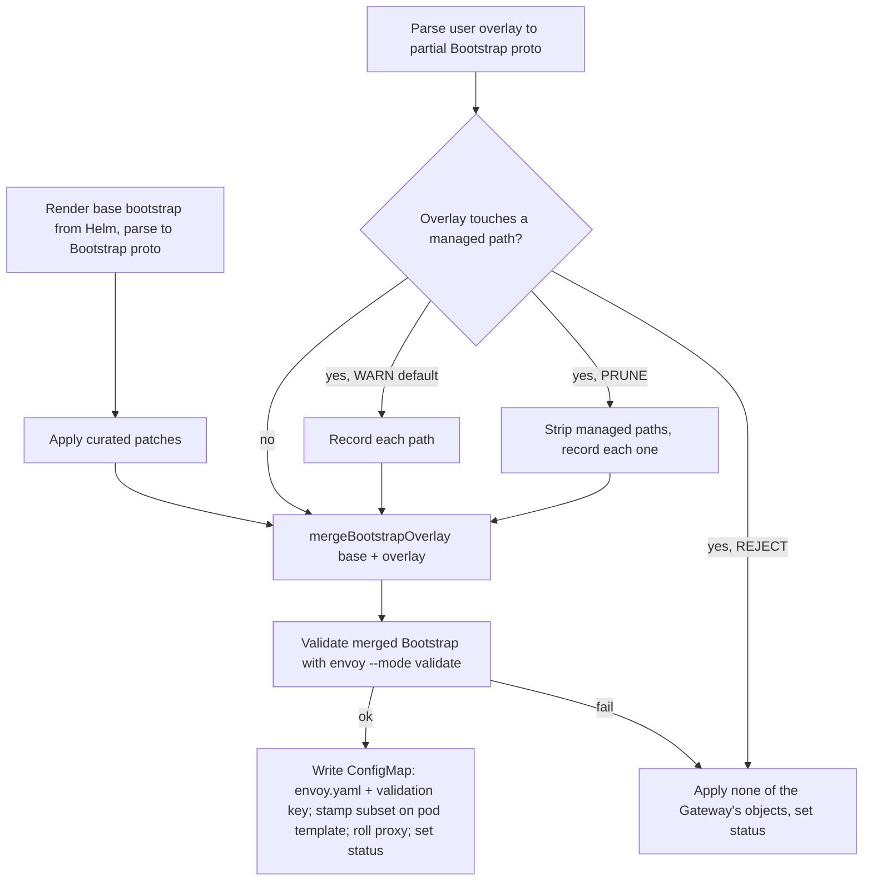

# EP-13666: Mutable Envoy bootstrap config for managed gateway proxies

- Issue: [#13666](https://github.com/kgateway-dev/kgateway/issues/13666)
- Merge function origin: [#14752](https://github.com/kgateway-dev/kgateway/pull/14752)
  (closed without merging; its code is not in the tree)
- Strict validation dependency: [#14814](https://github.com/kgateway-dev/kgateway/issues/14814)

## Background

For a managed gateway proxy, kgateway's deployer renders the Envoy bootstrap
(`envoy.yaml`) from an internal Helm template, stores it in a `ConfigMap` named
after the `Gateway`, and mounts it into the proxy `Pod` at `/etc/envoy` through the
`envoy-config` volume. The `envoy-wrapper` (envoyinit) reads that file and passes it
to Envoy as the whole bootstrap.

`GatewayParameters.spec.kube.envoyContainer.bootstrap` exposes a few curated fields
(`logLevel`, `componentLogLevels`, `logFormat`, `dnsResolver.udpMaxQueries`,
`enableReadinessProbeProxyProtocol`, `maxDownstreamConnections`). Nothing else in
the bootstrap can be set through the API: Envoy reloadable feature flags
(`envoy.reloadable_features.*`), `stats_config.histogram_bucket_settings`
([#14088](https://github.com/kgateway-dev/kgateway/issues/14088)),
`stats_flush_interval`, extra runtime layers, other DNS resolver settings, custom
static clusters.

The motivating case ([#13666](https://github.com/kgateway-dev/kgateway/issues/13666)) is reloadable feature flags. When an Envoy upgrade
changes behavior, Envoy adds an `envoy.reloadable_features.<name>` flag so operators
can restore the old behavior while they adapt, and removes the flag in a later
release. The flag is set in the bootstrap, as a `layered_runtime` layer. A user can
add one today with `-c` (see Alternatives), but the controller never sees it:
strict validation, status and rollout know nothing about it, and nothing kgateway
sets can be overridden that way. The issue asks for a generic way to change the
bootstrap rather than a setting specific to reloadable features, and this EP takes
that approach.

A second case shows why the merge must happen in the controller. Envoy rejects a
regex whose compiled program exceeds the runtime key
`re2.max_program_size.error_level` (default 100); regexes generated from long
OpenAPI path templates exceed it easily. A user can raise the limit in the proxy's
runtime, but under `validation.level: strict` the controller validates each route
against its own synthetic bootstrap, which has no `layered_runtime`
([`pkg/xds/bootstrap/builder.go`](https://github.com/kgateway-dev/kgateway/blob/851bfc9c3cf37139586e82c1c0081ff718c02799/pkg/xds/bootstrap/builder.go#L256)).
The route is dropped before it reaches a proxy that would accept it ([#14814](https://github.com/kgateway-dev/kgateway/issues/14814)).

The current workaround is to copy the generated bootstrap into a custom
`ConfigMap`, add the desired config, and repoint the `envoy-config` volume at it
with a `deploymentOverlay`. The user then owns a **complete, verbatim copy** of the
generated bootstrap, including control-plane–managed fields (`node.cluster`,
`node.metadata.role`, the `xds_cluster`, the xDS JWT credential config,
`dynamic_resources`).

### Relevant sources

- Bootstrap template: `pkg/kgateway/helm/envoy/templates/configmap.yaml`
- Wrapper that loads, transforms, and re-marshals the bootstrap proto:
  `pkg/envoyinit/run.go`
- Merge function: `mergeBootstrapOverlay` in `pkg/envoyinit/overlay.go` from the
  unmerged [#14752](https://github.com/kgateway-dev/kgateway/pull/14752) (proto `Merge` plus runtime-layer insertion), to be added in a
  package the deployer can use and extended with the list rules in Merge semantics
- API types: `api/v1alpha1/kgateway/gateway_parameters_types.go` (`EnvoyBootstrap`)
- Controller settings: `api/settings/settings.go`
- Overlay precedent (strategic merge patch with `$patch` directives):
  `api/v1alpha1/shared/overlay_types.go` (`KubernetesResourceOverlay`)

## Motivation

The workaround is fragile in exactly the way an API should not be. The moment
kgateway changes its bootstrap template in a future version — a new xDS field, a
new static listener, a renamed cluster, a new managed filter — the user's copied
`ConfigMap` silently drifts from the generated format. There is no merge, no
validation, and no warning; the user must manually re-reconcile their copy on every
upgrade, and a stale copy can break xDS connectivity or crash-loop the proxy.

We want a way to mutate the bootstrap that:

1. lets the user express **only their delta**, not a full copy,
2. **continues to apply correctly when the base bootstrap meaningfully changes**
   in a future version, because untouched fields flow through automatically, and
3. is **known to the controller**, so xDS validation sees the same bootstrap the
   proxy runs.

## Goals

- **Change the managed proxy's bootstrap through `GatewayParameters` without
  copying it.** Changes are a structured patch on the generated `Bootstrap` proto,
  so the base can change between versions without breaking them. Phase 1 ships a
  free-form overlay, Phase 2 adds curated typed fields, and Phase 3 adds removal
  and replace when a need appears.
- **The controller knows the effective bootstrap of every Gateway it manages.**
  Strict validation checks routes against it, so turning on `strict` no longer
  drops routes the proxy would accept
  ([#14814](https://github.com/kgateway-dev/kgateway/issues/14814)). Inputs the
  controller does not manage (`-c`, a replacement `ConfigMap`, self-managed
  Gateways) keep validating against Envoy defaults.
- **The user's value wins, and kgateway reports when it disagrees.** A patch that
  sets a control-plane–managed field is applied and reported on status, in events
  and in metrics. For lists, Merge semantics defines what winning means. Operators
  who want enforcement can opt into pruning or rejecting.
- **Validate the merged bootstrap before rollout,** and report failures on the
  `Gateway` instead of crash-looping Envoy.
- **Adding a curated field never breaks an existing overlay.** Curated fields are
  applied first and the overlay on top, so an overlay keeps its effect (Phase 2).
- **Cover the open requests.** Runtime keys, including reloadable feature flags
  ([#13666](https://github.com/kgateway-dev/kgateway/issues/13666)), work through
  the overlay in Phase 1. Histogram buckets
  ([#14088](https://github.com/kgateway-dev/kgateway/issues/14088)) work through
  the overlay in Phase 1 and get a curated field in Phase 2.

## Non-Goals

- Replacing the existing `deploymentOverlay` mechanism. It remains the way to make
  `Deployment`-level changes (volumes, sidecars, etc.); this EP is only about the
  bootstrap's content.
- Mutating dynamic (xDS-delivered) config such as listeners, routes, and clusters.
  Those are owned by the translation pipeline and configured via Gateway API and
  policy CRDs.
- Validating `-c` (see Alternatives). It merges in the proxy pod at startup, so the
  controller cannot see it; it stays documented as a way to add settings outside
  the controller's view.
- Arbitrary text/templating of the bootstrap document (see Alternatives).
- An admission webhook (see Write-time feedback).

## Implementation Details

### Design principle

Apply changes as a **proto-level patch onto the generated `Bootstrap`**, never as a
textual or whole-document replacement. This is the same layering Envoy itself uses
(`--config-path` + `--config-yaml`, which is a proto `MergeFrom`). Because the patch
targets stable proto field paths rather than line positions, it keeps working when
the surrounding base config changes.

### Phasing



- **Phase 1: API, controller-side merge, validation, status (the supported MVP).**
  Adds the merge function from the unmerged [#14752](https://github.com/kgateway-dev/kgateway/pull/14752) to the controller, extended
  with the list rules in Merge semantics, plus managed-path reporting, validation
  of the merged result, strict xDS validation against the merged bootstrap, status,
  and automatic rollout.
- **Phase 2: curated fields.** Add a typed field when users keep writing the same
  overlay.
- **Phase 3: removal and replace strategies.** Only once a concrete need appears for
  edits that remove or replace base content.

Phase 1 merges only in the controller; envoyinit does not merge an overlay of its
own (see Alternatives). Until Phase 1 ships, `-c` covers additions the controller
need not see, and full bootstrap replacement remains the documented option for
anything else.

The overlay can express anything a curated field can, so the overlay ships first and
fields are curated later.

### Phase 1: API, controller merge, guardrails

#### Configuration

The bootstrap API is `GatewayParameters.spec.kube.envoyContainer.bootstrap`
(`EnvoyBootstrap` in `api/v1alpha1/kgateway/gateway_parameters_types.go`). Its
existing fields are either Envoy command-line flags (`logLevel`,
`componentLogLevels`, `logFormat`) or rendered into the bootstrap by the Helm
template (`dnsResolver`, `maxDownstreamConnections`,
`enableReadinessProbeProxyProtocol`). Stats settings that render into the bootstrap
live on `spec.kube.stats` (`matcher` renders `stats_config.stats_matcher`).

This EP adds a `patches` field to `EnvoyBootstrap`. Everything under `patches` is
applied as a proto patch on top of the generated bootstrap, and its result is
reported on the `kgateway.dev/BootstrapPatchApplied` condition. Fields directly on
`bootstrap` keep being rendered by the Helm template. `patches` has two layers;
Phase 1 ships Layer 2 only.

```yaml
apiVersion: gateway.kgateway.dev/v1alpha1
kind: GatewayParameters
metadata:
  name: my-gateway
spec:
  kube:
    envoyContainer:
      bootstrap:
        dnsResolver:                           # existing field, rendered by Helm
          udpMaxQueries: 50
        patches:
          # Layer 1 (Phase 2): curated, strongly-typed patches for common cases.
          statsConfig:
            histogramBucketSettings:
              - match: { prefix: "cluster." }
                buckets: [1, 5, 10, 25, 50, 100, 250, 500, 1000, 2500, 5000, 10000]

          # Layer 2 (Phase 1): typed proto merge for everything else.
          overlay:
            mergeStrategy: StructuredMerge     # default, and the only value in Phase 1
            value:                             # a partial envoy.config.bootstrap.v3.Bootstrap
              stats_flush_interval: 10s
              layered_runtime:
                layers:
                  - name: user_runtime
                    static_layer:
                      envoy.reloadable_features.http_reject_path_with_fragment: false
```

- **Layer 2, the typed proto overlay (`overlay.value`), is what Phase 1 ships.** It
  is stored with `+kubebuilder:pruning:PreserveUnknownFields` and parsed by the
  controller as a *partial* `envoy.config.bootstrap.v3.Bootstrap`. The API server
  does not validate it, so typos and bad types are caught by the controller and
  reported on status. Because it is keyed by proto field, it survives
  base-template changes.
- **Layer 1, the curated patches (`statsConfig.histogramBucketSettings`, ...),
  comes in Phase 2.** They give CRD validation, documentation, and a stable
  contract. Each is Go code that builds a partial `Bootstrap` from the typed
  field, applied to the parsed base before the overlay (see Pipeline).
  [#14088](https://github.com/kgateway-dev/kgateway/issues/14088) is the first
  candidate for promotion; until then it goes through the overlay. The rest of
  this Phase 1 section mentions curated patches only where the overlay's behavior
  depends on them.

The existing fields stay where they are: moving or removing one is a breaking
change. So some settings can be written two ways, for example
`dnsResolver.udpMaxQueries` and `typed_dns_resolver_config`. As with
`deploymentOverlay`, the docs recommend the typed field where one exists, for its
validation, error messages and upgrade path. See Open Questions for whether
existing fields should also be offered under `patches`.

A GatewayClass (`spec.parametersRef`) and a Gateway
(`spec.infrastructure.parametersRef`) can each reference a `GatewayParameters`. Their
overlays combine the way `deploymentOverlay` and the other object overlays do today:
the GatewayClass overlay is merged onto the generated bootstrap, then the Gateway
overlay onto the result, each under the rules in Merge semantics. So:

- The Gateway's value wins a conflict with the GatewayClass's.
- In a prepended list (see Lists) the Gateway's entries come before the
  GatewayClass's, which come before the base's. In `layered_runtime.layers` the
  GatewayClass's layers come first and the Gateway's after them, before
  `admin_layer`. Either way the Gateway's value wins where order matters.
- A runtime layer name used in both overlays is rejected, because the GatewayClass
  layer is already in the base when the Gateway overlay merges. The message names
  both `GatewayParameters`.
- Each managed-path report names the `GatewayParameters` that set the path.

Curated patches are typed fields, so they combine like the existing fields: the
Gateway's are deep-merged over the GatewayClass's by `deepMergeEnvoyBootstrap`
(`pkg/deployer/merge.go`), the function that builds the merged `GatewayParameters`
the Helm values come from. That function skips `patches.overlay`.
`PostProcessObjects` reads the GatewayClass's overlay and the Gateway's overlay
separately (`resolveParametersForOverlays`), as it does for the object overlays,
and applies them in that order.

#### Worked example: reloadable feature flags

The Envoy bootstrap has no field for reloadable features. A flag such as
`envoy.reloadable_features.<name>` is a runtime key, set through
`layered_runtime.layers[].static_layer` as shown above.

- The generated bootstrap already defines a `layered_runtime` with one layer,
  `admin_layer`
  ([`configmap.yaml`](https://github.com/kgateway-dev/kgateway/blob/851bfc9c3cf37139586e82c1c0081ff718c02799/pkg/kgateway/helm/envoy/templates/configmap.yaml#L47-L50)).
  It starts empty and holds the values an operator sets on a running proxy with
  `POST /runtime_modify` on the admin port.
- For each key, Envoy uses the value from the last layer in `layers` that sets it.
  A plain proto merge appends, giving `[admin_layer, user_runtime]`, so
  `user_runtime` would override `/runtime_modify` for every key it sets. The merge
  therefore inserts user layers immediately before the first `admin_layer`. The
  effective precedence is Envoy's compiled-in default, then the user layer, then
  `/runtime_modify`.
- The user layer needs a **distinct `name`**. Envoy rejects duplicate layer names at
  startup; the merge rejects them earlier with a clearer message, checking each
  overlay layer against the base layers and the other overlay layers.
  `layered_runtime` is not a managed path.
- A flag that a later Envoy removes stops having an effect. Envoy logs
  `Using a removed guard <key>` at error level and ignores the key. Bootstrap
  validation (see Validate the merged result) collects that line and names the key
  in the condition message, so a stale flag shows up on the Envoy bump that
  removes it. Once Envoy treats a removed flag as invalid configuration, the bump
  fails validation for every Gateway whose overlay still sets it, and the Gateway
  follows the invalid-merge fallback.
- The example flag defaults to `true` in the pinned Envoy, under which Envoy rejects
  a request whose path contains a `#` fragment. Set to `false`, Envoy strips the
  fragment and routes the request.

#### Merge semantics

`StructuredMerge` is built on proto `MergeFrom`, which merges each kind of field as
follows:

| Field kind | Example | Result |
|---|---|---|
| Scalar | `cluster_manager.local_cluster_name`, `admin.address.socket_address.port_value` | The overlay's value replaces the base's. A zero value (`false`, `0`, `""`) counts as unset, so the overlay cannot reset a field to it. |
| Message | `stats_config`, `admin`, `stats_flush_interval` (a `Duration`) | Merged field by field, by these same rules. |
| `Any` | `typed_dns_resolver_config.typed_config`, the `typed_config` of a listener filter or cluster extension | The overlay's value replaces the base's whole. An `Any` holds its message as serialized bytes, so its fields are not merged. |
| `oneof` | `stats_config.stats_matcher` (`inclusion_list`, `exclusion_list` or `reject_all`) | Setting the same option merges it. Setting a different option clears the base's option. |
| Map, including `Struct` | `certificate_provider_instances`, `node.metadata` | Merged by key. An overlay entry replaces the base entry with the same key whole. |
| List | `static_resources.clusters`, `stats_sinks` | See Lists below. |

`MergeFrom` cannot remove an entry or replace a message as a whole. `mergeStrategy`
takes its value names from `KubernetesResourceOverlay`
(`api/v1alpha1/shared/overlay_types.go`) but not its implementation: that overlay
uses Kubernetes strategic merge patch, which depends on struct tags the Envoy
`Bootstrap` proto does not carry.

- `StructuredMerge` (default; Phase 1): proto `MergeFrom` as in the table, except
  for the lists described below. `mergeBootstrapOverlay` from [#14752](https://github.com/kgateway-dev/kgateway/pull/14752) provides the
  `Merge` call, the runtime-layer insertion and the duplicate check against the
  base; merge by name, prepending, and the check between overlay layers are new.
- `Replace` (Phase 3): replace the messages and lists named by field path as a whole
  (e.g. fully define `stats_config`).
- `JSONPatch` (Phase 3): RFC 6902 operations against the bootstrap, to remove
  individual entries. Its paths depend on the base bootstrap's structure, so it is
  discouraged and documented as such.

##### Lists

`MergeFrom` appends to every repeated field. For some lists Envoy rejects a second
entry with the same name (`duplicate cluster 'xds_cluster'`), so appending can never
override a base entry: the bootstrap fails validation and the whole overlay falls
back. `StructuredMerge` therefore handles three kinds of list:

| Kind | Fields | `StructuredMerge` |
|---|---|---|
| Named entries | `static_resources.clusters`, `static_resources.listeners`, `static_resources.secrets`, `overload_manager.resource_monitors` | Merge by `name`. An overlay entry whose `name` matches a base entry replaces that entry; other overlay entries are appended. |
| Runtime layers | `layered_runtime.layers` | Custom code, not `MergeFrom`. Overlay layers are inserted before `admin_layer` instead of appended. An overlay layer that reuses a base or overlay layer's `name` is rejected (see the worked example). |
| Every other list | e.g. `stats_config.histogram_bucket_settings`, `stats_config.stats_tags`, `stats_sinks`, `bootstrap_extensions` | Prepend: the overlay's entries go before the base's. |

- **A replaced entry is replaced whole,** not merged field by field. The user writes
  the full entry, for example by copying it from the generated `ConfigMap`, and a
  later kgateway change to that base entry does not reach it. A partial merge would
  be no better: most of a cluster or listener sits inside `typed_config` fields,
  which `MergeFrom` replaces whole anyway.
- **Only these four fields merge by name,** because Envoy requires unique names in
  each. Elsewhere `name` often identifies the extension type rather than the entry
  (`stats_sinks[].name` is `envoy.stat_sinks.statsd` for every statsd sink), and
  merging by `name` would silently drop entries.
- **Runtime layers are not replaced by name.** Replacing would let an overlay remove
  `admin_layer`, and with it `/runtime_modify`. A later layer already wins per key.
- **Prepending lets the overlay win in first-match lists.** In
  `histogram_bucket_settings`, Envoy uses the first entry that matches a stat, so
  an overlay entry beats a base entry for the same stat. In `stats_tags`,
  `stats_sinks` and `bootstrap_extensions` every entry applies, so order does not
  matter. `-c` gives the same order today.
- **The base rarely fills these lists.** Today it fills only the
  `stats_matcher` patterns (from `kube.stats.matcher`), where order does not
  matter. Removing a base entry waits for Phase 3 `Replace`.

Under merge by name, an overlay `xds_cluster` replaces kgateway's. It is a managed
path, so `WARN` applies and reports it, `PRUNE` drops it, and `REJECT` refuses the
overlay (see Guardrails).

#### Pipeline

Phase 1 merges in the controller, before the bootstrap `ConfigMap` is written, so
the `ConfigMap` on the cluster is the final config and all logic and status
reporting live in one place.



Today the deployer renders the bootstrap as Helm text and never builds a
`Bootstrap` proto. Phase 1 adds a parse / mutate / re-marshal step for Gateways
with `patches` set (see Deployer), the same roundtrip envoyinit already performs
(`pkg/envoyinit/run.go`). The existing
`pkg/xds/bootstrap` `ConfigBuilder` cannot generate the base bootstrap: it builds a
bootstrap only for validating translated xDS.

Parsing needs every `@type` in the base and the overlay to be registered in the
controller binary, because `protojson` resolves each `Any` through Go's global type
registry. The controller links only the packages its translation code imports,
which leaves out four types the generated bootstrap already uses
(`CaresDnsResolverConfig`, `DownstreamConnectionsConfig`, `CredentialInjector`, and
the generic injected credential), and an overlay may use any extension type. Phase 1
imports `pkg/utils/filter_types` into the controller, as envoyinit does
(`cmd/envoyinit/main.go`), which registers every go-control-plane package. That
grows the stripped controller binary by about 13 MB (150 MB to 163 MB) and leaves
no type list to maintain; the file is regenerated when go-control-plane is bumped,
as today. A `@type` the pinned Envoy does not know still fails
`envoy --mode validate` and is reported as `ValidationFailed`.

#### Guardrails

##### Managed paths

A path is managed if kgateway generates it and something outside the overlay
depends on its name or value: the controller, the proxy `Deployment`, envoyinit,
translated xDS, or another managed path. The controller keeps the list; every entry
is in the generated bootstrap (`pkg/kgateway/helm/envoy/templates/configmap.yaml`):

| Path | What depends on it |
|---|---|
| `node` | The controller selects the proxy's xDS snapshot by `node.metadata.role` ([`xds/utils.go`](https://github.com/kgateway-dev/kgateway/blob/851bfc9c3cf37139586e82c1c0081ff718c02799/pkg/kgateway/xds/utils.go#L64-L79)). envoyinit sets `node.locality`. |
| `dynamic_resources` | The proxy receives all translated config through it. |
| `admin.address` | The `Deployment`'s `preStop` hook calls `127.0.0.1:19000/healthcheck/fail`, and `admin_port_cluster` points at it. |
| `static_resources.clusters[name=xds_cluster]` | The proxy's connection to the controller, including the xDS JWT credential injector. |
| `cluster_manager.local_cluster_name`, and the static cluster with that name | The controller sends that cluster's endpoints by name (`pkg/kgateway/proxy_syncer/local_cluster.go`), and translated clusters use it for zone-aware routing. |
| `static_resources.clusters[name=admin_port_cluster]` | `readiness_listener` and `prometheus_listener` route to it. |
| `static_resources.clusters[name=gateway_proxy_sds]` (Istio integration only) | Translated listeners and clusters get Istio certificates through it (`wellknown.SdsClusterName`). |
| `static_resources.listeners[name=readiness_listener]` | The `Deployment`'s default readiness and startup probes target its port, 8082. |
| `static_resources.listeners[name=prometheus_listener]` | The pod's `prometheus.io/port: "9091"` scrape annotation targets its port. |

Two names are protected under every mode, because overriding them breaks the proxy:

- The secret name `SYSTEM_CA_CERT` is reserved; the controller rejects an overlay
  that defines it (see Changes envoyinit makes in the pod).
- `admin_layer` cannot be overridden: an overlay layer cannot share its name, and
  runtime layers are never replaced (see Lists).

Paths are matched on the **parsed proto** (field descriptors, with list entries
identified by key), never on raw YAML keys, because the proto JSON mapping accepts
both `dynamic_resources` and `dynamicResources`.

What happens to a patch that touches a managed path is an operator choice, set by a
new controller setting in `api/settings/settings.go`, modeled on `ValidationMode`:

```go
// BootstrapPatchManagedPaths determines what the controller does with a
// GatewayParameters bootstrap overlay that sets a control-plane-managed path.
// Supported values:
// - "WARN" (default): apply the overlay as written and report each managed path
//   it sets on status, in an event and in a metric.
// - "PRUNE": drop each managed path from the overlay before merging, apply the
//   rest, and report each dropped path.
// - "REJECT": apply none of the overlay and report the managed paths.
BootstrapPatchManagedPaths BootstrapPatchManagedPathsMode `split_words:"true" default:"WARN"`
```

That is `KGW_BOOTSTRAP_PATCH_MANAGED_PATHS=WARN|PRUNE|REJECT`.

**`WARN` is the default** because a user who sets a managed path usually means it.
The main reason to change the bootstrap is a security response, which often
overrides something kgateway sets; refusing it sends the user back to full
bootstrap replacement, which has no validation or status at all. So kgateway makes
the override visible instead of forbidding it. The condition reports that the
override applied, not that the proxy still works: an override can pass
`envoy --mode validate` and still break the proxy, or point it at the wrong
configuration. Changing `node.metadata.role` to another Gateway's role makes the
proxy receive that Gateway's snapshot: the xDS server authenticates the proxy's
service account token (`pkg/kgateway/setup/authn.go`) but selects the snapshot by
role alone.

That is not new exposure, and the trust model is unchanged. Any pod with a token
the controller accepts can already connect with any role, and `deploymentOverlay`
already lets a `GatewayParameters` author run arbitrary containers in the proxy
pod. Whoever can write the `GatewayParameters` a Gateway uses is trusted with that
proxy's bootstrap, as they are with its `Deployment`.

On upgrade, `WARN` keeps an override applying as long as the merge succeeds. If
kgateway N+1 starts managing a field the user set under N, the user's value still
applies and the conflict appears on status, so a security-response override
survives. If N+1 adds a cluster, listener, secret or resource monitor with the same
name as a user entry, the user's entry replaces it (see Lists), and status reports
it if the name is a managed path. If N+1 adds a runtime layer with the same name as
a user layer, the merge fails and the Gateway follows the invalid-merge fallback.

`PRUNE` and `REJECT` are for platform teams that want enforcement:

- `PRUNE` drops the managed paths and applies the rest, so an unrelated entry the
  Gateway depends on still applies after an upgrade that adds a managed path.
- `REJECT` applies nothing. On an upgrade that adds a managed path, the whole
  overlay stops applying to affected Gateways, which follow the invalid-merge
  fallback. The docs must state this.

The operator owns this choice rather than the `GatewayParameters` author, because
under `PRUNE` or `REJECT` the author is the person the setting constrains.

##### Growing the managed-path list

Under `WARN`, adding a path adds a report but does not change what applies. Under
`PRUNE` and `REJECT` it does, and under any mode a new runtime layer can collide
with a user layer's name, so each addition needs a release note. The per-path
metric (see Reporting) lets a platform team find affected Gateways before a version
bump.

##### Validate the merged result

Run the merged `Bootstrap` through `envoy --mode validate` before rollout. It builds
both the runtime and the cluster manager, so it catches duplicate layer and cluster
names. `validator.New` (`pkg/validator/factory.go`) builds a validator that runs
the Envoy binary in the controller image, optionally behind a result cache. It is
wired only into the translator today, so the bootstrap path needs new wiring. It
validates against the controller's Envoy, not the proxy's `envoyContainer.image`,
so a Gateway that overrides the proxy image is validated against a different Envoy
version than it runs.

The validator needs a bootstrap mode, which validates a copy of the merged
bootstrap prepared to match what the proxy pod runs:

- **`application_log_config`.** The xDS validator passes `--log-format %v` so that
  Envoy prints a bare message the controller can put on status, and strips
  `application_log_config` from the bootstrap
  ([`validator.go`](https://github.com/kgateway-dev/kgateway/blob/851bfc9c3cf37139586e82c1c0081ff718c02799/pkg/validator/validator.go#L302-L308))
  because Envoy refuses a bootstrap `log_format` together with that flag
  (`assertExclusiveLogFormatMethod` in `source/server/utils.cc`, which the
  validation server calls too, in `source/server/config_validation/server.cc`).
  Keeping the field with the flag would fail validation for every Gateway that
  sets `logFormat`. Bootstrap mode keeps the field and omits `--log-format` when
  the merged bootstrap sets it, so Envoy also checks the format
  (`maybeSetApplicationLogFormat`) and a bad `text_format` or `json_format` is
  caught before rollout. Envoy then prints its errors in the user's format; the
  validator takes the message from the `error initializing configuration` line, as
  the docker validator's `extractEnvoyError` already does.
- **Removed runtime guards.** For a boolean or numeric key under
  `envoy.reloadable_features.` or `envoy.restart_features.` that Envoy does not
  know, whether removed or misspelled, Envoy accepts the bootstrap and logs
  `Using a removed guard <key>. In future version of Envoy this will be treated as
  invalid configuration` at error level (`SnapshotImpl` in
  `source/common/runtime/runtime_impl.cc`; `FailOnWarnings` in
  `pkg/validator/validator.go` already matches it for the docker validator).
  Bootstrap mode runs at `-l error` instead of `-l critical` and matches those
  lines by text, so the log format does not matter. The keys go into the
  condition message and a `Warning` event. Validation still passes: the bootstrap
  works, and an Envoy bump is when the user most needs the proxy running. Other
  warnings are not collected, because a deprecated field in the base template is
  kgateway's to fix.
- **Placeholder files for file-based SDS.** Envoy's validate mode requires every
  `path_config_source` path to exist but does not read the file. On Envoy v1.40.2,
  the generated bootstrap with xDS TLS fails with
  `'/etc/envoy/xds_ca_sds.json' does not exist` when the file is missing and passes
  with an empty file there. The copy rewrites each `path_config_source` path,
  including any an overlay adds, to an empty file in a temporary directory. The
  files those SDS files point at (the projected xDS token and `ca.crt`) are never
  opened, and a static secret's `filename` is not read either.
- **`SYSTEM_CA_CERT` placeholder.** envoyinit adds this secret in the pod, so the
  copy adds the placeholder xDS validation already uses
  (`SystemCAValidationSecretPlaceholder` in `pkg/xds/bootstrap/builder.go`).
  Without it, an overlay static cluster that trusts the system CA fails with
  `Unknown static certificate validation context: SYSTEM_CA_CERT`.
- **Node.** The binary validator passes no `--service-node` (only the docker
  validator used in tests does), and the `ConfigMap` sets no `node.id`; the proxy
  gets its id from the `Deployment`'s `--service-node $(POD_NAME).$(POD_NAMESPACE)`.
  The copy sets a placeholder `node.id`, as the xDS validation builder does
  (`ConfigBuilder.Build`), since it never connects to xDS.

##### Changes envoyinit makes in the pod

The `ConfigMap` is not exactly what Envoy runs. When the proxy pod starts,
envoyinit changes the bootstrap
([`run.go`](https://github.com/kgateway-dev/kgateway/blob/851bfc9c3cf37139586e82c1c0081ff718c02799/pkg/envoyinit/run.go#L44-L67),
`internal/envoyinit/pkg/downward/transform.go`) and passes the result to Envoy with
`--config-yaml`:

- **Template pass.** envoyinit runs Go `text/template` over the whole file to fill
  in Downward API values such as `{{.PodName}}`, `{{.PodIp}}` and `{{.NodeName}}`.
  The generated bootstrap contains no templates, so only overlay content is
  affected. The controller does not know these values before the pod exists, so it
  cannot validate the text the pod runs, and a malformed template crash-loops the
  pod. The controller therefore rejects an overlay that contains `{{` anywhere,
  with reason `InvalidOverlay`, under every mode (see Open Questions).
- **System CA secret.** When the pod has an OS CA bundle, envoyinit appends a static
  secret named `SYSTEM_CA_CERT`, so an overlay secret with that name fails in the
  pod as a duplicate. The controller rejects an overlay that defines it, with
  reason `InvalidOverlay`, under every mode, rather than leaving it to show up as a
  duplicate against the validation placeholder (see Validate the merged result).
- **Node locality.** envoyinit sets `node.locality.region`, `zone` and `sub_zone`
  from the `KGATEWAY_NODE_*` environment variables or the pod's topology labels,
  overwriting each key it finds a value for. `node` is a managed path, so an overlay
  that sets `node.locality` is reported; the docs state that envoyinit overwrites
  the keys it derives.

##### Listener ports

`envoy --mode validate` does not bind ports, so it does not catch a static listener
on a port a Gateway listener also uses. On the proxy, Envoy rejects the second
listener as a duplicate address, and the controller does not see it.

Gateway listener ports come from the Gateway and its ListenerSets and are sent as
dynamic listeners over xDS; the bootstrap holds only the static listeners and the
admin address. Today the two are kept apart by constants: ports 8082
(`readiness_listener`), 9091 (`prometheus_listener`) and 19000 (admin) are reserved
(`pkg/kgateway/validate/gateway.go`), the translator rejects a Gateway or
ListenerSet listener on a reserved port, and the deployer leaves that port off the
`Service`.

An overlay can add or move a static listener, so a Gateway's reserved ports come
from its merged bootstrap instead. A port lives at a fixed set of proto paths:
`admin.address.socket_address.port_value`, and on each static listener
`address.socket_address.port_value` and
`additional_addresses[].address.socket_address.port_value`. A listener with a pipe
or internal address has no port and is skipped. The deployer reads those paths from
the merged proto when it builds the `Service` and writes the set into the
`ConfigMap`'s validation key (see Deployer), which the translator reads (see
Translator and Proxy Syncer); the ports are not added to the validation bootstrap.
Until the key exists, the translator uses the constant ports; a Gateway without
`patches` never has the key. A static listener an overlay adds on a Gateway
listener's port is caught on the first translation after the key is written.

The existing behavior then applies to the collected set. The translator rejects a
Gateway or ListenerSet listener on a reserved port with the existing status. The
deployer, which already has the Gateway's listener ports (`GatewayForDeployer` in
`pkg/krtcollections/policy.go`, recomputed when a ListenerSet changes), leaves the
port off the `Service` and lists each colliding port in the
`kgateway.dev/BootstrapPatchApplied` message. A collision does not reject the
overlay, so a ListenerSet added later cannot make a working overlay fall back.

##### Invalid-merge fallback

When the overlay cannot be parsed, the merged bootstrap fails validation, or
`REJECT` refuses the overlay, the deployer applies none of the Gateway's objects:
the `ConfigMap`, `Deployment`, `Service` and the rest stay as they are, as they do
today when the deployer cannot render a Gateway's objects. The controller never
rolls out the generated bootstrap without the overlay, because that would silently
remove settings the user depends on, often a security-response override.

- **Existing Gateway.** The proxy keeps running its last-good bootstrap and
  receiving xDS. Other `GatewayParameters` changes (image, resources, replicas)
  wait until the overlay is fixed, so the pods never run a combination that was
  not validated together.
- **New Gateway.** No proxy is deployed until the overlay is fixed. Nothing is
  serving, so the reconciler also sets `Accepted=False` with reason
  `InvalidParameters`, as it does today for any objects it cannot render. Without
  that, the translator's defaults would report `Accepted=True` and
  `Programmed=True` for a Gateway with no `Deployment`.
- **kgateway upgrade or Envoy bump.** The previous version's `Deployment` keeps
  running under the new control plane, as every proxy does while an upgrade rolls
  out. The condition and the metric identify these Gateways, and the upgrade docs
  say to check for them. This includes an Envoy bump that makes a removed feature
  flag invalid configuration.

The reconciler tells an existing Gateway from a new one by whether its generated
`ConfigMap` exists; it already has a `ConfigMap` client. For an existing Gateway
it sets `kgateway.dev/BootstrapPatchApplied=False` and leaves `Accepted` alone.
Today's error path sets `Accepted=False` with reason `InvalidParameters`, and
while that is set the translator stops reporting `Accepted=True`
(`gatewayConditionsWithDefaults` in `pkg/reports/status.go`), so a Gateway still
serving its last-good config would read as not accepted. The deployer returns a
distinct error for an invalid patch, which the reconciler handles in its own
branch, as it already does for `ErrNoValidPorts`.

#### Deployer

- **Where the pipeline runs.** In `PostProcessObjects`
  (`pkg/kgateway/deployer/gateway_parameters.go`), after Helm renders the
  Gateway's objects and before `deploymentOverlay`, `serviceOverlay` and
  `serviceAccountOverlay` are applied, so an object overlay can still change
  anything in the `Deployment`.
- **Only Gateways with `patches` set.** A Gateway whose resolved
  `GatewayParameters` have no `patches` keeps the Helm-rendered `envoy.yaml` byte
  for byte, and gets no validation key and no pod-template annotation. It is not
  parsed, merged, validated or re-marshalled, so upgrading to a version with this
  feature does not roll its pods.
- **Output format.** The merged bootstrap is marshalled with `protojson` using proto
  field names (`UseProtoNames: true`) and converted to YAML with sorted keys
  (`sigs.k8s.io/yaml`), so the `ConfigMap` keeps the snake_case of the template and
  the Envoy docs. `protoutils.MarshalBytes` emits lowerCamelCase and is not used
  here. Users copy entries from this `ConfigMap` to replace them, so it stays
  readable. The conversion also removes `protojson`'s whitespace, which the
  protobuf library varies between builds on purpose, so identical content keeps
  the same checksum across controller versions.
- **Validation key and pod annotation.** Next to `envoy.yaml`, the `ConfigMap` gets
  a `validation.json` key: the allowlisted subset of the merged bootstrap (see
  Translator and Proxy Syncer) as a partial `Bootstrap` in proto JSON, plus the
  reserved ports. The same subset goes on the pod template as the
  `kgateway.dev/validation-bootstrap` annotation, so every proxy pod carries the
  subset of the bootstrap it started with. A subset change always changes
  `envoy.yaml`, so the annotation never rolls pods on its own. A static layer is
  small; the deployer rejects a subset over 64 KiB with `InvalidOverlay` rather
  than approach the annotation size limit.
- No new volumes or mounts; the existing `envoy-config` volume carries the merged
  bootstrap. After applying the object overlays, the deployer checks that this
  volume still mounts the generated `ConfigMap`. If an overlay points it at another
  `ConfigMap` (the full-replacement workaround), the patches never reach the proxy,
  and the condition says so (`BootstrapNotMounted`).
- Pods roll when the pod-template checksum changes. Today the Helm template
  computes it from the rendered `envoy.yaml`
  ([`deployment.yaml`](https://github.com/kgateway-dev/kgateway/blob/851bfc9c3cf37139586e82c1c0081ff718c02799/pkg/kgateway/helm/envoy/templates/deployment.yaml#L31-L34)).
  The deployer computes it in Go from the final `envoy.yaml` instead, for every
  Gateway, so an overlay-only change rolls the pods. For a Gateway without
  `patches` the value does not change: Helm's `sha256sum` is the hex SHA-256 of the
  same bytes.

#### Reporting

Status goes on the **`Gateway`**, not `GatewayParameters`: `GatewayParametersStatus`
is empty today, one `GatewayParameters` can serve many Gateways, and the merged
result is per Gateway.

Add a `kgateway.dev/BootstrapPatchApplied` condition. The domain prefix keeps this
implementation-specific type from colliding with a type Gateway API adds later.

The Gateway reconciler (`pkg/kgateway/controller/gw_controller.go`), which runs the
deployer, writes the condition. It already writes `Accepted=False` with reason
`InvalidParameters` when the deployer cannot render a Gateway's objects. The
translator also writes Gateway conditions but preserves types it does not own
(`shouldPreserveGatewayCondition` in `pkg/reports/status.go`).

| Status | Reason | When |
| --- | --- | --- |
| `True` | `Applied` | Whole overlay applied, no managed path set. |
| `True` | `ManagedPathsOverridden` | `WARN` applied an overlay that sets one or more managed paths. The message lists each path. |
| `True` | `PathsIgnored` | `PRUNE` dropped one or more managed paths; the rest applied. The message lists each dropped path. |
| `False` | `PathsDenied` | `REJECT` refused an overlay that touched managed paths. The message lists them. |
| `False` | `InvalidOverlay` | The overlay does not parse as a partial `Bootstrap`, contains `{{`, or defines a reserved name. |
| `False` | `ValidationFailed` | The merged bootstrap failed `envoy --mode validate`. |
| `False` | `BootstrapNotMounted` | An object overlay points the `envoy-config` volume at a `ConfigMap` other than the generated one, so the proxy does not run the patched bootstrap. |

`True` with `ManagedPathsOverridden` or `PathsIgnored` is deliberate: the patch did
apply, and a routine report must not read as a broken Gateway to anyone alerting on
condition status. `False` means the patches are not in effect on the proxy.

**Overrides of curated fields.** Curated fields are applied before the overlay, so
an overlay can replace their output. That output is the user's own configuration,
not a managed path, so the mode does not apply. But the replacement can drop a
value the user did not mean to change: `dnsResolver.udpMaxQueries` (default 100)
renders into `typed_dns_resolver_config.typed_config`, an `Any`, so an overlay that
sets another c-ares option there replaces the whole `Any` and drops the cap. For a
curated patch under `patches`, the controller compares the overlay's paths with the
patch it built. For the existing Helm-rendered fields, it keeps a list of the paths
each one renders:

| Curated field | Renders into |
|---|---|
| `dnsResolver` | `typed_dns_resolver_config` |
| `maxDownstreamConnections` | `overload_manager.resource_monitors[name=envoy.resource_monitors.global_downstream_max_connections]` |
| `stats.matcher` | `stats_config.stats_matcher` |

When the overlay replaces one of them, or switches the `oneof` option it set, the
condition message names the curated field and the overlay path. The status and
reason do not change. Curated fields that render onto managed paths
(`enableReadinessProbeProxyProtocol` onto `readiness_listener`, `stats.enabled` onto
`prometheus_listener`) are already reported as managed paths.

Also emit a `Warning` event for each overridden, dropped or denied path, and a
metric labeled by Gateway, namespace and path, so a platform team can find the
affected Gateways. The reconciler has no event recorder today; Phase 1 wires a
`record.EventRecorder` into it. The metric has a series only for a Gateway whose
overlay sets a managed path, so its cardinality is bounded by the number of such
Gateways. Other kgateway metrics already carry the same Gateway labels, such as
the route replacement counter in
`pkg/kgateway/translator/irtranslator/metrics.go`.

#### Write-time feedback

Enforcement stays in the controller, the only place that can validate against the
*current* base bootstrap and run `envoy --mode validate`. kgateway has no admission
webhooks today and this EP does not add one.

CRD `x-kubernetes-validations` (CEL) rules could reject managed paths at write time,
but under the `WARN` default they would refuse what the controller applies, and a
CRD rule cannot depend on a controller setting. This EP ships none. If that changes
for `PRUNE`/`REJECT` users, the mechanics are known. CEL sees only the properties
a `PreserveUnknownFields` object declares, so each managed path must be declared
as a schema property in both snake_case and lowerCamelCase, and a keyed list needs
partially typed items with a `name` property. Declaring properties does not
prune: an allowed overlay round-trips with its unknown fields intact. This was
verified against envtest.

### Phase 2: curated fields

When an overlay shape recurs, promote it to a curated patch under `patches`. Each
curated patch needs:

- the API field, with CEL rules for its shape;
- the function that builds its partial `Bootstrap`, with unit and golden tests;
- a CEL rule rejecting `{{` in its string values, because the merged bootstrap goes
  through envoyinit's template pass like the overlay does.

Promotion is backward-compatible: the curated patch and the overlay target the same
proto path, with the curated patch applied first and the overlay merged on top.
In a prepended list the overlay's entries precede the curated ones, as they
precede the base's. Because the controller holds each curated patch as a proto,
it can report an overlay that replaces the patch's output without a hand-kept
path list (see Reporting).

The candidates, in order:

1. `patches.statsConfig.histogramBucketSettings`, for [#14088](https://github.com/kgateway-dev/kgateway/issues/14088). Envoy applies the
   first matching entry, and overlay entries precede curated ones (see Lists), so
   an overlay entry wins over a curated entry matching the same stat, as the
   overlay-on-top rule requires.
2. The RE2 program size limit (`re2MaxProgramSize.errorLevel` and `warnLevel`,
   rendered into kgateway's runtime layer). Through the overlay, a misspelled
   runtime key is silently ignored by Envoy and the limit stays at 100; a typed
   field is checked at write time and is discoverable in the API reference. It
   needs no plumbing of its own: it renders into the merged bootstrap, which strict
   validation already reads.

A curated `staticResources.clusters` field, if demand warrants, can reject
collisions with managed cluster names up front with a clearer message.

Settings that extend an existing Helm-rendered field, such as more c-ares options
next to `dnsResolver.udpMaxQueries`, are added when a use case comes up. Where they
go is part of the open question on existing fields.

### Phase 3: removal and replace strategies

Add `Replace` and (discouraged) `JSONPatch` once a concrete need appears.
`StructuredMerge` covers changes that only add or overwrite values, which are most
of them.

`Replace` lists the paths to replace next to `value`:

```yaml
overlay:
  mergeStrategy: Replace
  replace:
    - stats_config.histogram_bucket_settings
  value:
    stats_config:
      histogram_bucket_settings:
        - match: { prefix: "cluster." }
          buckets: [1, 5, 10, 25, 50, 100]
```

Each listed path is cleared in the base, and then the overlay is merged as under
`StructuredMerge`. The paths are a separate field rather than `$patch: replace`
directives inside `value`, because `value` is parsed as a `Bootstrap` proto, which
has no field for a directive.

- **Managed paths.** A replaced path that contains a managed path counts as setting
  it. Replacing `static_resources.clusters` sets
  `static_resources.clusters[name=xds_cluster]`, so `WARN` reports it, `PRUNE` keeps
  the base `xds_cluster` and replaces the other clusters, and `REJECT` refuses the
  overlay. `JSONPatch` operations are checked the same way.
- **Runtime layers.** `layered_runtime.layers` cannot be replaced, because that
  would remove `admin_layer`. A user changes runtime values by adding a layer.

### Translator and Proxy Syncer

Strict validation must see the bootstrap the target proxy runs. Today it builds its
own, with a node, a cluster manager and static resources but no `layered_runtime`
([`pkg/xds/bootstrap/builder.go`](https://github.com/kgateway-dev/kgateway/blob/851bfc9c3cf37139586e82c1c0081ff718c02799/pkg/xds/bootstrap/builder.go#L256)).

- **Insertion point.** Route validation runs per Gateway, inside
  [`ComputeRouteConfiguration`](https://github.com/kgateway-dev/kgateway/blob/851bfc9c3cf37139586e82c1c0081ff718c02799/pkg/kgateway/translator/irtranslator/route.go#L66).
  The Gateway's bootstrap subset must reach **every** Envoy validation call there:
  the whole-configuration and shared-settings checks
  ([`route.go`](https://github.com/kgateway-dev/kgateway/blob/851bfc9c3cf37139586e82c1c0081ff718c02799/pkg/kgateway/translator/irtranslator/route.go#L540-L565))
  and the per-route checks in
  [`routeValidationScope`](https://github.com/kgateway-dev/kgateway/blob/851bfc9c3cf37139586e82c1c0081ff718c02799/pkg/kgateway/translator/irtranslator/validate.go#L279).
  If any call is missed, a route can pass the scoped check and still fail the final
  whole-configuration check under Envoy defaults.
- **Source.** The deployer writes the allowlisted subset and the reserved ports
  into the Gateway's generated bootstrap `ConfigMap` (named after the Gateway and
  owned by it) as a `validation.json` key, and the same subset onto the pod
  template as the `kgateway.dev/validation-bootstrap` annotation (see Deployer).
  The translator reads the key through the `ConfigMap` collection the plugin SDK
  already builds (`pkg/pluginsdk/collections/collections.go`) and the annotation
  through the wrapped pod collection there (`WrappedPods`, which keeps
  annotations), selecting a Gateway's pods by the
  `gateway.networking.k8s.io/gateway-name` label in its namespace. From them it
  builds a per-Gateway KRT collection holding the current subset, the distinct
  subsets carried by pods that are not terminal, and the reserved ports. It does
  not resolve `GatewayParameters` a second time and does not parse `envoy.yaml`,
  so it needs none of the Envoy types an overlay uses. Its `Equals` compares the
  strings, so a pod becoming Ready, or a `ConfigMap` change outside the key, does
  not revalidate the Gateway's routes. Because the key is written together with
  `envoy.yaml`:
  - an invalid overlay leaves both unchanged, and validation keeps using the
    last-good subset;
  - it survives a controller restart with no state to rebuild.
- **Every running bootstrap must accept the config.** Envoy reads its bootstrap
  only at startup, and kgateway builds one xDS snapshot per Gateway, so old and
  new pods receive the same config while a rollout is in progress
  ([`perclient.go`](https://github.com/kgateway-dev/kgateway/blob/851bfc9c3cf37139586e82c1c0081ff718c02799/pkg/kgateway/proxy_syncer/perclient.go#L210)).
  So a route must pass under the current subset and under every subset a running
  pod carries. A pod without the annotation counts as Envoy defaults.
  - **Raising a limit** restores a dropped route only after the last old pod is
    gone. An old pod would reject the whole `RouteConfiguration` and stop taking
    route updates. A stalled rollout delays the change until it completes or is
    rolled back.
  - **Lowering a limit** drops the route before the first new pod starts. A new
    pod would otherwise start with no routes while its readiness listener reports
    Ready.
  - When a route fails only under an old pod's subset, its status names that pod.
  - Each distinct subset costs one cached Envoy run: two during a rollout, one
    otherwise.
- **An allowlist, not the whole bootstrap.** The merged bootstrap carries
  `xds_cluster`, admin and file-based SDS references that do not resolve in the
  controller pod. The allowlist is the static `layered_runtime` layers (not
  `admin_layer` or RTDS). Add a field only with a test showing it changes what
  Envoy accepts.
- **Policy and backend validation keep Envoy defaults in Phase 1.** TrafficPolicy
  and BackendConfigPolicy are validated when the policy is constructed, before any
  Gateway is known
  ([`traffic_policy_plugin.go`](https://github.com/kgateway-dev/kgateway/blob/851bfc9c3cf37139586e82c1c0081ff718c02799/pkg/kgateway/extensions2/plugins/trafficpolicy/traffic_policy_plugin.go#L312-L327));
  backend and generated-listener validation have no Gateway either. With defaults,
  these paths can reject config a proxy with a raised limit would accept, such as a
  long CORS wildcard origin, which becomes a regex
  ([`cors.go`](https://github.com/kgateway-dev/kgateway/blob/851bfc9c3cf37139586e82c1c0081ff718c02799/pkg/pluginsdk/policy/cors.go#L148-L165)),
  and can accept config a proxy with a lowered limit rejects. The docs must say
  both. Gateway-aware policy validation is a follow-up.
- **Caching and churn.** The validator caches by a hash of the bootstrap, so
  Gateways with different subsets stop sharing entries. A change to the subset
  revalidates that Gateway's routes and can change which are dropped or replaced,
  and so change RDS: raising a limit restores dropped routes; lowering it drops
  them.

### Test Plan

- **Merge function** (tests adapted from the unmerged [#14752](https://github.com/kgateway-dev/kgateway/pull/14752)): unit tests for each
  row of the field-kind table and each kind of list, layer placement, and duplicate
  layer names. Docker tests that run Envoy with a merged bootstrap and check,
  through the admin API, the runtime layers, their precedence, and that
  `/runtime_modify` still wins.
- **Guardrails:** managed-path matching on the parsed proto (both casings, keyed
  list entries); each mode applies, prunes or rejects as specified, with the right
  status reason; the settings decoder accepts only the three values; an overlay
  containing `{{` or defining `SYSTEM_CA_CERT` is rejected under every mode; an
  overlay that replaces a curated field's output applies under every mode and is
  named in the condition message; a translator status update keeps
  `kgateway.dev/BootstrapPatchApplied`.
- **Parsing:** the generated bootstrap parses in the controller with every option
  that adds a `@type` turned on; an overlay `@type` the pinned Envoy does not know
  fails `envoy --mode validate` with `ValidationFailed`.
- **Golden:** overlays produce the expected merged bootstrap; a base-bootstrap
  change leaves the user's settings in place; a managed-path overlay under each
  mode; a prepended list orders Gateway, GatewayClass, then base entries, and
  runtime layers order GatewayClass, Gateway, then `admin_layer`.
- **Reserved ports:** a static listener on a Gateway or ListenerSet listener's port
  leaves the overlay applied, rejects that listener, and leaves the port off the
  `Service`.
- **Strict validation:** a route whose regex exceeds the default RE2 limit is
  dropped without an overlay and programmed with one that raises the limit, in
  single- and multi-virtual-host configurations so every validation call is
  covered; the same route on a second Gateway without the overlay is still dropped,
  with status for that parent only; lowering the limit drops it again;
  `admin_layer` and non-allowlisted fields never reach the validation bootstrap;
  while a pod still carries an older subset, a route the current subset accepts
  but the older one rejects stays dropped, with the pod named in its status, and
  is programmed once that pod is gone; a route a newer subset rejects is dropped
  as soon as the `ConfigMap` changes, before any new pod exists; a pod without
  the annotation counts as Envoy defaults.
- **GatewayClass and Gateway:** both overlays apply in order and the Gateway's
  value wins; a runtime layer name used in both is rejected, naming both
  `GatewayParameters`; a managed-path report names the `GatewayParameters` that set
  it.
- **Bootstrap validation:** the generated bootstrap with xDS TLS enabled passes
  the real Envoy validation in bootstrap mode, so an Envoy version that starts
  reading the placeholder files fails this test; an overlay static cluster that
  trusts `SYSTEM_CA_CERT` passes; a Gateway with `logFormat` set passes, and an
  invalid `text_format` fails and is not rolled out; a removed runtime guard
  passes and is named in the condition message.
- **Rollout and fallback:** an overlay-only change changes the pod-template
  checksum, identical merged content does not, and a Gateway without `patches`
  keeps today's `envoy.yaml`, checksum and `ConfigMap` keys; an invalid overlay
  leaves every object of an existing Gateway unchanged (including a `Deployment`
  change in the same edit), sets `BootstrapPatchApplied=False` and leaves
  `Accepted` unchanged, while a new Gateway also gets `Accepted=False` with
  `InvalidParameters`; an object overlay that repoints the `envoy-config` volume
  gives `BootstrapNotMounted`.
- **Upgrade regression:** a managed-path addition against a stored overlay that
  sets that path plus a runtime layer, under each mode; a new base static cluster
  with an overlay cluster's name (the overlay's replaces it); a new base runtime
  layer with an overlay layer's name (invalid-merge fallback).
- **E2E:** a suite that applies an overlay and asserts the running Envoy's
  bootstrap through `/config_dump`, with a managed-path case per mode; and the
  motivating case end to end: a raw request with a `#` fragment gets a 400, and
  after the overlay sets `http_reject_path_with_fragment: false` and the pods roll,
  it reaches the backend with the fragment stripped.

## Alternatives

- **Merge in envoyinit at proxy startup** (`OVERLAY_CONF`, [#14752](https://github.com/kgateway-dev/kgateway/pull/14752)). The user wins,
  but the controller never sees the result: no validation before rollout, no
  status, no rollout on edits, and strict validation keeps using Envoy defaults.
  Its merge function moves into the controller instead.
- **`-c <overlay>` via `envoyContainer.extraArgs`.** Works today with no code
  change. Envoy loads `--config-path` first and merges the wrapper's
  `--config-yaml` over it with proto `MergeFrom`
  (`InstanceUtil::loadBootstrapConfig` in `source/server/server.cc`). For a scalar
  or message field kgateway's value wins, so the user cannot override anything
  kgateway sets. List entries from the `-c` file precede kgateway's, so a runtime
  layer lands before `admin_layer`, the precedence this EP wants, and the
  motivating feature flag already works this way. What `-c` lacks is
  controller visibility: no validation before rollout, no status, no rollout on
  edits, and strict validation keeps using Envoy defaults. It stays documented as
  a way to add settings outside the controller's view.
- **`PRUNE` or `REJECT` as the default, or a per-`GatewayParameters` mode.** Either
  default makes overriding a managed path impossible through the API, which sends
  security responses back to full replacement; `REJECT` also silently stops an
  overlay applying when an upgrade grows the managed-path list. Both are kept as
  opt-in modes. The mode is a controller setting rather than a field on
  `GatewayParameters` because the patch author is the person it constrains.
- **A typed allowlist of top-level fields** instead of a free-form overlay. A
  pruned schema would let CEL rules enforce the managed paths, but it limits what a
  user can change during a security response, and controller-side enforcement does
  not need it.
- **A single opaque full-bootstrap field.** Reintroduces the verbatim-copy problem
  inside the CRD.
- **String templating of the bootstrap.** Text-level patches depend on line and
  character positions and break when the base changes.

## Open Questions

- **Existing fields and `patches`.** Curated fields now live in two places:
  existing ones directly on `bootstrap` (rendered by Helm) and new ones under
  `patches` (applied as proto patches). Existing fields stay supported either way;
  removing one is a breaking change. Options:
  - Keep growing existing fields in place, such as `dnsResolver` with more c-ares
    options, and re-implement them as proto patches later without moving them.
  - Deprecate the existing Helm-rendered fields, keep them working, and add their
    replacements and any expansions as curated patches under `patches`. A CEL rule
    rejects setting both an old field and its replacement, so a value is never
    defined twice, and every new curated field is applied and reported the same
    way.
- **Templates in an overlay.** The controller rejects an overlay that contains `{{`
  (see Changes envoyinit makes in the pod), which also rejects a string that needs
  `{{` literally. The alternative is to support templates: the controller fills in
  the values it knows before the pod exists (`PodNamespace`, `PodSvcAccount`),
  validates with placeholders for per-pod values (`PodName`, `PodIp`, `NodeName`),
  and checks that the template parses. Does any user need a per-pod value in the
  bootstrap, such as the pod name in a stats tag, or is rejecting `{{` enough?
- **Which paths are managed.** The rule in Managed paths gives nine entries. Under
  `WARN` an entry only adds a report, but under `PRUNE` and `REJECT` it decides what
  applies: a user who replaces `readiness_listener` to add a listener filter loses
  that change under `PRUNE`. Is the rule right, and is any entry too broad? For
  example, `node` covers `node.locality`, which a user may want to set when the
  pod's topology labels are missing.
- **A static cluster with the name of a translated cluster.** Envoy does not let
  CDS update a cluster defined in the bootstrap: the CDS entry is skipped and
  logged only at debug level. If an overlay defines a static cluster with the same
  name as a cluster kgateway translates for a backend, routes to that backend use
  the user's static cluster, with no error. Bootstrap validation cannot detect
  this, because the translated cluster may not exist yet. The translator can detect
  it when a route or backend adds the translated cluster, by comparing the name
  with the Gateway's static cluster names. Should Phase 1 report the collision on
  status (on the route, the backend or the Gateway), or only document kgateway's
  generated cluster names as reserved?
- **Who wins, per overlay.** Some users want kgateway's future configuration to win
  over theirs (the `-c` semantics), so their value applies only until kgateway
  starts setting that path. A per-overlay `conflictPolicy: UserWins | KgatewayWins`,
  with conflicts reported either way, would cover it. Phase 1, or later?
- **`default_regex_engine` in translator validation.** The validation subset leaves
  out `default_regex_engine`. The only engine the proxy's Envoy can load,
  `GoogleRE2`, has no fields, so setting it changes nothing Envoy accepts; the RE2
  program-size limit is the runtime key `re2.max_program_size.error_level`, which
  the static layers already carry. The other engine type the controller links,
  the contrib `Hyperscan`, is not built into the proxy image, so an overlay that
  selects it fails bootstrap validation. Should tests guard this choice, so the
  field joins the subset once it can change what Envoy accepts? Candidates: a test
  that fails when `GoogleRE2` gains a field, and a test that fails when the
  pinned Envoy starts accepting `Hyperscan`.
