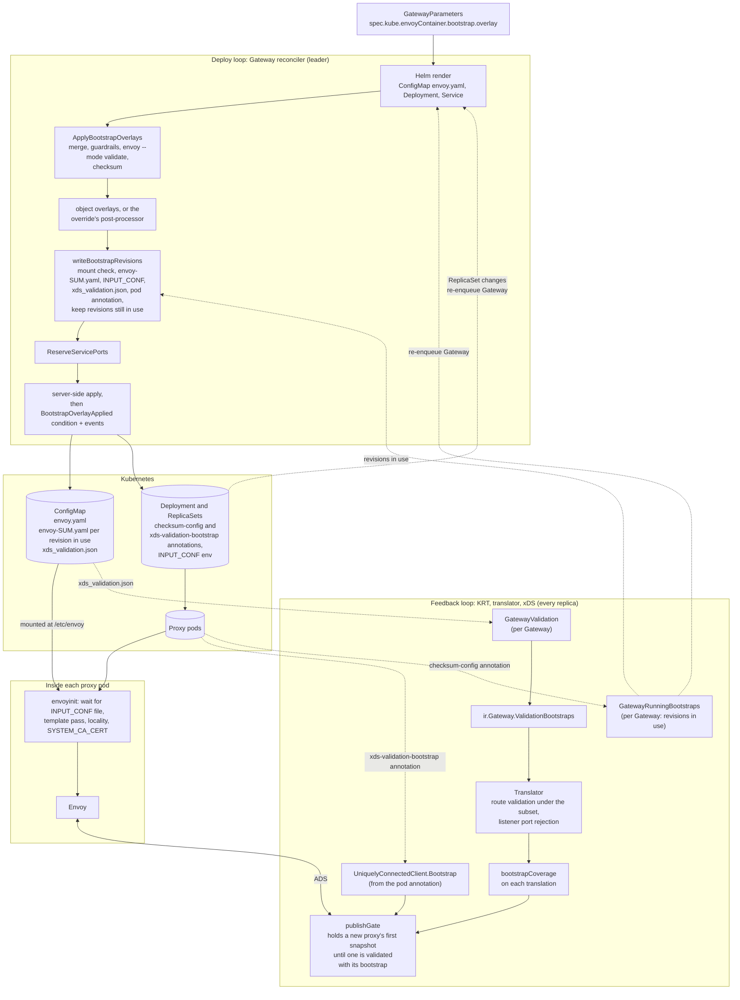
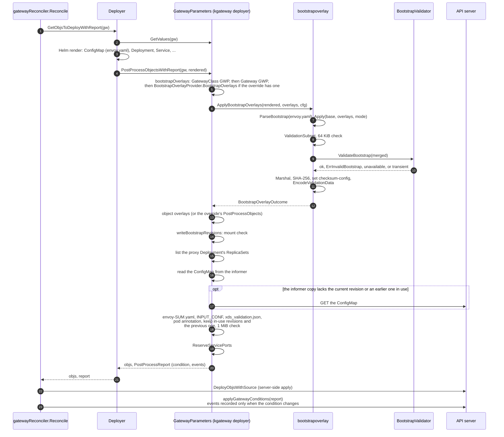
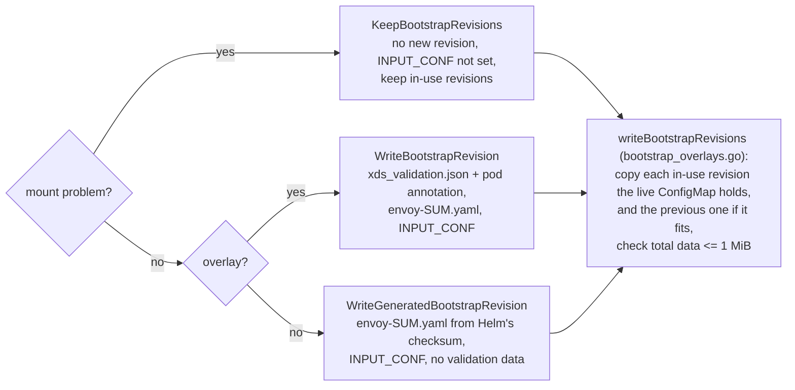
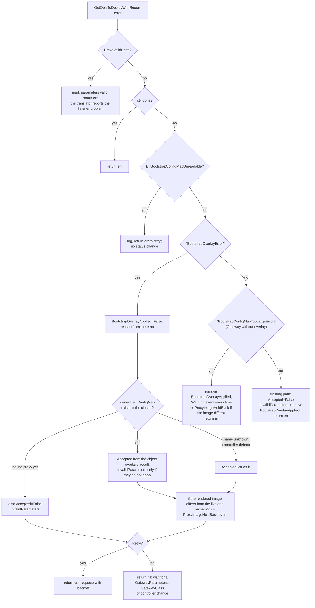
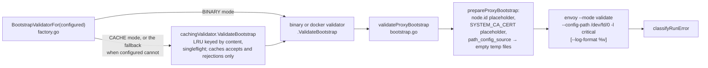
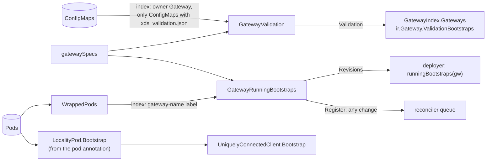
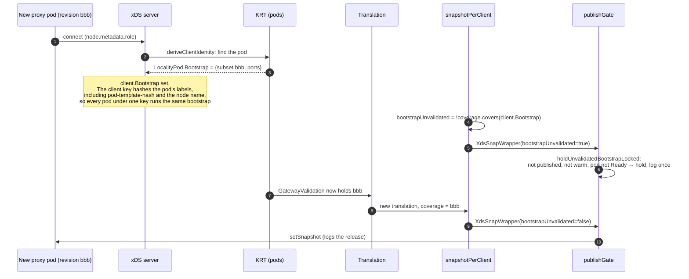
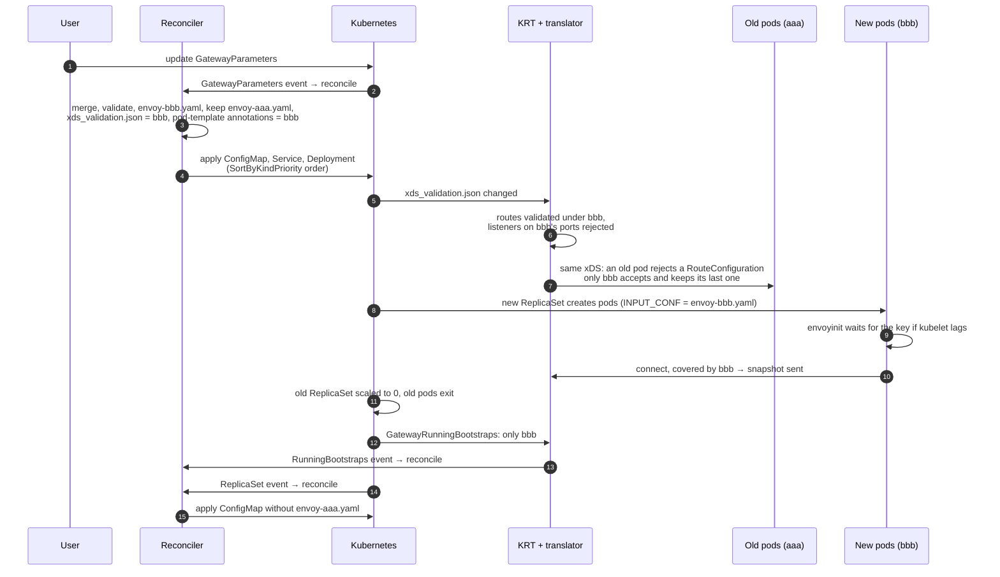

# Bootstrap overlays

A `GatewayParameters` can carry a partial Envoy bootstrap in
`spec.kube.envoyContainer.bootstrap.overlay`. The controller merges it into the
bootstrap the Helm chart generates, validates the result with Envoy, and rolls it out
to the Gateway's proxy. xDS translation then validates against the new bootstrap.

This guide follows the bootstrap through the code: from the `GatewayParameters` field
to a running Envoy, then back from the cluster into translation. The design,
[EP-13666](../../design/13666-envoy-bootstrap-config.md), explains why the feature
works this way.

## The big picture

The work falls into two loops, connected by what the deployer writes to the
cluster:

- **Deploy loop (leader only).** The Gateway reconciler renders the proxy objects,
  merges the overlay into the bootstrap, validates it with Envoy, writes it into the
  generated `ConfigMap` as a new *revision*, and rolls the pods.
- **Feedback loop (every replica).** KRT reads the validation data the deployer wrote
  to the `ConfigMap`. Translation validates routes against it and rejects Gateway
  listeners on the ports the bootstrap listens on. `publishGate` sends a new proxy
  no configuration until a translation has been validated with the bootstrap the
  proxy's pod started with. This applies only when the controller can find the
  proxy's pod.



Two facts hold the loops together:

- **Each pod records the bootstrap it started with,** in two pod-template
  annotations. A pod keeps them for its whole life, even after the `Deployment`'s
  template changes.
  - `kgateway.dev/checksum-config` names the pod's bootstrap revision.
  - `kgateway.dev/xds-validation-bootstrap` holds the parts of the bootstrap that
    change which configuration Envoy accepts, and the ports the bootstrap listens
    on. A pod gets it only when its Gateway has an overlay and its proxy mounts the
    generated `ConfigMap`. A pod without it is treated as running Envoy's defaults
    on the constant ports.
- **Translation validates only against the current bootstrap:** the one described
  by the `ConfigMap`'s `xds_validation.json`, which new pods start with. The pod
  annotations decide which revisions the deployer keeps and when a new proxy's first
  snapshot may be published.

## Where the bootstrap lives

Every place a copy of the bootstrap, or a summary of it, is stored:

| # | Where | What it holds | Written by | Read by |
|---|---|---|---|---|
| 1 | `GatewayParameters.spec.kube.envoyContainer.bootstrap.overlay.value` | The user's partial `Bootstrap` as proto JSON; the API server checks only that it is a non-empty object | the user | `resolvedKgatewayParameters.bootstrapOverlays` |
| 2 | Rendered `ConfigMap` key `envoy.yaml` (in memory) | Helm's generated bootstrap | [`configmap.yaml`](../../pkg/kgateway/helm/envoy/templates/configmap.yaml) | `ApplyBootstrapOverlays`, as the merge base |
| 3 | `ConfigMap` key `envoy.yaml` (in the cluster) | The current bootstrap: merged when there is an overlay, otherwise generated. Kept for people and tools; pods read #4 | `ApplyBootstrapOverlays` overwrites it | envoyinit only when `INPUT_CONF` is unset |
| 4 | `ConfigMap` key `envoy-<sha256>.yaml` | One key per bootstrap that a pod, or a ReplicaSet with replicas, still uses. When there is room, also the live `ConfigMap`'s current revision (the key whose content matches its `envoy.yaml`) | `writeBootstrapRevisions` | envoyinit, through `INPUT_CONF` |
| 5 | `ConfigMap` key `xds_validation.json` | `bootstrapoverlay.ValidationData` of the current bootstrap: the validation subset (static runtime layers) and the ports it listens on. Only for a Gateway with an overlay | `WriteBootstrapRevision` | KRT `GatewayValidation` |
| 6 | Pod-template annotation `kgateway.dev/checksum-config` | SHA-256 of the pod's bootstrap; names its revision key | Helm; `ApplyBootstrapOverlays` overwrites it for a Gateway with an overlay; `WriteGeneratedBootstrapRevision` sets it when the template has none | Deployment rollout, KRT `GatewayRunningBootstraps`, `bootstrapRevisions` (ReplicaSets) |
| 7 | Pod-template annotation `kgateway.dev/xds-validation-bootstrap` | The same `ValidationData` as #5, for the bootstrap *this pod* started with | `WriteBootstrapRevision` | KRT `LocalityPod.Bootstrap` |
| 8 | Proxy container env `INPUT_CONF` | `/etc/envoy/envoy-<sha256>.yaml` | `writeBootstrapRevisions` | envoyinit |
| 9 | `OUTPUT_CONF` in the pod (default `/tmp/envoy.yaml`) | The bootstrap after envoyinit's changes, for debugging. Envoy gets the same content inline, as the `--config-yaml` argument | envoyinit | people debugging |
| 10 | Temporary dir in the controller | Empty placeholder files for the bootstrap's `path_config_source` paths; the prepared copy goes to Envoy on stdin. Removed after validation | `validateProxyBootstrap` creates it, `prepareProxyBootstrap` writes the files | `envoy --mode validate`, as the binary or in docker (bind-mounted) |

Rows 4 and 8 apply to every Gateway whose proxy mounts the generated `ConfigMap`,
with or without an overlay.

The deployer goldens replace the pod template's checksum with `<checksum>` wherever
it appears (the annotation, the revision key `envoy-<checksum>.yaml`, and
`INPUT_CONF`), and replace the current revision's content with `<envoy.yaml>`. In
[`test/deployer/deployer_helm.go`](../../test/deployer/deployer_helm.go),
`elideCurrentRevision` first checks that the key and `INPUT_CONF` match the pod
template's checksum and that the revision's content equals `envoy.yaml`;
`sanitizeOutput` then replaces the checksum in the rendered YAML. An earlier
revision's checksum comes from the test input and appears unchanged.
[`checksum_test.go`](../../pkg/kgateway/deployer/checksum_test.go) checks that the
checksum changes when the bootstrap does.

## API and settings

| File | What it defines |
|---|---|
| [`gateway_parameters_types.go`](../../api/v1alpha1/kgateway/gateway_parameters_types.go) | `EnvoyBootstrap.Overlay`; `BootstrapOverlay`, with fields `MergeStrategy` and `Value`; and the `BootstrapMergeStrategy` enum, whose only value is `StructuredMerge`. `Value` is an `apiextensionsv1.JSON` that preserves unknown fields. The doc comments on these fields become the CRD's field descriptions, so they are the documentation users read. |
| [`conditions.go`](../../api/conditions/conditions.go) | The `kgateway.dev/BootstrapOverlayApplied` condition and its reasons. |
| [`settings.go`](../../api/settings/settings.go) | `KGW_BOOTSTRAP_OVERLAY_MANAGED_PATHS`: `WARN` (default), `PRUNE` or `REJECT`. |
| [`doc.go`](../../api/v1alpha1/kgateway/doc.go) | `+kubebuilder:rbac` markers to watch `replicasets` and write `events.k8s.io` events, generated into the chart's `role.yaml`. |
| [`helm_values_generator.go`](../../pkg/deployer/helm_values_generator.go) | The optional `ReportingObjectPostProcessor` interface and `PostProcessReport{Conditions, OwnedConditionTypes, Events}`, the way the deployer hands status back to the reconciler. |
| [`pkg/deployer/gateway_parameters.go`](../../pkg/deployer/gateway_parameters.go) | `deployer.Inputs.BootstrapValidator` and `BootstrapOverlayManagedPaths`. |
| [`ports.go`](../../pkg/kgateway/wellknown/ports.go) | `EnvoyReadinessPort` (8082), `EnvoyMetricsPort` (9091) and `EnvoyAdminPort` (19000). |

[`start.go`](../../pkg/kgateway/controller/start.go) builds the bootstrap validator with
`validator.BootstrapValidatorFor` and passes it and the managed-path mode through
the controller config into `deployer.Inputs`.

## Deploy loop

### Call sequence



Entry points:

- `gatewayReconciler.Reconcile` in
  [`gw_controller.go`](../../pkg/kgateway/controller/gw_controller.go).
- `Deployer.GetObjsToDeployWithReport` in
  [`pkg/deployer/deployer.go`](../../pkg/deployer/deployer.go). It calls
  `ReportingObjectPostProcessor` when the post-processor implements it, and
  `ObjectPostProcessor` otherwise.
- `GatewayParameters.PostProcessObjectsWithReport` in
  [`pkg/kgateway/deployer/gateway_parameters.go`](../../pkg/kgateway/deployer/gateway_parameters.go).
  Start here when reading the deployer: this function sets the order of every step
  below.

### Order of steps in `PostProcessObjectsWithReport`

1. **Collect the overlays.** `resolvedKgatewayParameters.bootstrapOverlays` (in
   [`bootstrap_overlays.go`](../../pkg/kgateway/deployer/bootstrap_overlays.go))
   returns the GatewayClass's overlay, then the Gateway's. A `GatewayParameters`
   referenced by both counts once.
2. **Let an override choose.** If the `HelmValuesGenerator` override implements
   `BootstrapOverlayProvider`, its `BootstrapOverlays` receives those overlays and
   returns the final list (see [Override `HelmValuesGenerator`](#override-helmvaluesgenerator)).
3. **Merge** with `ApplyBootstrapOverlays`, before the object overlays, so a
   `deploymentOverlay` can still change any object. With no bootstrap overlays this step is
   skipped and `ForgetBootstrapOverlayMetrics` clears the Gateway's metric series.
4. **Post-process the objects:** the `GatewayParameters` object overlays, or the
   override's `PostProcessObjects`.
5. **Write the revision** with `writeBootstrapRevisions`. This runs for every
   Gateway whose rendered objects include the generated `ConfigMap`, after the
   object overlays, so the mount check (`BootstrapMountProblem`) sees the final
   volumes and env. The check reports a problem when:
   - something other than the whole generated `ConfigMap` is mounted at
     `/etc/envoy`;
   - the proxy container's env sets `INPUT_CONF` to a file outside `/etc/envoy`; or
   - a second volume is mounted inside `/etc/envoy` over the file envoyinit reads:
     `envoy.yaml`, or the file the container's `INPUT_CONF` names.

   The controller has not yet set `INPUT_CONF` on the rendered `Deployment`, so any
   `INPUT_CONF` the check finds was set by the user.
6. **Reserve Service ports** with `ReserveServicePorts`. This runs after the object
   overlays, so a `serviceOverlay` cannot add a reserved port back, and only for a
   Gateway that has an overlay and whose proxy mounts the generated `ConfigMap`.
7. **Build the report:** `bootstrapOverlayAppliedCondition` and
   `bootstrapOverlayEvents`. For a Gateway without an overlay, the report only lists
   the condition type in `OwnedConditionTypes`, so the reconciler removes the
   condition.

An override that implements `ObjectPostProcessor` but not `BootstrapOverlayProvider`
takes a shorter path: its `PostProcessObjects`, then `writeBootstrapRevisions`, and a
report that only owns the condition type (see
[Override `HelmValuesGenerator`](#override-helmvaluesgenerator)).

When the merge fails, the deployer still runs step 4 on the objects rendered without
the bootstrap overlay. That tells it:

- which proxy image the failure holds back (`withRenderedProxy`);
- whether the proxy reads the generated bootstrap
  (`BootstrapOverlayError.MountProblem`);
- whether the object overlays apply (`BootstrapOverlayError.ObjectsErr`).

For a Gateway that already exists in the cluster, the reconciler sets `Accepted`
from `ObjectsErr` alone. A failed bootstrap overlay does not by itself make the
Gateway not accepted, but an object overlay that does not apply still does.

### `ApplyBootstrapOverlays`

In [`bootstrap_overlays.go`](../../pkg/kgateway/deployer/bootstrap_overlays.go), in
order:

| Step | Code | Failure reason |
|---|---|---|
| Find and parse the generated bootstrap | `findBootstrapConfigMap`, `bootstrapoverlay.ParseBootstrap` | `ControllerError` |
| Merge | `bootstrapoverlay.Apply(base, overlays, mode)` (see [Merge engine](#merge-engine-pkgkgatewaybootstrapoverlay)) | `InvalidOverlay` (`*InvalidOverlayError`), `PathsDenied` (`*ManagedPathsDeniedError`); any other error `ControllerError` |
| Encode the validation subset | `ValidationSubset`, `EncodeValidationSubset` | `InvalidOverlay` when over 64 KiB, since it goes on a pod annotation |
| Validate the merged bootstrap with Envoy | `cfg.Validator.ValidateBootstrap` (see [Validating with Envoy](#validating-the-merged-bootstrap-with-envoy-pkgvalidator)) | `ValidationFailed`; `ValidationUnavailable`, with `Retry` set only for a transient failure |
| Write it back | `bootstrapoverlay.Marshal` into `envoy.yaml`; its SHA-256 into `kgateway.dev/checksum-config` | `ControllerError` |
| Encode the validation data | `ListenerPorts`, `EncodeValidationData` | `ControllerError` |

The result, `BootstrapOverlayOutcome`, carries the merged YAML, checksum and encoded
validation data in private fields, so only `WriteBootstrapRevision` can write them,
and no code path can write a revision that was not validated. Its public fields feed the
condition message (`ManagedPathsMode`, `ManagedPaths`, `RemovedServicePorts`),
`ReserveServicePorts` (`BootstrapPorts`) and the revision writer (`ConfigMapName`).

### Revisions in the `ConfigMap`

Every pod mounts the same `ConfigMap`, and kubelet updates a mounted `ConfigMap` in
place. If pods read `envoy.yaml`, a container that restarts mid-rollout would load
the new bootstrap while its annotations still describe the old one. So each
revision gets its own key, and `INPUT_CONF` points each pod at its own revision's
key.

Example: Gateway `gw` partway through a rollout, after an overlay change moved its
bootstrap from revision `aaa…` to `bbb…`.

```yaml
# ConfigMap gw (owned by Gateway gw)
data:
  envoy.yaml: |          # current bootstrap (= bbb…), for people and tools
    ...
  envoy-bbb….yaml: |     # current revision; new pods read this
    ...
  envoy-aaa….yaml: |     # kept: an old pod or old ReplicaSet still uses it
    ...
  xds_validation.json: '{"bootstrap":{"layered_runtime":{...}},"reservedPorts":[8082,9091,19000]}'
  # xds_ca_sds.json, ca.crt, ... unchanged; they rotate in place
---
# Deployment gw, pod template
metadata:
  annotations:
    kgateway.dev/checksum-config: bbb…
    kgateway.dev/xds-validation-bootstrap: '{"bootstrap":{...},"reservedPorts":[...]}'
spec:
  containers:
  - name: kgateway-proxy
    env:
    - name: INPUT_CONF
      value: /etc/envoy/envoy-bbb….yaml
    volumeMounts:
    - name: envoy-config        # must be the whole generated ConfigMap at /etc/envoy
      mountPath: /etc/envoy
```

`GatewayParameters.writeBootstrapRevisions` (in
[`pkg/kgateway/deployer/gateway_parameters.go`](../../pkg/kgateway/deployer/gateway_parameters.go)):

1. `BootstrapMountProblem` checks that the `kgateway-proxy` container mounts the
   **whole** generated `ConfigMap` at `/etc/envoy`: no other `ConfigMap` or volume,
   no `subPath`, no `items`. It also checks the file envoyinit would read if the
   controller did not set `INPUT_CONF`: `envoy.yaml`, or the file named by an
   `INPUT_CONF` the user set. That file must be inside `/etc/envoy`, and no second
   volume may be mounted at its path or at a directory above it. A second volume
   mounted elsewhere inside `/etc/envoy` is allowed.
2. `bootstrapRevisions` works out which revisions to keep, from these sources:
   - `GatewayRunningBootstraps.Revisions`, from KRT: the checksums of the
     Gateway's pods that have not exited.
   - The checksum of each ReplicaSet of the proxy `Deployment` that has more than
     zero replicas, since such a ReplicaSet can still create a pod.
   - The live `ConfigMap`, which holds the content of the revisions to keep.
     `bootstrapRevisions` reads it from the informer
     (`kgatewayParameters.configMapClient`) when the informer's copy has a key for
     the revision this reconcile writes and for every revision in use
     (`missingRevisions`). Otherwise it reads it with a **direct GET**
     (`kgatewayParameters.getConfigMap`). Under a mount problem no revision is
     written, so only the revisions in use are checked.

     Each revision key names the SHA-256 of its content (the merged bootstrap's,
     or Helm's `sha256sum` of `envoy.yaml`). A stale informer copy can therefore be
     missing a key, or have an `envoy.yaml` from an older revision, but it never
     holds the wrong content under a key. Only a missing key triggers the GET:
     - A Gateway whose bootstrap has not changed and that is not mid-rollout
       causes no GET.
     - A bootstrap change causes a GET on each reconcile until the informer sees
       the write.
     - A proxy with a mount problem causes a GET on every reconcile: its pods'
       revision is never written, so the informer copy always lacks it.

     If the GET fails with any error other than NotFound, the deployer returns
     `ErrBootstrapConfigMapUnreadable`, and the reconciler retries without changing
     status or objects.
   - `BootstrapRevisions.Previous`: the live `ConfigMap`'s current revision, meaning
     the key whose content matches its `envoy.yaml` (`currentBootstrapRevision`).
     The live `Deployment`'s pod template names this revision until this
     reconcile's objects are applied, and a ReplicaSet or pod just created from
     that template may not be in the informers yet. So this write keeps it when
     the `ConfigMap` has room. After a later write makes another revision current,
     it is kept only while a pod or ReplicaSet uses it. Under a mount problem no
     new revision becomes current, so it stays the previous revision until
     `envoy.yaml` changes.
3. Then one of:



**Pruning works by omission.** A revision that is neither in use nor the previous
one is left out of the rendered `ConfigMap`, and server-side apply removes it. The
previous revision is also left out when it does not fit. A revision in use is never
dropped to make room: when the `ConfigMap` would exceed 1 MiB, the result is a
`BootstrapConfigMapTooLargeError`, whose message says whether the new bootstrap or
the revisions still in use caused it. For a Gateway with an overlay, the error is
wrapped in a `BootstrapOverlayError` with reason `BootstrapConfigMapTooLarge`; for a
Gateway without one, it is reported as a `Warning` event.

Two watches, set up in `NewGatewayReconciler`, make the reconciler run again when a
revision is no longer in use:

- `GatewayIndex.RunningBootstraps.Register`: the revisions the Gateway's pods run
  changed.
- The ReplicaSet client's handler: maps a ReplicaSet to its `Deployment`, then to its
  Gateway.

The reconciler waits for `RunningBootstraps` and the ReplicaSet informer to sync
before its first reconcile. Otherwise, after a controller restart, it could mistake
a pod list that has not synced yet for a Gateway with no pods, and prune a key a
running pod still reads. If the controller's RBAC lacks the `apps/replicasets` rule,
that sync never finishes and no Gateway is reconciled.

### Service ports

For every Gateway, `GetPortsValues` leaves Gateway listeners on the constant
reserved ports (8082, 9091, 19000) off the `Service`. Ports set in the
`GatewayParameters` `service.ports` are not filtered. For a Gateway with an overlay, `ReserveServicePorts` also
removes each Gateway listener port the merged bootstrap listens on
(`BootstrapOverlayOutcome.BootstrapPorts`), records them in `RemovedServicePorts` for
the condition message, and returns `InvalidOverlay` if that would leave the `Service`
with no ports. It is skipped when the proxy does not mount the generated
`ConfigMap`, since the proxy then listens on the default ports only.

### Reporting

- `bootstrapOverlayAppliedCondition` builds the condition from the outcome and the
  mount problem, with reason `Applied`, `ManagedPathsOverridden`, `PathsIgnored`, or
  `BootstrapNotMounted`. The message lists the managed paths and the ports left off
  the `Service`; for `BootstrapNotMounted` it gives only the mount problem.

  An overlay that fails the merge or validation returns a `BootstrapOverlayError`
  before the mount check runs. The Gateway's objects are not deployed, and
  `BootstrapOverlayApplied` is False with the error's reason, even when the
  bootstrap is not mounted. `PostProcessObjectsWithReport` then runs
  `BootstrapMountProblem` on the objects rendered without the overlay and sets
  `BootstrapOverlayError.MountProblem`. The reconciler appends `MountNote()` after
  the truncated overlay error, so the message says that the overlay has no effect on
  the proxy and that removing it deploys the held-back objects.
- `bootstrapOverlayEvents` returns one `Warning` event per managed path, or one for
  `BootstrapNotMounted`. `BootstrapOverlayError.Events` returns one per denied path
  for `PathsDenied`, otherwise one for the failure.
- `recordBootstrapOverlayManagedPaths` in
  [`metrics.go`](../../pkg/kgateway/deployer/metrics.go) sets the gauge
  `kgateway_controller_bootstrap_overlay_managed_paths{namespace,name,path}`.
- The report's `OwnedConditionTypes` lists `kgateway.dev/BootstrapOverlayApplied`, so
  the reconciler removes the condition when the report does not set it, for
  example when the overlay is removed.
- The reconciler's `applyGatewayConditions` writes the conditions and records the
  events only when a condition's status, reason or message changes, so reconciles
  that change nothing do not repeat events.
- When there is no report, as for a self-managed Gateway, the reconciler removes any
  `BootstrapOverlayApplied` condition left on the Gateway and clears its metric.
- `truncateText` keeps text within the API server's limits: an overlay error is cut
  to 4096 bytes before it goes into a condition message, `applyGatewayConditions`
  cuts each message to 32768 bytes before it compares it with the stored one, and
  `recordEvents` cuts each note to 1024 bytes. The full text is logged.
- The translator preserves the condition when it writes Gateway status
  (`shouldPreserveGatewayCondition` in
  [`pkg/reports/status.go`](../../pkg/reports/status.go)).

### Failure handling in the reconciler

On every failure path, **none of the Gateway's objects are applied**, so a running
proxy keeps its last good bootstrap. The generated `ConfigMap` is one of those
objects, so when xDS TLS is enabled, a rotated `ca.crt` does not reach a failing
Gateway's proxy until the failure clears.



The held-back image comes from `HeldBackProxyImage` in
[`proxy_image.go`](../../pkg/kgateway/deployer/proxy_image.go), which compares the
proxy container image in the live `Deployment` with the one the deployer rendered.

## Merge engine: `pkg/kgateway/bootstrapoverlay`

The package uses no Kubernetes types; it works only on Envoy protos. Read it after
`ApplyBootstrapOverlays`.

| File | Role |
|---|---|
| [`parse.go`](../../pkg/kgateway/bootstrapoverlay/parse.go) | Blank-imports `pkg/utils/filter_types`, so `protojson` can resolve every `@type` go-control-plane defines, plus the cncf/xds `TypedStruct` wrappers. `ParseBootstrap` (YAML to JSON to `protojson`). `parseOverlay` parses strictly and rejects `{{` after re-marshalling, so a JSON escape cannot hide it. `Marshal` writes snake_case YAML with sorted keys, so the checksum is stable across builds. `ListenerPorts` returns the admin port and the ports of each static listener's address and additional addresses, skipping UDP, pipe and internal addresses. It includes a listener with `bind_to_port` false, because Envoy rejects a second listener on the address of a listener that does not bind. |
| [`apply.go`](../../pkg/kgateway/bootstrapoverlay/apply.go) | `Apply`, the reserved-name checks, and the runtime layer name check. |
| [`merge.go`](../../pkg/kgateway/bootstrapoverlay/merge.go) | `mergeOverlay` and the list and `Any` rules. |
| [`managed.go`](../../pkg/kgateway/bootstrapoverlay/managed.go) | `managedPaths`, `checkNewStaticNames` (the `user_` prefix), `prune`. |
| [`validation.go`](../../pkg/kgateway/bootstrapoverlay/validation.go) | `ValidationSubset` (static runtime layers only), its canonical encoding, `ValidationData`, and the key and annotation names. |

### `Apply`

```text
for each overlay, all checked before any is merged, so the errors and REJECT list
every problem and every path:
  parseOverlay          strict protojson; unknown field or `{{` anywhere → error,
                        and skip the checks below
  checkReserved         SYSTEM_CA_CERT secret; non-static runtime layer;
                        a name repeated within one overlay
  checkNewStaticNames   new static cluster or listener without the user_ prefix
  claimLayers           runtime layer name used by the base or an earlier overlay
                        (all three run; any problem → skip the two steps below)
  managedPaths          record each managed path it sets
  PRUNE → prune(base, overlay)
any check failed → errors.Join of the InvalidOverlayErrors
REJECT and any managed path → ManagedPathsDeniedError
merged = clone(base); mergeOverlay(merged, overlay) for each, in order
```

Under every mode, each problem the per-overlay checks find becomes its own
`InvalidOverlayError` that names the source resource. A check reads only its own
overlay, the base, and the runtime layer names of earlier overlays, never a merged
result, so one invalid overlay does not hide another's problems. `Apply` joins the errors with
`errors.Join`, so the condition message has one line per problem.

### Merge rules

| Shape | Rule | How |
|---|---|---|
| scalar | overlay replaces | `proto.Merge` |
| message | merged field by field | `proto.Merge` |
| `google.protobuf.Any` | overlay replaces whole | `clearReplacedAnys` clears the base's `Any` first; otherwise an overlay `Any` with an empty payload would keep the base's payload under the overlay's type URL |
| map entry | overlay replaces whole | `proto.Merge` |
| ordinary list | overlay entries **before** base entries | `proto.Merge` appends, then `prependOverlayEntries` / `moveLastToFront` |
| `static_resources.{clusters,listeners,secrets}`, `overload_manager.resource_monitors` | merged **by name**: the same name replaces whole, a new name appends | `mergeByName` |
| `layered_runtime.layers` | inserted just **before the first admin layer**, or at the end when there is none | `slices.Insert` at the admin layer's index |

### Managed paths

`managedPaths` reports:

- `node`, `dynamic_resources`, `admin.address` and
  `cluster_manager.local_cluster_name`, when the overlay sets them.
- Every overlay entry in the four named lists whose name matches an entry of the
  **generated** bootstrap, reported as `static_resources.clusters[name=xds_cluster]`
  and so on. The names come from the base bootstrap passed to `Apply`, so an entry
  that a later release adds to the generated bootstrap becomes managed without a
  code change.

`WARN` applies them, `PRUNE` drops them with `prune`, and `REJECT` fails all the
overlays.

`checkNewStaticNames` rejects a static cluster or listener whose name neither
matches a generated entry nor starts with `UserNamePrefix` (`user_`). Envoy ignores
a cluster or listener from xDS that has the same name as a static one, so a static
entry named like a translated cluster or listener would replace that backend or
Gateway listener. `NewBackendObjectIR`'s doc comment in
[`pkg/pluginsdk/ir/backend.go`](../../pkg/pluginsdk/ir/backend.go) tells plugins not to
start cluster names with `user`.

## Validating the merged bootstrap with Envoy: `pkg/validator`



`BootstrapValidator` is separate from the xDS `Validator`.
`BootstrapValidatorFor` reuses the configured validator when it can validate
bootstraps, and otherwise uses the Envoy binary behind a cache. The copy
`prepareProxyBootstrap` hands to Envoy matches what the pod runs: Envoy in the pod
gets `node.id` from `--service-node` and the CA secret from envoyinit, so the
validator adds stand-ins for both.

The validator keeps the bootstrap's own `application_log_config.log_format`,
because a log format Envoy rejects would stop the proxy too. When the bootstrap sets
no log format, `--log-format %v` makes Envoy print only the rejection reason. When
it sets one, the reason can be unreadable in that format, so if Envoy rejects the
bootstrap, the validator runs it again without the log format and, if that run also
fails, reports its reason.

`prepareProxyBootstrap` leaves TLS file paths as they are. Envoy opens every TLS
file the bootstrap names when it loads the bootstrap, and a file mounted only in the
proxy pod does not exist in the controller container, so an overlay that names one
fails with `ValidationFailed`. An overlay can supply public TLS material (a CA, a
CRL) inline, or trust `SYSTEM_CA_CERT`. A private key supplied inline would be
stored in the `GatewayParameters` and the generated `ConfigMap`, so overlays cannot
set up mutual TLS until TLS file paths are supported.

Supporting TLS file paths is a follow-up. Validation would substitute placeholder
files, as xDS validation does for translated resources with the helper in
[`tls_files.go`](../../pkg/xds/bootstrap/tls_files.go), but that helper covers only
the certificate, key and CA; a CRL, a PKCS#12 bundle and an OCSP staple each need
their own placeholder.

`classifyRunError`, `fileError` (for the temporary files) and the docker runner's
exit-code handling sort the result:

| Envoy outcome | Error | Reason | Retried? |
|---|---|---|---|
| Envoy exits non-zero, or crashes on a signal other than SIGKILL | `ErrInvalidBootstrap` | `ValidationFailed` | no |
| Binary or docker missing, image has no Envoy (docker 126/127), temp dir not writable | `ErrBootstrapValidatorUnavailable` | `ValidationUnavailable` | no; a controller `Deployment` or settings change restarts the controller |
| Timeout, SIGKILL (likely OOM), docker 125, full disk | other error | `ValidationUnavailable` | yes |
| The caller's context ended | context error | none; the controller is stopping | n/a |

## Inside the proxy pod: `pkg/envoyinit`

`RunEnvoy` in [`run.go`](../../pkg/envoyinit/run.go):

1. **`waitForInputConfig`**: when `INPUT_CONF` names a file inside `/etc/envoy`,
   polls every second until the file exists. Kubelet serves `ConfigMap` volumes
   from a watch-based cache, so a pod created right after the `ConfigMap` write can
   see an older copy that lacks its revision key. The wait has no time limit of its
   own; the startup probe bounds it. A file outside `/etc/envoy` is the user's, and
   envoyinit fails at once if it is missing.
2. **`getAndTransformConfig`**: runs `text/template` over the whole file (which is
   why overlays cannot contain `{{`) and sets `node.locality`.
3. **`addSystemCASecret`**: when `getOSRootFilePath` finds the OS CA bundle,
   appends the `SYSTEM_CA_CERT` static secret. It edits the bootstrap as YAML, not
   as a `Bootstrap` proto, so envoyinit does not need to link every `@type` an
   overlay might use; only Envoy decides whether the bootstrap is valid.
4. Write a copy to `OUTPUT_CONF` (default `/tmp/envoy.yaml`) for debugging,
   ignoring a write error, then exec Envoy with the bootstrap inline in
   `--config-yaml`.

## Feedback loop: what translation knows about the bootstrap

### KRT collections



Both collections live in
[`validation_bootstraps.go`](../../pkg/krtcollections/validation_bootstraps.go) and
are built in `NewGatewayIndex` in
[`policy.go`](../../pkg/krtcollections/policy.go):

- **`GatewayValidation`** decodes `xds_validation.json` from the `ConfigMap` the
  Gateway owns into `ir.GatewayValidationBootstraps{Subset, ReservedPorts}`
  ([`validation_bootstrap.go`](../../pkg/pluginsdk/ir/validation_bootstrap.go)).
  `Validation` is `nil`, meaning Envoy's defaults and the constant ports, when the
  Gateway owns no `ConfigMap` with the key, when the data does not decode, or when
  it sets neither a subset nor ports. If only the subset fails to parse, the ports
  are still used. `Equals` compares the encoded subset and ports, so a change to
  another key in the `ConfigMap` does not re-run Gateway translation.
- **`GatewayRunningBootstraps`** collects the distinct `checksum-config` values of
  the Gateway's pods that have not exited. Only the deployer and the reconciler's
  requeue use it; translation does not.

`NewGatewayIndex` sets `ir.Gateway.ValidationBootstraps` in the wrapper around the
Gateway transformation, not inside it, so the field is set even when a custom
`WithGatewayForEnvoyTransformationFunc` replaces the transformation.

A pod's own annotation reaches xDS separately: `podBootstrapFromAnnotations` (in
`validation_bootstraps.go`), called from `augmentPodLabels` in
[`pods.go`](../../pkg/krtcollections/pods.go), fills `LocalityPod.Bootstrap`, and
`deriveClientIdentity` in
[`uniqueclients.go`](../../pkg/krtcollections/uniqueclients.go) copies it onto the
connecting client. A pod without the annotation gets Envoy's defaults and the
constant ports, which covers pods started before the feature existed.

### Consumers of `ir.Gateway.ValidationBootstraps`

1. **Route validation.** `validatorForGateway` in
   [`gateway_validator.go`](../../pkg/kgateway/translator/irtranslator/gateway_validator.go)
   wraps the strict-mode validator when the Gateway has a non-empty subset.
   `gatewayValidator.Validate` appends the subset's runtime layers to each
   validation bootstrap. Every validation call for the Gateway's routes uses the
   wrapped validator. Policy and backend validation do not, and keep Envoy's
   defaults.
2. **Listener ports.** `validate.ListenerPortForBootstrap` in
   [`validate/gateway.go`](../../pkg/kgateway/validate/gateway.go), called from
   [`listener/validation.go`](../../pkg/kgateway/translator/listener/validation.go),
   rejects a listener on a constant port or on a port the current bootstrap listens
   on. When the overlay added the port, the message says so.
3. **Bootstrap coverage.** `newBootstrapCoverage` in
   [`bootstrap_coverage.go`](../../pkg/kgateway/proxy_syncer/bootstrap_coverage.go)
   records, on the proxy syncer's per-Gateway resources (`validatedBootstraps`), the
   subset and reserved ports each translation was validated with. The record is
   part of `Equals`, so a translation that differs only in this record is still
   passed on to the per-client snapshots.

### Holding a new proxy's first snapshot



`perclient.go` sets `bootstrapUnvalidated` on a client's snapshot when
`bootstrapCoverage.covers` reports that the translation was not validated with the
client's bootstrap. `holdUnvalidatedBootstrapLocked` in
[`publish_gate.go`](../../pkg/kgateway/proxy_syncer/publish_gate.go) does not send
a flagged snapshot to a new proxy; a proxy that already has configuration is never
held. `XdsSnapWrapper.Equals` compares the flag, so a new translation that differs
only in what it was validated with still produces a new snapshot, and that snapshot
ends the hold.

The gate tracks clients by key; pods with identical labels (same ReplicaSet, same
node) share a key. It never holds a client key that:

- has been sent a snapshot since the key's first stream connected;
- reported an xDS version it accepted earlier (the code calls this client *warm*,
  and a client with no configuration *cold*);
- has an xDS stream that was accepted while its pod was Ready (`HasReadyPodStream`
  in `uniqueclients.go`). A reconnecting Envoy sends its listener request only after
  CDS, so until then its pod's readiness is the only thing that tells it apart from
  a new proxy.

Usually there is no hold: the deployer applies the `ConfigMap` before the
`Deployment` (`SortByKindPriority` in `pkg/deployer/deployer.go`), so a translation
validated with a new pod's bootstrap already exists when the pod connects. The hold
matters in two cases:

- Translation lags behind the `ConfigMap` write.
- The Envoy in a pod from an old ReplicaSet restarts mid-rollout. No translation is
  validated with its bootstrap, so the pod stays unready until the rollout removes
  it. This happens only when no other pod with the same client key is still
  connected; if one is, the restarted Envoy gets the key's current snapshot from the
  cache.

The hold has no time limit. The first-publish time limit, which bounds the wait for
referenced clusters, does not end it. If a deferred snapshot started that limit
before the hold, the limit keeps running during the hold, and a validated snapshot
still waiting for referenced clusters gets only the time that remains. Otherwise the
limit starts with the first validated snapshot.

With pod locality off (`DISABLE_POD_LOCALITY_XDS=true`), a client has no pod and is
never held.

## A change, end to end

The user edits an overlay on a running Gateway, changing its bootstrap from revision
`aaa` to `bbb`.



## Override `HelmValuesGenerator`

A project that embeds kgateway can replace Helm value generation with
`GatewayParameters.WithHelmValuesGeneratorOverride`. What happens to bootstrap
overlays depends on the interfaces the override implements:

| Override implements | Behavior |
|---|---|
| neither `ObjectPostProcessor` nor `BootstrapOverlayProvider` | kgateway's `GatewayParameters` bootstrap overlays and object overlays apply as usual |
| `ObjectPostProcessor` only | The override's post-processor runs in place of both the bootstrap overlays and the object overlays, so no bootstrap overlay is applied and no condition is set. The Gateway still gets a bootstrap revision and `INPUT_CONF` when the proxy reads the generated `ConfigMap` |
| `BootstrapOverlayProvider`, with or without `ObjectPostProcessor` | The override chooses the bootstrap overlays, and sets `Source.Kind` so messages name its own resource kind. kgateway merges, validates, writes the validation data, reserves Service ports and reports. kgateway's object overlays apply unless the override also implements `ObjectPostProcessor`, whose post-processor then replaces them and runs after the merge |

## Tests

| Area | Tests |
|---|---|
| Merge engine | [`apply_test.go`](../../pkg/kgateway/bootstrapoverlay/apply_test.go), [`parse_test.go`](../../pkg/kgateway/bootstrapoverlay/parse_test.go), [`validation_test.go`](../../pkg/kgateway/bootstrapoverlay/validation_test.go) |
| Deployer | [`bootstrap_overlays_test.go`](../../pkg/kgateway/deployer/bootstrap_overlays_test.go) (revisions, pruning, size limit, ports, mount check, condition, metric), [`bootstrap_parse_test.go`](../../pkg/kgateway/deployer/bootstrap_parse_test.go), and the deployer goldens in [`test/deployer/testdata`](../../test/deployer/testdata) |
| Reconciler | [`controller_test.go`](../../pkg/kgateway/controller/controller_test.go) |
| Envoy validation | `pkg/validator` tests |
| envoyinit | [`run_test.go`](../../pkg/envoyinit/run_test.go) (the wait for the `INPUT_CONF` file, the `SYSTEM_CA_CERT` secret) |
| KRT | [`validation_bootstraps_test.go`](../../pkg/krtcollections/validation_bootstraps_test.go), [`uniqueclients_test.go`](../../pkg/krtcollections/uniqueclients_test.go), `TestHarnessGatewayValidationBootstrapsEquals` in [`equality_harness_test.go`](../../pkg/pluginsdk/ir/equality_harness_test.go) |
| Translator | [`gateway_validator_test.go`](../../pkg/kgateway/translator/irtranslator/gateway_validator_test.go) (real Envoy, with bootstraps that raise and lower the RE2 program-size limit), [`validate/gateway_test.go`](../../pkg/kgateway/validate/gateway_test.go), `TestBootstrapReservedPort*` in [`listener/validation_test.go`](../../pkg/kgateway/translator/listener/validation_test.go), goldens under `pkg/kgateway/translator/gateway/testutils/{inputs,outputs}/bootstrap-validation/` |
| Publish gate | [`bootstrap_coverage_test.go`](../../pkg/kgateway/proxy_syncer/bootstrap_coverage_test.go) |
| E2E | [`test/e2e/features/bootstrapoverlays`](../../test/e2e/features/bootstrapoverlays/suite.go): `TestOverlayApplied`, `TestManagedPathModes`, `TestFragmentFeatureFlag`, `TestStaticNamePrefix` |

## Suggested reading order

1. **API:** `gateway_parameters_types.go` (`BootstrapOverlay`), `conditions.go`,
   `settings.go`.
2. **Merge engine:** `bootstrapoverlay/apply.go`, then `merge.go`, `managed.go`,
   `validation.go`.
3. **Deployer:** `PostProcessObjectsWithReport` in
   `pkg/kgateway/deployer/gateway_parameters.go`, then `ApplyBootstrapOverlays`,
   `writeBootstrapRevisions` and `WriteBootstrapRevision`, `ReserveServicePorts`,
   and `bootstrapOverlayAppliedCondition` in `bootstrap_overlays.go`.
4. **Validator:** `pkg/validator/bootstrap.go`, `cache.go`, `factory.go`.
5. **Reconciler:** `gw_controller.go`: the error branches in `Reconcile`,
   `applyGatewayConditions`, and the watches in `NewGatewayReconciler`.
6. **Pod side:** `pkg/envoyinit/run.go` (`waitForInputConfig`,
   `getAndTransformConfig`, `addSystemCASecret`).
7. **Feedback loop:** `krtcollections/validation_bootstraps.go`,
   `pluginsdk/ir/validation_bootstrap.go`, `NewGatewayIndex` in
   `krtcollections/policy.go`, `irtranslator/gateway_validator.go`,
   `validate/gateway.go`.
8. **xDS delivery:** `krtcollections/pods.go` and `uniqueclients.go`, then
   `proxy_syncer/bootstrap_coverage.go`, `perclient.go` and `publish_gate.go`.
